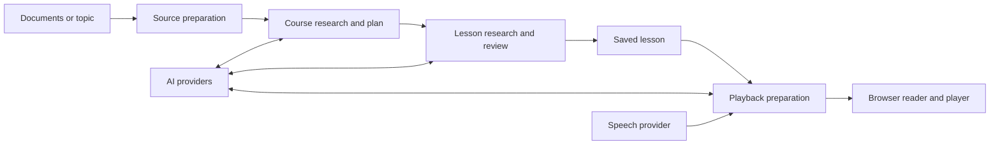

[Up one level](../index.md)

# From sources to playback

A course request becomes a plan before it becomes lesson content. The backend prepares its sources and learning context, saves the plan, then generates individual lessons against that context. Playback is another preparation stage over a saved lesson: its audio and visual cues have their own lifecycle.

## Preparation establishes reusable context

[Ingestion](../03-section-features/03-p-doc-processing.md) turns PDFs, Markdown and code archives into retrievable text and associated files. A topic-based request instead needs research to establish its material. [Course planning](../03-section-features/01-p-course-gen.md) combines that evidence with the approved profile, goals and prior-knowledge information to decide lesson order and scope. Account preferences are copied into a course so subsequent account changes leave that course's context stable.

The plan and the explanation are different outputs. [Lesson generation](../03-section-features/02-p-lesson-gen.md) takes one planned objective, gathers relevant evidence, drafts and reviews the explanation, then saves its content and visual references. This separation lets a ready lesson remain readable while other work continues and gives regeneration a bounded target.

## Delivery consumes committed state

Long operations run through [saved workflows](../02-section-architecture/02-p-workflow-engine.md); the browser observes their progress and reloads committed project revisions. PostgreSQL holds project and workflow state, while file bytes live in storage. A request ending or a browser disconnect therefore does not define the lifetime of a generation run.

[Playback](../03-section-features/04-p-multimedia.md) derives blocks from the lesson, prepares narration and scene cues, and persists results for the matching lesson version. The reader combines those results with lesson text, chat and exercise state. The [architecture](../02-section-architecture/01-p-architecture.md) explains the trust and ownership boundaries behind this flow; [learning design](02-p-manifesto.md) explains why generation has separate planning and review stages.
