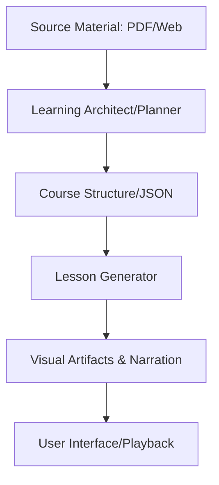
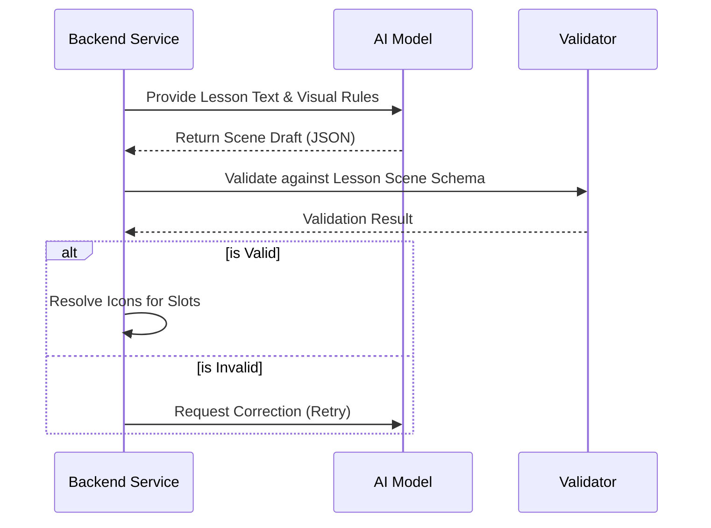

Relevant source files

The following files were used as context for generating this wiki page:

- [README.md](https://github.com/immagiov4/Nous/blob/21ec8b9ef2e9c48eae54d59ba738a6dc8f10dee6/README.md)
- [PROJECT_RULES.md](https://github.com/immagiov4/Nous/blob/21ec8b9ef2e9c48eae54d59ba738a6dc8f10dee6/PROJECT_RULES.md)
- [AGENTS.md](https://github.com/immagiov4/Nous/blob/21ec8b9ef2e9c48eae54d59ba738a6dc8f10dee6/AGENTS.md)
- [packages/shared-types/lessonWritingContract.ts](https://github.com/immagiov4/Nous/blob/21ec8b9ef2e9c48eae54d59ba738a6dc8f10dee6/packages/shared-types/lessonWritingContract.ts)
- [apps/backend/src/routes/chatPrompts.ts](https://github.com/immagiov4/Nous/blob/21ec8b9ef2e9c48eae54d59ba738a6dc8f10dee6/apps/backend/src/routes/chatPrompts.ts)
- [packages/shared-types/lessonVisualContracts.ts](https://github.com/immagiov4/Nous/blob/21ec8b9ef2e9c48eae54d59ba738a6dc8f10dee6/packages/shared-types/lessonVisualContracts.ts)
- [apps/backend/src/services/lessonScenes/lessonSceneGeneration.ts](https://github.com/immagiov4/Nous/blob/21ec8b9ef2e9c48eae54d59ba738a6dc8f10dee6/apps/backend/src/services/lessonScenes/lessonSceneGeneration.ts)
- [apps/web/i18n/uiMessages.ts](https://github.com/immagiov4/Nous/blob/21ec8b9ef2e9c48eae54d59ba738a6dc8f10dee6/apps/web/i18n/uiMessages.ts)

# Introduction to Nous Reader

Nous Reader turns documents and researched topics into interactive courses containing connected explanations, exercises, and narrated lessons. The system maintains a tight coupling between source material, generated explanations, and visual reasoning to ensure subjects are studied as a coherent sequence.

The platform is designed as an ADHD-friendly learning environment. It emphasizes step-by-step learning of whole subjects rather than acting as a generic chat application or content creation suite.

Sources: [README.md](https://github.com/immagiov4/Nous/blob/21ec8b9ef2e9c48eae54d59ba738a6dc8f10dee6/README.md), [PROJECT_RULES.md](https://github.com/immagiov4/Nous/blob/21ec8b9ef2e9c48eae54d59ba738a6dc8f10dee6/PROJECT_RULES.md)

## Core System Architecture

Nous Reader operates across three main layers: a browser-based frontend, a backend service, and shared contracts that define the communication and data structures between them.

### Data Flow Overview

The system processes source materials (such as PDFs or web research) through a pipeline that transforms raw information into structured lessons.

The diagram shows the high-level transformation from raw input to the final interactive learning experience.

Sources: [README.md](https://github.com/immagiov4/Nous/blob/21ec8b9ef2e9c48eae54d59ba738a6dc8f10dee6/README.md), [apps/backend/src/routes/chatPrompts.ts](https://github.com/immagiov4/Nous/blob/21ec8b9ef2e9c48eae54d59ba738a6dc8f10dee6/apps/backend/src/routes/chatPrompts.ts), [apps/backend/src/services/lessonScenes/lessonSceneGeneration.ts](https://github.com/immagiov4/Nous/blob/21ec8b9ef2e9c48eae54d59ba738a6dc8f10dee6/apps/backend/src/services/lessonScenes/lessonSceneGeneration.ts)

## Pedagogical Principles and Writing Contracts

The system enforces strict "Writing for Humans" principles and pedagogical rules to ensure content clarity and educational effectiveness. These are codified in shared contracts.

### Content Integrity Rules

The `lessonWritingContract.ts` file defines several mandatory rules for lesson generation:

*   **Self-Sufficiency:** Lessons must work without the original material open, integrating all necessary context.
*   **Active Voice:** Prefers active voice to clarify actors and actions.
*   **Formula Relevance:** Limits mathematical formulas to cases where they are natural to the subject, avoiding "decorative" equations.
*   **Propedeutic Order:** Builds each lesson in strict prerequisite order, ensuring every passage only requires concepts already introduced.

Sources: [packages/shared-types/lessonWritingContract.ts](https://github.com/immagiov4/Nous/blob/21ec8b9ef2e9c48eae54d59ba738a6dc8f10dee6/packages/shared-types/lessonWritingContract.ts)

### Writing Style Summary

| Rule Name | Description |
| :--- | :--- |
| `LESSON_COVERAGE_DEPTH_RULE` | Develops content in substantive depth rather than simple outlines. |
| `LESSON_CLEAR_LEXICON_RULE` | Uses familiar, precise words and established terms consistently. |
| `LESSON_GUIDED_NOVICE_RULE` | Prefers guided progression with worked examples for complex procedures. |
| `LESSON_POSITIVE_DEFINITION_RULE` | Defines new concepts positively before introducing contrasts or negations. |

Sources: [packages/shared-types/lessonWritingContract.ts](https://github.com/immagiov4/Nous/blob/21ec8b9ef2e9c48eae54d59ba738a6dc8f10dee6/packages/shared-types/lessonWritingContract.ts)

## Visual Artifacts and Scenes

Nous Reader uses various visual formats to supplement textual explanations. The `lessonVisualContracts.ts` and `lessonSceneGeneration.ts` files manage the logic for choosing and rendering these artifacts.

### Visual Formats

The system supports several specialized visual types:

1.  **Illustrative Images:** Raster illustrations for physical reality, anatomy, or complex scenes.
2.  **Lesson Scenes:** Abstract structures like flowcharts, comparisons, timelines, or hierarchies.
3.  **Interactive HTML:** CSS and JavaScript labs for hands-on exploration of concepts.
4.  **Mermaid Diagrams:** Entity-relationship or class diagrams.

Sources: [packages/shared-types/lessonVisualContracts.ts](https://github.com/immagiov4/Nous/blob/21ec8b9ef2e9c48eae54d59ba738a6dc8f10dee6/packages/shared-types/lessonVisualContracts.ts), [apps/backend/src/services/lessonScenes/lessonSceneGeneration.ts](https://github.com/immagiov4/Nous/blob/21ec8b9ef2e9c48eae54d59ba738a6dc8f10dee6/apps/backend/src/services/lessonScenes/lessonSceneGeneration.ts)

### Scene Generation Logic

The `generateLessonScene` function reads the lesson text, identifies the reader's task, and selects the most appropriate catalog form.

The sequence diagram illustrates the iterative process of generating and validating a lesson-specific visual scene.

Sources: [apps/backend/src/services/lessonScenes/lessonSceneGeneration.ts](https://github.com/immagiov4/Nous/blob/21ec8b9ef2e9c48eae54d59ba738a6dc8f10dee6/apps/backend/src/services/lessonScenes/lessonSceneGeneration.ts)

## Integrated Teaching Assistant (Nous)

Nous acts as an integrated assistant that can answer questions based on the current lesson, highlighted selections, or the entire library.

### Chat Capabilities

The assistant follows specific mandates for tool usage:
*   **Web Search:** Uses the `searchWeb` tool for external grounding or verification when requested or when library data is insufficient.
*   **Annotation:** Proactively suggests saving useful clarifications to notes via `requestAddToNotes`.
*   **Library Context:** Accesses course structures, lesson details, and learning artifacts across the user's library.

Sources: [apps/backend/src/routes/chatPrompts.ts](https://github.com/immagiov4/Nous/blob/21ec8b9ef2e9c48eae54d59ba738a6dc8f10dee6/apps/backend/src/routes/chatPrompts.ts)

### Prompt Engineering and Context

System prompts are dynamically built to include the appropriate context, such as the `selectedText`, `lessonContent`, and `sourceMaterial`. The assistant is instructed to simplify explanations without simplifying the content and to avoid conversational "tails" or unrequested questions.

Sources: [apps/backend/src/routes/chatPrompts.ts](https://github.com/immagiov4/Nous/blob/21ec8b9ef2e9c48eae54d59ba738a6dc8f10dee6/apps/backend/src/routes/chatPrompts.ts)

## Localization and UI

The application supports multiple languages, primarily English (`en`) and Italian (`it`). The `uiMessages.ts` file centralizes all user-facing strings, ensuring consistency across the interface. The system detects the browser's language preferences but allows for user-level overrides.

Sources: [apps/web/i18n/uiMessages.ts](https://github.com/immagiov4/Nous/blob/21ec8b9ef2e9c48eae54d59ba738a6dc8f10dee6/apps/web/i18n/uiMessages.ts)

## Summary

Nous Reader provides a structured, multi-modal learning environment. By transforming raw source materials into narrated, interactive lessons guided by strict pedagogical contracts, it helps learners maintain focus and achieve deep understanding of complex subjects.
