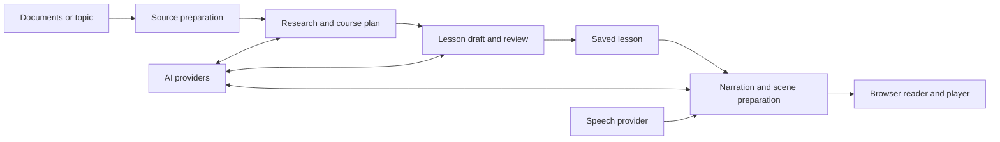

[Up one level](../index.md)

# From sources to playback

A source document gives Nous material to teach, but it does not yet define a course. The system first decides what the learner needs to understand and in which order, then generates individual lessons against that plan. Narration and synchronized visuals are prepared from the saved lessons, so the reader can open completed content while generation continues elsewhere.

## Establish what the course can build on

For a document-based course, [ingestion](../03-section-features/03-p-doc-processing.md) makes passages and figures retrievable with their source context. A topic request needs research to establish its material instead. In both cases, [planning](../03-section-features/01-p-course-gen.md) combines the evidence with the learning goals and starting knowledge to define lesson boundaries and prerequisite order. This gives later generation a specific objective to explain rather than a document to summarize indiscriminately.

The plan also makes individual lessons separable units of work. [Lesson generation](../03-section-features/02-p-lesson-gen.md) retrieves evidence for one objective, drafts its explanation and reviews it before committing the result. A replacement can therefore target that lesson while the previous saved version remains readable.

## Turn saved explanations into playback

The [player](../03-section-features/04-p-multimedia.md) needs more than text: it needs audio and cues connecting the spoken explanation to its visuals. Backend preparation derives those results from a particular saved lesson version. The browser then combines prepared playback with the lesson and its study state, instead of making provider calls from the player.

Planning, writing and audio preparation can all outlive an HTTP request. They run as [saved workflows](../02-section-architecture/02-p-workflow-engine.md), with project and execution state in PostgreSQL and file bytes in storage. Closing the browser leaves that work with the backend. Continue with [architecture](../02-section-architecture/01-p-architecture.md) for these ownership boundaries, or [learning design](02-p-manifesto.md) for the reasons behind the planning and review stages.
