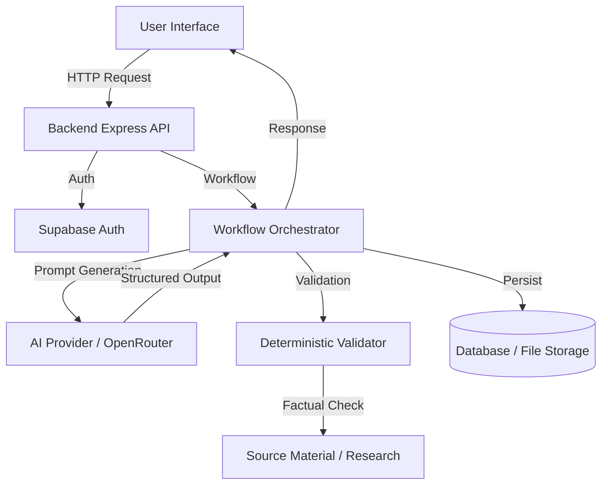
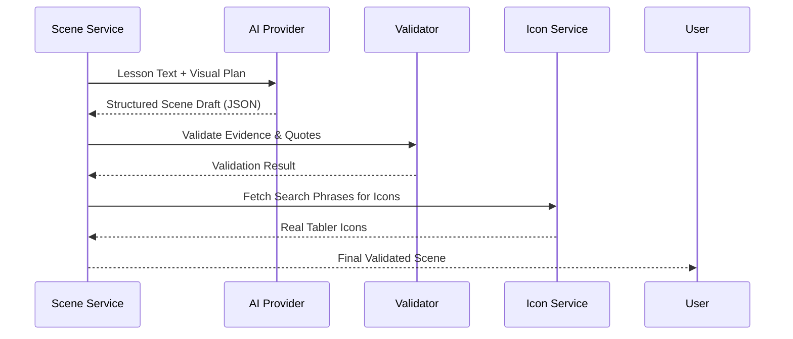

Relevant source files

The following files were used as context for generating this wiki page:

- [apps/backend/src/index.ts](https://github.com/immagiov4/Nous/blob/21ec8b9ef2e9c48eae54d59ba738a6dc8f10dee6/apps/backend/src/index.ts)
- [apps/backend/src/routes/chatPrompts.ts](https://github.com/immagiov4/Nous/blob/21ec8b9ef2e9c48eae54d59ba738a6dc8f10dee6/apps/backend/src/routes/chatPrompts.ts)
- [apps/backend/src/services/lessonScenes/lessonSceneGeneration.ts](https://github.com/immagiov4/Nous/blob/21ec8b9ef2e9c48eae54d59ba738a6dc8f10dee6/apps/backend/src/services/lessonScenes/lessonSceneGeneration.ts)
- [PROJECT_RULES.md](https://github.com/immagiov4/Nous/blob/21ec8b9ef2e9c48eae54d59ba738a6dc8f10dee6/PROJECT_RULES.md)
- [AGENTS.md](https://github.com/immagiov4/Nous/blob/21ec8b9ef2e9c48eae54d59ba738a6dc8f10dee6/AGENTS.md)
- [apps/web/index.html](https://github.com/immagiov4/Nous/blob/21ec8b9ef2e9c48eae54d59ba738a6dc8f10dee6/apps/web/index.html)
- [apps/web/tests/scripts/productionDeployment.test.ts](https://github.com/immagiov4/Nous/blob/21ec8b9ef2e9c48eae54d59ba738a6dc8f10dee6/apps/web/tests/scripts/productionDeployment.test.ts)

# High-Level System Architecture

Nous is an ADHD-friendly learning application designed to transform complex source materials into structured, multimodal lessons. The system uses a client-server architecture where the frontend provides an interactive, step-by-step learning environment, and the backend orchestrates AI-driven content generation, pedagogical planning, and data persistence.

The architecture emphasizes a "Context Before Code" philosophy, ensuring that AI agents operate within strict pedagogical boundaries and factual constraints derived from source materials. The system integrates Large Language Models (LLMs) to perform complex tasks such as course planning, lesson writing, and visual scene generation, while maintaining a deterministic validation layer to prevent hallucinations and preserve factual integrity.

Sources: [PROJECT_RULES.md](https://github.com/immagiov4/Nous/blob/21ec8b9ef2e9c48eae54d59ba738a6dc8f10dee6/PROJECT_RULES.md), [AGENTS.md](https://github.com/immagiov4/Nous/blob/21ec8b9ef2e9c48eae54d59ba738a6dc8f10dee6/AGENTS.md)

## Component Overview

The system consists of three primary layers: the Web Frontend, the Backend API, and the AI/Infrastructure layer.

### Core Components Table

| Component | Responsibility | Key Technologies |
| :--- | :--- | :--- |
| **Web Frontend** | Provides the user interface for reading lessons, interacting with artifacts, and managing the library. | React, Framer Motion, Playwright (E2E) |
| **Backend API** | Orchestrates workflows, manages authentication, and serves as the gateway to AI services. | Node.js, Express, Supabase (Auth/DB) |
| **AI Services** | Handles content generation, research (web search), and pedagogical planning. | OpenRouter, LLM Providers (Codex) |
| **Storage/Persistence** | Maintains user data, project files, and generated course plans. | Supabase, Local Volumes (Exports) |

Sources: [apps/backend/src/index.ts:169-238](https://github.com/immagiov4/Nous/blob/21ec8b9ef2e9c48eae54d59ba738a6dc8f10dee6/apps/backend/src/index.ts#L169-L238), [apps/web/index.html:43-58](https://github.com/immagiov4/Nous/blob/21ec8b9ef2e9c48eae54d59ba738a6dc8f10dee6/apps/web/index.html#L43-L58), [apps/web/tests/scripts/productionDeployment.test.ts:47-83](https://github.com/immagiov4/Nous/blob/21ec8b9ef2e9c48eae54d59ba738a6dc8f10dee6/apps/web/tests/scripts/productionDeployment.test.ts#L47-L83)

## System Data Flow

The following diagram illustrates the high-level flow of a user request from the interface through the backend orchestration to the AI service layer.

The system uses a correlation ID mechanism to track requests across lifecycle events, providing observability into durations and failures.

Sources: [apps/backend/src/index.ts:121-167](https://github.com/immagiov4/Nous/blob/21ec8b9ef2e9c48eae54d59ba738a6dc8f10dee6/apps/backend/src/index.ts#L121-L167), [apps/backend/src/services/lessonScenes/lessonSceneGeneration.ts:333-401](https://github.com/immagiov4/Nous/blob/21ec8b9ef2e9c48eae54d59ba738a6dc8f10dee6/apps/backend/src/services/lessonScenes/lessonSceneGeneration.ts#L333-L401)

## Backend Architecture

The backend is built as a modular Express application. It exposes specific routes for authentication, project management, and specialized AI workflows.

### Workflow Orchestration
The backend manages complex, multi-step processes through dedicated routers. These workflows include:
*   **Course Generation:** Planning modules and lessons from source URLs or documents.
*   **Lesson Generation:** Writing detailed pedagogical content and interactive pauses.
*   **Visual Generation:** Creating raster images, SVG diagrams, or HTML artifacts to support teaching goals.

### Request Observability
Every request is assigned a `x-request-id` (correlation ID). The server records internal timings for database operations, AI turns, and serialization. Logs are emitted upon request completion or disconnection to provide a clear trace of system performance.

Sources: [apps/backend/src/index.ts:109-158](https://github.com/immagiov4/Nous/blob/21ec8b9ef2e9c48eae54d59ba738a6dc8f10dee6/apps/backend/src/index.ts#L109-L158), [apps/backend/src/routes/chatPrompts.ts:10-30](https://github.com/immagiov4/Nous/blob/21ec8b9ef2e9c48eae54d59ba738a6dc8f10dee6/apps/backend/src/routes/chatPrompts.ts#L10-L30)

## AI Integration and Prompting

The system relies on LLMs for both discursive text and structured data generation. Prompt construction is centralized near the features that own them to ensure alignment with specific pedagogical rules.

### Pedagogical Visuals (Lesson Scenes)
The `lessonSceneGeneration` service demonstrates how the system converts lesson text into structured visual data. It enforces a strict catalog of forms:
*   **Static Forms:** Flowcharts, Venn diagrams, matrices, and tree structures.
*   **Quantitative Forms:** Gauges, charts, and lines based on real numbers found in the text.
*   **Interactive/Animated:** Autoplay-enabled scenes for complex processes.

Sources: [apps/backend/src/services/lessonScenes/lessonSceneGeneration.ts:68-150](https://github.com/immagiov4/Nous/blob/21ec8b9ef2e9c48eae54d59ba738a6dc8f10dee6/apps/backend/src/services/lessonScenes/lessonSceneGeneration.ts#L68-L150), [apps/backend/src/services/lessonScenes/lessonSceneGeneration.ts:167-330](https://github.com/immagiov4/Nous/blob/21ec8b9ef2e9c48eae54d59ba738a6dc8f10dee6/apps/backend/src/services/lessonScenes/lessonSceneGeneration.ts#L167-L330)

## Deployment and Security

Nous supports both managed (Supabase Cloud) and self-hosted (Docker Compose) deployment profiles.

*   **Authentication:** Managed via Supabase Auth. The backend resolves the current user for protected routes using JWT verification.
*   **CORS:** Restricts access to configured frontend origins and private network addresses.
*   **Environment Isolation:** Private credentials (e.g., OpenRouter API keys, GitHub tokens) are passed only to the backend, never exposed to the frontend browser environment.
*   **Persistence:** A durable volume (e.g., `/var/lib/nous/library-exports`) is used for large exports and project files.

Sources: [apps/backend/src/index.ts:211-230](https://github.com/immagiov4/Nous/blob/21ec8b9ef2e9c48eae54d59ba738a6dc8f10dee6/apps/backend/src/index.ts#L211-L230), [apps/web/tests/scripts/productionDeployment.test.ts:34-60](https://github.com/immagiov4/Nous/blob/21ec8b9ef2e9c48eae54d59ba738a6dc8f10dee6/apps/web/tests/scripts/productionDeployment.test.ts#L34-L60), [apps/web/tests/scripts/productionDeployment.test.ts:125-140](https://github.com/immagiov4/Nous/blob/21ec8b9ef2e9c48eae54d59ba738a6dc8f10dee6/apps/web/tests/scripts/productionDeployment.test.ts#L125-L140)

## Summary

The High-Level System Architecture of Nous is designed to bridge the gap between non-deterministic AI generation and deterministic educational requirements. By utilizing a central backend orchestrator, structured validation schemas, and a clear separation of concerns between content research and pedagogical delivery, the system provides a reliable environment for ADHD-friendly learning. Progress is tracked through a robust observability layer, and the entire stack is deployable in both cloud and self-hosted environments.
