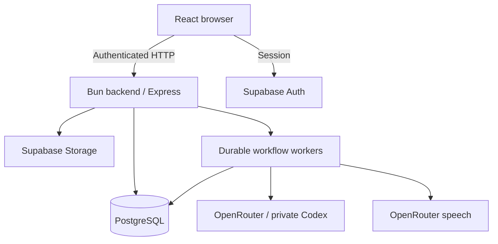

[Up one level](../01-section-overview/01-p-overview.md)

# Architecture and ownership

Nous separates browser interaction from authoritative project state and external provider work. React presents the library and reader; the backend authenticates requests, persists changes and executes workflows. Shared TypeScript contracts connect the two without putting server credentials or persistence authority in the browser.

## Follow responsibility, then files

| Owner | Responsibility and starting point |
| --- | --- |
| [apps/web](../../../apps/web/) | Application state, reader rendering, playback and browser interactions. |
| [apps/backend](../../../apps/backend/) | HTTP boundaries, authorization, project transactions, workflows and provider adapters. |
| [packages/shared-types](../../../packages/shared-types/) | Exchanged data shapes, lesson and playback contracts. |
| [packages/playtest](../../../packages/playtest/) | Reusable browser-test infrastructure. |
| [e2e/nous](../../../e2e/nous/) | Product-specific end-to-end scenarios. |

A rendering change usually belongs in the browser. A change to who may read or save a project belongs at the backend boundary, even when the browser also hides a control. An exchanged field requires both its shared contract and the producers and consumers to agree.

## Requests and long work have different lifetimes

[Routes](../06-section-backend/01-p-api-routes.md) validate a request and resolve its account before reaching project services. A short operation can return its saved result directly. Generation creates or reconnects to a [workflow](02-p-workflow-engine.md), whose state survives independently of that HTTP exchange. Revision notifications tell clients that authoritative project data changed; notifications supplement persisted state rather than owning it.

Provider adapters and workflow services divide responsibility for external calls. [Provider adapters](../07-section-ai/01-p-ai-providers.md) translate model capabilities and output formats; workflow services decide what a successful result means for a course. [Storage](../04-section-data/01-p-database-schema.md) owns projects and files, while [authentication](../06-section-backend/02-p-auth.md) owns identity and access. These are the useful entry points when tracing an error across components.
