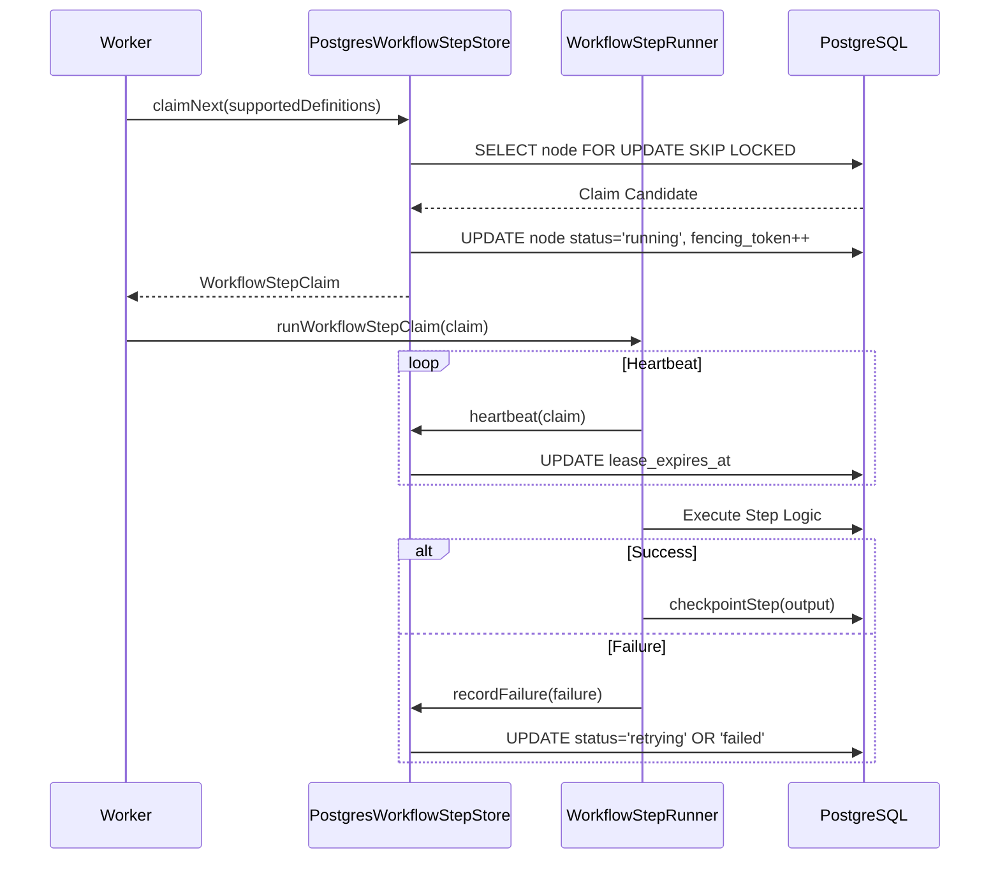
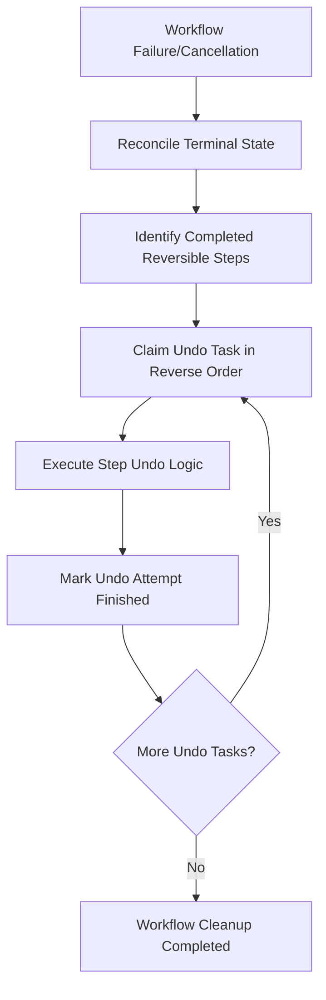

Relevant source files

The following files were used as context for generating this wiki page:

- [apps/backend/src/workflows/persistence/postgresWorkflowStore.ts](https://github.com/immagiov4/Nous/blob/21ec8b9ef2e9c48eae54d59ba738a6dc8f10dee6/apps/backend/src/workflows/persistence/postgresWorkflowStore.ts)
- [apps/backend/src/workflows/postgresWorkflowStepStore.ts](https://github.com/immagiov4/Nous/blob/21ec8b9ef2e9c48eae54d59ba738a6dc8f10dee6/apps/backend/src/workflows/postgresWorkflowStepStore.ts)
- [apps/backend/src/workflows/workflowStepRunner.ts](https://github.com/immagiov4/Nous/blob/21ec8b9ef2e9c48eae54d59ba738a6dc8f10dee6/apps/backend/src/workflows/workflowStepRunner.ts)
- [apps/backend/src/workflows/validation.ts](https://github.com/immagiov4/Nous/blob/21ec8b9ef2e9c48eae54d59ba738a6dc8f10dee6/apps/backend/src/workflows/validation.ts)
- [apps/backend/tests/workflows/postgresWorkflowExecutionStore.integration.test.ts](https://github.com/immagiov4/Nous/blob/21ec8b9ef2e9c48eae54d59ba738a6dc8f10dee6/apps/backend/tests/workflows/postgresWorkflowExecutionStore.integration.test.ts)
- [apps/backend/tests/workflows/postgresWorkflowRunStore.integration.test.ts](https://github.com/immagiov4/Nous/blob/21ec8b9ef2e9c48eae54d59ba738a6dc8f10dee6/apps/backend/tests/workflows/postgresWorkflowRunStore.integration.test.ts)
- [apps/backend/tests/workflows/postgresWorkflowUndoStore.integration.test.ts](https://github.com/immagiov4/Nous/blob/21ec8b9ef2e9c48eae54d59ba738a6dc8f10dee6/apps/backend/tests/workflows/postgresWorkflowUndoStore.integration.test.ts)

# Postgres-Backed Workflow Engine

The Postgres-Backed Workflow Engine manages the durable execution, state persistence, and fault tolerance of long-running workflows. It provides a reliable runtime environment where workflow definitions, execution states, and task claims are stored in a PostgreSQL database to ensure consistency across system restarts and worker failures.

The engine handles the lifecycle of a workflow run from creation to completion, including step execution, retries, timeouts, and undo operations. It enforces strict versioning of workflow definitions and uses fencing tokens to prevent multiple workers from executing the same task simultaneously.

## Core Architecture

The architecture relies on several specialized stores coordinated by the `PostgresWorkflowStore`. These stores manage specific aspects of workflow persistence, such as steps, signals, cancellations, and undo logs.

### Principal Components

| Component | Responsibility |
| :--- | :--- |
| `PostgresWorkflowStore` | Orchestrates the primary workflow lifecycle, including run creation and state retrieval. |
| `PostgresWorkflowStepStore` | Manages step-level operations: claiming tasks, heartbeats, and failure recording. |
| `PostgresWorkflowUndoStore` | Handles the reversal of completed steps when a workflow fails or is cancelled. |
| `WorkflowStepRunner` | Executes the logic of individual steps, manages timeouts, and reports results to the stores. |

Sources: [apps/backend/src/workflows/persistence/postgresWorkflowStore.ts](https://github.com/immagiov4/Nous/blob/21ec8b9ef2e9c48eae54d59ba738a6dc8f10dee6/apps/backend/src/workflows/persistence/postgresWorkflowStore.ts), [apps/backend/src/workflows/postgresWorkflowStepStore.ts](https://github.com/immagiov4/Nous/blob/21ec8b9ef2e9c48eae54d59ba738a6dc8f10dee6/apps/backend/src/workflows/postgresWorkflowStepStore.ts), [apps/backend/src/workflows/workflowStepRunner.ts](https://github.com/immagiov4/Nous/blob/21ec8b9ef2e9c48eae54d59ba738a6dc8f10dee6/apps/backend/src/workflows/workflowStepRunner.ts)

### System Interaction Flow

The following diagram illustrates the interaction between a worker and the persistence layer during step execution.

Sources: [apps/backend/src/workflows/postgresWorkflowStepStore.ts](https://github.com/immagiov4/Nous/blob/21ec8b9ef2e9c48eae54d59ba738a6dc8f10dee6/apps/backend/src/workflows/postgresWorkflowStepStore.ts), [apps/backend/src/workflows/workflowStepRunner.ts](https://github.com/immagiov4/Nous/blob/21ec8b9ef2e9c48eae54d59ba738a6dc8f10dee6/apps/backend/src/workflows/workflowStepRunner.ts)

## Workflow Runs and Idempotency

Workflows are identified by a unique `id` and are started through `createRun`. The engine enforces idempotency using a `requestKey` and optional `dedupeKey`.

### Idempotency Logic
- **Request Key**: Ensures that a specific request results in only one workflow run. If a request with the same `userId`, `workflowId`, and `requestKey` arrives again, the engine returns the existing run.
- **Dedupe Key**: Prevents multiple active workflows for the same logical operation (e.g., generating content for a specific project). If an active run exists with the same `dedupeKey`, the new request is bound to that existing run.
- **Fingerprinting**: The engine generates a SHA-256 fingerprint of the workflow input. It rejects requests where the `requestKey` matches but the input has changed.

Sources: [apps/backend/src/workflows/persistence/postgresWorkflowStore.ts](https://github.com/immagiov4/Nous/blob/21ec8b9ef2e9c48eae54d59ba738a6dc8f10dee6/apps/backend/src/workflows/persistence/postgresWorkflowStore.ts), [apps/backend/tests/workflows/postgresWorkflowRunStore.integration.test.ts](https://github.com/immagiov4/Nous/blob/21ec8b9ef2e9c48eae54d59ba738a6dc8f10dee6/apps/backend/tests/workflows/postgresWorkflowRunStore.integration.test.ts)

## Task Claiming and Fencing

The `PostgresWorkflowStepStore` manages task distribution to workers. It uses PostgreSQL's row-level locking (`FOR UPDATE SKIP LOCKED`) to ensure that multiple workers can safely poll for work concurrently.

### The Fencing Mechanism
To prevent "zombie" workers (those that have lost their lease but continue executing) from corrupting state, the engine uses fencing tokens:
1. Every time a node is claimed or scheduled for retry, its `fencing_token` is incremented in the database.
2. The `WorkflowStepClaim` issued to the worker contains the current token.
3. When the worker attempts to `checkpointStep` or `recordFailure`, the database update includes a `WHERE fencing_token = :claimToken` clause.
4. If another worker has already claimed the task (incrementing the token), the stale worker's update will fail, raising a `WorkflowLeaseLostError`.

Sources: [apps/backend/src/workflows/postgresWorkflowStepStore.ts](https://github.com/immagiov4/Nous/blob/21ec8b9ef2e9c48eae54d59ba738a6dc8f10dee6/apps/backend/src/workflows/postgresWorkflowStepStore.ts), [apps/backend/src/workflows/persistence/postgresWorkflowStore.ts](https://github.com/immagiov4/Nous/blob/21ec8b9ef2e9c48eae54d59ba738a6dc8f10dee6/apps/backend/src/workflows/persistence/postgresWorkflowStore.ts)

## Fault Tolerance and Recovery

The engine provides several mechanisms to recover from worker crashes, network partitions, and transient errors.

### Lease and Heartbeats
When a worker claims a step, it receives a lease (defaulting to 60 seconds). It must periodically send heartbeats to extend this lease. If a worker crashes and stops heartbeating, the lease expires.
Sources: [apps/backend/src/workflows/workflowStepRunner.ts](https://github.com/immagiov4/Nous/blob/21ec8b9ef2e9c48eae54d59ba738a6dc8f10dee6/apps/backend/src/workflows/workflowStepRunner.ts), [apps/backend/src/workflows/postgresWorkflowStepStore.ts](https://github.com/immagiov4/Nous/blob/21ec8b9ef2e9c48eae54d59ba738a6dc8f10dee6/apps/backend/src/workflows/postgresWorkflowStepStore.ts)

### Expired Step Recovery
The `recoverNextExpired` function identifies running nodes with expired leases. It determines the outcome based on the retry policy:
- **Retrying**: If the node has not exceeded `max_attempts`, it is scheduled for retry by incrementing the fencing token and setting the status back to `retrying`.
- **Failed**: If attempts are exhausted, the node and the entire workflow run are marked as failed.

Sources: [apps/backend/src/workflows/postgresWorkflowStepStore.ts](https://github.com/immagiov4/Nous/blob/21ec8b9ef2e9c48eae54d59ba738a6dc8f10dee6/apps/backend/src/workflows/postgresWorkflowStepStore.ts)

### Retry Policies
The engine distinguishes between different failure kinds to determine if a retry is appropriate:
- **Operational**: Transient issues (e.g., timeouts, provider busy) trigger retries with exponential backoff.
- **Corrective**: Logic errors or schema mismatches that include feedback for the next attempt.
- **Permanent**: Critical failures (e.g., unavailable definitions) that immediately terminate the workflow.

Sources: [apps/backend/src/workflows/postgresWorkflowStepStore.ts](https://github.com/immagiov4/Nous/blob/21ec8b9ef2e9c48eae54d59ba738a6dc8f10dee6/apps/backend/src/workflows/postgresWorkflowStepStore.ts), [apps/backend/src/workflows/workflowStepRunner.ts](https://github.com/immagiov4/Nous/blob/21ec8b9ef2e9c48eae54d59ba738a6dc8f10dee6/apps/backend/src/workflows/workflowStepRunner.ts)

## Schema and Definition Validation

Workflows must be registered before execution. The engine validates definitions to ensure structural integrity and schema compatibility.

### Validation Rules
- **Identity**: Every workflow must have an `id` and a `compatibilityId`.
- **Structural Integrity**: Node IDs must be unique within a workflow. Sequences must contain at least one node.
- **Schema Mapping**: The output schema of a node must match the input schema of the subsequent node in a sequence.
- **Hash Verification**: The engine generates a SHA-256 hash of the workflow manifest. This hash is stored with the run to ensure that the logic remains consistent throughout the workflow's life, even if the application code is updated.

Sources: [apps/backend/src/workflows/validation.ts](https://github.com/immagiov4/Nous/blob/21ec8b9ef2e9c48eae54d59ba738a6dc8f10dee6/apps/backend/src/workflows/validation.ts), [apps/backend/tests/workflows/postgresWorkflowRunStore.integration.test.ts](https://github.com/immagiov4/Nous/blob/21ec8b9ef2e9c48eae54d59ba738a6dc8f10dee6/apps/backend/tests/workflows/postgresWorkflowRunStore.integration.test.ts)

### Workflow Definition Registry
The registry tracks active and previous deployments. When a workflow is updated, the engine allows existing runs to continue using their original definition while new runs use the current deployment. If a definition is explicitly removed, the engine "fences" any in-flight steps using that definition to prevent further execution.
Sources: [apps/backend/tests/workflows/postgresWorkflowRunStore.integration.test.ts](https://github.com/immagiov4/Nous/blob/21ec8b9ef2e9c48eae54d59ba738a6dc8f10dee6/apps/backend/tests/workflows/postgresWorkflowRunStore.integration.test.ts), [apps/backend/src/workflows/persistence/postgresWorkflowStore.ts](https://github.com/immagiov4/Nous/blob/21ec8b9ef2e9c48eae54d59ba738a6dc8f10dee6/apps/backend/src/workflows/persistence/postgresWorkflowStore.ts)

## Compensation and Undo

If a workflow fails or is cancelled, the `PostgresWorkflowUndoStore` manages the execution of `undo` callbacks for every completed step.

Undo operations are executed in the **reverse order** of their original successful completion. The engine tracks undo attempts separately to allow retries of the compensation logic itself.
Sources: [apps/backend/tests/workflows/postgresWorkflowUndoStore.integration.test.ts](https://github.com/immagiov4/Nous/blob/21ec8b9ef2e9c48eae54d59ba738a6dc8f10dee6/apps/backend/tests/workflows/postgresWorkflowUndoStore.integration.test.ts), [apps/backend/src/workflows/persistence/postgresWorkflowStore.ts](https://github.com/immagiov4/Nous/blob/21ec8b9ef2e9c48eae54d59ba738a6dc8f10dee6/apps/backend/src/workflows/persistence/postgresWorkflowStore.ts)

## Conclusion

The Postgres-Backed Workflow Engine provides a robust foundation for distributed task execution by leveraging PostgreSQL's transactional guarantees. By combining row-level locking, fencing tokens, and durable state persistence, the system ensures that workflows are executed reliably and consistently, even in the presence of worker failures or concurrent updates.
