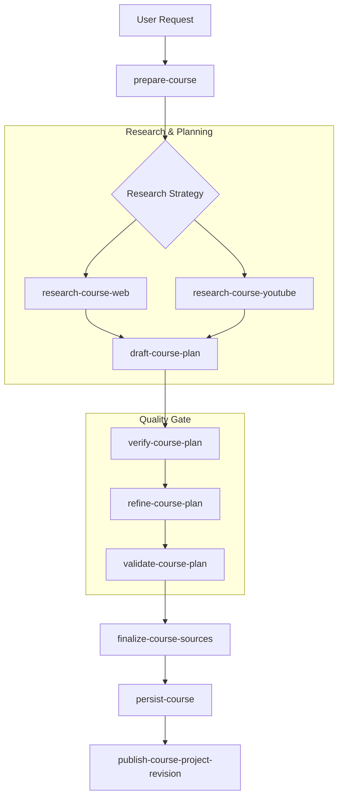

Relevant source files

The following files were used as context for generating this wiki page:

- [apps/backend/src/workflows/courseGenerationPlanning.ts](https://github.com/immagiov4/Nous/blob/21ec8b9ef2e9c48eae54d59ba738a6dc8f10dee6/apps/backend/src/workflows/courseGenerationPlanning.ts)
- [apps/backend/src/workflows/courseGenerationWorkflowContract.ts](https://github.com/immagiov4/Nous/blob/21ec8b9ef2e9c48eae54d59ba738a6dc8f10dee6/apps/backend/src/workflows/courseGenerationWorkflowContract.ts)
- [apps/backend/tests/workflows/courseGenerationWorkflow.test.ts](https://github.com/immagiov4/Nous/blob/21ec8b9ef2e9c48eae54d59ba738a6dc8f10dee6/apps/backend/tests/workflows/courseGenerationWorkflow.test.ts)
- [apps/backend/tests/workflows/courseGenerationResearch.test.ts](https://github.com/immagiov4/Nous/blob/21ec8b9ef2e9c48eae54d59ba738a6dc8f10dee6/apps/backend/tests/workflows/courseGenerationResearch.test.ts)
- [apps/backend/tests/workflows/courseSourceFinalization.test.ts](https://github.com/immagiov4/Nous/blob/21ec8b9ef2e9c48eae54d59ba738a6dc8f10dee6/apps/backend/tests/workflows/courseSourceFinalization.test.ts)
- [packages/shared-types/lessonWritingContract.ts](https://github.com/immagiov4/Nous/blob/21ec8b9ef2e9c48eae54d59ba738a6dc8f10dee6/packages/shared-types/lessonWritingContract.ts)

# Document-to-Course Pipeline

The Document-to-Course pipeline transforms raw documents and research data into structured, multi-module learning paths. It utilizes a durable workflow architecture to manage long-running asynchronous tasks including source research, pedagogical planning, and content mapping.

The system supports multiple entry modes, primarily focusing on `document` mode (single or multiple source files) and `learn` mode (topic-based research). It enforces strict pedagogical rules to ensure content is progressive, self-sufficient, and accurately attributed to its original sources.

Sources: [apps/backend/src/workflows/courseGenerationWorkflowContract.ts](https://github.com/immagiov4/Nous/blob/21ec8b9ef2e9c48eae54d59ba738a6dc8f10dee6/apps/backend/src/workflows/courseGenerationWorkflowContract.ts), [README.md](https://github.com/immagiov4/Nous/blob/21ec8b9ef2e9c48eae54d59ba738a6dc8f10dee6/README.md)

## Workflow Architecture

The pipeline operates as a series of durable nodes indexed in a registry. Each node represents a discrete step in the course generation lifecycle. This structure allows the system to resume from failure points and maintain idempotency across retries.

### Execution Flow
The pipeline follows a linear progression from preparation to persistence, with internal loops for research and refinement.

The diagram shows the transition from raw input through asynchronous research and iterative pedagogical refinement.

Sources: [apps/backend/tests/workflows/courseGenerationWorkflow.test.ts](https://github.com/immagiov4/Nous/blob/21ec8b9ef2e9c48eae54d59ba738a6dc8f10dee6/apps/backend/tests/workflows/courseGenerationWorkflow.test.ts)

## Source Research and Routing

The research phase gathers external evidence to supplement or verify document content. The `plan-course-research-sources` node determines which channels (Web or YouTube) are necessary based on the provided material.

*   **Web Research:** Scans authoritative sources to provide factual briefs and citable URLs.
*   **YouTube Research:** Searches for relevant transcripts and video clips to provide visual or narrative context.
*   **Routing Logic:** If supplied sources are insufficient, the system enforces a `corrective` failure to trigger research.

Sources: [apps/backend/tests/workflows/courseGenerationResearch.test.ts](https://github.com/immagiov4/Nous/blob/21ec8b9ef2e9c48eae54d59ba738a6dc8f10dee6/apps/backend/tests/workflows/courseGenerationResearch.test.ts)

## Pedagogical Planning and Refinement

The planning engine generates a `CourseRawPlan`, which is then subjected to structural verification. The system evaluates the plan across several quality dimensions.

### Quality Dimensions
The `CoursePlanVerificationSchema` enforces standards for course structure:

| Dimension | Description |
| :--- | :--- |
| **Coverage** | Ensures all required topics from the source or topic are addressed. |
| **Progression** | Validates that lessons follow a logical, propedeutic order. |
| **Granularity** | Prevents fragmented or overly compressed modules. |
| **Prerequisites** | Checks that every lesson requires only previously taught concepts. |
| **Duplication** | Identifies redundant content across different modules. |

Sources: [apps/backend/src/workflows/courseGenerationWorkflowContract.ts](https://github.com/immagiov4/Nous/blob/21ec8b9ef2e9c48eae54d59ba738a6dc8f10dee6/apps/backend/src/workflows/courseGenerationWorkflowContract.ts), [apps/backend/src/workflows/courseGenerationPlanning.ts](https://github.com/immagiov4/Nous/blob/21ec8b9ef2e9c48eae54d59ba738a6dc8f10dee6/apps/backend/src/workflows/courseGenerationPlanning.ts)

### Refinement Loop
If a plan fails verification, the `refine-course-plan` node uses the verification feedback to generate a corrected version. This process is iterative; if refined semantic findings remain, the workflow fails permanently with a `course_plan_validation_failed` error.

Sources: [apps/backend/tests/workflows/courseGenerationWorkflow.test.ts](https://github.com/immagiov4/Nous/blob/21ec8b9ef2e9c48eae54d59ba738a6dc8f10dee6/apps/backend/tests/workflows/courseGenerationWorkflow.test.ts)

## Source Finalization and Mapping

Once a plan is validated, the pipeline maps specific document "chunks" to generated lessons. This ensures that every lesson in the course can cite and retrieve the relevant passage from the original material.

*   **PDF Indexing:** The system builds a `CourseDocumentIndex` containing text chunks, page numbers, and heading paths.
*   **Batch Mapping:** Mapping requests are batched to fit within model prompt limits (defined by `PDF_MAPPING_TARGET_PROMPT_CHARS`).
*   **Fallback Mechanism:** If automatic mapping fails or is exhausted, the system applies a deterministic fallback based on document structure to ensure continuity.

Sources: [apps/backend/tests/workflows/courseSourceFinalization.test.ts](https://github.com/immagiov4/Nous/blob/21ec8b9ef2e9c48eae54d59ba738a6dc8f10dee6/apps/backend/tests/workflows/courseSourceFinalization.test.ts)

## Content Generation Rules

The pipeline enforces a "Binding Pedagogical Context" through the `lessonWritingContract`. This contract contains strict rules for the final content:

1.  **Self-Sufficiency:** Lessons must work without the original material open, integrating all necessary context into the text.
2.  **Positive Definition:** New concepts must be defined by what they *are* before discussing what they are *not*.
3.  **No Metadiscourse:** The teacher agent enters content directly without explaining that it is summarizing or organizing.
4.  **Math Delimiters:** Notation must use `\(...\)` for inline and `\[...\]` for display math, avoiding dollar signs.

Sources: [packages/shared-types/lessonWritingContract.ts](https://github.com/immagiov4/Nous/blob/21ec8b9ef2e9c48eae54d59ba738a6dc8f10dee6/packages/shared-types/lessonWritingContract.ts)

## Persistence and Publication

The final stage commits the course to the database via `persist-course`. This node handles:
*   Storing the `CourseLearningPlan` (modules, lessons, and exercises).
*   Updating the `projectRevision`.
*   Capturing a fingerprint of the committed course for state management.

Sources: [apps/backend/src/workflows/courseGenerationWorkflowContract.ts](https://github.com/immagiov4/Nous/blob/21ec8b9ef2e9c48eae54d59ba738a6dc8f10dee6/apps/backend/src/workflows/courseGenerationWorkflowContract.ts), [apps/backend/tests/workflows/courseGenerationWorkflow.test.ts](https://github.com/immagiov4/Nous/blob/21ec8b9ef2e9c48eae54d59ba738a6dc8f10dee6/apps/backend/tests/workflows/courseGenerationWorkflow.test.ts)

## Observability

The authenticated [workflow state API](../../../apps/backend/src/routes/workflows.ts) exposes planning node status, attempt counts and failure codes. [Workflow logs](../../../apps/backend/src/workflows/workflowObservability.ts) connect run and attempt events through `runId`, with node definitions and retry outcomes identifying where planning stopped. These lifecycle signals establish execution, not factual coverage or prerequisite quality; inspect the saved research, verification and refinement outputs through [content evaluation](../09-section-tools/02-p-testing-quality.md) for those judgments.
