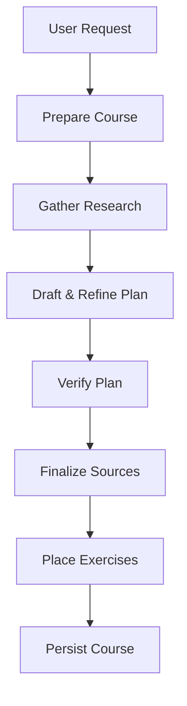
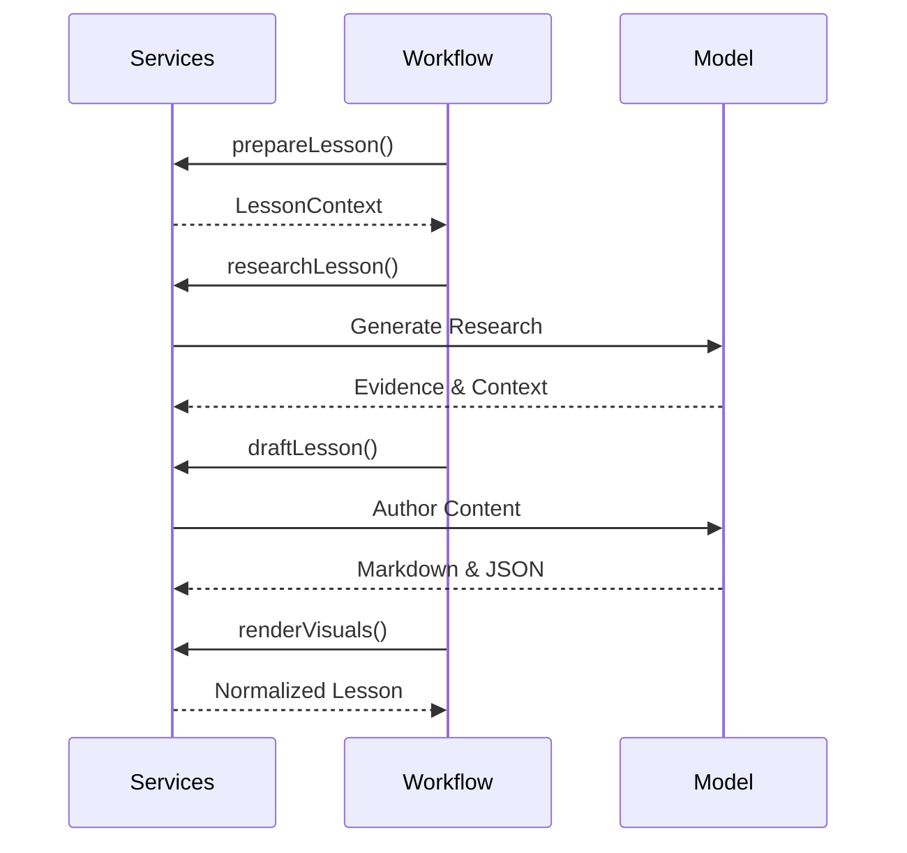
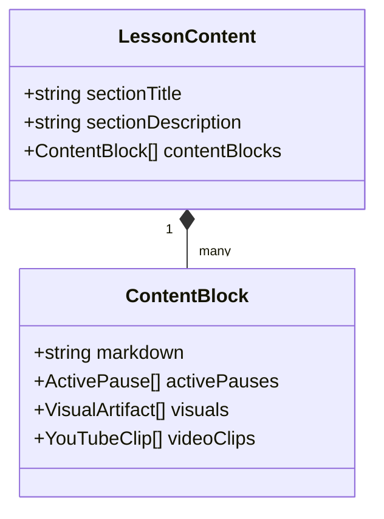

Relevant source files

The following files were used as context for generating this wiki page:

- [apps/backend/src/workflows/courseGenerationWorkflow.ts](https://github.com/immagiov4/Nous/blob/21ec8b9ef2e9c48eae54d59ba738a6dc8f10dee6/apps/backend/src/workflows/courseGenerationWorkflow.ts)
- [apps/backend/src/workflows/lessonGenerationWorkflow.ts](https://github.com/immagiov4/Nous/blob/21ec8b9ef2e9c48eae54d59ba738a6dc8f10dee6/apps/backend/src/workflows/lessonGenerationWorkflow.ts)
- [apps/backend/src/workflows/courseGenerationPlanning.ts](https://github.com/immagiov4/Nous/blob/21ec8b9ef2e9c48eae54d59ba738a6dc8f10dee6/apps/backend/src/workflows/courseGenerationPlanning.ts)
- [apps/backend/src/services/lessonGenerationPreparation.ts](https://github.com/immagiov4/Nous/blob/21ec8b9ef2e9c48eae54d59ba738a6dc8f10dee6/apps/backend/src/services/lessonGenerationPreparation.ts)
- [apps/backend/src/services/lessonGenerationPrompt.ts](https://github.com/immagiov4/Nous/blob/21ec8b9ef2e9c48eae54d59ba738a6dc8f10dee6/apps/backend/src/services/lessonGenerationPrompt.ts)
- [packages/shared-types/lessonWritingContract.ts](https://github.com/immagiov4/Nous/blob/21ec8b9ef2e9c48eae54d59ba738a6dc8f10dee6/packages/shared-types/lessonWritingContract.ts)
- [packages/shared-types/coursePlanningInstructions.ts](https://github.com/immagiov4/Nous/blob/21ec8b9ef2e9c48eae54d59ba738a6dc8f10dee6/packages/shared-types/coursePlanningInstructions.ts)
- [apps/backend/src/workflows/courseGenerationWorkflowContract.ts](https://github.com/immagiov4/Nous/blob/21ec8b9ef2e9c48eae54d59ba738a6dc8f10dee6/apps/backend/src/workflows/courseGenerationWorkflowContract.ts)

# Course & Lesson Generation

The Course & Lesson Generation system transforms raw source materials—such as PDFs, web content, and YouTube transcripts—into structured, pedagogical learning paths. It operates through a series of durable workflows that coordinate research, planning, verification, and content authoring. The system uses Professor Nous, a rigorous and accessible teacher persona, to ensure high-quality educational output.

Sources: [README.md](https://github.com/immagiov4/Nous/blob/21ec8b9ef2e9c48eae54d59ba738a6dc8f10dee6/README.md), [packages/shared-types/lessonWritingContract.ts:203](https://github.com/immagiov4/Nous/blob/21ec8b9ef2e9c48eae54d59ba738a6dc8f10dee6/packages/shared-types/lessonWritingContract.ts#L203)

## System Architecture

The generation process is divided into two primary hierarchical workflows: Course Generation and Lesson Generation. Both rely on a shared infrastructure for research and source management.

### Workflow Hierarchy

1.  **Course Generation Workflow:** Coordinates the high-level structure, research, and syllabus creation.
2.  **Lesson Generation Workflow:** Handles the detailed authoring of individual lessons, including visuals and active pauses.

The following diagram illustrates the high-level flow from initial user request to the finalized course structure.

The diagram shows the sequential stages of the Course Generation Workflow.
Sources: [apps/backend/src/workflows/courseGenerationWorkflow.ts:252-280](https://github.com/immagiov4/Nous/blob/21ec8b9ef2e9c48eae54d59ba738a6dc8f10dee6/apps/backend/src/workflows/courseGenerationWorkflow.ts#L252-L280)

## Course Planning & Research

Course planning determines the strategy and structure of the learning path based on the user's goals and available materials.

### Generation Strategies
The system supports four distinct strategies for generating a course:
- **Learn:** Topic-based research using web and YouTube data.
- **Single-source:** Based on one primary document.
- **Source-set:** Based on multiple provided documents.
- **Archive:** Based on a retained archive of files and symbols.

Sources: [apps/backend/src/workflows/courseGenerationWorkflowContract.ts:167](https://github.com/immagiov4/Nous/blob/21ec8b9ef2e9c48eae54d59ba738a6dc8f10dee6/apps/backend/src/workflows/courseGenerationWorkflowContract.ts#L167), [apps/backend/src/workflows/courseGenerationPlanning.ts:107](https://github.com/immagiov4/Nous/blob/21ec8b9ef2e9c48eae54d59ba738a6dc8f10dee6/apps/backend/src/workflows/courseGenerationPlanning.ts#L107)

### Research Phase
During the research phase, the system gathers external data to supplement primary sources or provide a foundation for topic-based courses.
- **Web Research:** Extracts factual briefs and citable sources.
- **YouTube Research:** Finds video candidates, extracts transcripts, and plans clips for pedagogical use.

Sources: [apps/backend/src/workflows/courseGenerationWorkflow.ts:256-265](https://github.com/immagiov4/Nous/blob/21ec8b9ef2e9c48eae54d59ba738a6dc8f10dee6/apps/backend/src/workflows/courseGenerationWorkflow.ts#L256-L265), [apps/backend/src/workflows/courseGenerationPlanning.ts:110-120](https://github.com/immagiov4/Nous/blob/21ec8b9ef2e9c48eae54d59ba738a6dc8f10dee6/apps/backend/src/workflows/courseGenerationPlanning.ts#L110-L120)

### Refinement and Verification
The system enforces structural quality through a "Draft-Verify-Refine" loop. Plans are assessed against several quality dimensions including granularity, progression, and prerequisite order.

| Dimension | Description |
| :--- | :--- |
| **Granularity** | Evaluates if lesson boundaries match requested grouping (e.g., small steps vs. fuller lessons). |
| **Progression** | Ensures a logical flow from foundational to advanced concepts. |
| **Prerequisites** | Verifies that concepts are taught before they are required. |
| **Coverage** | Ensures all required topics from source materials are included. |

Sources: [apps/backend/src/workflows/courseGenerationWorkflowContract.ts:311-325](https://github.com/immagiov4/Nous/blob/21ec8b9ef2e9c48eae54d59ba738a6dc8f10dee6/apps/backend/src/workflows/courseGenerationWorkflowContract.ts#L311-L325), [packages/shared-types/coursePlanningInstructions.ts:63-65](https://github.com/immagiov4/Nous/blob/21ec8b9ef2e9c48eae54d59ba738a6dc8f10dee6/packages/shared-types/coursePlanningInstructions.ts#L63-L65)

## Lesson Generation Workflow

Once a course plan is finalized, individual lessons are authored. This workflow handles content drafting, review, and the generation of interactive elements.

The sequence shows the internal operations of authoring a single lesson.
Sources: [apps/backend/src/workflows/lessonGenerationWorkflow.ts:340-365](https://github.com/immagiov4/Nous/blob/21ec8b9ef2e9c48eae54d59ba738a6dc8f10dee6/apps/backend/src/workflows/lessonGenerationWorkflow.ts#L340-L365)

### Pedagogical Context Construction
Every lesson is generated within a "Binding Pedagogical Context." This context includes:
- **User Learning Profile:** Goals, experience level, and preferred learning style.
- **Syllabus Entry:** The lesson's place within the overall course.
- **Course Planning Instructions:** Explicit controls for depth and granularity.
- **Parent Context:** Content from previous lessons to ensure continuity.

Sources: [apps/backend/src/services/lessonGenerationPreparation.ts:25-50](https://github.com/immagiov4/Nous/blob/21ec8b9ef2e9c48eae54d59ba738a6dc8f10dee6/apps/backend/src/services/lessonGenerationPreparation.ts#L25-L50), [apps/backend/src/services/lessonGenerationPrompt.ts:116-130](https://github.com/immagiov4/Nous/blob/21ec8b9ef2e9c48eae54d59ba738a6dc8f10dee6/apps/backend/src/services/lessonGenerationPrompt.ts#L116-L130)

### Content Authoring Rules
The system follows strict writing rules to maintain educational quality:
- **First Exposure Rule:** Define concepts positively before discussing limits or alternatives.
- **Self-Sufficiency:** The lesson must be understandable without opening original source documents.
- **Technical Notation:** Symbols and formulas must be immediately connected to plain-language explanations.
- **Markdown Integrity:** Prose must remain discursive; lists and tables are used only when they clarify relationships.

Sources: [packages/shared-types/lessonWritingContract.ts:31-40, 115-120, 140-145](https://github.com/immagiov4/Nous/blob/21ec8b9ef2e9c48eae54d59ba738a6dc8f10dee6/packages/shared-types/lessonWritingContract.ts#L31-L40)

## Learning Aids & Visuals

Lessons are enriched with interactive and visual elements to support diverse learning styles.

### Active Pauses
Content blocks can contain "Active Pauses" (quizzes and exercises). These are placed strategically after the passage that teaches the required concepts. Supported exercise types include multiple-choice questions, reasoning tasks, and application exercises.

Sources: [apps/backend/src/services/lessonGenerationPrompt.ts:184-192](https://github.com/immagiov4/Nous/blob/21ec8b9ef2e9c48eae54d59ba738a6dc8f10dee6/apps/backend/src/services/lessonGenerationPrompt.ts#L184-L192), [packages/shared-types/lessonWritingContract.ts:148-155](https://github.com/immagiov4/Nous/blob/21ec8b9ef2e9c48eae54d59ba738a6dc8f10dee6/packages/shared-types/lessonWritingContract.ts#L148-L155)

### Visual Artifacts
The system plans and renders various visual types:
- **Illustrative Images:** Raster illustrations for physical or stylized reality.
- **Lesson Scenes:** Abstract structures like flowcharts, timelines, or comparisons.
- **Interactive HTML:** Labs or simulations requiring user interaction.
- **Formula Spotlight:** LaTeX-based explanations that highlight specific symbols during narration.

Sources: [packages/shared-types/lessonVisualContracts.ts:117-130, 246-250](https://github.com/immagiov4/Nous/blob/21ec8b9ef2e9c48eae54d59ba738a6dc8f10dee6/packages/shared-types/lessonVisualContracts.ts#L117-L130), [apps/backend/src/services/lessonScenes/lessonSceneGeneration.ts:145-165](https://github.com/immagiov4/Nous/blob/21ec8b9ef2e9c48eae54d59ba738a6dc8f10dee6/apps/backend/src/services/lessonScenes/lessonSceneGeneration.ts#L145-L165)

## Data Models

### Course Planning Controls
Controls allow users to adjust the "weight" of the generated content.

| Parameter | Options | Description |
| :--- | :--- | :--- |
| **Depth** | much-less, less, auto, more, much-more | Controls the amount of optional elaboration and enrichment. |
| **Granularity** | much-less, less, auto, more, much-more | Determines lesson size, from "smallest steps" to "broadest results." |

Sources: [packages/shared-types/coursePlanningInstructions.ts:16-55](https://github.com/immagiov4/Nous/blob/21ec8b9ef2e9c48eae54d59ba738a6dc8f10dee6/packages/shared-types/coursePlanningInstructions.ts#L16-L55)

### Lesson Content Structure
The final lesson is a structured object containing multiple content types.

Sources: [apps/backend/src/workflows/lessonGenerationWorkflowContract.ts:153-178](https://github.com/immagiov4/Nous/blob/21ec8b9ef2e9c48eae54d59ba738a6dc8f10dee6/apps/backend/src/workflows/lessonGenerationWorkflowContract.ts#L153-L178), [apps/backend/src/services/lessonGenerationNormalization.ts:15-30](https://github.com/immagiov4/Nous/blob/21ec8b9ef2e9c48eae54d59ba738a6dc8f10dee6/apps/backend/src/services/lessonGenerationNormalization.ts#L15-L30)

## Summary

Course & Lesson Generation in Nous is a multi-stage process that prioritizes pedagogical rigor and source fidelity. By using durable workflows, the system ensures that research, planning, and authoring are consistent and verifiable. The final output is a rich, interactive learning experience that adapts to user preferences while remaining grounded in authoritative source material.

Sources: [packages/shared-types/lessonWritingContract.ts:203-210](https://github.com/immagiov4/Nous/blob/21ec8b9ef2e9c48eae54d59ba738a6dc8f10dee6/packages/shared-types/lessonWritingContract.ts#L203-L210), [apps/backend/src/workflows/courseGenerationPlanning.ts:400-410](https://github.com/immagiov4/Nous/blob/21ec8b9ef2e9c48eae54d59ba738a6dc8f10dee6/apps/backend/src/workflows/courseGenerationPlanning.ts#L400-L410)

## Observability

[Workflow state](../../../apps/backend/src/routes/workflows.ts) exposes the lesson run's node statuses and failures; [attempt logs](../../../apps/backend/src/workflows/workflowObservability.ts) distinguish retries, checkpoint replay and completion by run and node. The [persistence tests](../../../apps/backend/tests/workflows/lessonGenerationPersistence.test.ts) cover atomic adoption, replacement of learner state and compensation. A completed run proves that content was committed, while the explanation's factual and teaching quality still requires the [testing and quality guidance](../09-section-tools/02-p-testing-quality.md).
