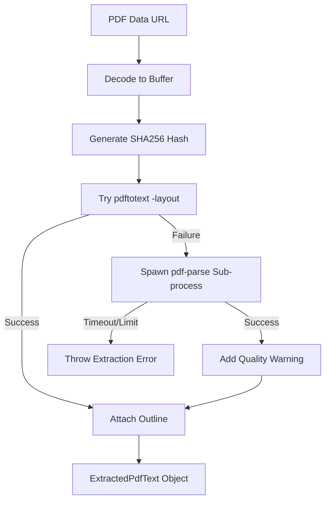
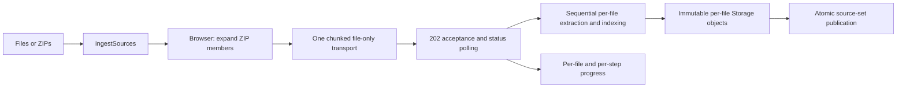

<details>
<summary>Relevant source files</summary>

The following files were used as context for generating this wiki page:

- [apps/backend/src/services/pdfTextExtractor.ts](../../../apps/backend/src/services/pdfTextExtractor.ts)
- [apps/backend/src/services/pdfImageExtractor.ts](../../../apps/backend/src/services/pdfImageExtractor.ts)
- [packages/shared-types/pdfTextIndex.ts](../../../packages/shared-types/pdfTextIndex.ts)
- [apps/backend/src/services/lessonGenerationSources.ts](../../../apps/backend/src/services/lessonGenerationSources.ts)
- [apps/web/services/projects/courseSources.ts](../../../apps/web/services/projects/courseSources.ts)
- [apps/backend/src/projects/postgresProjectStore.ts](../../../apps/backend/src/projects/postgresProjectStore.ts) (Referenced via tests)
- [apps/backend/src/projects/sourceArchive.ts](../../../apps/backend/src/projects/sourceArchive.ts) (Referenced via tests)

</details>

# Document Processing & PDF Extraction

Document Processing and PDF Extraction within the Nous platform is a multi-layered system designed to transform raw file uploads (PDFs, Markdown, and ZIP archives) into structured, queryable data for AI-driven lesson generation. The system handles text extraction, image recovery, and hierarchical indexing to ensure that pedagogical content remains grounded in the original source material.

The pipeline emphasizes resilience through a multi-parser fallback strategy for PDFs, ensuring that even complex layouts can be converted into usable text. This processed data is then segmented into semantic chunks and indexed by page number and heading path, allowing for precise citations within the generated lessons.

## Text Extraction Pipeline

The core of the document processing system is the `extractPdfText` function, which utilizes a primary high-fidelity parser with a robust fallback mechanism.

### Multi-Stage Parsing
1.  **pdftotext**: The primary parser. It is invoked via a sub-process with `-layout` flags to preserve the original visual structure, which is critical for table and column detection.
2.  **pdf-parse**: A secondary fallback parser utilized if `pdftotext` is missing from the environment or fails to produce output.
3.  **Fallback Process**: For memory safety and isolation, `pdf-parse` is often run in a dedicated Node.js sub-process (`pdfTextFallbackProcess.mjs`) with strict memory limits (`--max-old-space-size`). The worker sends UTF-8 JSON so Bun and Node share the same protocol, including mathematical Unicode.

Sources: [apps/backend/src/services/pdfTextExtractor.ts:326-373](../../../apps/backend/src/services/pdfTextExtractor.ts#L326-L373), [apps/backend/src/services/pdfTextExtractor.ts:149-198](../../../apps/backend/src/services/pdfTextExtractor.ts#L149-L198)



The diagram shows the decision flow between high-fidelity layout preservation and isolated fallback extraction. 
Sources: [apps/backend/src/services/pdfTextExtractor.ts:375-395](../../../apps/backend/src/services/pdfTextExtractor.ts#L375-L395)

### Extraction Specifications

| Parameter | Default / Limit | Description |
| :--- | :--- | :--- |
| `maxOutputBytes` | Variable | Caps the total text volume to prevent heap exhaustion. |
| `pdftotextTimeoutMs` | 15,000ms (Archive) | Max time allowed for the primary OS-level parser. |
| `fallbackTimeoutMs` | 15,000ms (Archive) | Max time for the isolated Node.js fallback process. |
| `max-old-space-size` | Derived from input and output budgets | Memory limit for the fallback sub-process. |

Sources: [apps/backend/tests/projects/sourceArchive.test.ts:114-120](../../../apps/backend/tests/projects/sourceArchive.test.ts#L114-L120), [apps/backend/tests/services/pdfTextExtractor.test.ts:86-90](../../../apps/backend/tests/services/pdfTextExtractor.test.ts#L86-L90)

## Image Extraction & Contextualization

Beyond text, the system extracts standalone figures and images from PDFs using `pdfjs-dist`. Unlike simple extraction, this module attempts to reconstruct the semantic context surrounding each image.

### Filtering Logic
To avoid extracting incidental UI elements (icons, watermarks, or lines), the system applies strict thresholds based on both rendered and intrinsic dimensions.
*  **Standalone Figures**: Requires a minimum area (e.g., 24,000 intrinsic pixels) or specific side length ratios.
*  **Inline Images**: Higher area requirements to distinguish between decorative icons and substantive diagrams.

Sources: [apps/backend/src/services/pdfImageExtractor.ts:7-22](../../../apps/backend/src/services/pdfImageExtractor.ts#L7-L22), [apps/backend/src/services/pdfImageExtractor.ts:219-257](../../../apps/backend/src/services/pdfImageExtractor.ts#L219-L257)

### Optional Figure Captions

The lesson document stage stores extracted figure bytes before requesting optional Italian captions. For OpenRouter, `pdfImageCaption.ts` defaults to the image-capable `google/gemini-3.1-flash-lite` route; `MODEL_PDF_IMAGE_CAPTION` can override it. The former `nvidia/nemotron-nano-12b-v2-vl` route returned HTTP 404 with no available endpoints. Caption failures remain optional and do not remove stored figures. Codex captions use the configured lesson model through the research provider slot.

### Spatial Context Reconstruction
The `buildLocalImageTextContext` function analyzes the `centerY` coordinates of text lines relative to the bounding box of the extracted image.
*  **textBefore**: The last 5 lines appearing above the image.
*  **textCurrent**: Lines overlapping the vertical span of the image.
*  **textAfter**: The first 5 lines appearing below the image.

Sources: [apps/backend/src/services/pdfImageExtractor.ts:98-120](../../../apps/backend/src/services/pdfImageExtractor.ts#L98-L120)

## Content Indexing and Segmentation

Once text is extracted, it is transformed into a `PdfTextIndex`. This structure is the basis for AI retrieval and user-facing citations.

### Chunking Strategy
Text is not stored as a single block but divided into `PdfTextChunk` objects.
*  **Target Size**: Chunks target approximately 8,000 characters (on web) or smaller semantic segments defined by headings.
*  **Heading Inference**: The system detects headings using regex patterns (e.g., `1.1 Concetti`) or visual cues (high ratio of uppercase/title-case characters).
*  **Overlapping**: Paragraphs are preserved, and chunks may include overlapping context to maintain flow.

Sources: [packages/shared-types/pdfTextIndex.ts:36-65](../../../packages/shared-types/pdfTextIndex.ts#L36-L65), [apps/web/services/projects/courseSources.ts:6-7](../../../apps/web/services/projects/courseSources.ts#L6-L7)

### Page Mapping
For PDF sources, every chunk is mapped to a physical page range. If exact layout data is missing, the system uses a progress-based estimation:
`startPage = floor(startOffset / totalChars * pageCount) + 1`

Sources: [packages/shared-types/pdfTextIndex.ts:118-136](../../../packages/shared-types/pdfTextIndex.ts#L118-L136)

## Source Archive Preparation

New courses use one source-ingestion module for separate files and ZIPs. Its browser interface, `ingestSources({ inputs, destination, signal, onProgress })`, hides expansion, transport and preparation. ZIP members are streamed one at a time into browser-private filesystem files, validated against their declared size and CRC, and sent as individual files through the same transport used by separate uploads. The ZIP container stays in the browser. Existing saved archive projects retain their server-side reader.



The PDF step owns native extraction; the collection context is the internal seam for scanned-page detection and transcription. Text files use the shared deterministic Markdown outline and text-index implementation. Preparation retains text/index metadata while original bytes use one reusable per-file buffer. Originals stream to Storage as bounded ranges of the assembled upload, with one immutable object per file. Bun collects released buffers after each extraction and source-object transfer. The `/api/pdf` utility remains available to its other callers.

ZIP staging uses OPFS writable streams when available. Browsers without OPFS writable support stage each admitted member as a Blob under the same per-file and collection envelopes. Browsers without the required decompression/stream APIs show an action to extract the archive and attach its files separately. Duplicate member paths reject the selection with a named warning so distinct originals are not silently discarded.

The metadata prefix is limited to the shared transfer-part byte budget, checked before backend file access and before the client starts transferring source bytes.

### Transfer, jobs and resource limits

| Resource | Contract |
| --- | --- |
| Source originals | 32,000,000 bytes per individual file, including ZIP members. The picker names known exclusions before transfer. Failed preparation retains each file name and reason. |
| Collection | 1,000,000,000 bytes for transfer, including the metadata prefix, and for expanded ZIP content; at most 20,000 ZIP entries. The ZIP directory is read in bounded blocks, including ZIP64 ranges. |
| Transport | Authenticated binary parts contain at most 16,000,000 bytes. The final request carries the metadata-prefix length and write options. Both the production HTTP adapter and the configurable loopback proxy use `sourceTransfer.ts` for the 100 MB body, approximately 100 s first-byte and 30 s origin-write model. Source requests use a 90 s deadline; long processing runs asynchronously. |
| Job | The existing import-session owner, finalization queue and status route provide 202 acceptance, progress polling, replay and cancellation. A lost process-local job produces an explicit interrupted/retry state. Durable restart recovery remains part of #170. |
| Temporary files | Compose mounts the disk-backed `source-staging` volume and sets `TMPDIR=/var/lib/nous/source-staging`. Parser subprocesses inherit it. Source admission rejects tmpfs/ramfs before accepting original bytes when that deployment configuration is missing. |
| Object persistence | Originals are stored separately, within the per-file envelope and the production 200 MiB object ceiling. The ZIP container is not stored. Existing concurrency four and the 64,000,000-byte in-flight budget apply to active object transfers. |
| PDF extraction | Native and isolated fallback stages retain their 15 s limits and the 64 MB text-output bound. The fallback heap derives from one file and its output budget. The 480 s archive deadline applies to the legacy archive preparer. |

Publication preserves revision and ownership checks, retains existing source references during partial replacement, and exposes usable sources together with named failures. Temporary files and uncommitted objects belong to the existing cleanup owners. Backup recognition still reads bounded directory/manifest ranges; backup import/export decoding and publication remain separate and can adopt the same transport seam later.

Sources: [browser module](../../../apps/web/services/projects/sourceIngestion.ts), [server module](../../../apps/backend/src/projects/sourceIngestion.ts), [job owner](../../../apps/backend/src/projects/projectImportChunks.ts), [transfer model](../../../packages/shared-types/sourceTransfer.ts), [fake proxy](../../../e2e/nous/fakeCloudflareProxy.ts), [project store](../../../apps/backend/src/projects/postgresProjectStore.ts), [staging admission](../../../apps/backend/src/projects/sourceStaging.ts).

## Data Structures

### ExtractedPdfText
The primary result of a successful extraction.

```typescript
interface ExtractedPdfText {
  text: string;
  pages: ExtractedPdfTextPage[];
  sourceHash: string;
  parser: 'pdftotext' | 'pdf-parse';
  usedFallbackParser: boolean;
  outline: ExtractedPdfOutlineNode[];
  outlineOrigin: 'deterministic' | 'native' | 'none';
}
```

Sources: [apps/backend/src/services/pdfTextExtractor.ts:89-102](../../../apps/backend/src/services/pdfTextExtractor.ts#L89-L102)

### PdfTextChunk
The unit of content used during lesson generation.
| Field | Type | Description |
| :--- | :--- | :--- |
| `id` | `string` | Unique identifier (e.g., `source-hash:chunk-001`). |
| `text` | `string` | The actual text content. |
| `headingPath` | `string[]` | Hierarchy of headings leading to this chunk. |
| `pageStart` | `number` | The physical page where this chunk begins. |

Sources: [packages/shared-types/pdfTextIndex.ts:20-31](../../../packages/shared-types/pdfTextIndex.ts#L20-L31)

## Conclusion
The Document Processing system acts as a robust gateway between unstructured user uploads and structured pedagogical data. By combining isolated sub-process extraction for stability, dimension-based filtering for images, and semantic chunking for text, it provides a highly reliable foundation for generating accurate, cited educational content. Significant emphasis is placed on security and resource management, particularly when handling untrusted ZIP archives and complex PDF structures.
