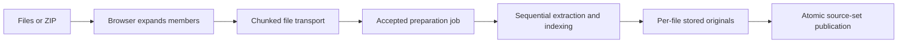

[Up one level](../01-section-overview/01-p-overview.md)

# Source ingestion

Generation needs the passage that supports a lesson objective, together with enough context to interpret it. Sending an entire PDF or code archive would spend context on unrelated material and obscure where a claim came from. Ingestion instead prepares retrievable text while retaining its page, heading or file location and the references to associated files.

## Prepare files before publishing their source set

New-course creation and source attachment use the same [browser ingestion module](../../../apps/web/services/projects/sourceIngestion.ts). It expands ZIP members one at a time and sends each member through the same chunked transport as a separate file. Keeping the ZIP container in the browser lets the backend prepare and store originals individually instead of holding an entire archive in memory.

Completion accepts preparation with HTTP 202. The client follows the authenticated import status route for per-file and per-step progress, then applies the saved snapshot. Publication checks ownership and revision, retains existing source references during partial replacement and returns usable sources alongside named failures. A server restart interrupts the process-local preparation job explicitly, allowing the client to report the failure rather than poll forever; this job has a different recovery boundary from durable generation workflows.

ZIP members are checked against declared size and CRC, and duplicate paths reject the selection. Browser-private filesystem streams provide staging where available; a bounded Blob path supports browsers without writable filesystem streams. Browsers missing the required decompression or streaming APIs require separately extracted files. The [server module](../../../apps/backend/src/projects/sourceIngestion.ts) and [shared transfer contract](../../../packages/shared-types/sourceTransfer.ts) own admission and transport limits, while [staging](../../../apps/backend/src/projects/sourceStaging.ts) enforces disk-backed temporary storage. Saved archive projects and backup restoration retain their own readers.

## Keep a PDF passage with its evidence

PDF extraction attempts to preserve layout and reading order, so selected text can still be understood as a passage. Figures keep their page and nearby text for the same reason: an image without its surrounding explanation may be the wrong evidence for an objective. Filtering removes likely decorative marks, while optional captions help retrieval identify informational candidates without replacing the source image. Figure extraction and captioning run in the backend lesson document stage, after the figure bytes are stored; an optional caption failure leaves the stored figure available.

A figure reference must resolve against the source version that supplied this context. If a PDF is replaced, retaining an earlier caption or placement could attach the new file to an old interpretation. [Asset lifecycle](../04-section-data/02-p-asset-management.md) explains how replacement refreshes those references.

Extraction also determines what downstream research can claim to cover. An isolated fallback parser can attempt the work when the primary path fails or is unavailable, and its result can carry a quality warning. Its memory budget derives from the individual input and output budgets, and its UTF-8 JSON protocol preserves mathematical Unicode across Bun and Node. Resource limits fail explicitly rather than presenting a truncated document as complete. Scanned or damaged PDFs may still yield too little usable text; [planning](01-p-course-gen.md#research-routing) separately decides whether the prepared evidence is sufficient.

## Preserve navigation for structured sources

Markdown headings give a selected section its place in the document. Code archives use a file index instead: generation or chat can search that index and retrieve particular indexed text files, retaining their paths and source version. This avoids flattening unrelated files into one passage and gives [contextual chat](07-p-chat-ui.md) a bounded retrieval target.

Start changes at [source text services](../../../apps/backend/src/services/projectSourceText.ts), [PDF text extraction](../../../apps/backend/src/services/pdfTextExtractor.ts) or [PDF image extraction](../../../apps/backend/src/services/pdfImageExtractor.ts), according to the lost context. Once preparation succeeds, [lesson generation](02-p-lesson-gen.md) selects and reviews how the evidence is used.
