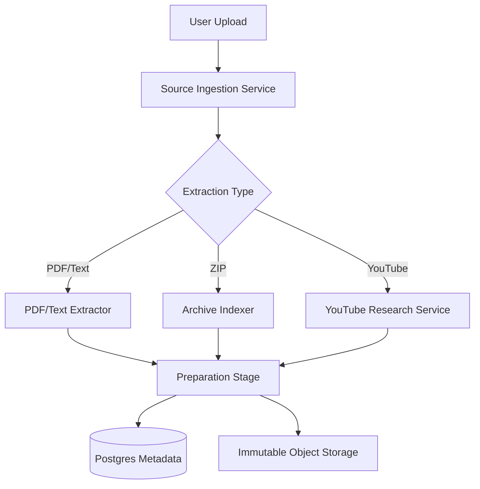
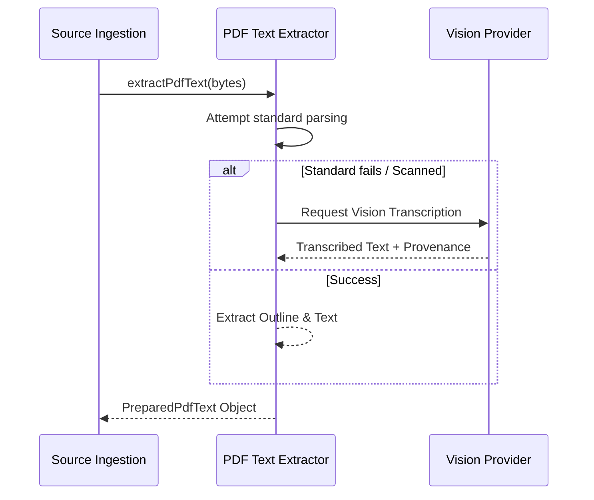

Relevant source files

The following files were used as context for generating this wiki page:

- [apps/backend/src/projects/sourceIngestion.ts](https://github.com/immagiov4/Nous/blob/21ec8b9ef2e9c48eae54d59ba738a6dc8f10dee6/apps/backend/src/projects/sourceIngestion.ts)
- [apps/backend/src/services/lessonGenerationSources.ts](https://github.com/immagiov4/Nous/blob/21ec8b9ef2e9c48eae54d59ba738a6dc8f10dee6/apps/backend/src/services/lessonGenerationSources.ts)
- [apps/backend/src/projects/postgresProjectStore.ts](https://github.com/immagiov4/Nous/blob/21ec8b9ef2e9c48eae54d59ba738a6dc8f10dee6/apps/backend/src/projects/postgresProjectStore.ts)
- [apps/backend/src/projects/sourceArchive.ts](https://github.com/immagiov4/Nous/blob/21ec8b9ef2e9c48eae54d59ba738a6dc8f10dee6/apps/backend/src/projects/sourceArchive.ts)
- [apps/backend/src/services/pdfTextExtractor.ts](https://github.com/immagiov4/Nous/blob/21ec8b9ef2e9c48eae54d59ba738a6dc8f10dee6/apps/backend/src/services/pdfTextExtractor.ts)
- [apps/backend/src/services/youtubeResearch.ts](https://github.com/immagiov4/Nous/blob/21ec8b9ef2e9c48eae54d59ba738a6dc8f10dee6/apps/backend/src/services/youtubeResearch.ts)

# Source Ingestion & Processing

Source Ingestion & Processing manages the lifecycle of transforming raw user uploads—such as PDFs, text files, and web links—into structured, searchable data for lesson generation. The system handles file extraction, text normalization, and metadata indexing to ensure that pedagogical content remains grounded in verified source material.

The pipeline ensures high availability and consistency by using asynchronous preparation for large files, collision-resistant storage, and transactional metadata updates. It supports various source kinds, including standalone documents, YouTube transcripts, and codebase archives.

Sources: [apps/backend/src/projects/sourceIngestion.ts](https://github.com/immagiov4/Nous/blob/21ec8b9ef2e9c48eae54d59ba738a6dc8f10dee6/apps/backend/src/projects/sourceIngestion.ts), [apps/backend/src/services/lessonGenerationSources.ts](https://github.com/immagiov4/Nous/blob/21ec8b9ef2e9c48eae54d59ba738a6dc8f10dee6/apps/backend/src/services/lessonGenerationSources.ts)

## System Architecture

The architecture separates raw file storage from structured metadata. The `PostgresProjectStore` coordinates the persistence of source metadata in a relational database, while the underlying bytes are stored as immutable objects.

### Data Flow Overview

The following diagram illustrates the flow from a user upload to a prepared project snapshot.

This flow ensures that large-scale processing, such as OCR or deep archive indexing, does not block the primary application database.

Sources: [apps/backend/src/projects/postgresProjectStore.ts](https://github.com/immagiov4/Nous/blob/21ec8b9ef2e9c48eae54d59ba738a6dc8f10dee6/apps/backend/src/projects/postgresProjectStore.ts), [apps/backend/src/projects/sourceIngestion.ts](https://github.com/immagiov4/Nous/blob/21ec8b9ef2e9c48eae54d59ba738a6dc8f10dee6/apps/backend/src/projects/sourceIngestion.ts)

## Source Ingestion Pipeline

The ingestion pipeline validates and prepares collections of sources for a project. It uses the `prepareSourceCollection` function to process multiple files, identifying unusable content and generating a `documentIndex`.

### Key Functions and Components

| Component | Responsibility |
| :--- | :--- |
| `prepareSourceCollection` | Orchestrates the extraction of text from uploaded files and updates the project snapshot. |
| `SourcePreparationUnusableError` | Reports failures when files contain no usable text or the parser fails. |
| `documentIndex` | A structured map of chunks, sequences, and heading paths used for retrieval. |
| `sourceHash` | Ensures that a prepared source is only reprocessed if the underlying bytes change. |

Sources: [apps/backend/src/projects/sourceIngestion.ts:24-150](https://github.com/immagiov4/Nous/blob/21ec8b9ef2e9c48eae54d59ba738a6dc8f10dee6/apps/backend/src/projects/sourceIngestion.ts#L24-L150), [apps/backend/tests/services/sourceIngestion.test.ts](https://github.com/immagiov4/Nous/blob/21ec8b9ef2e9c48eae54d59ba738a6dc8f10dee6/apps/backend/tests/services/sourceIngestion.test.ts)

### Processing Logic

1. **Extraction**: The system reads raw bytes from the temporary upload path.
2. **Indexing**: For each file, the system creates a `documentIndex` containing text chunks.
3. **Collision Handling**: It assigns collision-free identities to sources with the same name.
4. **Failure Reporting**: If every file in a collection is unusable, the system throws a `SourcePreparationUnusableError` with specific reasons (e.g., `no-usable-text`, `parser-failed`).

Sources: [apps/backend/src/projects/sourceIngestion.ts:160-200](https://github.com/immagiov4/Nous/blob/21ec8b9ef2e9c48eae54d59ba738a6dc8f10dee6/apps/backend/src/projects/sourceIngestion.ts#L160-L200), [apps/web/tests/services/projects/courseSources.test.ts](https://github.com/immagiov4/Nous/blob/21ec8b9ef2e9c48eae54d59ba738a6dc8f10dee6/apps/web/tests/services/projects/courseSources.test.ts)

## Document Extraction

The system utilizes specialized extractors for PDFs and text documents. PDF processing includes vision-based transcription for scanned pages to ensure high-fidelity text recovery.

### PDF Extraction Sequence

This sequence shows how the system handles PDF text extraction with a fallback mechanism for scanned documents.

PDF extraction enforces a soft timeout (default 90 seconds) to prevent resource exhaustion during long-running OCR tasks.

Sources: [apps/backend/src/services/pdfTextExtractor.ts](https://github.com/immagiov4/Nous/blob/21ec8b9ef2e9c48eae54d59ba738a6dc8f10dee6/apps/backend/src/services/pdfTextExtractor.ts), [apps/backend/tests/services/lessonGenerationSources.test.ts](https://github.com/immagiov4/Nous/blob/21ec8b9ef2e9c48eae54d59ba738a6dc8f10dee6/apps/backend/tests/services/lessonGenerationSources.test.ts)

## Archive and Codebase Processing

Archives (ZIP files) are treated as codebase sources. The `indexSourceArchive` function builds a lexicographic tree of the archive's contents while enforcing safety and size limits.

### Archive Constraints

* **Path Validation**: Rejects traversal (e.g., `../`), absolute, or duplicate paths.
* **Size Limits**: Enforces limits on entry count, per-file bytes, and total expanded bytes.
* **Metadata**: Generates a `representationHash` for the prepared index independently of the original ZIP hash.

Sources: [apps/backend/src/projects/sourceArchive.ts:50-250](https://github.com/immagiov4/Nous/blob/21ec8b9ef2e9c48eae54d59ba738a6dc8f10dee6/apps/backend/src/projects/sourceArchive.ts#L50-L250), [apps/backend/tests/projects/sourceArchive.test.ts](https://github.com/immagiov4/Nous/blob/21ec8b9ef2e9c48eae54d59ba738a6dc8f10dee6/apps/backend/tests/projects/sourceArchive.test.ts)

## Storage and Persistence

The `PostgresProjectStore` manages the atomic transition of project states. It stores source bytes in immutable object storage and links them via `object_path` references in the database.

### Transactional Integrity

When a project is saved, the store uses a single transaction to:
1. Create or update the `projects` row.
2. Insert source metadata into `project_sources`.
3. Save the `project_snapshots`.
4. Queue orphaned source objects for deletion if the transaction fails or if they are replaced.

Sources: [apps/backend/src/projects/postgresProjectStore.ts](https://github.com/immagiov4/Nous/blob/21ec8b9ef2e9c48eae54d59ba738a6dc8f10dee6/apps/backend/src/projects/postgresProjectStore.ts), [apps/backend/tests/projects/postgresProjectStore.test.ts](https://github.com/immagiov4/Nous/blob/21ec8b9ef2e9c48eae54d59ba738a6dc8f10dee6/apps/backend/tests/projects/postgresProjectStore.test.ts)

## Summary

Source Ingestion & Processing provides a robust framework for converting heterogeneous data into a unified format for pedagogical use. By combining vision-transcription fallbacks for PDFs, strict path validation for archives, and transactional persistence in Postgres, the system ensures that lesson generation is supported by reliable and traceable source material.
