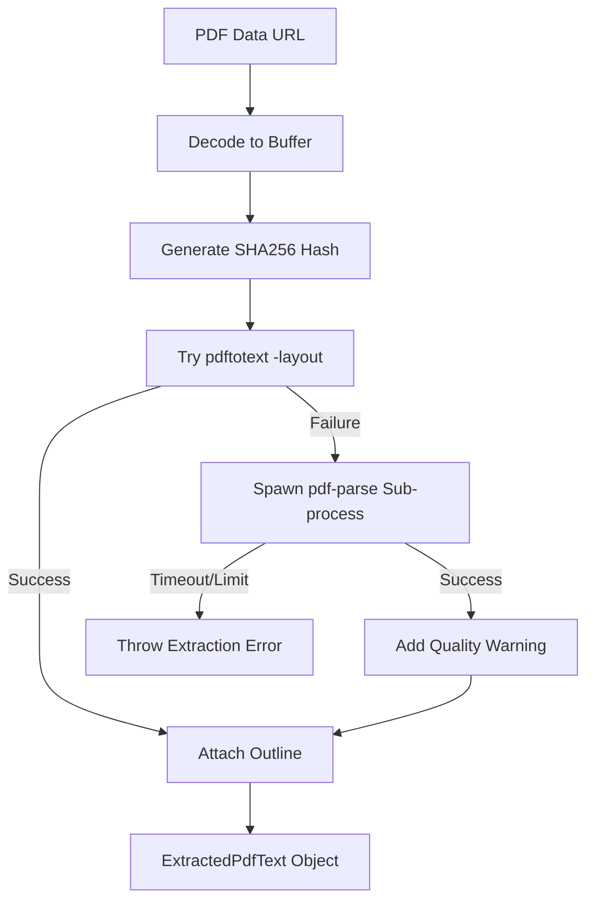
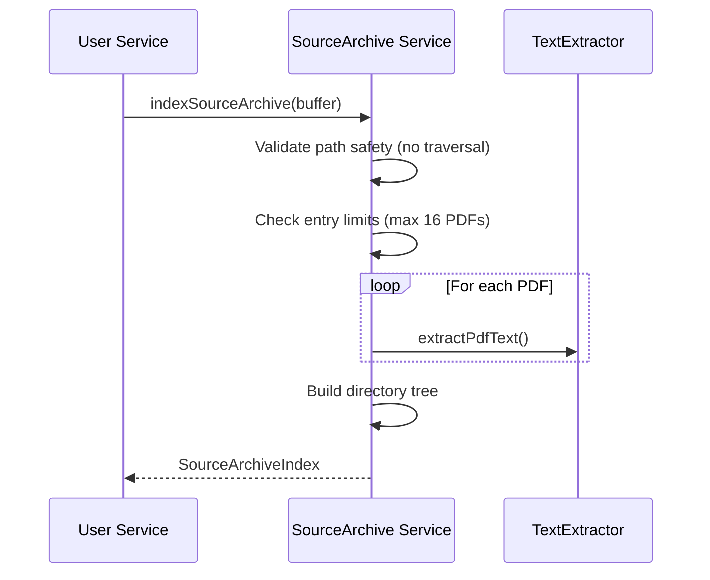

<details>
<summary>Relevant source files</summary>

The following files were used as context for generating this wiki page:

- [apps/backend/src/services/pdfTextExtractor.ts](../../../apps/backend/src/services/pdfTextExtractor.ts)
- [apps/backend/src/services/pdfImageExtractor.ts](../../../apps/backend/src/services/pdfImageExtractor.ts)
- [packages/shared-types/pdfTextIndex.ts](../../../packages/shared-types/pdfTextIndex.ts)
- [apps/backend/src/services/lessonGenerationSources.ts](../../../apps/backend/src/services/lessonGenerationSources.ts)
- [apps/web/services/projects/courseSources.ts](../../../apps/web/services/projects/courseSources.ts)
- [apps/backend/src/projects/postgresProjectStore.ts](../../../apps/backend/src/projects/postgresProjectStore.ts) (Referenced via tests)
- [apps/backend/src/projects/sourceArchive.ts](../../../apps/backend/src/projects/sourceArchive.ts) (Referenced via tests)

</details>

# Document Processing & PDF Extraction

Document Processing and PDF Extraction within the Nous platform is a multi-layered system designed to transform raw file uploads (PDFs, Markdown, and ZIP archives) into structured, queryable data for AI-driven lesson generation. The system handles text extraction, image recovery, and hierarchical indexing to ensure that pedagogical content remains grounded in the original source material.

The pipeline emphasizes resilience through a multi-parser fallback strategy for PDFs, ensuring that even complex layouts can be converted into usable text. This processed data is then segmented into semantic chunks and indexed by page number and heading path, allowing for precise citations within the generated lessons.

## Text Extraction Pipeline

The core of the document processing system is the `extractPdfText` function, which utilizes a primary high-fidelity parser with a robust fallback mechanism.

### Multi-Stage Parsing
1.  **pdftotext**: The primary parser. It is invoked via a sub-process with `-layout` flags to preserve the original visual structure, which is critical for table and column detection.
2.  **pdf-parse**: A secondary fallback parser utilized if `pdftotext` is missing from the environment or fails to produce output.
3.  **Fallback Process**: For memory safety and isolation, `pdf-parse` is often run in a dedicated Node.js sub-process (`pdfTextFallbackProcess.mjs`) with strict memory limits (`--max-old-space-size`).

Sources: [apps/backend/src/services/pdfTextExtractor.ts:326-373](../../../apps/backend/src/services/pdfTextExtractor.ts#L326-L373), [apps/backend/src/services/pdfTextExtractor.ts:149-198](../../../apps/backend/src/services/pdfTextExtractor.ts#L149-L198)



The diagram shows the decision flow between high-fidelity layout preservation and isolated fallback extraction. 
Sources: [apps/backend/src/services/pdfTextExtractor.ts:375-395](../../../apps/backend/src/services/pdfTextExtractor.ts#L375-L395)

### Extraction Specifications

| Parameter | Default / Limit | Description |
| :--- | :--- | :--- |
| `maxOutputBytes` | Variable | Caps the total text volume to prevent heap exhaustion. |
| `pdftotextTimeoutMs` | 15,000ms (Archive) | Max time allowed for the primary OS-level parser. |
| `fallbackTimeoutMs` | 15,000ms (Archive) | Max time for the isolated Node.js fallback process. |
| `max-old-space-size` | ~272MB (Typical) | Memory limit for the fallback sub-process. |

Sources: [apps/backend/tests/projects/sourceArchive.test.ts:114-120](../../../apps/backend/tests/projects/sourceArchive.test.ts#L114-L120), [apps/backend/tests/services/pdfTextExtractor.test.ts:86-90](../../../apps/backend/tests/services/pdfTextExtractor.test.ts#L86-L90)

### Scanned pages and transcription provenance

`completePdfTextExtraction` inspects every physical page after text extraction. Empty pages, replacement/control glyphs, letters, digits or operators lost between parser outputs, invisible scanner text layers, and a raster image covering the physical page bounds require recovery, even when a visible footer remains selectable. Cross-parser glyph counts use Unicode normalization and ignore layout punctuation and whitespace. If pdftotext lost symbols on an otherwise digital page, the PDF.js-backed text parser is tried for that page first. Usable text remains unchanged. Only pages still requiring recovery are rendered by PDF.js, with its bundled CMaps, fonts and WASM decoders, and sent to the configured vision provider.

The transcription contract returns complete Markdown with KaTeX math, or an explicit blank/unreadable status. Multiline formulas are canonicalized at their delimiters without changing symbols or matrix rows, then checked with the reader's normalization and KaTeX. An unreadable answer, a dominant prose-script mismatch against the original OCR layer (formulas excluded), or invalid math permits one further model request: a fresh image request for unreadable/wrong-script output, or a syntax correction otherwise. The page has a shared budget of two upstream requests, including transient transport failures, and a separate 150-second deadline for each attempt. The 75-second render deadline is separate from network attempts. A first-attempt timeout receives one fresh request within the same two-call budget. A remaining page failure clears that page's content and records its physical number without rejecting the other pages; genuinely blank pages carry no transcription marker and do not make an otherwise empty source usable.

A collection owns one bounded transcription pool, defaulting to 32 page requests across documents (PDF_TRANSCRIPTION_CONCURRENCY). The next PDF can prepare pages while earlier requests are in flight. Images reserve capacity before rendering and retain it until completion; the local path expands one source file at a time. Originals are staged on temporary disk while the network completes, then reopened one at a time to finalize entries in source order and preserve binary fallbacks. Temporary files and pool leases are released on completion or interruption. HTTP 429/5xx responses reduce concurrency multiplicatively and use the existing operational backoff and Retry-After handling within the same page request/deadline budget. The calibrated render width remains 1800 pixels and course-wide tier selection uses Luna xhigh for scanned pages 1–150 and Luna medium for 151–300, both pinned to OpenAI. Models, efforts and both thresholds have environment overrides. Admission beyond 300 stops transcription with a localized request to narrow the course material. Source-file boundaries do not reset the counter; usable text-layer pages are excluded. Collection logs expose peak requests, peak rendered images and backoff counts. Per-document logs contain source hashes, physical page numbers, reported usage/cost and safe upstream request/provider identifiers. Failed documents mark usage as incomplete because interrupted upstream requests may not report their consumption.

`POST /api/pdf/extract-text` supports NDJSON progress and retains its JSON response contract. Upload controllers show collection-wide scanned-page completion in their existing processing message. Stopping source preparation aborts the PDF request before an interview or draft exists. Valid page progress renews the existing request wait, allowing long documents to finish while a stalled stream still expires; no new total-page or price policy is introduced. JSON and streamed errors retain the same domain codes and source warnings. Archive extraction uses the same page completion module while keeping its existing archive size/admission policies. Prepared archive entries persist physical page byte ranges and provenance in `project_source_entries.pdf_pages`. Metadata is normalized through its shared schema before hashing, so JSONB key ordering preserves archive identity after reload; paginated reads and searches return the overlapping page metadata, and lesson evidence separates clean and transcribed pages before selection. The existing Node parser process returns UTF-8 JSON so mathematical Unicode survives transport into Bun.

Every transcribed page carries a machine-transcription marker in its text and a `vision-transcription` provenance record. Page-aware chunks retain `transcribedPages`, including chunks split after the marker. Prepared PDF text is stored with the source descriptor and reused only for its matching source hash, so course workflow stages and direct lesson-source recovery reuse the upload result. Evidence units retain the source page identities through lesson drafting and factual review. Only retained evidence units contribute playback provenance. Backup export/import and source reattachment preserve the source-bound prepared text. Playback carries typed `sourceProvenance` separately from lesson-wide descriptions into scene, mathematical pronunciation and motion requests. Multiple-source upload warnings preserve each failed document and page list, including when every selected PDF fails. Course and structured model adapters share `TRANSCRIBED_SOURCE_RULE`: outline, lesson, quiz and playback preparation must correct evident transcription slips from the supplied reasoning without inventing content. The existing factual-support policy accepts a justified correction with references to the transcribed evidence. Ambiguous handwriting remains uncertain; KaTeX validation proves syntax, not mathematical meaning.

Sources: [pdfPageTranscription.ts](../../../apps/backend/src/services/pdfPageTranscription.ts), [pdfTranscription.ts](../../../packages/shared-types/pdfTranscription.ts), [projectSourceText.ts](../../../apps/backend/src/services/projectSourceText.ts), [lessonFactualSupport.ts](../../../apps/backend/src/services/lessonFactualSupport.ts)

## Image Extraction & Contextualization

Beyond text, the system extracts standalone figures and images from PDFs using `pdfjs-dist`. Unlike simple extraction, this module attempts to reconstruct the semantic context surrounding each image.

### Filtering Logic
To avoid extracting incidental UI elements (icons, watermarks, or lines), the system applies strict thresholds based on both rendered and intrinsic dimensions.
*  **Standalone Figures**: Requires a minimum area (e.g., 24,000 intrinsic pixels) or specific side length ratios.
*  **Inline Images**: Higher area requirements to distinguish between decorative icons and substantive diagrams.

Sources: [apps/backend/src/services/pdfImageExtractor.ts:7-22](../../../apps/backend/src/services/pdfImageExtractor.ts#L7-L22), [apps/backend/src/services/pdfImageExtractor.ts:219-257](../../../apps/backend/src/services/pdfImageExtractor.ts#L219-L257)

### Optional Figure Captions

The lesson document stage stores extracted figure bytes before requesting optional Italian captions. For OpenRouter, `pdfImageCaption.ts` defaults to the image-capable `google/gemini-3.1-flash-lite` route; `MODEL_PDF_IMAGE_CAPTION` can override it. Caption failures remain optional and do not remove stored figures. Codex captions use the configured lesson model through the research provider slot.

### Spatial Context Reconstruction
The `buildLocalImageTextContext` function analyzes the `centerY` coordinates of text lines relative to the bounding box of the extracted image.
*  **textBefore**: The last 5 lines appearing above the image.
*  **textCurrent**: Lines overlapping the vertical span of the image.
*  **textAfter**: The first 5 lines appearing below the image.

Sources: [apps/backend/src/services/pdfImageExtractor.ts:98-120](../../../apps/backend/src/services/pdfImageExtractor.ts#L98-L120)

## Content Indexing and Segmentation

Once text is extracted, it is transformed into a `PdfTextIndex`. This structure is the basis for AI retrieval and user-facing citations.

### Chunking Strategy
Text is not stored as a single block but divided into `PdfTextChunk` objects.
*  **Target Size**: Chunks target approximately 8,000 characters (on web) or smaller semantic segments defined by headings.
*  **Heading Inference**: The system detects headings using regex patterns (e.g., `1.1 Concetti`) or visual cues (high ratio of uppercase/title-case characters).
*  **Overlapping**: Paragraphs are preserved, and chunks may include overlapping context to maintain flow.

Sources: [packages/shared-types/pdfTextIndex.ts:36-65](../../../packages/shared-types/pdfTextIndex.ts#L36-L65), [apps/web/services/projects/courseSources.ts:6-7](../../../apps/web/services/projects/courseSources.ts#L6-L7)

### Page Mapping
For PDF sources, every chunk is mapped to a physical page range. If exact layout data is missing, the system uses a progress-based estimation:
`startPage = floor(startOffset / totalChars * pageCount) + 1`

Sources: [packages/shared-types/pdfTextIndex.ts:118-136](../../../packages/shared-types/pdfTextIndex.ts#L118-L136)

## Source Archive Preparation

For `codebase` projects, the system processes ZIP archives. This involves a high-intensity "Admission" phase to prevent server overload.



The sequence illustrates the validation and selective extraction of PDF content hidden within source code archives.
Sources: [apps/backend/tests/projects/sourceArchive.test.ts:96-150](../../../apps/backend/tests/projects/sourceArchive.test.ts#L96-L150), [apps/backend/tests/projects/sourceArchive.test.ts:373-388](../../../apps/backend/tests/projects/sourceArchive.test.ts#L373-L388)

### Safety Constraints
*  **Path Validation**: Rejects traversal attacks (`../`), absolute paths, or duplicate entries.
*  **Safety Limits**: Caps PDF processing to the first 16 eligible files or a cumulative 64MB budget per archive to prevent DoS.
*  **Lexicographic Stability**: Archives are processed and indexed in a stable alphabetical order to ensure deterministic IDs.

Sources: [apps/backend/tests/projects/sourceArchive.test.ts:241-260](../../../apps/backend/tests/projects/sourceArchive.test.ts#L241-L260), [apps/backend/tests/projects/sourceArchive.test.ts:291-305](../../../apps/backend/tests/projects/sourceArchive.test.ts#L291-L305)

## Data Structures

### ExtractedPdfText
The primary result of a successful extraction.

```typescript
interface ExtractedPdfText {
  text: string;
  pages: ExtractedPdfTextPage[];
  sourceHash: string;
  parser: 'pdftotext' | 'pdf-parse';
  usedFallbackParser: boolean;
  outline: ExtractedPdfOutlineNode[];
  outlineOrigin: 'deterministic' | 'native' | 'none';
}
```

Sources: [apps/backend/src/services/pdfTextExtractor.ts:89-102](../../../apps/backend/src/services/pdfTextExtractor.ts#L89-L102)

### PdfTextChunk
The unit of content used during lesson generation.
| Field | Type | Description |
| :--- | :--- | :--- |
| `id` | `string` | Unique identifier (e.g., `source-hash:chunk-001`). |
| `text` | `string` | The actual text content. |
| `headingPath` | `string[]` | Hierarchy of headings leading to this chunk. |
| `pageStart` | `number` | The physical page where this chunk begins. |

Sources: [packages/shared-types/pdfTextIndex.ts:20-31](../../../packages/shared-types/pdfTextIndex.ts#L20-L31)

## Conclusion
The Document Processing system acts as a robust gateway between unstructured user uploads and structured pedagogical data. By combining isolated sub-process extraction for stability, dimension-based filtering for images, and semantic chunking for text, it provides a highly reliable foundation for generating accurate, cited educational content. Significant emphasis is placed on security and resource management, particularly when handling untrusted ZIP archives and complex PDF structures.
