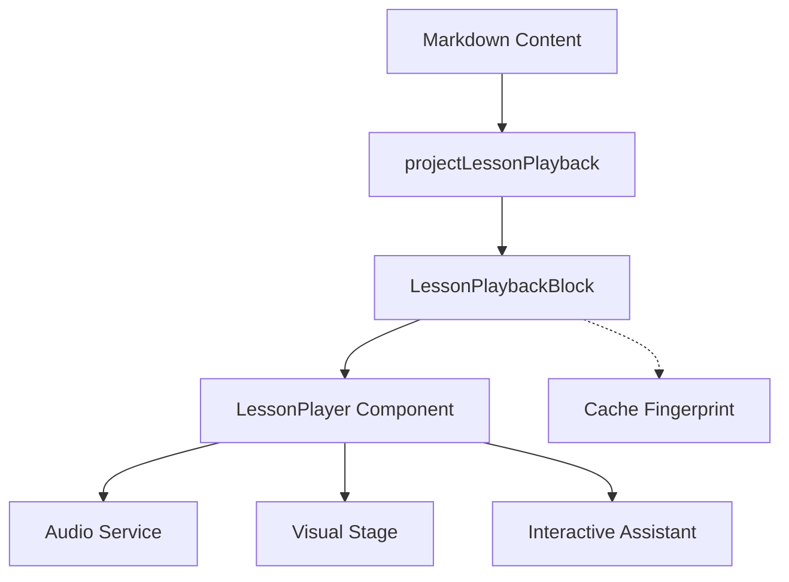
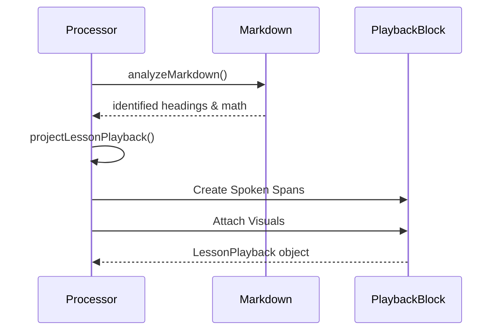
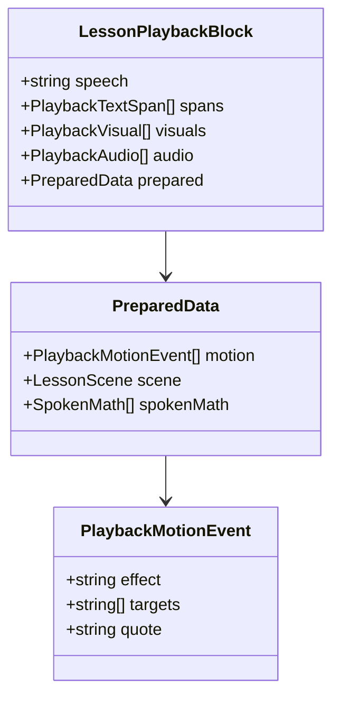

Relevant source files

The following files were used as context for generating this wiki page:

- [packages/shared-types/lessonPlayback.ts](https://github.com/immagiov4/Nous/blob/21ec8b9ef2e9c48eae54d59ba738a6dc8f10dee6/packages/shared-types/lessonPlayback.ts)
- [apps/web/components/workspace/playback/LessonPlayer.tsx](https://github.com/immagiov4/Nous/blob/21ec8b9ef2e9c48eae54d59ba738a6dc8f10dee6/apps/web/components/workspace/playback/LessonPlayer.tsx)
- [apps/backend/src/projects/lessonPlayback.ts](https://github.com/immagiov4/Nous/blob/21ec8b9ef2e9c48eae54d59ba738a6dc8f10dee6/apps/backend/src/projects/lessonPlayback.ts)
- [packages/shared-types/lessonPlaybackSchema.ts](https://github.com/immagiov4/Nous/blob/21ec8b9ef2e9c48eae54d59ba738a6dc8f10dee6/packages/shared-types/lessonPlaybackSchema.ts)
- [apps/backend/tests/projects/lessonPlayback.test.ts](https://github.com/immagiov4/Nous/blob/21ec8b9ef2e9c48eae54d59ba738a6dc8f10dee6/apps/backend/tests/projects/lessonPlayback.test.ts)
- [apps/backend/src/services/lessonScenes/lessonSceneGeneration.ts](https://github.com/immagiov4/Nous/blob/21ec8b9ef2e9c48eae54d59ba738a6dc8f10dee6/apps/backend/src/services/lessonScenes/lessonSceneGeneration.ts)

# Interactive Lesson Playback

Interactive Lesson Playback turns authored course documents into synchronized, narrated learning experiences. It integrates text-to-speech (TTS), visual reasoning through diagrams and scenes, and interactive conversation to help students understand complex subjects through a coherent sequence of explanations.

The system segments lesson content into discrete playback blocks, mapping spoken text to specific source markdown ranges. It ensures visual elements like LaTeX formulas and Mermaid diagrams appear exactly when the narration refers to them.

## System Architecture

The playback system operates across the web workspace and the backend. The `LessonPlayer` component manages the UI state, audio playback, and visual transitions, while shared types define the contracts for content segmentation and synchronization.

This diagram shows the flow from raw markdown to the interactive player interface. Sources: [packages/shared-types/lessonPlayback.ts](https://github.com/immagiov4/Nous/blob/21ec8b9ef2e9c48eae54d59ba738a6dc8f10dee6/packages/shared-types/lessonPlayback.ts), [apps/web/components/workspace/playback/LessonPlayer.tsx](https://github.com/immagiov4/Nous/blob/21ec8b9ef2e9c48eae54d59ba738a6dc8f10dee6/apps/web/components/workspace/playback/LessonPlayer.tsx)

### Key Architecture Components

| Component | Responsibility |
| :--- | :--- |
| `projectLessonPlayback` | Segments markdown and generated artifacts into narrated blocks. |
| `LessonPlayer` | Orchestrates audio, visual stage, and student follow-up questions. |
| `LessonPlaybackBlock` | Contains the speech text, visual metadata, and timing offsets for a segment. |
| `lessonPlaybackKey` | Generates a SHA-256 hash to invalidate stale audio when content changes. |

Sources: [packages/shared-types/lessonPlayback.ts:80-100](https://github.com/immagiov4/Nous/blob/21ec8b9ef2e9c48eae54d59ba738a6dc8f10dee6/packages/shared-types/lessonPlayback.ts#L80-L100), [apps/backend/src/projects/lessonPlayback.ts:57-73](https://github.com/immagiov4/Nous/blob/21ec8b9ef2e9c48eae54d59ba738a6dc8f10dee6/apps/backend/src/projects/lessonPlayback.ts#L57-L73)

## Content Segmentation and Projection

The system processes `PlaybackContentBlock` arrays to produce a `LessonPlayback`. This process involves identifying headings, extracting spoken text while omitting markdown syntax, and associating visual elements with the correct narrative context.

### Segmentation Logic
1.  **Markdown Analysis**: `analyzeMarkdown` scans text for headings, math ranges, and visual references.
2.  **Chunking**: `markdownChunks` groups text into heading, speech, or visual chunks based on structural boundaries.
3.  **Speech Projection**: `spokenText` removes markdown markers (like `**` or `_`) to create clean text for TTS, while `PlaybackTextSpan` objects maintain links back to the original UTF-16 source offsets.
4.  **Visual Attachment**: Standalone visuals ( Mermaid, tables, or generated images) attach to the narrated block that introduces them.

Sources: [packages/shared-types/lessonPlayback.ts:133-250](https://github.com/immagiov4/Nous/blob/21ec8b9ef2e9c48eae54d59ba738a6dc8f10dee6/packages/shared-types/lessonPlayback.ts#L133-L250), [packages/shared-types/lessonPlayback.ts:400-450](https://github.com/immagiov4/Nous/blob/21ec8b9ef2e9c48eae54d59ba738a6dc8f10dee6/packages/shared-types/lessonPlayback.ts#L400-L450)

The sequence depicts the transformation of raw content into structured playback blocks. Sources: [packages/shared-types/lessonPlayback.ts](https://github.com/immagiov4/Nous/blob/21ec8b9ef2e9c48eae54d59ba738a6dc8f10dee6/packages/shared-types/lessonPlayback.ts)

## Visual Synchronization

Playback supports multiple visual kinds, including standard markdown, Mermaid diagrams, and complex "Lesson Scenes."

### Visual Types
- **Markdown**: Renders formatted text or LaTeX.
- **Mermaid**: Renders sequence diagrams or flowcharts using the `MermaidRenderCache`.
- **Generated Visuals**: Pre-computed images or HTML artifacts.
- **Lesson Scenes**: Abstract structures like comparisons, checklists, and hierarchies defined in the `LESSON_SCENE_CATALOG`.

Sources: [packages/shared-types/lessonPlayback.ts:32-37](https://github.com/immagiov4/Nous/blob/21ec8b9ef2e9c48eae54d59ba738a6dc8f10dee6/packages/shared-types/lessonPlayback.ts#L32-L37), [apps/web/components/workspace/playback/LessonPlayer.tsx:78-100](https://github.com/immagiov4/Nous/blob/21ec8b9ef2e9c48eae54d59ba738a6dc8f10dee6/apps/web/components/workspace/playback/LessonPlayer.tsx#L78-L100)

### Spoken Math and Fenced Code
To ensure accurate narration of technical content:
- **Math**: The system Omits LaTeX formulas from initial projection until the model supplies a `spokenMath` pronunciation (e.g., "x squared" for `$x^2$`).
- **Fenced Code**: For ambiguous code blocks (marked `text` or `plaintext`), the system requires a decision to either treat it as "prose" for narration or "code" for display only.

Sources: [packages/shared-types/lessonPlayback.ts:795-815](https://github.com/immagiov4/Nous/blob/21ec8b9ef2e9c48eae54d59ba738a6dc8f10dee6/packages/shared-types/lessonPlayback.ts#L795-L815), [packages/shared-types/lessonPlaybackSchema.ts:168-180](https://github.com/immagiov4/Nous/blob/21ec8b9ef2e9c48eae54d59ba738a6dc8f10dee6/packages/shared-types/lessonPlaybackSchema.ts#L168-L180)

## Synchronization and Motion

The `LessonPlaybackBlock` contains a `prepared` field that defines `motion` events. These events trigger visual highlights or reveals synchronized with the narration.

The class diagram illustrates how motion events are nested within the playback block structure. Sources: [packages/shared-types/lessonPlayback.ts](https://github.com/immagiov4/Nous/blob/21ec8b9ef2e9c48eae54d59ba738a6dc8f10dee6/packages/shared-types/lessonPlayback.ts), [packages/shared-types/lessonPlaybackSchema.ts](https://github.com/immagiov4/Nous/blob/21ec8b9ef2e9c48eae54d59ba738a6dc8f10dee6/packages/shared-types/lessonPlaybackSchema.ts)

### Motion Events
- **Focus**: Highlights specific elements within a scene or diagram.
- **Reveal**: Gradually shows items as the narrator mentions them.
- **Targets**: Elements are targeted by stable IDs such as `node:id`, `edge:index`, or `group:index`.

Sources: [packages/shared-types/lessonPlayback.ts:44-75](https://github.com/immagiov4/Nous/blob/21ec8b9ef2e9c48eae54d59ba738a6dc8f10dee6/packages/shared-types/lessonPlayback.ts#L44-L75), [packages/shared-types/lessonPlaybackSchema.ts:50-70](https://github.com/immagiov4/Nous/blob/21ec8b9ef2e9c48eae54d59ba738a6dc8f10dee6/packages/shared-types/lessonPlaybackSchema.ts#L50-L70)

## Persistence and Reconciliation

The backend maintains the relationship between lesson content and generated playback data. Because TTS audio generation is expensive, the system uses a fingerprinting mechanism to reuse existing audio whenever possible.

### Cache Invalidation
The `lessonPlaybackKey` acts as a unique fingerprint. The system invalidates this key and drops the `playback` data if any of the following change:
- Main content blocks or lesson title/description.
- Projected speech text (affected by annotation changes).
- Hashes of referenced generated visuals.
- The `lastGenerationRunId`.

Sources: [apps/backend/src/projects/lessonPlayback.ts:57-75](https://github.com/immagiov4/Nous/blob/21ec8b9ef2e9c48eae54d59ba738a6dc8f10dee6/apps/backend/src/projects/lessonPlayback.ts#L57-L75), [apps/backend/tests/projects/lessonPlayback.test.ts:110-125](https://github.com/immagiov4/Nous/blob/21ec8b9ef2e9c48eae54d59ba738a6dc8f10dee6/apps/backend/tests/projects/lessonPlayback.test.ts#L110-L125)

### Data Reconciliation
`reconcileLessonPlayback` ensures that client-side saves do not overwrite server-prepared playback data. The server remains the authority for preparing and storing narration blocks.

Sources: [apps/backend/src/projects/lessonPlayback.ts:111-135](https://github.com/immagiov4/Nous/blob/21ec8b9ef2e9c48eae54d59ba738a6dc8f10dee6/apps/backend/src/projects/lessonPlayback.ts#L111-L135)

## Playback Data Model

### LessonPlayback Schema
| Field | Type | Description |
| :--- | :--- | :--- |
| `version` | `1` | Schema version indicator. |
| `lessonKey` | `string(64)` | SHA-256 fingerprint of the lesson state. |
| `blocks` | `LessonPlaybackBlock[]` | Ordered segments of the lesson. |

### LessonPlaybackBlock Schema
| Field | Type | Description |
| :--- | :--- | :--- |
| `id` | `string` | Stable block identifier. |
| `heading` | `string` | The active heading text for the block. |
| `speech` | `string` | The full text to be spoken by TTS. |
| `audio` | `PlaybackAudio[]` | Reference to MP3 assets and word-level onsets. |
| `visuals` | `PlaybackVisual[]` | Visual elements visible during this block. |

Sources: [packages/shared-types/lessonPlaybackSchema.ts:127-160](https://github.com/immagiov4/Nous/blob/21ec8b9ef2e9c48eae54d59ba738a6dc8f10dee6/packages/shared-types/lessonPlaybackSchema.ts#L127-L160)

## Observability

[Workflow state](../../../apps/backend/src/routes/workflows.ts) exposes preparation and alignment progress and failures. The [alignment workflow](../../../apps/backend/src/workflows/recordingAlignment.ts) also warns when alignment fails and stores a failed alignment result while retaining estimated timing. [Hook-and-stage integration tests](../../../apps/web/tests/hooks/reader/useLessonPlaybackAudio.integration.test.tsx) cover playback startup and audio-session failures. A playable recording can therefore still use estimated cues; successful preparation alone does not establish audible pronunciation quality or accurate synchronization.
