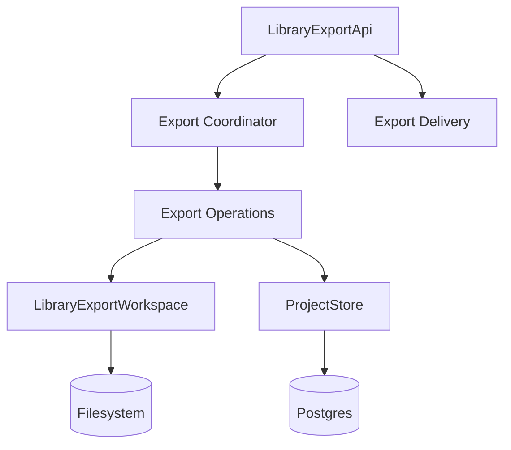
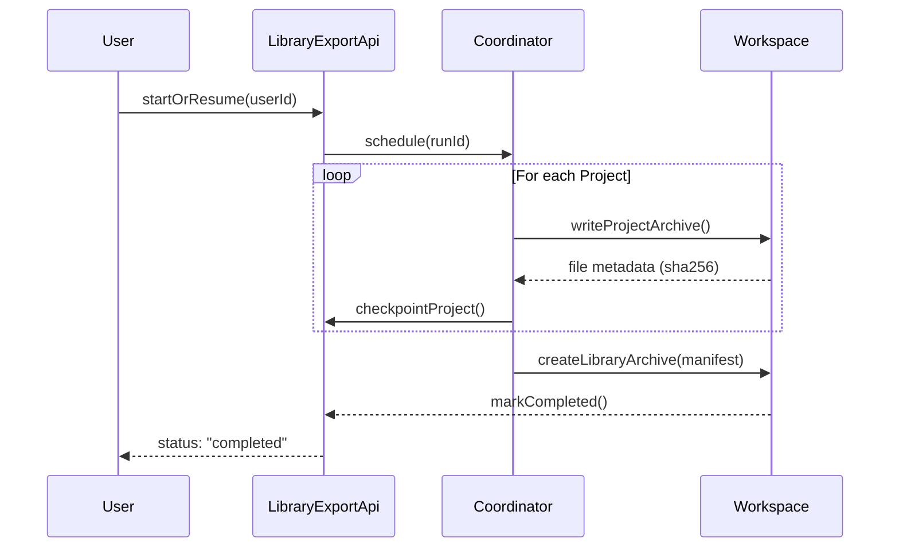

Relevant source files

The following files were used as context for generating this wiki page:

- [apps/backend/src/projects/libraryExport.ts](https://github.com/immagiov4/Nous/blob/21ec8b9ef2e9c48eae54d59ba738a6dc8f10dee6/apps/backend/src/projects/libraryExport.ts)
- [apps/backend/src/projects/libraryExportWorkspace.ts](https://github.com/immagiov4/Nous/blob/21ec8b9ef2e9c48eae54d59ba738a6dc8f10dee6/apps/backend/src/projects/libraryExportWorkspace.ts)
- [apps/backend/tests/projects/libraryExport.test.ts](https://github.com/immagiov4/Nous/blob/21ec8b9ef2e9c48eae54d59ba738a6dc8f10dee6/apps/backend/tests/projects/libraryExport.test.ts)
- [apps/backend/src/routes/chatPrompts.ts](https://github.com/immagiov4/Nous/blob/21ec8b9ef2e9c48eae54d59ba738a6dc8f10dee6/apps/backend/src/routes/chatPrompts.ts)
- [apps/backend/src/routes/libraryChat.ts](https://github.com/immagiov4/Nous/blob/21ec8b9ef2e9c48eae54d59ba738a6dc8f10dee6/apps/backend/src/routes/libraryChat.ts)
- [apps/backend/tests/routes/projects.test.ts](https://github.com/immagiov4/Nous/blob/21ec8b9ef2e9c48eae54d59ba738a6dc8f10dee6/apps/backend/tests/routes/projects.test.ts)

# Library & Workspace Export

The Library & Workspace Export system manages the generation, staging, and delivery of project archives and complete library backups. It allows you to package your learning materials, including project metadata, course structures, assets, and folders, into import-compatible ZIP archives for backup or migration.

The system ensures data integrity through SHA-256 checksums and uses a durable checkpoint mechanism to resume interrupted exports. It operates within a specialized workspace directory, managing temporary partial files before finalizing the delivery.

Sources: [apps/backend/src/projects/libraryExport.ts](https://github.com/immagiov4/Nous/blob/21ec8b9ef2e9c48eae54d59ba738a6dc8f10dee6/apps/backend/src/projects/libraryExport.ts), [apps/backend/src/projects/libraryExportWorkspace.ts](https://github.com/immagiov4/Nous/blob/21ec8b9ef2e9c48eae54d59ba738a6dc8f10dee6/apps/backend/src/projects/libraryExportWorkspace.ts)

## System Architecture

The export architecture coordinates between the database (ProjectStore), the physical file system (Workspace), and the client delivery mechanism.

The diagram shows the coordination between high-level API interfaces and the underlying persistence layers.
Sources: [apps/backend/src/projects/libraryExport.ts](https://github.com/immagiov4/Nous/blob/21ec8b9ef2e9c48eae54d59ba738a6dc8f10dee6/apps/backend/src/projects/libraryExport.ts), [apps/backend/tests/projects/libraryExport.test.ts](https://github.com/immagiov4/Nous/blob/21ec8b9ef2e9c48eae54d59ba738a6dc8f10dee6/apps/backend/tests/projects/libraryExport.test.ts)

### Key Components

| Component | Responsibility |
| :--- | :--- |
| `LibraryExportApi` | Provides the public interface for starting runs, checking status, and creating download access. |
| `LibraryExportCoordinator` | Manages global execution limits and schedules background tasks. |
| `LibraryExportWorkspace` | Resolves paths, writes project archives, and generates the final library ZIP. |
| `LibraryExportRunStore` | Persists the state of current and past export runs, including project checkpoints. |
| `LibraryExportDelivery` | Handles retention policies, cleanup, and one-time download token verification. |

Sources: [apps/backend/src/projects/libraryExport.ts](https://github.com/immagiov4/Nous/blob/21ec8b9ef2e9c48eae54d59ba738a6dc8f10dee6/apps/backend/src/projects/libraryExport.ts), [apps/backend/src/projects/libraryExportWorkspace.ts](https://github.com/immagiov4/Nous/blob/21ec8b9ef2e9c48eae54d59ba738a6dc8f10dee6/apps/backend/src/projects/libraryExportWorkspace.ts)

## Export Process Flow

An export run progresses through specific phases to ensure all projects are successfully archived before creating the master library manifest.

1.  **Preparation**: The system reads the user's library snapshot, identifying all projects, folders, and placements.
2.  **Project Archiving**: For each project, the system generates a backup archive containing project JSON and assets. It saves a checkpoint after each successful project write.
3.  **Library Archiving**: The system aggregates all project archives into a single library ZIP and includes a `manifest.json`.
4.  **Integrity Check**: The system verifies the final archive against expected byte sizes and SHA-256 hashes.
5.  **Ready**: The run completes, and the user can request a download token.

The sequence illustrates the progression from user request to background completion and checkpointing.
Sources: [apps/backend/src/projects/libraryExport.ts](https://github.com/immagiov4/Nous/blob/21ec8b9ef2e9c48eae54d59ba738a6dc8f10dee6/apps/backend/src/projects/libraryExport.ts), [apps/backend/src/projects/libraryExportWorkspace.ts](https://github.com/immagiov4/Nous/blob/21ec8b9ef2e9c48eae54d59ba738a6dc8f10dee6/apps/backend/src/projects/libraryExportWorkspace.ts), [apps/backend/tests/projects/libraryExport.test.ts](https://github.com/immagiov4/Nous/blob/21ec8b9ef2e9c48eae54d59ba738a6dc8f10dee6/apps/backend/tests/projects/libraryExport.test.ts)

## Workspace Management

The `LibraryExportWorkspace` handles file operations in a root directory defined by the `LIBRARY_EXPORT_ROOT` environment variable. It defaults to a `nous-library-exports` subfolder in the system's temporary directory.

### File Atomicity
To prevent corrupted downloads, the workspace writes data to `.partial` files. Once a write operation completes and the system verifies the data, it renames the partial file to its final destination.
Sources: [apps/backend/src/projects/libraryExportWorkspace.ts](https://github.com/immagiov4/Nous/blob/21ec8b9ef2e9c48eae54d59ba738a6dc8f10dee6/apps/backend/src/projects/libraryExportWorkspace.ts)

### Checkpoint Verification
The system uses checkpoints to avoid re-processing projects if a run is interrupted. A project is skipped if the existing file in the workspace matches the `archiveBytes` and `archiveSha256` stored in the checkpoint.
Sources: [apps/backend/src/projects/libraryExportWorkspace.ts](https://github.com/immagiov4/Nous/blob/21ec8b9ef2e9c48eae54d59ba738a6dc8f10dee6/apps/backend/src/projects/libraryExportWorkspace.ts), [apps/backend/src/projects/libraryExport.ts](https://github.com/immagiov4/Nous/blob/21ec8b9ef2e9c48eae54d59ba738a6dc8f10dee6/apps/backend/src/projects/libraryExport.ts)

## Resumability and Conflict Handling

The export system is designed to handle backend restarts and project modifications during a run.

*   **Process Interruption**: If the backend stops, the `recoverPendingRuns()` function identifies "running" tasks and re-schedules them using existing checkpoints.
*   **Stale Projects**: If a project selected for export is deleted or modified (revision change) before its checkpoint is written, the run fails with `LIBRARY_EXPORT_EXPECTED_PROJECT_CHANGED`.
*   **Identity Verification**: The system tracks `incarnationId` and `revision` for every project. It refuses to resume a run if the project identity in the database no longer matches the identity captured when the run started.

Sources: [apps/backend/src/projects/libraryExport.ts](https://github.com/immagiov4/Nous/blob/21ec8b9ef2e9c48eae54d59ba738a6dc8f10dee6/apps/backend/src/projects/libraryExport.ts), [apps/backend/tests/projects/libraryExport.test.ts](https://github.com/immagiov4/Nous/blob/21ec8b9ef2e9c48eae54d59ba738a6dc8f10dee6/apps/backend/tests/projects/libraryExport.test.ts)

## Delivery and Download

Downloads are protected by a one-time use token mechanism to ensure security and enforce retention policies.

1.  **Token Generation**: You call `createDownloadAccess(userId, runId)` to obtain a short-lived token.
2.  **Retrieval**: You use this token to POST to the download endpoint. The system verifies the token and streams the ZIP file.
3.  **Expiration**: Upon successful download, the system marks the run as "downloaded" and schedules immediate cleanup of the workspace files.
4.  **Retention**: Completed archives that are not downloaded are automatically reclaimed after a configurable retention period (defaulting to 24 hours).

Sources: [apps/backend/src/projects/libraryExport.ts](https://github.com/immagiov4/Nous/blob/21ec8b9ef2e9c48eae54d59ba738a6dc8f10dee6/apps/backend/src/projects/libraryExport.ts), [apps/backend/tests/projects/libraryExport.test.ts](https://github.com/immagiov4/Nous/blob/21ec8b9ef2e9c48eae54d59ba738a6dc8f10dee6/apps/backend/tests/projects/libraryExport.test.ts)

## Library Retrieval in Chat

The export system's logic regarding library structure is also utilized by the backend AI agents to provide library-aware responses.

Tools like `getProjectStructures` and `searchLibrary` allow the AI to navigate the same folders and placements used in the export manifest. This ensures that the "Whole Library Scope" mentioned in chat prompts matches the actual content available for export.

Sources: [apps/backend/src/routes/chatPrompts.ts](https://github.com/immagiov4/Nous/blob/21ec8b9ef2e9c48eae54d59ba738a6dc8f10dee6/apps/backend/src/routes/chatPrompts.ts), [apps/backend/src/routes/libraryChat.ts](https://github.com/immagiov4/Nous/blob/21ec8b9ef2e9c48eae54d59ba738a6dc8f10dee6/apps/backend/src/routes/libraryChat.ts)

## Summary

The Library & Workspace Export system provides a robust, background-processed pipeline for generating full library backups. It prioritizes data consistency through project-level checkpointing and file-system atomicity, while managing server resources through global execution limits and automated cleanup of expired or downloaded archives.

## Observability

The [project routes](../../../apps/backend/src/routes/projects.ts) report revision conflicts as HTTP 409 with an error code. [Library export](../../../apps/backend/src/projects/libraryExport.ts) exposes persisted progress and logs checkpoints, completion and failure with the export run, phase and elapsed time. The [database contract tests](../../../apps/backend/tests/projects/libraryExportRunStore.integration.test.ts) cover restart persistence and rejection of stale completion. These signals locate a rejected save or interrupted export; they do not explain the semantic differences between competing project edits.
