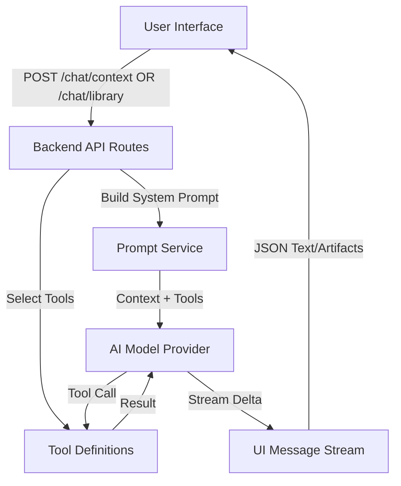
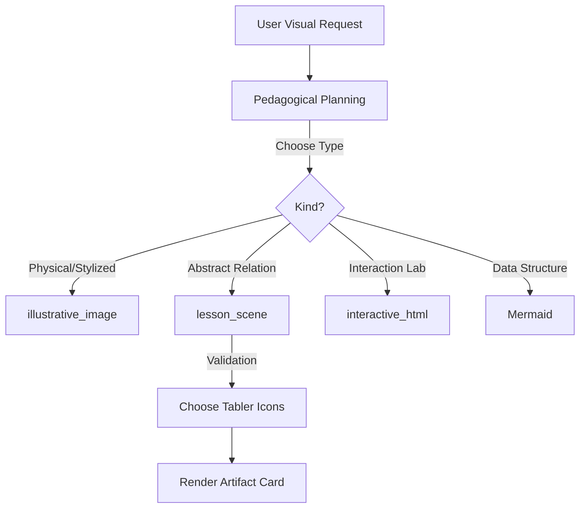

Relevant source files

The following files were used as context for generating this wiki page:

- [apps/backend/src/routes/chatPrompts.ts](https://github.com/immagiov4/Nous/blob/21ec8b9ef2e9c48eae54d59ba738a6dc8f10dee6/apps/backend/src/routes/chatPrompts.ts)
- [apps/backend/src/routes/contextChat.ts](https://github.com/immagiov4/Nous/blob/21ec8b9ef2e9c48eae54d59ba738a6dc8f10dee6/apps/backend/src/routes/contextChat.ts)
- [apps/backend/src/routes/libraryChat.ts](https://github.com/immagiov4/Nous/blob/21ec8b9ef2e9c48eae54d59ba738a6dc8f10dee6/apps/backend/src/routes/libraryChat.ts)
- [apps/backend/src/services/codexChatStream.ts](https://github.com/immagiov4/Nous/blob/21ec8b9ef2e9c48eae54d59ba738a6dc8f10dee6/apps/backend/src/services/codexChatStream.ts)
- [packages/shared-types/lessonVisualContracts.ts](https://github.com/immagiov4/Nous/blob/21ec8b9ef2e9c48eae54d59ba738a6dc8f10dee6/packages/shared-types/lessonVisualContracts.ts)
- [apps/backend/src/services/lessonScenes/lessonSceneGeneration.ts](https://github.com/immagiov4/Nous/blob/21ec8b9ef2e9c48eae54d59ba738a6dc8f10dee6/apps/backend/src/services/lessonScenes/lessonSceneGeneration.ts)
- [PROJECT_RULES.md](https://github.com/immagiov4/Nous/blob/21ec8b9ef2e9c48eae54d59ba738a6dc8f10dee6/PROJECT_RULES.md)

# Chat & Assistant UI

Nous provides an ADHD-friendly teaching assistant integrated into the reader environment. The system facilitates learning by offering contextual clarifications, external web research, and the generation of visual artifacts to supplement text-based lessons. It operates through two primary interfaces: **Context Chat**, which focuses on a specific lesson or passage, and **Library Chat**, which enables navigation and search across the entire learning library.

The assistant prioritizes active, pedagogical support. It transforms source material into accessible explanations, avoids conversational filler, and proactiveley suggests saving meaningful clarifications as notes to aid future study sessions.

Sources: [apps/backend/src/routes/chatPrompts.ts](https://github.com/immagiov4/Nous/blob/21ec8b9ef2e9c48eae54d59ba738a6dc8f10dee6/apps/backend/src/routes/chatPrompts.ts), [PROJECT_RULES.md](https://github.com/immagiov4/Nous/blob/21ec8b9ef2e9c48eae54d59ba738a6dc8f10dee6/PROJECT_RULES.md)

## System Architecture and Data Flow

The Chat UI utilizes a streaming architecture to provide real-time feedback. The backend routes incoming requests to AI models via providers like OpenRouter or Codex. These models interact with a suite of specialized tools to retrieve library data, search the web, or generate pedagogical visuals.

### AI Request Pipeline

1.  **Request Input**: The client sends the conversation history, user preferences, and the current study context (e.g., selected text, lesson content, or library scope).
2.  **Prompt Construction**: The backend builds a system prompt based on the specific chat scope and active user preferences.
3.  **Tool Attachment**: The system attaches relevant tools (e.g., `searchLibrary`, `generateCurrentLessonArtifact`) based on the request type.
4.  **Streaming Response**: The backend uses `streamText` or `createCodexChatStream` to pipe the AI response back to the UI, handling tool calls and multi-step reasoning internally.

The diagram shows the flow from user input through context-aware prompt building to the AI provider and back to the interface.
Sources: [apps/backend/src/routes/contextChat.ts](https://github.com/immagiov4/Nous/blob/21ec8b9ef2e9c48eae54d59ba738a6dc8f10dee6/apps/backend/src/routes/contextChat.ts), [apps/backend/src/services/codexChatStream.ts](https://github.com/immagiov4/Nous/blob/21ec8b9ef2e9c48eae54d59ba738a6dc8f10dee6/apps/backend/src/services/codexChatStream.ts)

## Chat Scopes and Prompts

The assistant operates within specific scopes to maintain pedagogical focus and ensure technical accuracy.

### Context Chat
Context Chat anchors the conversation to the current lesson. It supports three distinct scopes:
*   **Selection**: Focuses on a specific passage highlighted by the user.
*   **Lesson**: Addresses the entire open lesson.
*   **Annotation**: Relates to an existing note or highlight linked to a passage.

The system prompt enforces strict rules: the assistant must stay concrete, simplify explanations without losing content, and prefer original source material for factual grounding.
Sources: [apps/backend/src/routes/chatPrompts.ts](https://github.com/immagiov4/Nous/blob/21ec8b9ef2e9c48eae54d59ba738a6dc8f10dee6/apps/backend/src/routes/chatPrompts.ts), [apps/backend/src/routes/contextChat.ts](https://github.com/immagiov4/Nous/blob/21ec8b9ef2e9c48eae54d59ba738a6dc8f10dee6/apps/backend/src/routes/contextChat.ts)

### Library Chat
Library Chat manages the user's broader educational repository. It uses an **Autonomous Execution Plan** to fulfill requests:
1.  Scan scope using `getProjectStructures`.
2.  Identify candidate lessons based on progress or note timestamps.
3.  Retrieve specific content with `getLessonDetails`.
4.  Translate technical identifiers (like `projectId`) into natural language titles for the user.

Sources: [apps/backend/src/routes/chatPrompts.ts](https://github.com/immagiov4/Nous/blob/21ec8b9ef2e9c48eae54d59ba738a6dc8f10dee6/apps/backend/src/routes/chatPrompts.ts), [apps/backend/src/routes/libraryChat.ts](https://github.com/immagiov4/Nous/blob/21ec8b9ef2e9c48eae54d59ba738a6dc8f10dee6/apps/backend/src/routes/libraryChat.ts)

## Tool Integration

Tools extend the assistant's capabilities beyond simple text generation. Tools are rendered as self-contained cards in the UI and often appear above the assistant's text response.

| Tool Name | Scope | Purpose |
| :--- | :--- | :--- |
| `searchWeb` | Both | Performs external cross-checks to verify accuracy or retrieve recent facts. |
| `requestAddToNotes` | Context | Proposes saving a clarification or generated artifact to the student's notes. |
| `generateCurrentLessonArtifact` | Context | Generates temporary maps, charts, or interactive widgets for the current lesson. |
| `listLibraryTree` | Library | Explores the folder and course structure of the permitted scope. |
| `searchLibrary` | Library | Searches across titles, descriptions, and lesson content in the library. |
| `startCourseAssessment` | Library | Initiates an interview to create a new course when a topic is missing from the library. |

Sources: [apps/backend/src/routes/chatPrompts.ts](https://github.com/immagiov4/Nous/blob/21ec8b9ef2e9c48eae54d59ba738a6dc8f10dee6/apps/backend/src/routes/chatPrompts.ts), [apps/backend/src/routes/contextChat.ts](https://github.com/immagiov4/Nous/blob/21ec8b9ef2e9c48eae54d59ba738a6dc8f10dee6/apps/backend/src/routes/contextChat.ts), [apps/backend/src/routes/libraryChat.ts](https://github.com/immagiov4/Nous/blob/21ec8b9ef2e9c48eae54d59ba738a6dc8f10dee6/apps/backend/src/routes/libraryChat.ts)

### Tool Mandates
The assistant follows specific "Mandates" for tool usage:
*   **Web Priority**: Explicit user instructions to "search the web" override background preferences. Technical errors from the web search must be reported plainly.
*   **Rendering**: The assistant must not use dangling introductions (e.g., "I will do this:") and must never use positional references like "below" or "afterward" since the UI placement varies.
*   **Note Proactive Usage**: If a student resolves a doubt, the assistant proactively calls `requestAddToNotes` even without an explicit request, provided the information adds real value to future study.

Sources: [apps/backend/src/routes/chatPrompts.ts](https://github.com/immagiov4/Nous/blob/21ec8b9ef2e9c48eae54d59ba738a6dc8f10dee6/apps/backend/src/routes/chatPrompts.ts)

## Visual Artifact Generation

The assistant can generate and edit visual pedagogical aids. These artifacts are categorized by their rendering requirements.

### Artifact Kinds
*   **Illustrative Image**: Raster illustrations used for physical reality, perspective, and materials.
*   **Lesson Scene**: Abstract structures like flowcharts, hierarchies, timelines, or checklists.
*   **Interactive HTML**: Lab-like widgets where interaction is indispensable to explore concepts.
*   **Mermaid**: Entity-relationship diagrams (`erDiagram`) or object-oriented structures (`classDiagram`).

### Generation Logic
When a user asks for a visual, the assistant decides on a type and provides a prompt or structured data. For **Lesson Scenes**, the system reads the lesson, identifies a semantic relationship, and fills a structured schema (items, groups, values).

Pedagogical planning determines the format based on which clarifies the concept most effectively.
Sources: [packages/shared-types/lessonVisualContracts.ts](https://github.com/immagiov4/Nous/blob/21ec8b9ef2e9c48eae54d59ba738a6dc8f10dee6/packages/shared-types/lessonVisualContracts.ts), [apps/backend/src/services/lessonScenes/lessonSceneGeneration.ts](https://github.com/immagiov4/Nous/blob/21ec8b9ef2e9c48eae54d59ba738a6dc8f10dee6/apps/backend/src/services/lessonScenes/lessonSceneGeneration.ts)

## Summary

The Chat & Assistant UI in Nous transforms the learning experience from passive reading to active dialogue. By utilizing scoped contexts and specialized tools, the assistant provides grounded explanations and visual aids that align with the project's ADHD-friendly manifesto. The separation between Context Chat and Library Chat ensures that the assistant remains relevant whether the user is deep-diving into a single passage or managing their overall learning path.
