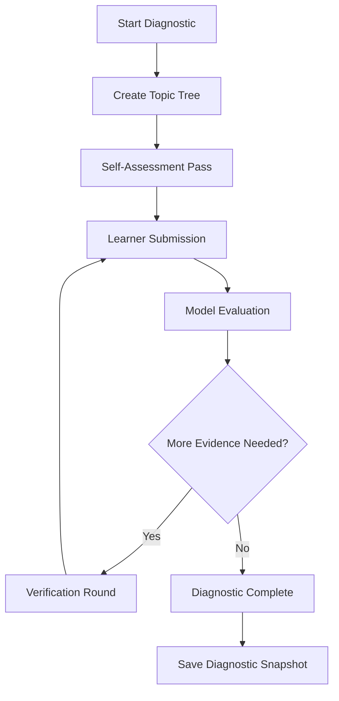
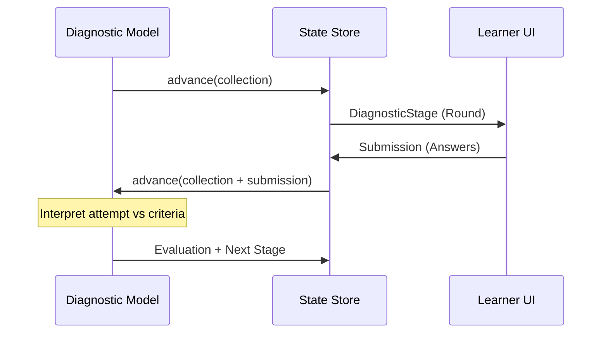

Relevant source files

The following files were used as context for generating this wiki page:

- [apps/backend/src/workflows/priorKnowledgeDiagnosticModel.ts](https://github.com/immagiov4/Nous/blob/21ec8b9ef2e9c48eae54d59ba738a6dc8f10dee6/apps/backend/src/workflows/priorKnowledgeDiagnosticModel.ts)
- [apps/backend/src/workflows/priorKnowledgeDiagnosticState.ts](https://github.com/immagiov4/Nous/blob/21ec8b9ef2e9c48eae54d59ba738a6dc8f10dee6/apps/backend/src/workflows/priorKnowledgeDiagnosticState.ts)
- [apps/backend/src/workflows/priorKnowledgeDiagnosticSnapshot.ts](https://github.com/immagiov4/Nous/blob/21ec8b9ef2e9c48eae54d59ba738a6dc8f10dee6/apps/backend/src/workflows/priorKnowledgeDiagnosticSnapshot.ts)
- [apps/backend/tests/workflows/courseDiagnostic.integration.test.ts](https://github.com/immagiov4/Nous/blob/21ec8b9ef2e9c48eae54d59ba738a6dc8f10dee6/apps/backend/tests/workflows/courseDiagnostic.integration.test.ts)
- [apps/backend/src/workflows/courseGenerationPreparation.ts](https://github.com/immagiov4/Nous/blob/21ec8b9ef2e9c48eae54d59ba738a6dc8f10dee6/apps/backend/src/workflows/courseGenerationPreparation.ts)
- [apps/backend/src/workflows/priorKnowledgeDiagnosticState.ts](https://github.com/immagiov4/Nous/blob/21ec8b9ef2e9c48eae54d59ba738a6dc8f10dee6/apps/backend/src/workflows/priorKnowledgeDiagnosticState.ts)

# Knowledge Diagnostics & Assessments

Knowledge Diagnostics and Assessments collect evidence regarding a learner's starting point before generating a course. The system evaluates a learner's prior knowledge through self-assessment and interactive rounds of tasks. This diagnostic protocol ensures that the generated course content aligns with the learner's existing proficiency and addresses specific knowledge gaps.

The diagnostic process is iterative and non-linear. It begins with a topic tree for self-reporting and evolves into verification rounds only when different responses could materially change the starting point of the course. The system preserves unresolved doubts as limitations rather than making forced assumptions about mastery.

Sources: [apps/backend/src/workflows/priorKnowledgeDiagnosticModel.ts](https://github.com/immagiov4/Nous/blob/21ec8b9ef2e9c48eae54d59ba738a6dc8f10dee6/apps/backend/src/workflows/priorKnowledgeDiagnosticModel.ts), [apps/backend/src/workflows/courseGenerationPreparation.ts](https://github.com/immagiov4/Nous/blob/21ec8b9ef2e9c48eae54d59ba738a6dc8f10dee6/apps/backend/src/workflows/courseGenerationPreparation.ts)

## Self-assessment interaction

Selecting “Non lo conosco” (`unfamiliar`) fills unanswered or previously inferred descendants with the same self-report and collapses the selected parent's branch. The learner can reopen the branch and explicitly change any subtopic. Other ratings do not propagate. Changing the parent away from `unfamiliar` clears answers inferred from that parent while preserving explicit descendant answers, including an explicitly selected `unfamiliar`. Every topic is still submitted individually; inferred answers use the normal self-report contract.

## Diagnostic Workflow Architecture

The diagnostic system operates as a state machine that transitions between an initial self-assessment and multiple rounds of active tasks. The backend workflow manages a `DiagnosticCollection`, which acts as the single source of truth for the entire interview session.

### Core Components

| Component | Responsibility |
| :--- | :--- |
| **Diagnostic Model** | Generates the topic tree, selects tasks for rounds, and evaluates collected evidence. |
| **Diagnostic Collection** | Stores nodes, passes (rounds), submissions, and the cumulative evaluations. |
| **Diagnostic Snapshot** | Provides an immutable record of a completed diagnostic for course planning. |
| **Verification Logic** | Compares learner attempts against criteria defined by the model for specific tasks. |

Sources: [apps/backend/src/workflows/priorKnowledgeDiagnosticModel.ts](https://github.com/immagiov4/Nous/blob/21ec8b9ef2e9c48eae54d59ba738a6dc8f10dee6/apps/backend/src/workflows/priorKnowledgeDiagnosticModel.ts), [apps/backend/src/workflows/priorKnowledgeDiagnosticState.ts](https://github.com/immagiov4/Nous/blob/21ec8b9ef2e9c48eae54d59ba738a6dc8f10dee6/apps/backend/src/workflows/priorKnowledgeDiagnosticState.ts)

### Diagnostic Lifecycle Flow

This diagram shows the iterative cycle between the model generating assessment stages and the learner providing evidence.

Sources: [apps/backend/src/workflows/priorKnowledgeDiagnosticModel.ts](https://github.com/immagiov4/Nous/blob/21ec8b9ef2e9c48eae54d59ba738a6dc8f10dee6/apps/backend/src/workflows/priorKnowledgeDiagnosticModel.ts), [apps/backend/tests/workflows/courseDiagnostic.integration.test.ts](https://github.com/immagiov4/Nous/blob/21ec8b9ef2e9c48eae54d59ba738a6dc8f10dee6/apps/backend/tests/workflows/courseDiagnostic.integration.test.ts)

## Data Models and State

The diagnostic state is preserved in the `DiagnosticCollection` structure. This collection tracks the progression of the interview across different "passes."

### Diagnostic Nodes and Topics
The system represents the subject matter as a tree of nodes. Nodes express containment rather than prerequisites.
- **Node IDs**: Stable identities allocated to model outputs, independent of topic titles.
- **Scope**: Each topic defines a clear scope for assessment.

### Evaluation and Interpretations
The model generates an evaluation after each submitted pass. Evaluations are cumulative and reflect the complete current state of evidence.
- **Interpretations**: Observations derived from actual submitted attempts against specific criteria.
- **Missing Information**: Records gaps where knowledge remains unobserved or self-reports are uncertain.
- **Conflicts**: Identifies where self-reports and observed performance results contradict each other.

Sources: [apps/backend/src/workflows/priorKnowledgeDiagnosticModel.ts:80-100](https://github.com/immagiov4/Nous/blob/21ec8b9ef2e9c48eae54d59ba738a6dc8f10dee6/apps/backend/src/workflows/priorKnowledgeDiagnosticModel.ts#L80-L100), [apps/backend/src/workflows/priorKnowledgeDiagnosticState.ts](https://github.com/immagiov4/Nous/blob/21ec8b9ef2e9c48eae54d59ba738a6dc8f10dee6/apps/backend/src/workflows/priorKnowledgeDiagnosticState.ts)

## Implementation of Verification Rounds

Verification rounds consist of one or more `DiagnosticTask` objects. Unlike the initial self-assessment, these tasks require the learner to demonstrate knowledge through specific response formats.

### Task Structure
Each task includes:
- **Claim**: A statement describing the specific knowledge being tested.
- **Criteria**: Observable evidence expected in the response to support the claim.
- **Response Format**: Defines if the task is a multiple-choice question or a text-based prompt.
- **Selection Reason**: Internal justification for why this task is necessary to determine the course starting point.

Sources: [apps/backend/src/workflows/priorKnowledgeDiagnosticModel.ts:25-35](https://github.com/immagiov4/Nous/blob/21ec8b9ef2e9c48eae54d59ba738a6dc8f10dee6/apps/backend/src/workflows/priorKnowledgeDiagnosticModel.ts#L25-L35)

### Task State Transitions
The system tracks the transition from a task definition to a learner's attempt and the subsequent evaluation.

Sources: [apps/backend/src/workflows/priorKnowledgeDiagnosticModel.ts:160-200](https://github.com/immagiov4/Nous/blob/21ec8b9ef2e9c48eae54d59ba738a6dc8f10dee6/apps/backend/src/workflows/priorKnowledgeDiagnosticModel.ts#L160-L200), [apps/backend/tests/workflows/courseDiagnostic.integration.test.ts](https://github.com/immagiov4/Nous/blob/21ec8b9ef2e9c48eae54d59ba738a6dc8f10dee6/apps/backend/tests/workflows/courseDiagnostic.integration.test.ts)

## Persistence and Course Integration

Completed diagnostics are persisted as `DiagnosticSnapshot` objects. These snapshots are immutable and are used by the course planning system to determine curriculum depth and content selection.

### Integration with Course Generation
During `courseGenerationPreparation`, the workflow loads the approved diagnostic evidence.
1. The system resolves the `diagnosticRef` from the project.
2. It projects the snapshot into `priorKnowledge` and `diagnosticEvidence`.
3. If no diagnostic was approved, it defaults to a `not-collected` state.

Sources: [apps/backend/src/workflows/courseGenerationPreparation.ts:80-105](https://github.com/immagiov4/Nous/blob/21ec8b9ef2e9c48eae54d59ba738a6dc8f10dee6/apps/backend/src/workflows/courseGenerationPreparation.ts#L80-L105), [apps/backend/src/workflows/priorKnowledgeDiagnosticSnapshot.ts](https://github.com/immagiov4/Nous/blob/21ec8b9ef2e9c48eae54d59ba738a6dc8f10dee6/apps/backend/src/workflows/priorKnowledgeDiagnosticSnapshot.ts)

### Database Schema for Snapshots
Snapshots are stored in the `prior_knowledge_diagnostic_snapshots` table, keyed by `user_id` and a unique reference containing the `projectId` and `incarnationId`.

Sources: [apps/backend/tests/workflows/courseDiagnostic.integration.test.ts:310-330](https://github.com/immagiov4/Nous/blob/21ec8b9ef2e9c48eae54d59ba738a6dc8f10dee6/apps/backend/tests/workflows/courseDiagnostic.integration.test.ts#L310-L330)

## Diagnostic Rules and Constraints

The system follows a strict set of instructional rules to maintain diagnostic integrity:
- **No Propagation**: The diagnostic model does not propagate knowledge inferences between parent and child nodes; the UI pre-fills learner-visible, editable self-reports when the learner rates a parent “Non lo conosco”.
- **Untrusted Self-Reports**: Self-reports (e.g., "basics", "independent") do not certify observed knowledge and are eligible for verification.
- **cumulative Interpretation**: Attempts are interpreted cumulativeley; earlier revisions are retained for audit.
- **No Grade**: Feedback on completion identifies what to revisit without assigning a numerical grade or mastery threshold.
- **Unresolved Doubts**: The model must preserve uncertainty as limitations rather than resolving them via heuristics.

Sources: [apps/backend/src/workflows/priorKnowledgeDiagnosticModel.ts:55-80](https://github.com/immagiov4/Nous/blob/21ec8b9ef2e9c48eae54d59ba738a6dc8f10dee6/apps/backend/src/workflows/priorKnowledgeDiagnosticModel.ts#L55-L80)

## Observability

The development route `/dev/diagnostic` exercises the self-assessment tree without providers or persistence, including a failed first submission. Inspect `DiagnosticState.inferredFrom` to identify which parent supplied an inferred answer, and `buildDiagnosticSubmission` to inspect the normal per-topic payload. `DiagnosticFlow.test.tsx` verifies cascade ownership, explicit answers and reopening.

The [lesson persistence tests](../../../apps/backend/tests/workflows/lessonGenerationPersistence.test.ts) inspect quiz answers before replacement, after commit and after compensation. For practical activities, the [feedback evaluator](../../../apps/web/services/openrouter/exercises/evaluation.ts) returns a score, summary, caveats and evaluation time; its [tests](../../../apps/web/tests/services/openrouter/exercises.evaluation.test.ts) cover normalization and invalid results. These are inspectable state and contract checks, not a measure of assessment accuracy: pedagogical validity and the justification for a model's score require reading the task, submission and feedback together.
