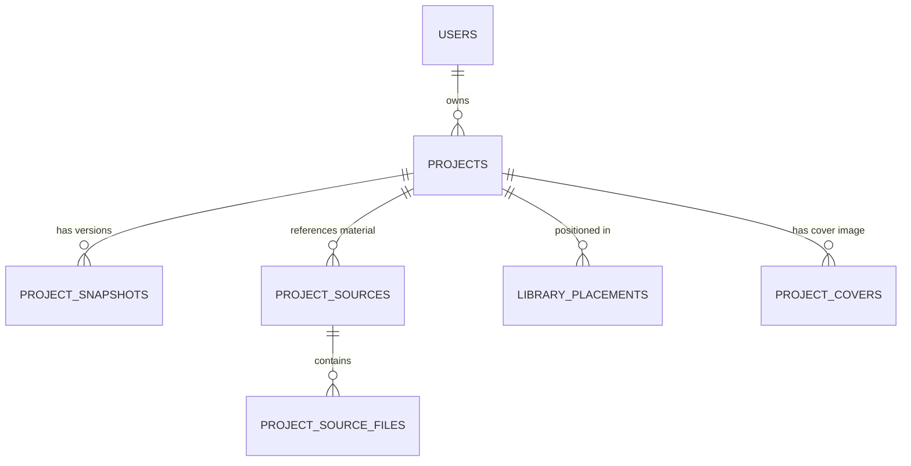
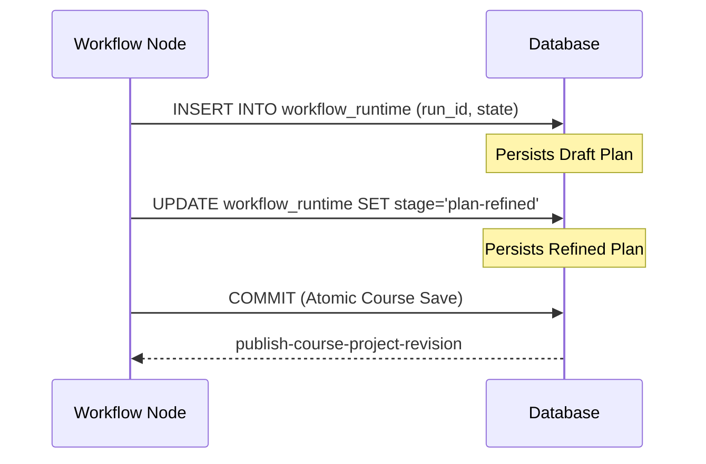

Relevant source files

The following files were used as context for generating this wiki page:

- [apps/backend/tests/integration/supabaseLocal.integration.test.ts](https://github.com/immagiov4/Nous/blob/21ec8b9ef2e9c48eae54d59ba738a6dc8f10dee6/apps/backend/tests/integration/supabaseLocal.integration.test.ts)
- [apps/backend/tests/projects/postgresProjectStore.test.ts](https://github.com/immagiov4/Nous/blob/21ec8b9ef2e9c48eae54d59ba738a6dc8f10dee6/apps/backend/tests/projects/postgresProjectStore.test.ts)
- [apps/backend/src/workflows/courseGenerationWorkflowContract.ts](https://github.com/immagiov4/Nous/blob/21ec8b9ef2e9c48eae54d59ba738a6dc8f10dee6/apps/backend/src/workflows/courseGenerationWorkflowContract.ts)
- [apps/backend/tests/workflows/courseGenerationWorkflow.test.ts](https://github.com/immagiov4/Nous/blob/21ec8b9ef2e9c48eae54d59ba738a6dc8f10dee6/apps/backend/tests/workflows/courseGenerationWorkflow.test.ts)
- [apps/web/tests/scripts/workflowPostgresCi.test.ts](https://github.com/immagiov4/Nous/blob/21ec8b9ef2e9c48eae54d59ba738a6dc8f10dee6/apps/web/tests/scripts/workflowPostgresCi.test.ts)

# Database Schema & Migrations

The database layer manages persistent storage for learning projects, workflow state, user feedback, and model configurations. It utilizes PostgreSQL, integrated with Supabase for authentication and Row-Level Security (RLS) to ensure data isolation between users. The schema is organized to support atomic project updates, complex course structures with module-based lesson hierarchies, and long-running AI workflow state.

Migrations are applied sequentially to define tables, indexes, and security policies. The system supports local development through Supabase local containers, ensuring parity between local environments and production deployments. Automated tests verify migration logic, RLS enforcement, and the integrity of complex data structures like project snapshots and document indexes.

Sources: [apps/backend/tests/integration/supabaseLocal.integration.test.ts](https://github.com/immagiov4/Nous/blob/21ec8b9ef2e9c48eae54d59ba738a6dc8f10dee6/apps/backend/tests/integration/supabaseLocal.integration.test.ts), [apps/web/tests/scripts/workflowPostgresCi.test.ts](https://github.com/immagiov4/Nous/blob/21ec8b9ef2e9c48eae54d59ba738a6dc8f10dee6/apps/web/tests/scripts/workflowPostgresCi.test.ts)

## Core Project Storage

The primary data structures center around learning projects. The system distinguishes between project metadata, which supports library listing and sorting, and detailed project snapshots containing the full pedagogical content.

### Entity Relationships

The following diagram illustrates the relationships between core project tables. Projects act as the root entity, linked to multiple snapshots for revision history and multiple sources for pedagogical reference material.

The database enforces a strict hierarchy where project assets are tied to specific user IDs to maintain tenant isolation.

Sources: [apps/backend/tests/projects/postgresProjectStore.test.ts](https://github.com/immagiov4/Nous/blob/21ec8b9ef2e9c48eae54d59ba738a6dc8f10dee6/apps/backend/tests/projects/postgresProjectStore.test.ts), [apps/backend/tests/integration/supabaseLocal.integration.test.ts](https://github.com/immagiov4/Nous/blob/21ec8b9ef2e9c48eae54d59ba738a6dc8f10dee6/apps/backend/tests/integration/supabaseLocal.integration.test.ts)

### Project Metadata & Snapshots

Projects are stored in `public.projects` with essential metadata. Detailed content is persisted in `public.project_snapshots` to optimize library listing performance.

| Table | Field | Type | Description |
| :--- | :--- | :--- | :--- |
| `projects` | `id` | UUID/String | Unique identifier for the project. |
| `projects` | `user_id` | UUID | Foreign key to the authenticated user. |
| `projects` | `meta` | JSONB | Contains title, lesson counts, and timestamps. |
| `projects` | `revision` | Integer | Incremental version counter for optimistic locking. |
| `project_snapshots` | `snapshot` | JSONB | The full [CourseLearningPlan](#learning-plan-structure). |

Optimistic locking is implemented using the `revision` column. Writes to a project or its snapshot must match the expected revision to prevent race conditions during concurrent edits.

Sources: [apps/backend/tests/projects/postgresProjectStore.test.ts](https://github.com/immagiov4/Nous/blob/21ec8b9ef2e9c48eae54d59ba738a6dc8f10dee6/apps/backend/tests/projects/postgresProjectStore.test.ts), [apps/backend/src/workflows/courseGenerationWorkflowContract.ts](https://github.com/immagiov4/Nous/blob/21ec8b9ef2e9c48eae54d59ba738a6dc8f10dee6/apps/backend/src/workflows/courseGenerationWorkflowContract.ts)

## Source & Asset Management

The system manages diverse source materials including PDFs, text files, and ZIP archives. Binary data is stored in private Supabase Storage buckets, while the database maintains integrity metadata and searchable indexes.

### Source File Structure

The `public.project_sources` table stores metadata for primary project materials. For multi-file sources, individual files are tracked in `public.project_source_files`.

*   **Integrity**: Sources are referenced by SHA-256 hashes.
*   **Storage Path**: Object paths follow a conventional structure: `users/{uid}/projects/{pid}/{source_id}/{hash}/original`.
*   **Deletions**: A specialized `public.project_source_deletions` table queues storage objects for removal when their database metadata is deleted, ensuring eventual consistency between the DB and Storage.

Sources: [apps/backend/tests/integration/supabaseLocal.integration.test.ts](https://github.com/immagiov4/Nous/blob/21ec8b9ef2e9c48eae54d59ba738a6dc8f10dee6/apps/backend/tests/integration/supabaseLocal.integration.test.ts), [apps/backend/tests/projects/postgresProjectStore.test.ts](https://github.com/immagiov4/Nous/blob/21ec8b9ef2e9c48eae54d59ba738a6dc8f10dee6/apps/backend/tests/projects/postgresProjectStore.test.ts)

### Archive Indexing

When ZIP archives are processed, the system generates a searchable index in `public.project_source_entries`. This index maps file paths within the archive to their respective storage objects and content previews.

| Column | Description |
| :--- | :--- |
| `project_id` | Reference to the parent project. |
| `path` | File or directory path within the archive. |
| `kind` | Type of entry (`file` or `directory`). |
| `preview` | Text excerpt for search and assistant context. |

Sources: [apps/backend/tests/projects/postgresProjectStore.test.ts](https://github.com/immagiov4/Nous/blob/21ec8b9ef2e9c48eae54d59ba738a6dc8f10dee6/apps/backend/tests/projects/postgresProjectStore.test.ts)

## Workflow Runtime State

AI-driven workflows, such as course generation, persist their intermediate state to allow for long-running task completion and recovery from failures.

### Persistence Lifecycle

The workflow persistence mechanism saves a `CoursePersistenceState` object. This state tracks the progress of planning, research, and generation stages.

The database ensures that the final "publication" of a course only happens after the atomic commit of all related project entities (project, snapshot, placements, and source metadata).

Sources: [apps/backend/src/workflows/courseGenerationWorkflowContract.ts](https://github.com/immagiov4/Nous/blob/21ec8b9ef2e9c48eae54d59ba738a6dc8f10dee6/apps/backend/src/workflows/courseGenerationWorkflowContract.ts), [apps/backend/tests/workflows/courseGenerationWorkflow.test.ts](https://github.com/immagiov4/Nous/blob/21ec8b9ef2e9c48eae54d59ba738a6dc8f10dee6/apps/backend/tests/workflows/courseGenerationWorkflow.test.ts)

## Security & Access Control

Row-Level Security (RLS) is the primary mechanism for data protection. Policies are defined for every table to restrict data access to the owning `user_id`.

*   **Project Isolation**: Users can only `SELECT`, `UPDATE`, or `DELETE` projects where `auth.uid() = user_id`.
*   **Feedback Privacy**: While users can submit feedback, the feedback inbox remains private through RLS, restricted to admin roles.
*   **Service Role**: A `service_role` bypasses RLS for administrative tasks like user management and cross-user diagnostics.

Sources: [apps/backend/tests/integration/supabaseLocal.integration.test.ts](https://github.com/immagiov4/Nous/blob/21ec8b9ef2e9c48eae54d59ba738a6dc8f10dee6/apps/backend/tests/integration/supabaseLocal.integration.test.ts)

## Feedback and Diagnostics

The database tracks user-submitted feedback and relates it to GitHub issues and internal diagnostics.

| Table | Purpose | Key Metadata |
| :--- | :--- | :--- |
| `feedback_reports` | Tracks bugs and feature requests. | `category`, `status`, `github_issue_number`. |
| `project_import_diagnostics` | Records failures during library imports. | `correlation_id`, `stage`, `error_code`. |

Import diagnostics are bounded by a retention window (e.g., 30 days) to prevent table bloat. Access to these records is restricted to users with the `admin` role in `app_metadata`.

Sources: [apps/backend/tests/integration/supabaseLocal.integration.test.ts](https://github.com/immagiov4/Nous/blob/21ec8b9ef2e9c48eae54d59ba738a6dc8f10dee6/apps/backend/tests/integration/supabaseLocal.integration.test.ts), [apps/backend/tests/projects/postgresProjectStore.test.ts](https://github.com/immagiov4/Nous/blob/21ec8b9ef2e9c48eae54d59ba738a6dc8f10dee6/apps/backend/tests/projects/postgresProjectStore.test.ts)

## Configuration Data

The `public.model_config` table stores global settings for AI providers and models.

*   **Global Record**: A single row with ID `global` contains the default configuration.
*   **Model Mapping**: Fields like `course_model`, `lesson_model`, and `context_model` map internal workflow slots to specific provider strings (e.g., `google/gemini-2.0-flash`).
*   **TTS Config**: Manages Text-to-Speech settings, including the current model and voice selected for pedagogical narration.

Sources: [apps/backend/tests/integration/supabaseLocal.integration.test.ts](https://github.com/immagiov4/Nous/blob/21ec8b9ef2e9c48eae54d59ba738a6dc8f10dee6/apps/backend/tests/integration/supabaseLocal.integration.test.ts)
