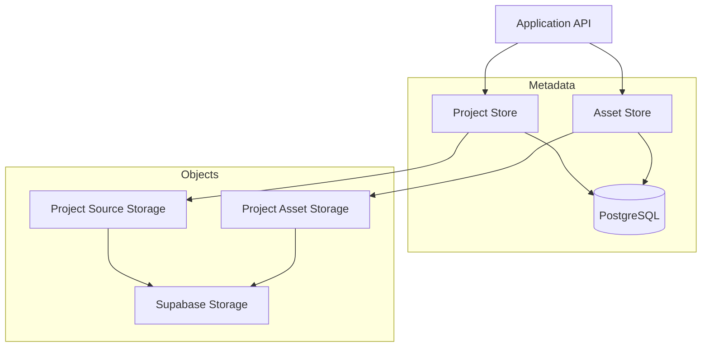
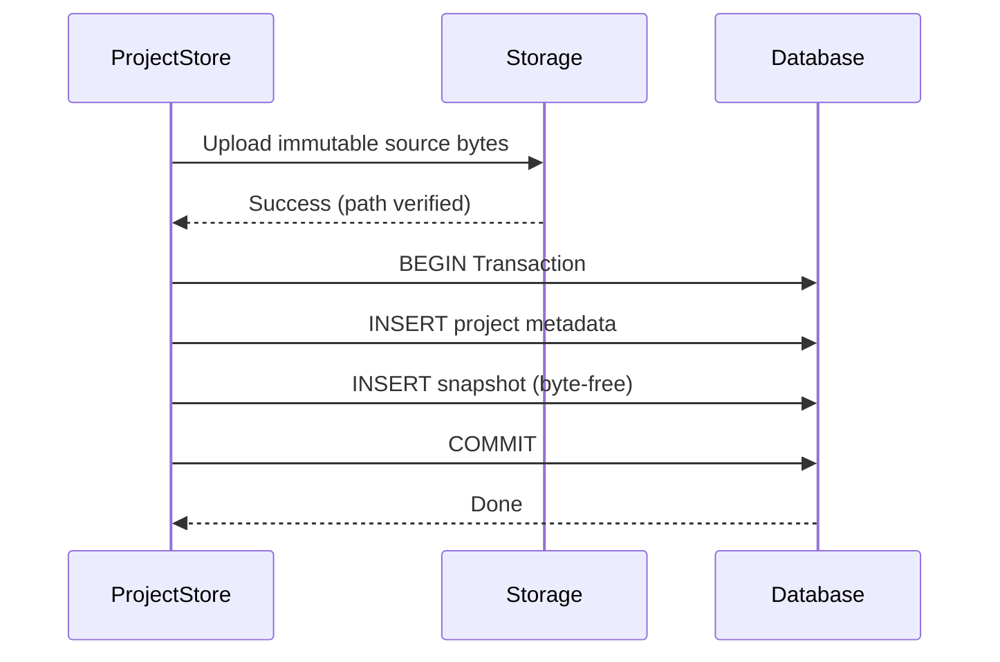

Relevant source files

The following files were used as context for generating this wiki page:

- [apps/backend/src/projects/postgresProjectStore.ts](https://github.com/immagiov4/Nous/blob/21ec8b9ef2e9c48eae54d59ba738a6dc8f10dee6/apps/backend/src/projects/postgresProjectStore.ts)
- [apps/backend/src/projects/postgresProjectAssetStore.ts](https://github.com/immagiov4/Nous/blob/21ec8b9ef2e9c48eae54d59ba738a6dc8f10dee6/apps/backend/src/projects/postgresProjectAssetStore.ts)
- [apps/backend/src/projects/projectSourceStorage.ts](https://github.com/immagiov4/Nous/blob/21ec8b9ef2e9c48eae54d59ba738a6dc8f10dee6/apps/backend/src/projects/projectSourceStorage.ts)
- [packages/shared-types/projectAsset.ts](https://github.com/immagiov4/Nous/blob/21ec8b9ef2e9c48eae54d59ba738a6dc8f10dee6/packages/shared-types/projectAsset.ts)
- [apps/backend/src/projects/projectAsset.ts](https://github.com/immagiov4/Nous/blob/21ec8b9ef2e9c48eae54d59ba738a6dc8f10dee6/apps/backend/src/projects/projectAsset.ts)
- [apps/backend/tests/projects/postgresProjectStore.test.ts](https://github.com/immagiov4/Nous/blob/21ec8b9ef2e9c48eae54d59ba738a6dc8f10dee6/apps/backend/tests/projects/postgresProjectStore.test.ts)
- [apps/backend/tests/integration/supabaseLocal.integration.test.ts](https://github.com/immagiov4/Nous/blob/21ec8b9ef2e9c48eae54d59ba738a6dc8f10dee6/apps/backend/tests/integration/supabaseLocal.integration.test.ts)

# Project & Asset Storage

The Project & Asset Storage system manages the persistence and retrieval of learning projects and their associated media assets. It uses a hybrid architecture that combines a PostgreSQL database for structured metadata with Supabase Storage for large binary objects. The system ensures data integrity through transactional metadata writes and immutable object storage.

Sources: [apps/backend/src/projects/postgresProjectStore.ts](https://github.com/immagiov4/Nous/blob/21ec8b9ef2e9c48eae54d59ba738a6dc8f10dee6/apps/backend/src/projects/postgresProjectStore.ts), [apps/backend/src/projects/projectAsset.ts](https://github.com/immagiov4/Nous/blob/21ec8b9ef2e9c48eae54d59ba738a6dc8f10dee6/apps/backend/src/projects/projectAsset.ts)

## System Architecture

The storage layer divides responsibilities between metadata management and binary large object (BLOB) handling. This separation allows the system to maintain small, performant database records while scaling to handle large PDF sources, ZIP archives, and generated images.

The following diagram shows the high-level relationship between the storage components:

The diagram illustrates how the API interacts with Project and Asset stores, which in turn coordinate activities between PostgreSQL and Supabase Storage.

Sources: [apps/backend/src/projects/postgresProjectStore.ts](https://github.com/immagiov4/Nous/blob/21ec8b9ef2e9c48eae54d59ba738a6dc8f10dee6/apps/backend/src/projects/postgresProjectStore.ts), [apps/backend/src/projects/projectSourceStorage.ts](https://github.com/immagiov4/Nous/blob/21ec8b9ef2e9c48eae54d59ba738a6dc8f10dee6/apps/backend/src/projects/projectSourceStorage.ts), [apps/backend/src/projects/postgresProjectAssetStore.ts](https://github.com/immagiov4/Nous/blob/21ec8b9ef2e9c48eae54d59ba738a6dc8f10dee6/apps/backend/src/projects/postgresProjectAssetStore.ts)

## Project Storage

The `PostgresProjectStore` manages the lifecycle of projects, including creation, updates (revisions), and deletion. It stores project snapshots as JSONB columns in PostgreSQL and refers to source files via deterministic object paths.

### Metadata Tables
| Table | Description |
| :--- | :--- |
| `public.projects` | Core project metadata including title, counts, and revision number. |
| `public.project_snapshots` | Deep JSONB snapshots of the project state at specific revisions. |
| `public.project_sources` | Metadata for primary project source files (e.g., PDFs). |
| `public.project_source_files` | References to secondary or multi-source document fragments. |
| `public.project_source_entries` | Index entries for ZIP archive contents. |

Sources: [apps/backend/tests/projects/postgresProjectStore.test.ts](https://github.com/immagiov4/Nous/blob/21ec8b9ef2e9c48eae54d59ba738a6dc8f10dee6/apps/backend/tests/projects/postgresProjectStore.test.ts), [apps/backend/tests/integration/supabaseLocal.integration.test.ts](https://github.com/immagiov4/Nous/blob/21ec8b9ef2e9c48eae54d59ba738a6dc8f10dee6/apps/backend/tests/integration/supabaseLocal.integration.test.ts)

### Transactional Integrity
The system uses PostgreSQL transactions to ensure that metadata and object references remain synchronized. When a project is saved, the store first uploads bytes to immutable storage and then commits the metadata. If the metadata commit fails, the system provides a cleanup mechanism to remove the orphaned object.

The sequence shows the "upload-then-commit" pattern used to ensure that snapshots never reference non-existent storage objects.

Sources: [apps/backend/src/projects/postgresProjectStore.ts](https://github.com/immagiov4/Nous/blob/21ec8b9ef2e9c48eae54d59ba738a6dc8f10dee6/apps/backend/src/projects/postgresProjectStore.ts), [apps/backend/tests/projects/postgresProjectStore.test.ts](https://github.com/immagiov4/Nous/blob/21ec8b9ef2e9c48eae54d59ba738a6dc8f10dee6/apps/backend/tests/projects/postgresProjectStore.test.ts)

## Asset Management

Assets are media objects generated or referenced during the learning process, such as images in HTML artifacts. Unlike primary project sources, assets have a lifecycle tied to workflow runs and node instances.

### Staging and Adoption
Assets follow a two-stage lifecycle:
1.  **Staging**: Assets are uploaded with a `staged` state. They are assigned an `idempotencyKey` based on the workflow run.
2.  **Adoption**: When a project snapshot is successfully saved and references these assets, their state changes to `active`.

Unadopted assets or those belonging to failed workflow runs are eventually cleaned up by a background process.

Sources: [apps/backend/src/projects/postgresProjectAssetStore.ts](https://github.com/immagiov4/Nous/blob/21ec8b9ef2e9c48eae54d59ba738a6dc8f10dee6/apps/backend/src/projects/postgresProjectAssetStore.ts), [apps/backend/src/projects/projectAsset.ts](https://github.com/immagiov4/Nous/blob/21ec8b9ef2e9c48eae54d59ba738a6dc8f10dee6/apps/backend/src/projects/projectAsset.ts)

### Deterministic Object Paths
The system generates storage paths using SHA-256 hashes of the file content and identity metadata. This ensures that identical files within the same project context share storage while remaining isolated across different users.

| Path Component | Logic |
| :--- | :--- |
| `users/{userId}` | Primary tenant isolation. |
| `projects/{projectHash}` | Hash of the project ID for secondary isolation. |
| `assets/{identityHash}` | Hash of (userId, projectId, runId, nodeInstanceId, idempotencyKey). |
| `{contentHash}` | SHA-256 of the binary content. |

Sources: [apps/backend/src/projects/projectAsset.ts:89-106](https://github.com/immagiov4/Nous/blob/21ec8b9ef2e9c48eae54d59ba738a6dc8f10dee6/apps/backend/src/projects/projectAsset.ts#L89-L106)

## Storage Implementation

The `SupabaseProjectSourceStorage` class implements the `ProjectAssetObjectStorage` interface. It uses the Supabase Storage API over HTTP to manage buckets.

Key operations include:
-   `upload`: Writes bytes with `x-upsert: false` to enforce immutability.
-   `download`: Retrieves bytes and verifies integrity using the expected byte size and hash.
-   `delete`: Removes objects from the storage bucket.

Sources: [apps/backend/src/projects/projectSourceStorage.ts](https://github.com/immagiov4/Nous/blob/21ec8b9ef2e9c48eae54d59ba738a6dc8f10dee6/apps/backend/src/projects/projectSourceStorage.ts), [apps/backend/src/projects/projectAsset.ts:24-33](https://github.com/immagiov4/Nous/blob/21ec8b9ef2e9c48eae54d59ba738a6dc8f10dee6/apps/backend/src/projects/projectAsset.ts#L24-L33)

## Cleanup and Reconciliation

The system maintains data hygiene through a deletion queue. When a project is deleted or a source is replaced, the metadata is removed transactionally, and the object paths are added to `public.project_asset_deletions` or `public.project_source_deletions`.

A worker claims these paths using advisory locks to perform the actual deletion from Supabase Storage without blocking user-facing requests.

Sources: [apps/backend/src/projects/postgresProjectStore.ts](https://github.com/immagiov4/Nous/blob/21ec8b9ef2e9c48eae54d59ba738a6dc8f10dee6/apps/backend/src/projects/postgresProjectStore.ts), [apps/backend/tests/projects/postgresProjectStore.test.ts](https://github.com/immagiov4/Nous/blob/21ec8b9ef2e9c48eae54d59ba738a6dc8f10dee6/apps/backend/tests/projects/postgresProjectStore.test.ts)

## Conclusion

The Project & Asset Storage system provides a robust foundation for learning data by combining transactional metadata with immutable BLOB storage. By utilizing deterministic hashing and a two-stage asset lifecycle, the system ensures that project snapshots are always consistent and that storage resources are efficiently managed.
