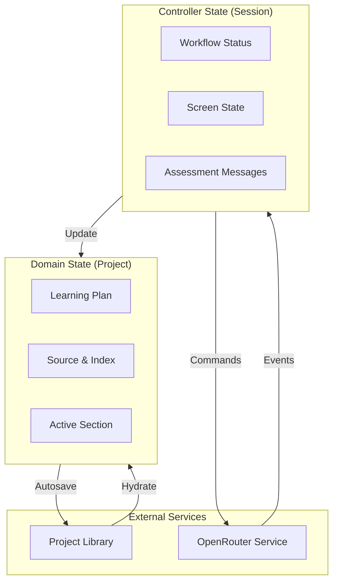
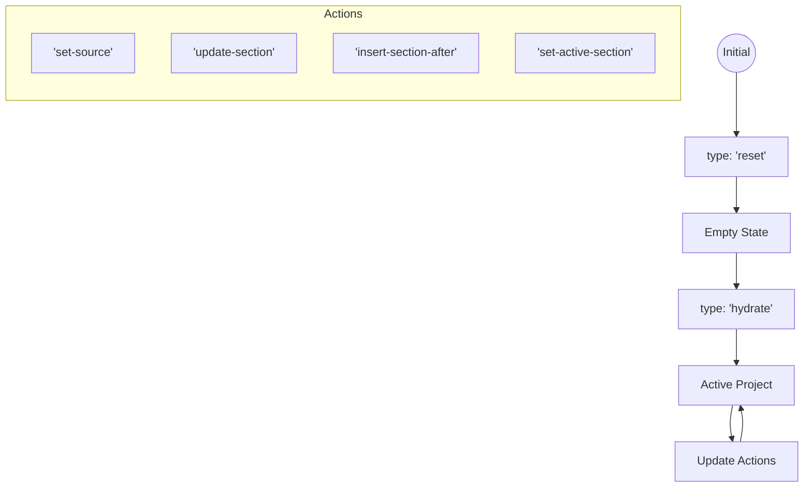
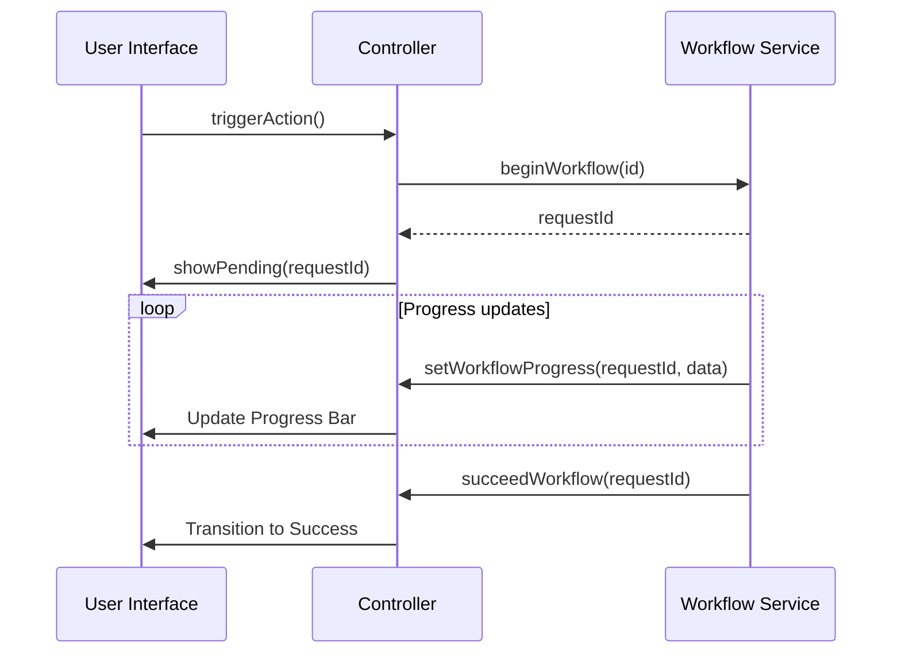

Relevant source files

The following files were used as context for generating this wiki page:

- [apps/web/hooks/workspace/controller/state.ts](https://github.com/immagiov4/Nous/blob/21ec8b9ef2e9c48eae54d59ba738a6dc8f10dee6/apps/web/hooks/workspace/controller/state.ts)
- [apps/web/hooks/workspace/useWorkspaceDomain.ts](https://github.com/immagiov4/Nous/blob/21ec8b9ef2e9c48eae54d59ba738a6dc8f10dee6/apps/web/hooks/workspace/useWorkspaceDomain.ts)
- [apps/web/services/workspace/domain.ts](https://github.com/immagiov4/Nous/blob/21ec8b9ef2e9c48eae54d59ba738a6dc8f10dee6/apps/web/services/workspace/domain.ts)
- [apps/web/services/workspace/workflow.ts](https://github.com/immagiov4/Nous/blob/21ec8b9ef2e9c48eae54d59ba738a6dc8f10dee6/apps/web/services/workspace/workflow.ts)
- [apps/web/hooks/workspace/controller/controllerContext.ts](https://github.com/immagiov4/Nous/blob/21ec8b9ef2e9c48eae54d59ba738a6dc8f10dee6/apps/web/hooks/workspace/controller/controllerContext.ts)
- [apps/web/hooks/workspace/controller/types.ts](https://github.com/immagiov4/Nous/blob/21ec8b9ef2e9c48eae54d59ba738a6dc8f10dee6/apps/web/hooks/workspace/controller/types.ts)

# Workspace State Management

Workspace State Management coordinates the reactive data flow between the persistent project library, the active learning domain, and asynchronous generation workflows. It ensures that the user interface stays synchronized with the underlying course data, playback progress, and background AI operations.

## Architecture Overview

The system architecture separates transient session state from the authoritative domain data. The `useWorkspaceControllerState` hook manages UI-specific states like navigation, diagnostic adapters, and active workflow statuses. Authoritative project data resides in the `WorkspaceDomainState`, which is modified through a centralized reducer pattern.

The following diagram illustrates the relationship between the controller state, the domain state, and the external library services:

Sources: [apps/web/hooks/workspace/controller/state.ts](https://github.com/immagiov4/Nous/blob/21ec8b9ef2e9c48eae54d59ba738a6dc8f10dee6/apps/web/hooks/workspace/controller/state.ts), [apps/web/services/workspace/domain.ts](https://github.com/immagiov4/Nous/blob/21ec8b9ef2e9c48eae54d59ba738a6dc8f10dee6/apps/web/services/workspace/domain.ts), [apps/web/hooks/workspace/controller/controllerContext.ts](https://github.com/immagiov4/Nous/blob/21ec8b9ef2e9c48eae54d59ba738a6dc8f10dee6/apps/web/hooks/workspace/controller/controllerContext.ts)

## Workspace Domain State

The `WorkspaceDomainState` represents the complete state of a learning project. It includes the course content, user preferences, and research data. The `workspaceDomainReducer` handles all modifications to this state, ensuring atomic updates for complex structures like the `LearningPlan`.

### Domain Components

| Field | Description |
| :--- | :--- |
| `source` | The primary input material (PDF, ZIP, or Text). |
| `learningPlan` | The hierarchical structure of modules and lessons. |
| `documentIndex` | The processed text index for source material. |
| `userProfile` | Learner-specific preferences and assessment data. |
| `activeSectionId` | The ID of the lesson or exercise currently in view. |
| `researchDossiers` | External context gathered for lesson generation. |

Sources: [apps/web/services/workspace/domain.ts:9-25](https://github.com/immagiov4/Nous/blob/21ec8b9ef2e9c48eae54d59ba738a6dc8f10dee6/apps/web/services/workspace/domain.ts#L9-L25), [apps/web/hooks/workspace/controller/types.ts:46-77](https://github.com/immagiov4/Nous/blob/21ec8b9ef2e9c48eae54d59ba738a6dc8f10dee6/apps/web/hooks/workspace/controller/types.ts#L46-L77)

### State Transitions

Data enters the domain through hydration from a `ProjectSnapshot`. Once hydrated, the domain state is updated via actions that modify specific fields or tree nodes.

Sources: [apps/web/services/workspace/domain.ts:31-55](https://github.com/immagiov4/Nous/blob/21ec8b9ef2e9c48eae54d59ba738a6dc8f10dee6/apps/web/services/workspace/domain.ts#L31-L55), [apps/web/hooks/workspace/useWorkspaceDomain.ts:50-55](https://github.com/immagiov4/Nous/blob/21ec8b9ef2e9c48eae54d59ba738a6dc8f10dee6/apps/web/hooks/workspace/useWorkspaceDomain.ts#L50-L55)

## Workflow Management

Workflows track long-running asynchronous operations, such as generating a course plan or creating a lesson. Each workflow is identified by a `WorkspaceWorkflowId` and maintains its status, progress, and error state.

### Workflow Lifecycle
1. **Begin**: The controller assigns a new `requestId` and sets the status to `pending`.
2. **Progress**: Background tasks update the `progress` snapshot and optional `reasoning` text.
3. **Completion**: The workflow transitions to either `succeeded` or `failed`.

Sources: [apps/web/hooks/workspace/controller/state.ts:63-125](https://github.com/immagiov4/Nous/blob/21ec8b9ef2e9c48eae54d59ba738a6dc8f10dee6/apps/web/hooks/workspace/controller/state.ts#L63-L125), [apps/web/services/workspace/workflow.ts:25-34](https://github.com/immagiov4/Nous/blob/21ec8b9ef2e9c48eae54d59ba738a6dc8f10dee6/apps/web/services/workspace/workflow.ts#L25-L34)

### Blocking Workflows
Certain workflows are designated as "blocking" if they prevent further user interaction with the project.
* `openProject`
* `attachSource`
* `generatePlan`
* `assessment`
* `completeSection`

The `selectIsBlocking` helper checks if any of these critical operations are in a `pending` status.
Sources: [apps/web/services/workspace/workflow.ts:55-61](https://github.com/immagiov4/Nous/blob/21ec8b9ef2e9c48eae54d59ba738a6dc8f10dee6/apps/web/services/workspace/workflow.ts#L55-L61), [apps/web/services/workspace/workflow.ts:63-79](https://github.com/immagiov4/Nous/blob/21ec8b9ef2e9c48eae54d59ba738a6dc8f10dee6/apps/web/services/workspace/workflow.ts#L63-L79)

## Generation State Coordination

The workspace tracks active AI generation tokens to prevent race conditions and ensure that background tasks reattach to the correct UI components if the user navigates away and returns.

* **Generation Tokens**: Every generation attempt receives a unique `token`. The state only accepts updates if the `token` remains current for that `projectId`.
* **Reattachment Handlers**: The controller stores `onReattach` callbacks. If a user returns to a generating lesson, the UI calls `reattachLessonGeneration` to restore the active state.
* **Generating Section Tracking**: `generatingSectionId` identifies which specific part of the learning plan is currently being modified by the AI.

Sources: [apps/web/hooks/workspace/controller/state.ts:167-195](https://github.com/immagiov4/Nous/blob/21ec8b9ef2e9c48eae54d59ba738a6dc8f10dee6/apps/web/hooks/workspace/controller/state.ts#L167-L195), [apps/web/hooks/workspace/controller/state.ts:238-255](https://github.com/immagiov4/Nous/blob/21ec8b9ef2e9c48eae54d59ba738a6dc8f10dee6/apps/web/hooks/workspace/controller/state.ts#L238-L255)

## Persistence and Autosave

The `useProjectLibrary` hook (referenced via `WorkspaceProjectLibraryAdapter`) coordinates with the workspace domain to ensure data safety.
1. **Snapshots**: The controller generates a `ProjectSnapshot` from the current `WorkspaceDomainState`.
2. **Patching**: For small updates like changing the active section, the controller uses `patchCurrentProject` to send granular updates.
3. **Autosave**: The system monitors a "persistence signature" (a hash of the domain state). If the current signature differs from the `lastPersistedSignature`, an autosave is triggered after a brief debounce period.

Sources: [apps/web/hooks/workspace/controller/types.ts:79-138](https://github.com/immagiov4/Nous/blob/21ec8b9ef2e9c48eae54d59ba738a6dc8f10dee6/apps/web/hooks/workspace/controller/types.ts#L79-L138), [apps/web/hooks/workspace/controller/controllerContext.ts:121-137](https://github.com/immagiov4/Nous/blob/21ec8b9ef2e9c48eae54d59ba738a6dc8f10dee6/apps/web/hooks/workspace/controller/controllerContext.ts#L121-L137)
