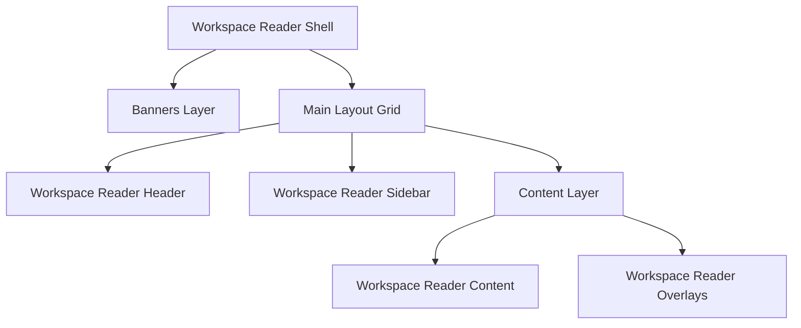
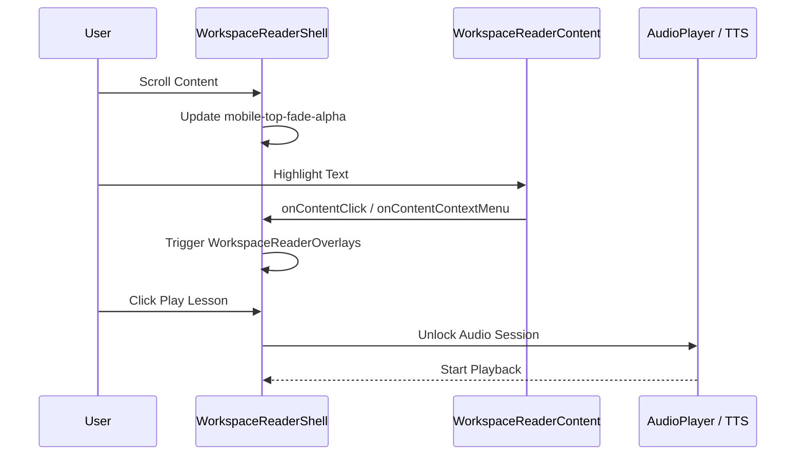

Relevant source files

The following files were used as context for generating this wiki page:

- [apps/web/components/workspace/shell/WorkspaceReaderShell.tsx](https://github.com/immagiov4/Nous/blob/21ec8b9ef2e9c48eae54d59ba738a6dc8f10dee6/apps/web/components/workspace/shell/WorkspaceReaderShell.tsx)
- [apps/web/components/workspace/shell/WorkspaceReaderContent.tsx](https://github.com/immagiov4/Nous/blob/21ec8b9ef2e9c48eae54d59ba738a6dc8f10dee6/apps/web/components/workspace/shell/WorkspaceReaderContent.tsx)
- [apps/web/components/workspace/shell/WorkspaceReaderSidebar.tsx](https://github.com/immagiov4/Nous/blob/21ec8b9ef2e9c48eae54d59ba738a6dc8f10dee6/apps/web/components/workspace/shell/WorkspaceReaderSidebar.tsx)
- [apps/web/hooks/reader/useReaderContext.ts](https://github.com/immagiov4/Nous/blob/21ec8b9ef2e9c48eae54d59ba738a6dc8f10dee6/apps/web/hooks/reader/useReaderContext.ts)
- [apps/web/tests/components/workspace/WorkspaceReaderShell.test.tsx](https://github.com/immagiov4/Nous/blob/21ec8b9ef2e9c48eae54d59ba738a6dc8f10dee6/apps/web/tests/components/workspace/WorkspaceReaderShell.test.tsx)
- [apps/web/tests/components/workspace/shell/LessonDocumentSources.test.tsx](https://github.com/immagiov4/Nous/blob/21ec8b9ef2e9c48eae54d59ba738a6dc8f10dee6/apps/web/tests/components/workspace/shell/LessonDocumentSources.test.tsx)

# Workspace Reader Shell

The Workspace Reader Shell is the primary application container for the Nous learning environment. It orchestrates the layout, scrolling behavior, and lifecycle of the reading interface, ensuring a focused and responsive experience across mobile and desktop viewports. The shell coordinates several critical sub-systems, including the lesson content renderer, navigation sidebars, and interactive overlays for annotations and learning aids.

Sources: [apps/web/components/workspace/shell/WorkspaceReaderShell.tsx](https://github.com/immagiov4/Nous/blob/21ec8b9ef2e9c48eae54d59ba738a6dc8f10dee6/apps/web/components/workspace/shell/WorkspaceReaderShell.tsx), [apps/web/tests/components/workspace/WorkspaceReaderShell.test.tsx](https://github.com/immagiov4/Nous/blob/21ec8b9ef2e9c48eae54d59ba738a6dc8f10dee6/apps/web/tests/components/workspace/WorkspaceReaderShell.test.tsx)

## Core Architecture and Layout

The Shell manages a multi-layered interface that adjusts dynamically based on the display mode (standard or embedded) and the device's viewport. It locks the document-level scrolling to provide a custom scrolling container for lesson content, which allows for precise control over UI effects like top-fade transparency in mobile views.

### Layout Components

| Component | Responsibility |
| :--- | :--- |
| **WorkspaceReaderHeader** | Manages the top navigation, settings, TTS controls, and learning aids. |
| **WorkspaceReaderSidebar** | Provides the learning plan navigation, module toggles, and exercise access. |
| **WorkspaceReaderContent** | Renders the active lesson markdown, generated visuals, and quizzes. |
| **WorkspaceReaderOverlays** | Handles floating context menus, AI assistant answers, and note-taking interfaces. |
| **WorkspaceReaderBanners** | Displays system-level alerts, such as storage errors or source file requirements. |

Sources: [apps/web/components/workspace/shell/WorkspaceReaderShell.tsx](https://github.com/immagiov4/Nous/blob/21ec8b9ef2e9c48eae54d59ba738a6dc8f10dee6/apps/web/components/workspace/shell/WorkspaceReaderShell.tsx), [apps/web/tests/components/workspace/WorkspaceReaderShell.test.tsx](https://github.com/immagiov4/Nous/blob/21ec8b9ef2e9c48eae54d59ba738a6dc8f10dee6/apps/web/tests/components/workspace/WorkspaceReaderShell.test.tsx)

### Visual Composition Hierarchy

The following diagram illustrates how the Shell organizes its internal layers to ensure that overlays and headers maintain correct stacking order.

The Shell confines overlays to a specific content layer situated below the header. This ensures that floating elements like context menus or AI response panels do not overlap the primary navigation controls.

Sources: [apps/web/components/workspace/shell/WorkspaceReaderShell.tsx](https://github.com/immagiov4/Nous/blob/21ec8b9ef2e9c48eae54d59ba738a6dc8f10dee6/apps/web/components/workspace/shell/WorkspaceReaderShell.tsx), [apps/web/tests/components/workspace/WorkspaceReaderShell.test.tsx](https://github.com/immagiov4/Nous/blob/21ec8b9ef2e9c48eae54d59ba738a6dc8f10dee6/apps/web/tests/components/workspace/WorkspaceReaderShell.test.tsx)

## Viewport and Scroll Management

The Shell uses the visual viewport height to calculate its application shell dimensions, preventing layout shifts on mobile devices when browser toolbars appear or disappear.

*   **Document Lock:** Upon mounting, the Shell sets `overflow: hidden` and `overscroll-behavior: none` on the `document.documentElement` and `document.body`. It restores original values when unmounted.
*   **Scroll Reset:** The component resets both the window scroll and the internal content container scroll to `(0, 0)` on mount to ensure a consistent starting point for the reader.
*   **Mobile Top Fade:** In mobile viewports, the Shell calculates a `--reader-mobile-top-fade-alpha` variable based on the scroll position. The alpha value reduces from `1.000` to `0.000` over the first 50 pixels of scrolling. If a banner is active, this fade is cleared to avoid visual conflicts with layout-reserving alerts.

Sources: [apps/web/components/workspace/shell/WorkspaceReaderShell.tsx](https://github.com/immagiov4/Nous/blob/21ec8b9ef2e9c48eae54d59ba738a6dc8f10dee6/apps/web/components/workspace/shell/WorkspaceReaderShell.tsx), [apps/web/tests/components/workspace/WorkspaceReaderShell.test.tsx](https://github.com/immagiov4/Nous/blob/21ec8b9ef2e9c48eae54d59ba738a6dc8f10dee6/apps/web/tests/components/workspace/WorkspaceReaderShell.test.tsx)

## Context and State Flow

The Shell acts as a bridge between the reader's state (managed via hooks) and the visual components. It utilizes `useReaderContext` to access global learning data and propagates this through dedicated props to child components.

Sources: [apps/web/hooks/reader/useReaderContext.ts](https://github.com/immagiov4/Nous/blob/21ec8b9ef2e9c48eae54d59ba738a6dc8f10dee6/apps/web/hooks/reader/useReaderContext.ts), [apps/web/tests/components/workspace/WorkspaceReaderShell.test.tsx](https://github.com/immagiov4/Nous/blob/21ec8b9ef2e9c48eae54d59ba738a6dc8f10dee6/apps/web/tests/components/workspace/WorkspaceReaderShell.test.tsx)

### Playback Integration
The Shell manages the lifecycle of lesson playback. When a user initiates playback from either the header or sidebar, the shell:
1.  Unlocks the `LessonPlaybackAudio` session.
2.  Opens the `LessonPlayer` dialog.
3.  Ensures any existing TTS generation or playback is stopped before starting the new session.

Sources: [apps/web/components/workspace/shell/WorkspaceReaderShell.tsx](https://github.com/immagiov4/Nous/blob/21ec8b9ef2e9c48eae54d59ba738a6dc8f10dee6/apps/web/components/workspace/shell/WorkspaceReaderShell.tsx), [apps/web/tests/components/workspace/WorkspaceReaderShell.test.tsx](https://github.com/immagiov4/Nous/blob/21ec8b9ef2e9c48eae54d59ba738a6dc8f10dee6/apps/web/tests/components/workspace/WorkspaceReaderShell.test.tsx)

## Source Material Display
The Reader Shell supports viewing original source documents (like PDFs or archives) through the `LessonDocumentSources` component. This system allows students to:
*   Open cited pages in original PDFs via blob URLs.
*   Load detached source files on demand from storage.
*   View exact code paths or file selectors used by the AI to generate the lesson content.

The system specifically sanitizes these views to hide internal technical identifiers (like `chunkIds` or `sourceIds`), presenting only user-friendly file names and page ranges.

Sources: [apps/web/tests/components/workspace/shell/LessonDocumentSources.test.tsx](https://github.com/immagiov4/Nous/blob/21ec8b9ef2e9c48eae54d59ba738a6dc8f10dee6/apps/web/tests/components/workspace/shell/LessonDocumentSources.test.tsx)

## Display Modes
The Shell supports two primary display modes:
1.  **Standard:** The full application experience with document scroll locking and fixed height management.
2.  **Embedded:** Used when the reader is hosted within another container. In this mode, document scrolling is not locked, and the shell applies an `overflow-visible` class to allow the host to manage the viewport.

Sources: [apps/web/components/workspace/shell/WorkspaceReaderShell.tsx](https://github.com/immagiov4/Nous/blob/21ec8b9ef2e9c48eae54d59ba738a6dc8f10dee6/apps/web/components/workspace/shell/WorkspaceReaderShell.tsx), [apps/web/tests/components/workspace/WorkspaceReaderShell.test.tsx](https://github.com/immagiov4/Nous/blob/21ec8b9ef2e9c48eae54d59ba738a6dc8f10dee6/apps/web/tests/components/workspace/WorkspaceReaderShell.test.tsx)
