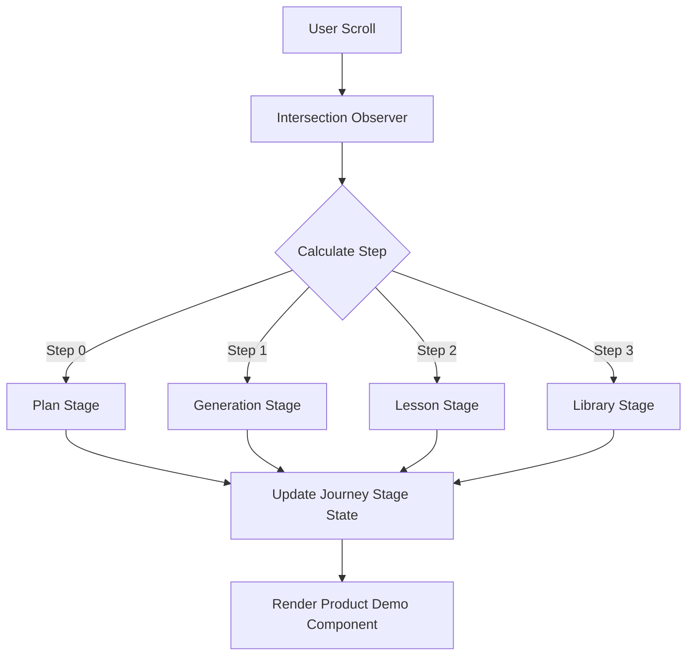
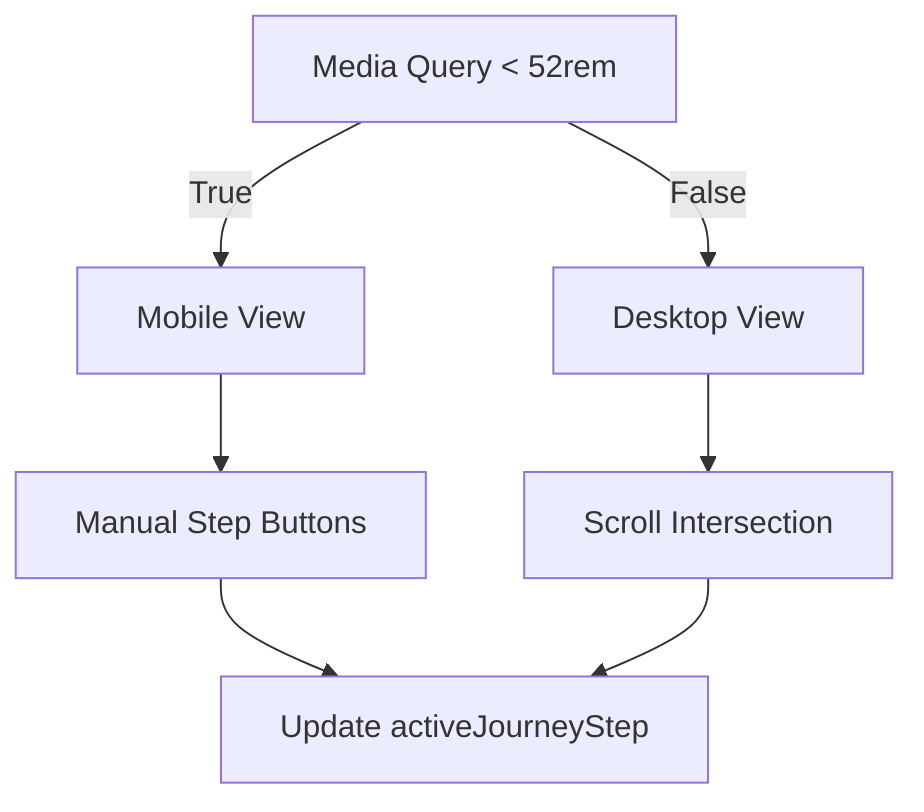

Relevant source files

The following files were used as context for generating this wiki page:

- [apps/web/components/marketing/LandingPage.tsx](https://github.com/immagiov4/Nous/blob/21ec8b9ef2e9c48eae54d59ba738a6dc8f10dee6/apps/web/components/marketing/LandingPage.tsx)
- [apps/web/components/marketing/marketing.css](https://github.com/immagiov4/Nous/blob/21ec8b9ef2e9c48eae54d59ba738a6dc8f10dee6/apps/web/components/marketing/marketing.css)
- [apps/web/index.html](https://github.com/immagiov4/Nous/blob/21ec8b9ef2e9c48eae54d59ba738a6dc8f10dee6/apps/web/index.html)
- [apps/backend/src/routes/chatPrompts.ts](https://github.com/immagiov4/Nous/blob/21ec8b9ef2e9c48eae54d59ba738a6dc8f10dee6/apps/backend/src/routes/chatPrompts.ts)
- [PROJECT_RULES.md](https://github.com/immagiov4/Nous/blob/21ec8b9ef2e9c48eae54d59ba738a6dc8f10dee6/PROJECT_RULES.md)

# Marketing & Landing Pages

The Marketing and Landing Pages module provides the public-facing interface for Nous, facilitating user acquisition through feature demonstrations and a waitlist system. It communicates the project's "ADHD-friendly" learning philosophy by showcasing how the platform transforms raw materials like PDFs and ZIP archives into structured, step-by-step lessons.

This system manages the landing page layout, interactive product demos, and the transition from public marketing content to the authenticated application environment via a login dialog.

## Architecture and Layout

The marketing frontend uses a dedicated styling layer and a responsive React-based structure. It enforces a specific visual identity using serif fonts for headings and a "paper" themed color palette.

### Layout Components

The primary layout resides in `apps/web/components/marketing/LandingPage.tsx` and follows a standard vertical section flow:

| Section | Purpose |
| :--- | :--- |
| **Hero** | Presents the core value proposition and initial waitlist CTA. |
| **Journey** | An interactive section explaining the four stages of the learning process. |
| **Product Demo** | Integrated visual demonstrations of the learning interface. |
| **Login Dialog** | A modal interface for existing testers to access the application. |

Sources: `[apps/web/components/marketing/LandingPage.tsx]`, `[apps/web/components/marketing/marketing.css]`

### Visual System

The system defines specific CSS variables to maintain consistency across marketing components. These include a "marketing-paper" background (`#fcfaf7`) and "marketing-ink" text (`#1a1917`). The layout uses `clamp` and `min` functions to ensure fluid responsiveness across screen sizes.

Sources: `[apps/web/components/marketing/marketing.css]`

## The User Journey Flow

The "Journey" section tracks the user's scroll position to sync descriptive text with interactive product demos. It utilizes the `IntersectionObserver` API to detect which step is currently most visible to the user.

### Journey Stages

The journey consists of four distinct stages:
1. **Plan**: Uploading materials (PDF, ZIP).
2. **Generation**: Transforming materials into modules and lessons.
3. **Lesson**: Interactive study with chat and notes.
4. **Library**: Managing the collection and tracking progress.

This diagram illustrates how the `LandingPage` component manages the journey state based on user interaction:

Sources: `[apps/web/components/marketing/LandingPage.tsx]`

## Waitlist and Access Control

The waitlist system handles new user leads, while a protected login dialog restricts access to existing testers.

### Waitlist Form Logic

The `WaitlistForm` (referenced in `LandingPage.tsx`) captures email addresses. The marketing CSS provides distinct states for success and error messages, using semantic colors like `#2f5f36` for success and `#a43722` for errors.

### Login Modal

The login dialog is implemented as a native `<dialog>` element. It uses a `useRef` to manage the modal state and ensures focus is placed on the heading for accessibility when opened. 

Sources: `[apps/web/components/marketing/LandingPage.tsx]`, `[apps/web/components/marketing/marketing.css]`

## Responsive Design

The marketing module employs a "mobile-first" mindset for complex interactions. For example, the Journey section switches from a scroll-based intersection model on desktops to a button-controlled fieldset on mobile devices (screens narrower than `52rem`).

### Responsive Transitions

Sources: `[apps/web/components/marketing/LandingPage.tsx]`, `[apps/web/components/marketing/marketing.css]`

## Technical Specifications

The following table summarizes the key technical constants and configurations used in the marketing module:

| Constant | Value / Source | Description |
| :--- | :--- | :--- |
| `MOBILE_JOURNEY_MEDIA_QUERY` | `(max-width: 52rem)` | The breakpoint for switching journey layouts. |
| `--marketing-page-width` | `92rem` | Maximum width for marketing page containers. |
| `JOURNEY_STAGES` | `['plan', 'generation', 'lesson', 'library']` | The ordered sequence of the user journey. |
| `IntersectionObserver` Root Margin | `-22% 0px -45%` | The margins used to detect active journey steps. |

Sources: `[apps/web/components/marketing/LandingPage.tsx]`, `[apps/web/components/marketing/marketing.css]`

## Summary

The Marketing & Landing Pages module effectively bridge the gap between initial user interest and the application’s core learning environment. By combining responsive React components with a robust CSS-based design system and scroll-synced demonstrations, the system provides a clear, guided introduction to the Nous platform's capabilities.
