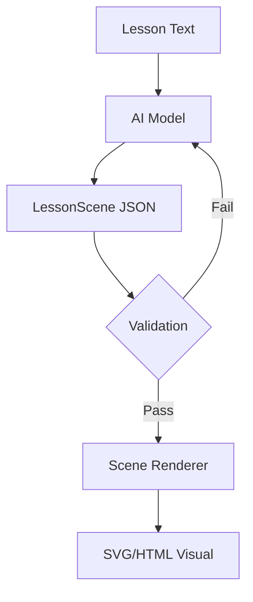
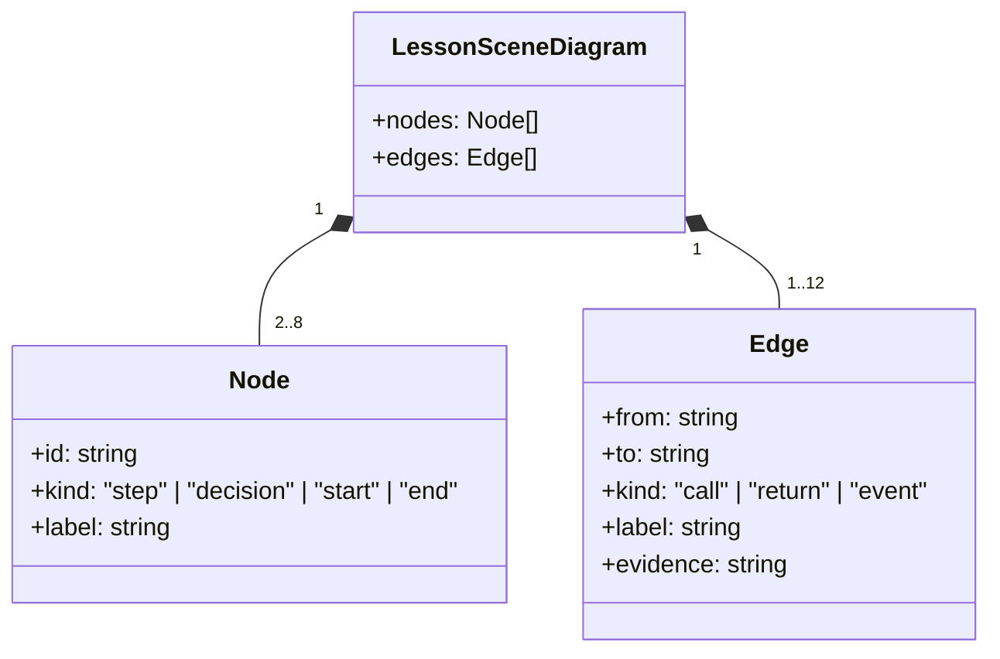

Relevant source files

The following files were used as context for generating this wiki page:

- [packages/shared-types/lessonSceneRegistry.ts](https://github.com/immagiov4/Nous/blob/21ec8b9ef2e9c48eae54d59ba738a6dc8f10dee6/packages/shared-types/lessonSceneRegistry.ts)
- [apps/backend/src/services/lessonScenes/lessonSceneGeneration.ts](https://github.com/immagiov4/Nous/blob/21ec8b9ef2e9c48eae54d59ba738a6dc8f10dee6/apps/backend/src/services/lessonScenes/lessonSceneGeneration.ts)
- [apps/web/tests/components/workspace/LessonPlaybackStage.test.tsx](https://github.com/immagiov4/Nous/blob/21ec8b9ef2e9c48eae54d59ba738a6dc8f10dee6/apps/web/tests/components/workspace/LessonPlaybackStage.test.tsx)
- [apps/web/tests/components/shared/LessonSceneLabCatalog.test.tsx](https://github.com/immagiov4/Nous/blob/21ec8b9ef2e9c48eae54d59ba738a6dc8f10dee6/apps/web/tests/components/shared/LessonSceneLabCatalog.test.tsx)
- [packages/shared-types/lessonVisualContracts.ts](https://github.com/immagiov4/Nous/blob/21ec8b9ef2e9c48eae54d59ba738a6dc8f10dee6/packages/shared-types/lessonVisualContracts.ts)
- [e2e/nous/atlas/synthetic.ts](https://github.com/immagiov4/Nous/blob/21ec8b9ef2e9c48eae54d59ba738a6dc8f10dee6/e2e/nous/atlas/synthetic.ts)

# Lesson Scene Renderers

Lesson Scene Renderers transform validated JSON descriptions of educational concepts into visual components. These renderers handle the geometry, layout, and styling of "scenes"—abstract structures, relations, or quantities shown via forms like flowcharts, comparisons, and timelines. By separating the semantic content (defined in the scene JSON) from the visual implementation, the system ensures that visuals remain legible, accessible, and restylable across different themes and devices.

## Architecture and Data Flow

The rendering process starts with a `LessonScene` object. This object contains structured data like items, groups, and diagrams, but excludes specific coordinate or styling logic, which the renderers compute at runtime.

### Scene Generation and Validation
Before reaching the renderer, an AI model generates the scene based on lesson text. The system validates this data against the `LessonSceneSchema` to ensure it adheres to the pedagogical and structural rules of the chosen form.

Sources: [apps/backend/src/services/lessonScenes/lessonSceneGeneration.ts](https://github.com/immagiov4/Nous/blob/21ec8b9ef2e9c48eae54d59ba738a6dc8f10dee6/apps/backend/src/services/lessonScenes/lessonSceneGeneration.ts), [packages/shared-types/lessonSceneRegistry.ts](https://github.com/immagiov4/Nous/blob/21ec8b9ef2e9c48eae54d59ba738a6dc8f10dee6/packages/shared-types/lessonSceneRegistry.ts)

### The Rendering Pipeline
The renderer selects a component based on the `type` field in the scene data. The components use shared layouts and logic to map the abstract data to physical pixels.

1.  **Form Selection:** The system identifies the specific renderer (e.g., `flowchart`, `radar`, `comparison`) from the `LESSON_SCENE_REGISTRY`.
2.  **Icon Resolution:** The backend chooses icons based on `iconQueries` provided in the scene draft.
3.  **Geometry Computation:** The renderer calculates positions, such as the trig-based coordinates for `radar` charts or the tree levels for `tree` diagrams.
4.  **Scaling:** The `LessonPlaybackStage` uses a `ResizeObserver` to fit the scene within the viewport, applying CSS scales to maintain aspect ratios.

Sources: [apps/backend/src/services/lessonScenes/lessonSceneGeneration.ts](https://github.com/immagiov4/Nous/blob/21ec8b9ef2e9c48eae54d59ba738a6dc8f10dee6/apps/backend/src/services/lessonScenes/lessonSceneGeneration.ts), [apps/web/tests/components/workspace/LessonPlaybackStage.test.tsx](https://github.com/immagiov4/Nous/blob/21ec8b9ef2e9c48eae54d59ba738a6dc8f10dee6/apps/web/tests/components/workspace/LessonPlaybackStage.test.tsx), [packages/shared-types/lessonSceneRegistry.ts](https://github.com/immagiov4/Nous/blob/21ec8b9ef2e9c48eae54d59ba738a6dc8f10dee6/packages/shared-types/lessonSceneRegistry.ts)

## Core Renderer Types

The project categorizes renderers into static, animated, and specialized forms.

### Static Renderers
Static renderers display fixed relationships. They support up to 12 items and 6 groups.

| Form | Description | Constraints |
| :--- | :--- | :--- |
| `quadrant` | Categorizes items into four areas. | Exactly 4 groups; X and Y axis labels required. |
| `radar`/`polar` | Shows 3–6 measures on a common scale. | Values must be positive and below a defined max. |
| `tree` | Displays hierarchical data. | Exactly one root; max 3 levels; acyclic. |
| `venn` | Shows set intersections. | Exactly 3 regions; short labels (max 24 chars). |
| `matrix` | Compares items across multiple criteria. | Max 5 columns and 8 rows. |

Sources: [packages/shared-types/lessonSceneRegistry.ts](https://github.com/immagiov4/Nous/blob/21ec8b9ef2e9c48eae54d59ba738a6dc8f10dee6/packages/shared-types/lessonSceneRegistry.ts)

### Animated and Quantitative Renderers
These renderers support `autoplay` and time-based progression.

*   **Proportional:** Displays growing quantities. It uses `amountPerUnit` and `initial` values to calculate total outputs.
*   **Guided Path:** Follows a sequence of 2 to 8 steps. Each step requires a non-empty label and detail.
*   **Line:** Visualizes values associated with specific times. Times must be strictly increasing and grounded in the lesson text.

Sources: [packages/shared-types/lessonSceneRegistry.ts](https://github.com/immagiov4/Nous/blob/21ec8b9ef2e9c48eae54d59ba738a6dc8f10dee6/packages/shared-types/lessonSceneRegistry.ts), [e2e/nous/atlas/synthetic.ts](https://github.com/immagiov4/Nous/blob/21ec8b9ef2e9c48eae54d59ba738a6dc8f10dee6/e2e/nous/atlas/synthetic.ts)

### Diagram Renderers
Diagrams (flowchart, sequence, journey) translate nodes and edges into Mermaid-compatible structures or custom SVG layouts.

Sources: [packages/shared-types/lessonSceneRegistry.ts](https://github.com/immagiov4/Nous/blob/21ec8b9ef2e9c48eae54d59ba738a6dc8f10dee6/packages/shared-types/lessonSceneRegistry.ts)

## Specialized Form: Formula Spotlight

The `formula-spotlight` renderer focuses on mathematical education. It displays a LaTeX formula and highlights specific symbols as the narration refers to them.

*   **LaTeX Rendering:** It uses KaTeX to display formulas.
*   **Symbol Anchoring:** Each symbol in the `symbols` array has an `anchor` string. The renderer emphasizes the symbol only when the narration reaches the corresponding text.
*   **Constraints:** It requires at least one symbol. It does not allow items or groups, as it exclusively uses the `formula` and `symbols` fields.

Sources: [packages/shared-types/lessonSceneRegistry.ts](https://github.com/immagiov4/Nous/blob/21ec8b9ef2e9c48eae54d59ba738a6dc8f10dee6/packages/shared-types/lessonSceneRegistry.ts), [apps/web/tests/components/workspace/LessonPlaybackStage.test.tsx](https://github.com/immagiov4/Nous/blob/21ec8b9ef2e9c48eae54d59ba738a6dc8f10dee6/apps/web/tests/components/workspace/LessonPlaybackStage.test.tsx)

## Visual Consistency Rules

Renderers must follow strict visual and pedagogical contracts:

*   **Language:** All visible text must match the lesson language.
*   **No Decorative Text:** Renderers exclude narrative captions, takeaways, or filler text. These belong in the lesson prose, not the visual scene.
*   **Grounding:** Quantitative values and quotations must exist literally in the source lesson text. Renderers must not invent scores or data points.
*   **Closing Text:** A scene may include a `note` (limit/assumption) or a `quote` (closing question), but never both simultaneously, except in `quote` or `decision` forms.

Sources: [packages/shared-types/lessonVisualContracts.ts](https://github.com/immagiov4/Nous/blob/21ec8b9ef2e9c48eae54d59ba738a6dc8f10dee6/packages/shared-types/lessonVisualContracts.ts), [apps/backend/src/services/lessonScenes/lessonSceneGeneration.ts](https://github.com/immagiov4/Nous/blob/21ec8b9ef2e9c48eae54d59ba738a6dc8f10dee6/apps/backend/src/services/lessonScenes/lessonSceneGeneration.ts)

## Interaction and Playback

In the `LessonPlaybackStage`, the renderer synchronizes with the audio clock. 

1.  **Motion States:** The stage computes `opacity` and `emphasis` for targets based on the current time and aligned "onsets" from the audio recording.
2.  **Highlighting:** Items receive a `--motion-emphasis` CSS variable (0 to 1) to signal focus.
3.  **Captions:** The renderer ensures that as a word is spoken, the corresponding scene element (if anchored) is highlighted or revealed.

Sources: [apps/web/tests/components/workspace/LessonPlaybackStage.test.tsx](https://github.com/immagiov4/Nous/blob/21ec8b9ef2e9c48eae54d59ba738a6dc8f10dee6/apps/web/tests/components/workspace/LessonPlaybackStage.test.tsx)
