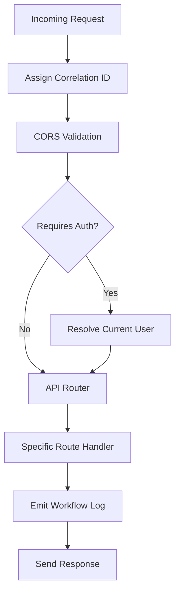
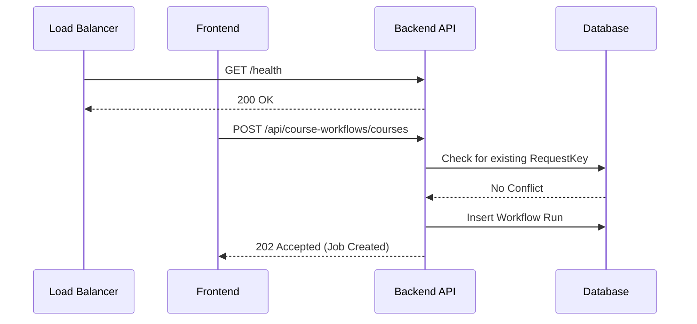

Relevant source files

The following files were used as context for generating this wiki page:

- [apps/backend/src/index.ts](https://github.com/immagiov4/Nous/blob/21ec8b9ef2e9c48eae54d59ba738a6dc8f10dee6/apps/backend/src/index.ts)
- [apps/backend/tests/routes/courseWorkflows.test.ts](https://github.com/immagiov4/Nous/blob/21ec8b9ef2e9c48eae54d59ba738a6dc8f10dee6/apps/backend/tests/routes/courseWorkflows.test.ts)
- [apps/backend/tests/routes/authProtection.test.ts](https://github.com/immagiov4/Nous/blob/21ec8b9ef2e9c48eae54d59ba738a6dc8f10dee6/apps/backend/tests/routes/authProtection.test.ts)
- [scripts/feature-map.ts](https://github.com/immagiov4/Nous/blob/21ec8b9ef2e9c48eae54d59ba738a6dc8f10dee6/scripts/feature-map.ts)
- [apps/web/tests/scripts/productionDeployment.test.ts](https://github.com/immagiov4/Nous/blob/21ec8b9ef2e9c48eae54d59ba738a6dc8f10dee6/apps/web/tests/scripts/productionDeployment.test.ts)

# Backend API Routes

The Backend API provides the core services for the Nous learning platform, including project management, AI-driven content generation, and workflow orchestration. It uses an Express-based architecture to handle requests, enforce authentication, and manage complex long-running tasks through a durable workflow system.

Sources: [apps/backend/src/index.ts](https://github.com/immagiov4/Nous/blob/21ec8b9ef2e9c48eae54d59ba738a6dc8f10dee6/apps/backend/src/index.ts), [scripts/feature-map.ts](https://github.com/immagiov4/Nous/blob/21ec8b9ef2e9c48eae54d59ba738a6dc8f10dee6/scripts/feature-map.ts)

## Request Lifecycle and Middleware

The application processes requests through a centralized pipeline that handles observability, security, and data parsing. Every request receives a unique `x-request-id` correlation ID to trace operations across logs and performance timings.

### Security and Authentication
Most API routes require authentication. The system uses `resolveCurrentUser` and `resolveCurrentUserForPasswordSetup` middleware to identify users before they access protected resources. Public routes like `/health` and `/api/status` remain open for deployment probes.

Sources: [apps/backend/src/index.ts](https://github.com/immagiov4/Nous/blob/21ec8b9ef2e9c48eae54d59ba738a6dc8f10dee6/apps/backend/src/index.ts), [apps/backend/tests/routes/authProtection.test.ts](https://github.com/immagiov4/Nous/blob/21ec8b9ef2e9c48eae54d59ba738a6dc8f10dee6/apps/backend/tests/routes/authProtection.test.ts)

### Payload Management
The backend enforces specific body size limits based on the route to prevent resource exhaustion.

| Route Group | Body Limit |
| :--- | :--- |
| `/api/openrouter` | 80mb |
| `/api/pdf` | 160mb |
| `/api/projects` | 300mb |
| `/api/stt` | 20mb |
| `/api/feedback` | 2mb |
| Default | 50mb |

Sources: [apps/backend/src/index.ts](https://github.com/immagiov4/Nous/blob/21ec8b9ef2e9c48eae54d59ba738a6dc8f10dee6/apps/backend/src/index.ts)

### Flow Diagram: Request Processing
The following diagram shows how a request moves from the entry point to a specific route handler.

## Functional API Modules

API routes are organized into logical modules that handle specific domains of the application.

### Workflow Orchestration
The workflow routes manage long-running AI processes like course and lesson generation. These routes provide endpoints to start a run, poll for status, and retrieve results without exposing internal implementation details.

*   **Course Workflows:** `/api/course-workflows/courses` (POST) starts a durable course generation.
*   **Polling:** `/api/course-workflows/runs/:runId` (GET) retrieves a snapshot of the run status.
*   **Active Runs:** `/api/course-workflows/courses/:projectId/active` (GET) helps reconnect a project to its ongoing planning phase.

Sources: [apps/backend/src/index.ts](https://github.com/immagiov4/Nous/blob/21ec8b9ef2e9c48eae54d59ba738a6dc8f10dee6/apps/backend/src/index.ts), [apps/backend/tests/routes/courseWorkflows.test.ts](https://github.com/immagiov4/Nous/blob/21ec8b9ef2e9c48eae54d59ba738a6dc8f10dee6/apps/backend/tests/routes/courseWorkflows.test.ts)

### Project and Asset Management
These routes handle the core data of the application, including project snapshots and media assets.
*   **Imports:** Supports chunked uploads via `/api/projects/import/chunks/:uploadId/:chunkIndex`.
*   **Assets:** Manages images and other project-specific files through `createProjectAssetRouter`.
*   **Exports:** Provides library export downloads via `createLibraryExportDownloadRouter`.

Sources: [apps/backend/src/index.ts](https://github.com/immagiov4/Nous/blob/21ec8b9ef2e9c48eae54d59ba738a6dc8f10dee6/apps/backend/src/index.ts)

### AI and Multimodal Services
The backend proxies and processes various AI services:
*   **Chat:** `/api/chat` handles conversational context.
*   **Speech:** `/api/stt` (Speech-to-Text) and `/api/tts` (Text-to-Speech) manage audio processing.
*   **Visuals:** `/api/images` handles image generation, while `/api/youtube` provides research context from video transcripts.

Sources: [apps/backend/src/index.ts](https://github.com/immagiov4/Nous/blob/21ec8b9ef2e9c48eae54d59ba738a6dc8f10dee6/apps/backend/src/index.ts), [apps/backend/tests/routes/authProtection.test.ts](https://github.com/immagiov4/Nous/blob/21ec8b9ef2e9c48eae54d59ba738a6dc8f10dee6/apps/backend/tests/routes/authProtection.test.ts)

## Error Handling

The backend implements a unified error handling strategy. It converts standard Errors into `BackendErrorDiagnostic` objects and returns structured JSON responses.

*   **413 Payload Too Large:** Returned when a request exceeds the configured limit.
*   **401 Unauthorized:** Returned when an unauthenticated user accesses a protected route.
*   **409 Conflict:** Returned for workflow key conflicts (e.g., repeating a request key).
*   **500 Internal Server Error:** A catch-all for unhandled exceptions, logging a sanitized stack trace and correlation ID.

Sources: [apps/backend/src/index.ts](https://github.com/immagiov4/Nous/blob/21ec8b9ef2e9c48eae54d59ba738a6dc8f10dee6/apps/backend/src/index.ts), [apps/backend/tests/routes/courseWorkflows.test.ts](https://github.com/immagiov4/Nous/blob/21ec8b9ef2e9c48eae54d59ba738a6dc8f10dee6/apps/backend/tests/routes/courseWorkflows.test.ts)

## Production Considerations

In production environments, the backend enforces strict CORS configurations and serves health endpoints for monitoring.

Sources: [apps/web/tests/scripts/productionDeployment.test.ts](https://github.com/immagiov4/Nous/blob/21ec8b9ef2e9c48eae54d59ba738a6dc8f10dee6/apps/web/tests/scripts/productionDeployment.test.ts), [apps/backend/tests/routes/courseWorkflows.test.ts](https://github.com/immagiov4/Nous/blob/21ec8b9ef2e9c48eae54d59ba738a6dc8f10dee6/apps/backend/tests/routes/courseWorkflows.test.ts)

The Backend API Routes architecture ensures that expensive AI operations are handled asynchronously via workflows while providing a consistent, secure, and observable interface for the frontend application.
