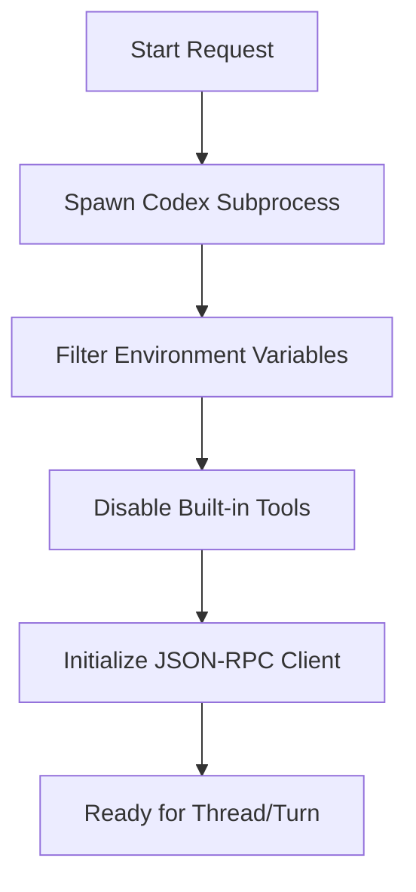
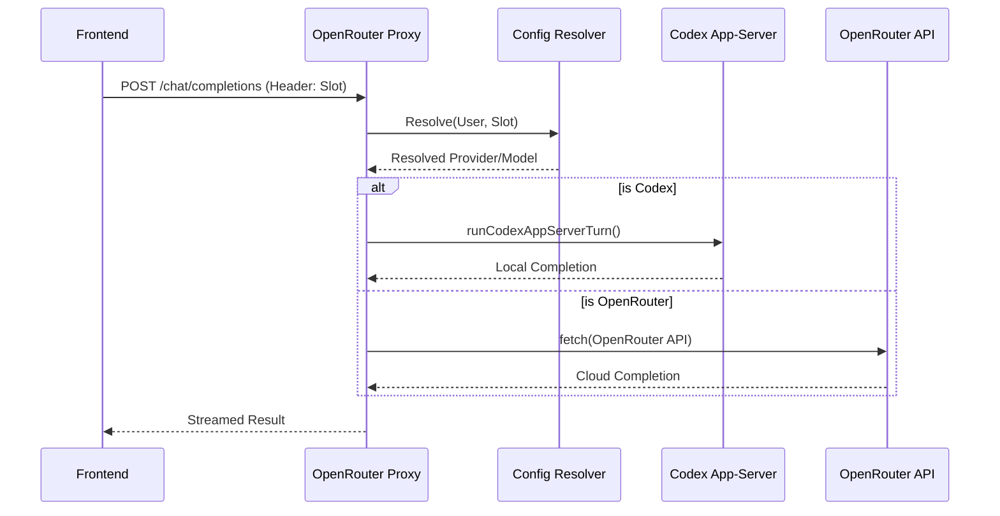

Relevant source files

The following files were used as context for generating this wiki page:

- [apps/backend/src/services/codexAppServer.ts](https://github.com/immagiov4/Nous/blob/21ec8b9ef2e9c48eae54d59ba738a6dc8f10dee6/apps/backend/src/services/codexAppServer.ts)
- [apps/backend/src/routes/chatPrompts.ts](https://github.com/immagiov4/Nous/blob/21ec8b9ef2e9c48eae54d59ba738a6dc8f10dee6/apps/backend/src/routes/chatPrompts.ts)
- [apps/backend/src/routes/openRouterProxy.ts](https://github.com/immagiov4/Nous/blob/21ec8b9ef2e9c48eae54d59ba738a6dc8f10dee6/apps/backend/src/routes/openRouterProxy.ts)
- [packages/shared-types/lessonWritingContract.ts](https://github.com/immagiov4/Nous/blob/21ec8b9ef2e9c48eae54d59ba738a6dc8f10dee6/packages/shared-types/lessonWritingContract.ts)
- [packages/shared-types/lessonVisualContracts.ts](https://github.com/immagiov4/Nous/blob/21ec8b9ef2e9c48eae54d59ba738a6dc8f10dee6/packages/shared-types/lessonVisualContracts.ts)
- [apps/backend/src/services/codexAccess.ts](https://github.com/immagiov4/Nous/blob/21ec8b9ef2e9c48eae54d59ba738a6dc8f10dee6/apps/backend/src/services/codexAccess.ts)
- [apps/backend/src/services/codexChatStream.ts](https://github.com/immagiov4/Nous/blob/21ec8b9ef2e9c48eae54d59ba738a6dc8f10dee6/apps/backend/src/services/codexChatStream.ts)
- [packages/shared-types/aiPromptInstructions.ts](https://github.com/immagiov4/Nous/blob/21ec8b9ef2e9c48eae54d59ba738a6dc8f10dee6/packages/shared-types/aiPromptInstructions.ts)

# Codex Access & Prompt Management

Codex Access and Prompt Management coordinate the interactions between the Nous application and its underlying AI engines. The system manages the local **Codex App-Server**, handles request routing through a proxy for external providers like **OpenRouter**, and enforces strict pedagogical writing contracts via centralized prompt construction. This architecture ensures that AI responses maintain a consistent teaching tone, adhere to safety constraints, and correctly utilize specialized tools like web search or artifact generation.

## Codex App-Server Architecture

The `codexAppServer` service manages a local AI process that communicates via a JSON-RPC protocol over standard input/output (stdio). This local engine serves as a private, secure alternative to cloud-based AI providers.

### Process Management and Security
The system spawns the Codex binary as a subprocess with a restricted environment. To ensure security, it explicitly disables several built-in capabilities such as `shell_tool`, `browser_use`, and `workspace_dependencies`.

*The diagram shows the lifecycle of the Codex subprocess initialization and security filtering.*

Sources: `[apps/backend/src/services/codexAppServer.ts]`

### Protocol and Client Lifecycle
The `CodexJsonRpcClient` manages the lifecycle of requests through the following stages:
1.  **Handshake**: Initializes the connection with `initialize` and `initialized` notifications.
2.  **Thread Management**: Creates ephemeral threads to isolate conversation contexts.
3.  **Turn Execution**: Sends user input and developer instructions to a specific thread.
4.  **Token Metering**: Tracks `inputTokens`, `outputTokens`, `reasoningTokens`, and `cacheReadTokens` for every turn.

Sources: `[apps/backend/src/services/codexAppServer.ts]`, `[apps/backend/tests/services/codexAppServer.test.ts]`

## AI Proxy and Resolution

The `openRouterProxy` acts as a unified gateway for all AI requests. It resolves which provider and model to use based on the "slot" (e.g., `lesson`, `artifact`, `research`) and the user's preferences.

### Model Slot Resolution
The system assigns specific model configurations to different functional slots to optimize for speed, reasoning, or cost.

| Slot | Usage Description |
| :--- | :--- |
| `lesson` | Generating primary educational content and prose. |
| `artifact` | Creating visual components (SVG, Mermaid diagrams). |
| `research` | Performing web-augmented search and analysis. |
| `context` | Answering questions about specific lesson selections. |

Sources: `[apps/backend/src/routes/openRouterProxy.ts]`

### Request Routing Flow
When a request arrives at the proxy, it performs the following steps:
1.  **Identify Slot**: Reads the `X-Nous-Model-Slot` header.
2.  **Resolve Configuration**: Determines if the request should go to the local `codex` provider or a cloud provider via `OpenRouter`.
3.  **Access Control**: Validates access permissions via `assertCodexRequestAccess`.
4.  **Execution**: Either streams an OpenRouter response or calls the `runCodexAppServerTurn`.

*This sequence illustrates how the proxy intercepts requests to route them to local or remote AI engines.*

Sources: `[apps/backend/src/routes/openRouterProxy.ts]`

## Prompt Management and Writing Contracts

Prompt management centralizes instructions to ensure the AI acts as "Professor Nous." These instructions are divided into system prompts and specific writing "contracts."

### Centralized Writing Rules
The `lessonWritingContract` defines rules that govern the AI's linguistic behavior. These rules prioritize clarity, active voice, and pedagogical effectiveness.

*   **Lexicon**: Prefers plain words over abstract metaphors.
*   **Math Delimiters**: Enforces LaTeX notation using `\(...\)` for inline and `\[...\]` for display math.
*   **Propedeutic Order**: Requires that every passage only uses concepts already explained earlier in the lesson.
*   **Metadiscourse**: Prohibits the AI from talking about the task (e.g., "I will now summarize...").

Sources: `[packages/shared-types/lessonWritingContract.ts]`

### Visual and Artifact Contracts
Artifact generation is governed by specialized rendering rules for different formats:
*   **SVG**: Restricts usage to simple informational diagrams with specific CSS classes (e.g., `.t`, `.box`, `.arr`).
*   **HTML/JS**: Prohibits network access and external scripts, requiring self-contained interactive widgets.
*   **Mermaid**: Limits diagrams to `erDiagram` or `classDiagram` for structural clarity.

Sources: `[packages/shared-types/lessonVisualContracts.ts]`

## Chat and Tool Prompting

The system builds dynamic prompts for the `context` and `library` chat modes, integrating metadata and tool mandates.

### Tool Mandates
System prompts include "Mandates" that define how the AI should narrate its tool usage:
*   **Tool Narration**: The AI must not use dangling introductions (e.g., "I will check below:") because the UI displays tool outputs separately from text.
*   **Web Priority**: Defines how the `searchWeb` tool should be used based on explicit user instructions versus active preferences.
*   **Annotation**: Guides the AI to proactively propose saving notes via `requestAddToNotes` when a useful clarification emerges.

Sources: `[apps/backend/src/routes/chatPrompts.ts]`

### Contextual Prompt Construction
When a user asks a question about a specific lesson passage, the system constructs a prompt containing:
1.  **Primary Context**: The highlighted selection and surrounding text.
2.  **Original Source**: Metadata and excerpts from the distinct original source material.
3.  **Course Metadata**: Internal identifiers for the current project and lesson.

Sources: `[apps/backend/src/routes/chatPrompts.ts]`

## Conclusion
Codex Access and Prompt Management form the bridge between raw AI capabilities and the specific pedagogical needs of the Nous Reader. By isolating the complexity of JSON-RPC communication and cloud proxying behind a unified interface, the system allows for flexible model selection. Simultaneously, strict writing and visual contracts ensure that AI-generated content remains safe, accurate, and educational across all supported providers.
