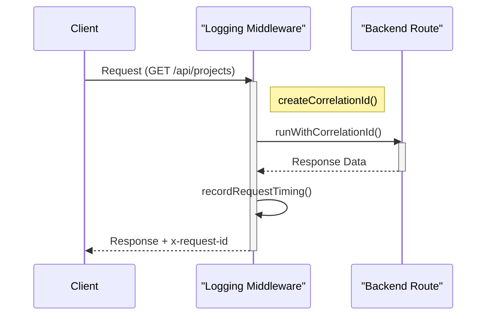
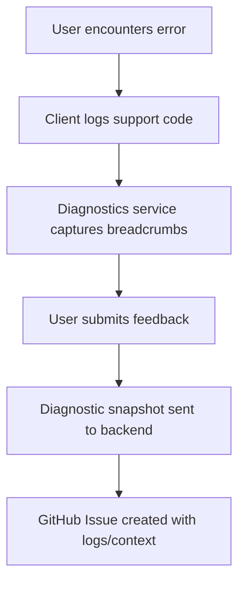

Relevant source files

The following files were used as context for generating this wiki page:

- [PROJECT_RULES.md](https://github.com/immagiov4/Nous/blob/21ec8b9ef2e9c48eae54d59ba738a6dc8f10dee6/PROJECT_RULES.md)
- [AGENTS.md](https://github.com/immagiov4/Nous/blob/21ec8b9ef2e9c48eae54d59ba738a6dc8f10dee6/AGENTS.md)
- [apps/backend/src/index.ts](https://github.com/immagiov4/Nous/blob/21ec8b9ef2e9c48eae54d59ba738a6dc8f10dee6/apps/backend/src/index.ts)
- [apps/backend/src/workflows/requestObservability.ts](https://github.com/immagiov4/Nous/blob/21ec8b9ef2e9c48eae54d59ba738a6dc8f10dee6/apps/backend/src/workflows/requestObservability.ts)
- [apps/backend/src/workflows/workflowObservability.ts](https://github.com/immagiov4/Nous/blob/21ec8b9ef2e9c48eae54d59ba738a6dc8f10dee6/apps/backend/src/workflows/workflowObservability.ts)
- [apps/web/tests/services/feedback/browserDiagnostics.test.ts](https://github.com/immagiov4/Nous/blob/21ec8b9ef2e9c48eae54d59ba738a6dc8f10dee6/apps/web/tests/services/feedback/browserDiagnostics.test.ts)
- [apps/backend/src/services/githubFeedback.ts](https://github.com/immagiov4/Nous/blob/21ec8b9ef2e9c48eae54d59ba738a6dc8f10dee6/apps/backend/src/services/githubFeedback.ts)

# Observability & Telemetry

Observability and Telemetry in Nous provide visibility into the system's runtime behavior, AI performance, and user interactions. The system implements a multi-layered approach to tracking that includes request correlation, workflow logging, AI metering, and diagnostic collection. These mechanisms ensure that developers can trace durations, identify failures, and report blind spots across the entire application stack.

## Request and Correlation Tracking

The backend implements a correlation system to trace requests through the service architecture. Each request receives a unique `correlationId` (UUID), which the system propagates across internal execution paths.

### Lifecycle Logging
The server records the lifecycle of every HTTP request, capturing timing information, response status, and potential failures. It excludes quiet paths like `/api/status` from successful request logs to reduce noise.

This diagram shows how the middleware wraps request execution to ensure timing and identity are preserved.

### Server-Timing Headers
The system uses the `Server-Timing` header to expose internal performance metrics to the client. This includes metrics for specific phases like `serialization`.
Sources: [apps/backend/src/index.ts](https://github.com/immagiov4/Nous/blob/21ec8b9ef2e9c48eae54d59ba738a6dc8f10dee6/apps/backend/src/index.ts), [apps/backend/src/workflows/requestObservability.ts](https://github.com/immagiov4/Nous/blob/21ec8b9ef2e9c48eae54d59ba738a6dc8f10dee6/apps/backend/src/workflows/requestObservability.ts)

## Workflow and AI Observability

Workflows represent complex, often non-deterministic operations such as AI content generation. The observability layer tracks these operations with detailed logs.

### Workflow Event Logging
The system emits workflow logs through a centralized `emitWorkflowLog` function. These logs contain:
*   **Action**: The outcome of the operation (e.g., `completed`, `failed`).
*   **Entity**: The system component involved (e.g., `lifecycle`, `ai_generation`).
*   **DurationMs**: Total time taken for the operation.
*   **Failure**: Detailed error information if the action failed, using the `StepFailure` structure.

| Field | Type | Description |
| :--- | :--- | :--- |
| `correlationId` | String | Unique ID linking related logs. |
| `operation` | String | The specific task being performed (e.g., `http_request`). |
| `timings` | Object | Map of phase names to durations in milliseconds. |
| `responseBytes` | Number | Size of the response payload. |

Sources: [apps/backend/src/index.ts](https://github.com/immagiov4/Nous/blob/21ec8b9ef2e9c48eae54d59ba738a6dc8f10dee6/apps/backend/src/index.ts), [apps/backend/src/workflows/workflowObservability.ts](https://github.com/immagiov4/Nous/blob/21ec8b9ef2e9c48eae54d59ba738a6dc8f10dee6/apps/backend/src/workflows/workflowObservability.ts)

### AI Metering and Traceability
For AI-related tasks, observability includes tracing durations and reporting failures. Every Pull Request in the repository is required to contain an `## Observability` section that describes how the change affects system visibility.
Sources: [AGENTS.md](https://github.com/immagiov4/Nous/blob/21ec8b9ef2e9c48eae54d59ba738a6dc8f10dee6/AGENTS.md), [PROJECT_RULES.md](https://github.com/immagiov4/Nous/blob/21ec8b9ef2e9c48eae54d59ba738a6dc8f10dee6/PROJECT_RULES.md)

## Client-Side Diagnostics and Feedback

The frontend maintains a diagnostic buffer to capture events leading up to a user-reported issue or a system failure.

### Diagnostic Collection
The `browserDiagnostics` service collects:
*   **Sanitized Console Logs**: Captures `[Nous]` prefixed console messages while redacting sensitive information like emails, API keys, and access tokens.
*   **Uncaught Errors**: Records unhandled browser exceptions without URL parameters to prevent credential leakage.
*   **Product Context**: Tracks the current project ID, lesson ID, and surface (e.g., `reader`).
*   **Breadcrumbs**: A bounded list of navigation and state change events.

### Backend Failure Correlation
When the backend returns a support code, the client logs a `Codice assistenza` (Support code). This links the client-side session to the backend `correlationId` in diagnostic snapshots.

This flow illustrates how diagnostics move from a client-side error to a developer-facing report.

Sources: [apps/web/tests/services/feedback/browserDiagnostics.test.ts](https://github.com/immagiov4/Nous/blob/21ec8b9ef2e9c48eae54d59ba738a6dc8f10dee6/apps/web/tests/services/feedback/browserDiagnostics.test.ts), [apps/backend/src/services/githubFeedback.ts](https://github.com/immagiov4/Nous/blob/21ec8b9ef2e9c48eae54d59ba738a6dc8f10dee6/apps/backend/src/services/githubFeedback.ts)

## Error Diagnostics Structure

Errors are transformed into a standardized `WorkflowErrorDiagnostic` format. This structure ensures that technical details are logged internally while providing safe, localized messages to users.

### Diagnostic Sanitization
The system proactively removes "puffery," personal AI experiences, and internal technical identifiers (like storage keys or hashes) from user-facing text and diagnostics. Stack frames are sanitized to remove sensitive paths before being included in diagnostics.

Sources: [apps/backend/src/index.ts](https://github.com/immagiov4/Nous/blob/21ec8b9ef2e9c48eae54d59ba738a6dc8f10dee6/apps/backend/src/index.ts), [apps/backend/src/workflows/workflowErrorDiagnostics.ts](https://github.com/immagiov4/Nous/blob/21ec8b9ef2e9c48eae54d59ba738a6dc8f10dee6/apps/backend/src/workflows/workflowErrorDiagnostics.ts), [packages/shared-types/lessonWritingContract.ts](https://github.com/immagiov4/Nous/blob/21ec8b9ef2e9c48eae54d59ba738a6dc8f10dee6/packages/shared-types/lessonWritingContract.ts)

## Summary

Observability & Telemetry in Nous serves as the primary mechanism for proving system reliability and performance. By correlating backend requests, metering AI workflows, and buffering client-side diagnostics, the system provides a continuous trace of data from user interaction to backend persistence. This architecture supports the project's "Prove it" mandate, turning claims into measurable behavior tests or traces.
