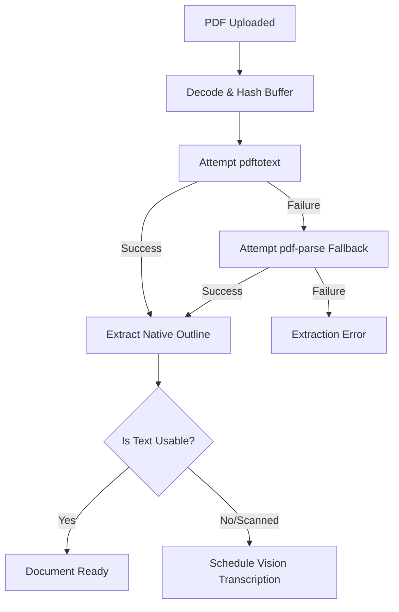
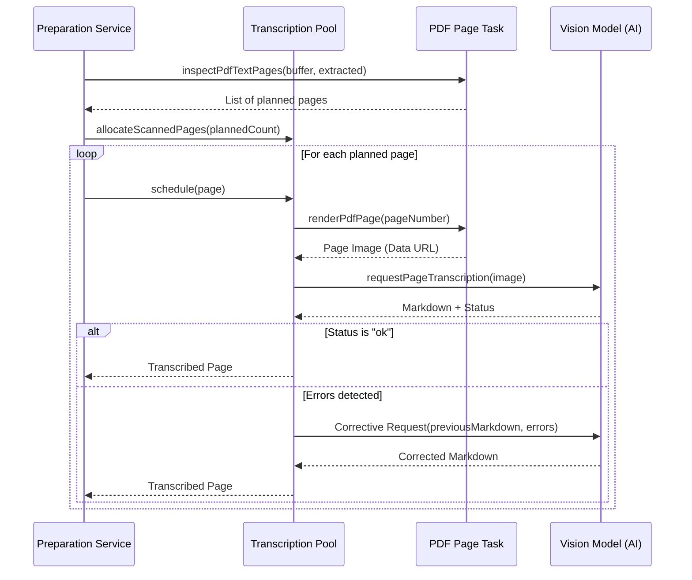

Relevant source files

The following files were used as context for generating this wiki page:

- [apps/backend/src/services/pdfTextExtractor.ts](https://github.com/immagiov4/Nous/blob/21ec8b9ef2e9c48eae54d59ba738a6dc8f10dee6/apps/backend/src/services/pdfTextExtractor.ts)
- [apps/backend/src/services/pdfPageTranscription.ts](https://github.com/immagiov4/Nous/blob/21ec8b9ef2e9c48eae54d59ba738a6dc8f10dee6/apps/backend/src/services/pdfPageTranscription.ts)
- [apps/backend/tests/services/pdfTextExtractor.test.ts](https://github.com/immagiov4/Nous/blob/21ec8b9ef2e9c48eae54d59ba738a6dc8f10dee6/apps/backend/tests/services/pdfTextExtractor.test.ts)
- [apps/backend/tests/services/sourcePreparationSlowProof.test.ts](https://github.com/immagiov4/Nous/blob/21ec8b9ef2e9c48eae54d59ba738a6dc8f10dee6/apps/backend/tests/services/sourcePreparationSlowProof.test.ts)
- [apps/backend/tests/workflows/courseSourceFinalization.test.ts](https://github.com/immagiov4/Nous/blob/21ec8b9ef2e9c48eae54d59ba738a6dc8f10dee6/apps/backend/tests/workflows/courseSourceFinalization.test.ts)
- [apps/backend/src/routes/chatPrompts.ts](https://github.com/immagiov4/Nous/blob/21ec8b9ef2e9c48eae54d59ba738a6dc8f10dee6/apps/backend/src/routes/chatPrompts.ts)

# PDF Processing Workers

PDF Processing Workers transform uploaded PDF documents into structured didactic content. The system extracts text layers, identifies document structure, and transcribes scanned or complex pages using vision-based AI models.

These workers execute a tiered extraction strategy. They attempt native text extraction first to minimize cost and latency. If native extraction yields unusable results, the system triggers vision-based transcription for individual pages.

## Text Extraction Pipeline

The extraction pipeline identifies and retrieves the text content of a PDF document. It prioritizes speed and fidelity by attempting multiple extraction methods in sequence.

### Layered Extraction Logic
The `extractPdfTextLayer` function coordinates the extraction process. It first decodes the PDF Data URL into a buffer and generates a SHA-256 hash for identification. The pipeline follows three distinct stages:

1.  **Native Extraction**: The worker invokes `pdftotext` with a layout-preserving flag. This method maintains the original spacing and alignment of the text.
2.  **Fallback Extraction**: If `pdftotext` fails or is missing, the worker executes a separate Node.js process using `pdf-parse`. This fallback runs in an isolated process to manage memory limits via `--max-old-space-size`.
3.  **Vision Transcription**: If the extracted text is empty or identified as scanned, the system schedules vision-based transcription.

Sources: [apps/backend/src/services/pdfTextExtractor.ts](https://github.com/immagiov4/Nous/blob/21ec8b9ef2e9c48eae54d59ba738a6dc8f10dee6/apps/backend/src/services/pdfTextExtractor.ts), [apps/backend/tests/services/pdfTextExtractor.test.ts](https://github.com/immagiov4/Nous/blob/21ec8b9ef2e9c48eae54d59ba738a6dc8f10dee6/apps/backend/tests/services/pdfTextExtractor.test.ts)

### Deterministic Outline Building
When a PDF lacks a native table of contents, the `buildDeterministicPdfOutline` function generates a hierarchy from the text. It scans for lines matching specific patterns:
*   Numbered headings (e.g., "1.1 Concetti essenziali").
*   Named markers (e.g., "Chapter", "Sezione", "Parte").

The worker builds a tree structure based on the depth of the numbering or the specific marker type.
Sources: [apps/backend/src/services/pdfTextExtractor.ts:251-285](https://github.com/immagiov4/Nous/blob/21ec8b9ef2e9c48eae54d59ba738a6dc8f10dee6/apps/backend/src/services/pdfTextExtractor.ts#L251-L285), [apps/backend/tests/services/pdfTextExtractor.test.ts:75-103](https://github.com/immagiov4/Nous/blob/21ec8b9ef2e9c48eae54d59ba738a6dc8f10dee6/apps/backend/tests/services/pdfTextExtractor.test.ts#L75-L103)

## Vision Transcription Workflow

Vision transcription processes pages that native parsers cannot read, such as handwritten notes or scanned documents. It uses AI vision models to transcribe images of PDF pages into LaTeX-compatible Markdown.

### Transcription Lifecycle
The `preparePdfTextExtraction` function manages the transcription queue. It identifies "planned" pages—those lacking readable text—and allocates them to a `PdfTranscriptionPool`.

1.  **Inspection**: `inspectPdfTextPages` determines which pages require vision processing based on text density and quality markers.
2.  **Rendering**: `renderPdfPage` converts the PDF page into a high-resolution PNG image (default width: 1800px).
3.  **Transcription**: The worker sends the image to a vision model (e.g., via OpenRouter). It provides specific instructions to preserve mathematical symbols in LaTeX format ($...$ for inline, $$...$$ for display).
4.  **Correction**: If the model returns unreadable status or math syntax errors, the system performs a second attempt with corrective feedback.

Sources: [apps/backend/src/services/pdfPageTranscription.ts:182-321](https://github.com/immagiov4/Nous/blob/21ec8b9ef2e9c48eae54d59ba738a6dc8f10dee6/apps/backend/src/services/pdfPageTranscription.ts#L182-L321), [apps/backend/tests/services/sourcePreparationSlowProof.test.ts:19-120](https://github.com/immagiov4/Nous/blob/21ec8b9ef2e9c48eae54d59ba738a6dc8f10dee6/apps/backend/tests/services/sourcePreparationSlowProof.test.ts#L19-L120)

### Mathematical Normalization
The transcription process enforces strict mathematical formatting. The `TRANSCRIPTION_INSTRUCTIONS` mandate:
*   Use of standard LaTeX supported by KaTeX.
*   Separation of $$ delimiters onto new lines for multiline formulas.
*   Escaping of literal dollar signs (\$ in prose).
*   Faithful preservation of quantifiers, set memberships, and arrows.
Sources: [apps/backend/src/services/pdfPageTranscription.ts:51-54](https://github.com/immagiov4/Nous/blob/21ec8b9ef2e9c48eae54d59ba738a6dc8f10dee6/apps/backend/src/services/pdfPageTranscription.ts#L51-L54)

## System Constraints and Configuration

The PDF processing system implements several resource limits to ensure backend stability and manage costs.

### Processing Limits
| Parameter | Default Value | Description |
| :--- | :--- | :--- |
| `maxOutputBytes` | Variable | Caps the total text extracted from a single PDF. |
| `pdftotextTimeoutMs` | 15,000ms | Timeout for the native extraction tool. |
| `fallbackTimeoutMs` | 15,000ms | Timeout for the `pdf-parse` fallback process. |
| `renderWidth` | 1800px | Target width for rendering pages for transcription. |
| `attemptTimeoutMs` | 150,000ms | Timeout for a single AI transcription request. |

Sources: [apps/backend/src/services/pdfTextExtractor.ts:60-65](https://github.com/immagiov4/Nous/blob/21ec8b9ef2e9c48eae54d59ba738a6dc8f10dee6/apps/backend/src/services/pdfTextExtractor.ts#L60-L65), [apps/backend/src/services/pdfPageTranscription.ts:25-30](https://github.com/immagiov4/Nous/blob/21ec8b9ef2e9c48eae54d59ba738a6dc8f10dee6/apps/backend/src/services/pdfPageTranscription.ts#L25-L30)

### Error Handling
The system distinguishes between recoverable and permanent failures:
*   **PdfTextExtractionTimeoutError**: Occurs when a parser exceeds its time budget.
*   **PdfTextExtractionOutputLimitError**: Occurs when the text content exceeds `maxOutputBytes` or triggers a heap out-of-memory error in the fallback process.
*   **Transcription Failure**: If a page cannot be transcribed after two attempts, it is marked as failed. The system continues processing other pages.
Sources: [apps/backend/src/services/pdfTextExtractor.ts:67-79](https://github.com/immagiov4/Nous/blob/21ec8b9ef2e9c48eae54d59ba738a6dc8f10dee6/apps/backend/src/services/pdfTextExtractor.ts#L67-L79), [apps/backend/src/services/pdfPageTranscription.ts:246-261](https://github.com/immagiov4/Nous/blob/21ec8b9ef2e9c48eae54d59ba738a6dc8f10dee6/apps/backend/src/services/pdfPageTranscription.ts#L246-L261)

## Integration with Course Generation

After extraction, the system maps the processed PDF text to the course structure.

1.  **Chunking**: The extracted text is indexed into chunks with metadata (sourceId, page numbers, heading paths).
2.  **Mapping**: The `CourseChunkMappingBatch` process maps these chunks to specific lessons.
3.  **Finalization**: `completeCourseSourceFinalization` attaches `primaryChunkIds` and `sourceReferences` to lessons, allowing the UI to link directly to specific PDF pages.

Sources: [apps/backend/tests/workflows/courseSourceFinalization.test.ts:233-261](https://github.com/immagiov4/Nous/blob/21ec8b9ef2e9c48eae54d59ba738a6dc8f10dee6/apps/backend/tests/workflows/courseSourceFinalization.test.ts#L233-L261), [apps/backend/src/routes/chatPrompts.ts:404-421](https://github.com/immagiov4/Nous/blob/21ec8b9ef2e9c48eae54d59ba738a6dc8f10dee6/apps/backend/src/routes/chatPrompts.ts#L404-L421)

PDF Processing Workers ensure that didactic content is extracted with high precision, balancing the efficiency of native extraction with the robust capabilities of AI-driven vision transcription.
