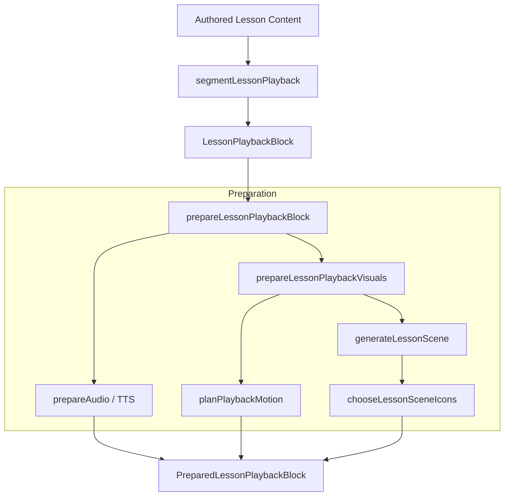
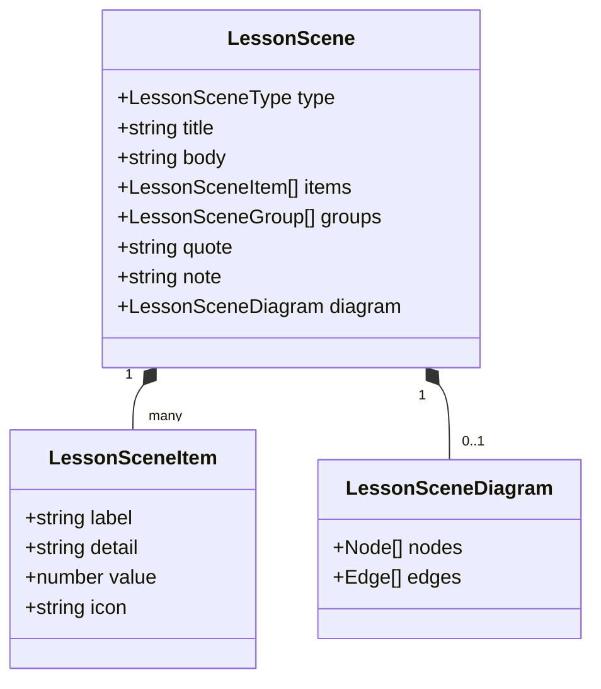
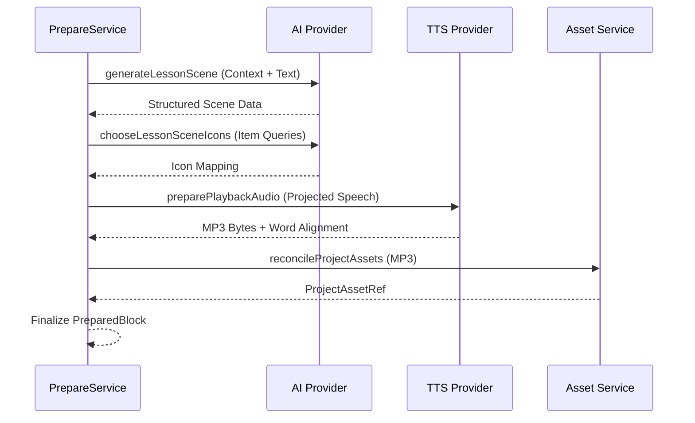

Relevant source files

The following files were used as context for generating this wiki page:

- [apps/backend/src/services/lessonPlayback/prepareLessonPlaybackBlock.ts](https://github.com/immagiov4/Nous/blob/21ec8b9ef2e9c48eae54d59ba738a6dc8f10dee6/apps/backend/src/services/lessonPlayback/prepareLessonPlaybackBlock.ts)
- [packages/shared-types/lessonPlayback.ts](https://github.com/immagiov4/Nous/blob/21ec8b9ef2e9c48eae54d59ba738a6dc8f10dee6/packages/shared-types/lessonPlayback.ts)
- [packages/shared-types/lessonPlaybackSchema.ts](https://github.com/immagiov4/Nous/blob/21ec8b9ef2e9c48eae54d59ba738a6dc8f10dee6/packages/shared-types/lessonPlaybackSchema.ts)
- [apps/backend/tests/projects/lessonPlayback.test.ts](https://github.com/immagiov4/Nous/blob/21ec8b9ef2e9c48eae54d59ba738a6dc8f10dee6/apps/backend/tests/projects/lessonPlayback.test.ts)
- [apps/backend/src/services/lessonScenes/lessonSceneGeneration.ts](https://github.com/immagiov4/Nous/blob/21ec8b9ef2e9c48eae54d59ba738a6dc8f10dee6/apps/backend/src/services/lessonScenes/lessonSceneGeneration.ts)
- [packages/shared-types/lessonScene.ts](https://github.com/immagiov4/Nous/blob/21ec8b9ef2e9c48eae54d59ba738a6dc8f10dee6/packages/shared-types/lessonScene.ts)

# Backend Playback Services

Backend Playback Services process lesson content into a multimodal experience by generating synchronized audio and structured visuals. These services segment authored Markdown text, resolve mathematical pronunciations, and orchestrate the generation of educational scenes that align with the spoken narration.

The system ensures that each playback session remains consistent with the authored source through a deterministic fingerprinting mechanism. When a user opens a lesson, the backend prepares the necessary assets—including Text-to-Speech (TTS) files and visual animation cues—to allow the frontend player to highlight specific symbols and concepts in real-time.

## Core Architecture and Data Flow

The playback system operates on a pipeline that transforms raw content blocks into a structured `LessonPlayback` object. This object contains a series of `LessonPlaybackBlock` units, each representing a narrated segment with associated visuals.

### Playback Preparation Lifecycle

The lifecycle begins with the segmentation of lesson Markdown into logical blocks based on headings and paragraph structures. Once segmented, the service prepares each block by generating audio and resolving visual cues.

*Diagram 1: The backend pipeline for transforming authored content into prepared playback assets.*
Sources: [apps/backend/src/services/lessonPlayback/prepareLessonPlaybackBlock.ts](https://github.com/immagiov4/Nous/blob/21ec8b9ef2e9c48eae54d59ba738a6dc8f10dee6/apps/backend/src/services/lessonPlayback/prepareLessonPlaybackBlock.ts), [packages/shared-types/lessonPlayback.ts](https://github.com/immagiov4/Nous/blob/21ec8b9ef2e9c48eae54d59ba738a6dc8f10dee6/packages/shared-types/lessonPlayback.ts)

### Invalidation and Caching

To prevent redundant processing, the system uses a `lessonKey` to fingerprint the state of a lesson. Any change to the lesson content, such as modifying text or updating a referenced visual, invalidates the existing playback key and triggers a re-preparation of the audio and visual assets.

*   **Fingerprint Factors:** The key includes projected speech, referenced visual IDs, and the content of stored visuals.
*   **Persistent State:** Ordinary saves preserve server-side playback data unless the content is explicitly replaced or the generation ID changes.
*   **Audio Queueing:** When playback is invalidated, the system queues new audio generation for the affected sections.

Sources: [apps/backend/tests/projects/lessonPlayback.test.ts](https://github.com/immagiov4/Nous/blob/21ec8b9ef2e9c48eae54d59ba738a6dc8f10dee6/apps/backend/tests/projects/lessonPlayback.test.ts)

## Data Models

The following structures define the contract between the playback services and the rest of the application.

### LessonPlaybackBlock
The `LessonPlaybackBlock` is the primary unit of delivery. It contains the text to be spoken, the mapping back to the original source, and the prepared assets.

| Field | Type | Description |
| :--- | :--- | :--- |
| `id` | `string` | Stable identifier for the block within a lesson version. |
| `speech` | `string` | The final text projected for Text-to-Speech narration. |
| `spans` | `PlaybackTextSpan[]` | Mappings between speech offsets and authored source offsets. |
| `visuals` | `PlaybackVisual[]` | List of visuals (Markdown, Scenes, or Images) associated with the block. |
| `prepared` | `Object` | Optional prepared data including `motion` events and the active `scene`. |
| `audio` | `PlaybackAudio[]` | References to generated MP3 assets and word alignment data. |

Sources: [packages/shared-types/lessonPlayback.ts](https://github.com/immagiov4/Nous/blob/21ec8b9ef2e9c48eae54d59ba738a6dc8f10dee6/packages/shared-types/lessonPlayback.ts), [packages/shared-types/lessonPlaybackSchema.ts](https://github.com/immagiov4/Nous/blob/21ec8b9ef2e9c48eae54d59ba738a6dc8f10dee6/packages/shared-types/lessonPlaybackSchema.ts)

### Lesson Scene Structure
Scenes are structured visual representations used to clarify complex relationships or processes.

*Diagram 2: The structured data model for generated lesson scenes.*
Sources: [packages/shared-types/lessonScene.ts](https://github.com/immagiov4/Nous/blob/21ec8b9ef2e9c48eae54d59ba738a6dc8f10dee6/packages/shared-types/lessonScene.ts), [apps/backend/src/services/lessonScenes/lessonSceneGeneration.ts](https://github.com/immagiov4/Nous/blob/21ec8b9ef2e9c48eae54d59ba738a6dc8f10dee6/apps/backend/src/services/lessonScenes/lessonSceneGeneration.ts)

## Key Service Operations

### Speech Preparation and Math Resolution
Authored Markdown often contains mathematical formulas that require specific pronunciations for effective TTS. 

1.  **Detection:** The service identifies math delimiters (`\(...\)`, `\[...\]`) and ambiguous fenced code blocks.
2.  **Projection:** It generates a "projected speech" version where math and code are replaced by model-generated prose.
3.  **Spoken Math:** `validatePlaybackSpokenMath` ensures that every formula occurrence has a corresponding pronunciation entry in the `prepared` metadata.
4.  **Alignment:** `preparePlaybackAudio` generates the MP3 and optionally requests word-level timing to allow the UI to highlight text during playback.

Sources: [packages/shared-types/lessonPlayback.ts](https://github.com/immagiov4/Nous/blob/21ec8b9ef2e9c48eae54d59ba738a6dc8f10dee6/packages/shared-types/lessonPlayback.ts), [apps/backend/src/services/lessonPlayback/prepareLessonPlaybackBlock.ts](https://github.com/immagiov4/Nous/blob/21ec8b9ef2e9c48eae54d59ba738a6dc8f10dee6/apps/backend/src/services/lessonPlayback/prepareLessonPlaybackBlock.ts)

### Visual and Motion Planning
`prepareLessonPlaybackVisuals` determines how the UI should behave as the narration progresses.

*   **Scene Generation:** If a block requires a visual, the service calls `generateLessonScene`. This process involves selecting a scene type (e.g., `checklist`, `comparison`, `flowchart`) based on the pedagogical context of the passage.
*   **Motion Events:** `planPlaybackMotion` identifies specific targets within a scene (e.g., a node in a diagram or a row in a matrix) and associates them with `focus` or `reveal` effects triggered by specific quotes in the narration.
*   **Animation Cues:** `resolvePlaybackAnimationCues` synchronizes the visual state transitions with the narration timing.

Sources: [apps/backend/src/services/lessonPlayback/prepareLessonPlaybackBlock.ts](https://github.com/immagiov4/Nous/blob/21ec8b9ef2e9c48eae54d59ba738a6dc8f10dee6/apps/backend/src/services/lessonPlayback/prepareLessonPlaybackBlock.ts), [packages/shared-types/lessonPlayback.ts](https://github.com/immagiov4/Nous/blob/21ec8b9ef2e9c48eae54d59ba738a6dc8f10dee6/packages/shared-types/lessonPlayback.ts)

### Workflow Sequence Diagram

This diagram illustrates the interaction between the preparation service and external providers during a typical block preparation request.

*Diagram 3: Interaction flow for preparing audio and visual assets.*
Sources: [apps/backend/src/services/lessonPlayback/prepareLessonPlaybackBlock.ts](https://github.com/immagiov4/Nous/blob/21ec8b9ef2e9c48eae54d59ba738a6dc8f10dee6/apps/backend/src/services/lessonPlayback/prepareLessonPlaybackBlock.ts), [apps/backend/src/services/lessonScenes/lessonSceneGeneration.ts](https://github.com/immagiov4/Nous/blob/21ec8b9ef2e9c48eae54d59ba738a6dc8f10dee6/apps/backend/src/services/lessonScenes/lessonSceneGeneration.ts)

## Implementation Details

### Scene Catalog Requirements
The backend enforces strict rules for scene generation to ensure pedagogical quality:
*   **Independent Content:** `LESSON_SCENE_INDEPENDENT_CONTENT_RULE` mandates that scenes preserve every step or computation required by the teaching goal.
*   **Closing Text:** `LESSON_SCENE_CLOSING_TEXT_RULE` prevents redundant information by restricting notes and questions to essential cases.
*   **Diagram Constraints:** Flowcharts and sequence diagrams must have between 2 and 8 nodes and carry exact lesson quotations as evidence for every connection.

Sources: [apps/backend/src/services/lessonScenes/lessonSceneGeneration.ts](https://github.com/immagiov4/Nous/blob/21ec8b9ef2e9c48eae54d59ba738a6dc8f10dee6/apps/backend/src/services/lessonScenes/lessonSceneGeneration.ts), [packages/shared-types/lessonScene.ts](https://github.com/immagiov4/Nous/blob/21ec8b9ef2e9c48eae54d59ba738a6dc8f10dee6/packages/shared-types/lessonScene.ts)

### Audio Constraints
*   **Format:** The system explicitly requires `audio/mpeg` (MP3) for playback assets.
*   **Validation:** `canonicalizeLessonNodeContent` rejects any playback asset that does not match the canonical MP3 media type during import or save operations.

Sources: [apps/backend/tests/projects/lessonPlayback.test.ts](https://github.com/immagiov4/Nous/blob/21ec8b9ef2e9c48eae54d59ba738a6dc8f10dee6/apps/backend/tests/projects/lessonPlayback.test.ts), [packages/shared-types/lessonPlaybackSchema.ts](https://github.com/immagiov4/Nous/blob/21ec8b9ef2e9c48eae54d59ba738a6dc8f10dee6/packages/shared-types/lessonPlaybackSchema.ts)

Backend Playback Services integrate complex AI-driven visual generation with deterministic text processing and TTS. By centering preparation on the `LessonPlaybackBlock` and using robust fingerprinting, the system provides a low-latency, synchronized learning experience that remains faithful to the authored source material.
