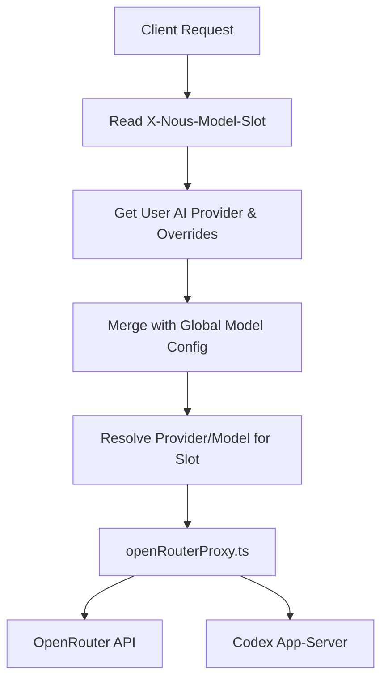

<details>
<summary>Relevant source files</summary>

The following files were used as context for generating this wiki page:

- [apps/backend/src/routes/openRouterProxy.ts](../../../apps/backend/src/routes/openRouterProxy.ts)
- [apps/backend/src/config/modelConfig.ts](../../../apps/backend/src/config/modelConfig.ts)
- [apps/backend/tests/config/modelConfig.test.ts](../../../apps/backend/tests/config/modelConfig.test.ts)
- [apps/backend/src/services/lessonGenerationModel.ts](../../../apps/backend/src/services/lessonGenerationModel.ts)
- [apps/web/tests/components/admin/AdminPanel.test.tsx](../../../apps/web/tests/components/admin/AdminPanel.test.tsx)
- [apps/backend/src/services/courseCoverRegeneration.ts](../../../apps/backend/src/services/courseCoverRegeneration.ts)
</details>

# AI Provider Setup & Configuration

AI Provider Setup & Configuration in Nous is a multi-layered system designed to manage interactions with two Large Language Model (LLM) providers: OpenRouter and Codex through ChatGPT login. The system centralizes model selection, reasoning effort levels, and credential management to ensure consistent AI behavior across different functional "slots" such as lesson generation, course planning, and research.

The architecture relies on a global configuration that can be overridden at the user level, allowing for flexible deployments ranging from shared hosted instances to private, self-hosted environments using the Codex app-server. This configuration determines not only which model is used for a specific task but also how parameters like reasoning effort and service tiers are applied during the API proxying phase.

## Architecture & Data Flow

The system uses a proxy-based approach to route requests to AI providers. The `openRouterProxy` acts as a central gateway for all AI interactions, resolving the appropriate model and provider based on the requested "Model Slot."

### Model Slot Resolution
Every AI request must specify a `X-Nous-Model-Slot`. This slot maps the high-level intent (e.g., generating a lesson) to a specific model and provider configuration defined in the backend.



*The diagram above shows the flow from an initial client request through the resolution of model configurations to the final provider routing.*
Sources: [apps/backend/src/routes/openRouterProxy.ts:98-111](../../../apps/backend/src/routes/openRouterProxy.ts#L98-L111), [apps/backend/src/config/modelConfig.ts](../../../apps/backend/src/config/modelConfig.ts)

### Provider Implementation Details
The project distinguishes between two provider types:
1.  **OpenRouter**: Used as the default aggregator. Supports specialized headers like `X-Title` and reasoning effort configurations.
2.  **Codex**: A specialized internal provider that runs via `runCodexAppServerTurn`. It is used for secure, server-side processing without exposing raw provider tokens to the client.

Sources: [apps/backend/src/routes/openRouterProxy.ts:50-65](../../../apps/backend/src/routes/openRouterProxy.ts#L50-L65), [apps/backend/src/routes/openRouterProxy.ts:133-172](../../../apps/backend/src/routes/openRouterProxy.ts#L133-L172)

### Structured outputs

Backend features that need one schema-bound model answer call `generateStructuredOutput` with a slot, a named JSON Schema, a system prompt and a prompt. It resolves the slot's provider and model. Codex runs an app-server turn without tools, except web search when the caller requests it, and its JSON answer is parsed; OpenRouter uses the AI SDK's object output. The module does not validate the result against the schema; callers own any validation. Malformed output surfaces as `SyntaxError` or `NoObjectGeneratedError`, which lesson correction retries recognize. An optional `webSearch` flag lets Codex search the web while still forbidding local files, and gives AI SDK models the provider's search tools. Callers that pin a model in durable workflow state pass that resolved model instead of a slot, and a caller can show one image before the prompt. Lesson research, drafting, coverage, learning aids, YouTube query planning, factual evidence review, lesson verification, lesson visual planning and rendering, and course cover planning use it. Course generation keeps its own provider seam because it passes caller-defined tools to the model.

Codex and OpenRouter structured responses share `prepareStrictStructuredOutput` with the course generator. The OpenRouter AI SDK sends `strict: true` for object output by default, so the adapter applies to both transports independently of the selected model. It recursively makes optional object properties required and nullable in the provider schema, including properties inside arrays and union branches. Root values other than object schemas use a required `result` envelope. The parsed response is unwrapped and provider-only nulls are removed before caller validation; required fields and fields whose original schema allows null keep their values. The adapter also converts `oneOf` to the supported `anyOf` representation and removes the unsupported URI format. Domain schemas, durable workflow manifests and definition hashes retain their original contracts.

When OpenRouter rejects compilation of the provider schema, structured generation uses its existing JSON-string envelope and includes the original domain schema in the prompt. The decoded payload restores optional null fields with the same normalizer as the direct path, without unwrapping a second root envelope. Required fields, explicitly nullable fields, and invalid values remain subject to caller validation. Scene failures retain bounded workflow diagnostics with the direct or JSON-envelope path, schema issue codes and paths, or domain problems with private model labels removed. The terminal playback error carries the final diagnostic into the durable workflow evidence.

Sources: [structuredGeneration.ts](../../../apps/backend/src/services/structuredGeneration.ts), [strictStructuredOutput.ts](../../../apps/backend/src/services/strictStructuredOutput.ts), [courseGenerationModel.ts](../../../apps/backend/src/workflows/courseGenerationModel.ts)

### PDF page transcription

Scanned-page transcription uses the existing `research` provider selection and the account's provider overrides. OpenRouter defaults to Luna: course scanned pages 1–150 use xhigh reasoning and pages 151–300 use medium. MODEL_PDF_TRANSCRIPTION and MODEL_PDF_TRANSCRIPTION_REDUCED configure both models (default openai/gpt-6-luna); PDF_TRANSCRIPTION_REASONING_EFFORT and PDF_TRANSCRIPTION_REDUCED_REASONING_EFFORT configure their efforts. PDF_TRANSCRIPTION_FULL_QUALITY_PAGES and PDF_TRANSCRIPTION_MAX_SCANNED_PAGES configure the course-wide boundaries. Real text-layer pages do not consume the allowance; splitting material across source files does not reset it. Admission beyond the second boundary raises PDF_SCANNED_PAGE_LIMIT before rendering or provider calls, with a localized instruction to narrow the material to the parts needed. Reduced-quality page ranges appear in the existing processing message. For this default model, transcription requests pin OpenRouter provider order and allowlist to `openai` with cross-provider fallback disabled; `PDF_TRANSCRIPTION_OPENROUTER_PROVIDER` overrides the upstream slug. Other model overrides use normal routing unless that upstream override is set. The restriction belongs to transcription, not the shared text-model adapter: PDF figure captions and other structured calls keep their own existing routes. A missing or unavailable pinned endpoint produces an explicit page failure through the bounded request path, never an implicit Azure fallback. Codex uses `CODEX_MODEL_PDF_TRANSCRIPTION` when set, otherwise its configured research model and reasoning/service-tier settings. Models must accept image input. Successful page calls report input/output tokens and provider cost where available; subscription providers need not report a dollar amount. The shared pool size is configurable with `PDF_TRANSCRIPTION_CONCURRENCY` (default 32). Safe request IDs and upstream provider/model identity are logged when supplied; absent endpoint metadata is not inferred. Page failures remain explicit. The source-ingestion job owns the course-wide page allowance and shared pool.

All downstream course and structured-generation calls receive the shared transcription-provenance rule. Source metadata identifies the affected pages; the factual reviewer uses its existing evidence-reference validator when accepting a justified correction of an evident transcription error.

## Configuration Components

### Global Model Configuration
The `GlobalModelConfig` structure defines the default models and reasoning levels for the entire application. It includes mappings for specific slots like `artifact`, `assessment`, `course`, and `lesson`.

| Parameter | Description | Supported Values |
| :--- | :--- | :--- |
| `aiProvider` | The default AI provider for the system. | `openrouter`, `codex` |
| Per-slot reasoning fields | The reasoning level is configured per text-model slot (for example, `lessonReasoningEffort` or `researchReasoningEffort`). | `none`, `minimal`, `low`, `medium`, `high` |
| `codexFastModelSlots` | Selects the Codex slots for which the `fast` service tier is derived. | Text-model slot names |
| `aiProviderOverrides` | Map of specific slots to alternative providers. | Key-Value pairs (e.g., `lesson: codex`) |

Sources: [apps/backend/src/config/modelConfig.ts:27-69](../../../apps/backend/src/config/modelConfig.ts#L27-L69), [apps/backend/src/config/modelConfig.ts:284-287](../../../apps/backend/src/config/modelConfig.ts#L284-L287), [apps/backend/tests/config/modelConfig.test.ts:13-52](../../../apps/backend/tests/config/modelConfig.test.ts#L13-L52)

### Unknown provider values

The supported provider values are `openrouter` and `codex`. An unknown `AI_PROVIDER` environment value uses the existing `openrouter` default. A persisted global row with an unknown `ai_provider` retains the active provider; invalid per-slot overrides are filtered out. Unknown account metadata providers are ignored, so requests use the global configuration. The administrative client applies the same provider and override filtering when reading user responses, so account controls show the effective global defaults while stored metadata remains unchanged. Administrative writes reject an invalid primary `aiProvider` with HTTP 400 and filter invalid per-slot overrides. New durable workflow and lesson visual configurations reject unsupported providers; frozen historical schemas reconstruct archived workflow definitions. SQL migrations remain immutable schema records.

Sources: [modelConfig.ts](../../../apps/backend/src/config/modelConfig.ts), [currentUser.ts](../../../apps/backend/src/auth/currentUser.ts), [admin.ts](../../../apps/backend/src/routes/admin.ts), [adminApi.ts](../../../apps/web/services/admin/adminApi.ts), [modelConfigSchema.ts](../../../apps/backend/src/workflows/modelConfigSchema.ts), [lessonVisualModelConfig.ts](../../../apps/backend/src/services/lessonVisualModelConfig.ts)

### Model Slots
The system categorizes AI tasks into distinct slots, allowing granular control over which model handles which type of work:
*  **Artifact**: Used for generating visual or interactive elements.
*  **Assessment**: Used for student evaluation and chat-based interviews.
*  **Course**: Handles high-level course planning and structuring.
*  **Lesson**: Manages the detailed generation of lesson content.
*  **Research**: Utilizes models with web-search capabilities for factual gathering.
*  **Playback preparation** (`playbackPreparation`): Prepares lesson playback highlighting independently of lesson generation; defaults to `anthropic/claude-haiku-5.5` on OpenRouter and to `gpt-6-luna` on Codex; low reasoning and the Codex `fast` tier. Like scene slots, it follows the global provider and is read from live configuration, outside durable workflow config.
*  **Scene** and **Scene icon**: Compose lesson scenes and choose their icons. They follow the provider resolved for the run's visuals (no scene-specific provider override), use the Codex `fast` tier when Codex is selected, and are read from the live configuration because durable workflow config omits them. `embeddingModel` (OpenRouter) indexes the icon catalog.

Sources: [apps/backend/src/routes/openRouterProxy.ts:80-92](../../../apps/backend/src/routes/openRouterProxy.ts#L80-L92), [apps/backend/src/config/modelConfig.ts:195-227](../../../apps/backend/src/config/modelConfig.ts#L195-L227), [apps/backend/src/config/modelConfig.ts:322-327](../../../apps/backend/src/config/modelConfig.ts#L322-L327), [apps/backend/src/services/structuredGeneration.ts:55-67](../../../apps/backend/src/services/structuredGeneration.ts#L55-L67)

## Proxy Logic & Request Transformation

The `openRouterProxy.ts` handles the transformation of generic chat requests into provider-specific payloads.

### Handling Specialized Tools
OpenRouter research requests retain the `openrouter:web_search` tool and use the configured research model. Codex research turns enable app-server web search. The proxy keeps these provider-specific paths separate.

Sources: [openRouterProxy.ts](../../../apps/backend/src/routes/openRouterProxy.ts), [chatPrompts.ts](../../../apps/backend/src/routes/chatPrompts.ts)

### Image Input Filtering
The proxy implements safety checks for multimodal inputs. If a model is identified as not supporting images (via `openRouterModelSupportsImages`), the proxy strips `image_url` content from the messages before forwarding the request to prevent API errors.
Sources: [apps/backend/src/routes/openRouterProxy.ts:175-197](../../../apps/backend/src/routes/openRouterProxy.ts#L175-L197)

## Administrative Configuration

Admin users can modify the AI provider setup through the `AdminPanel`. This interface allows for:
*  **Global Provider Swapping**: Changing the primary `aiProvider`.
*  **Slot Overrides**: Setting a user-specific provider for a single function (e.g., forcing a specific user to use `codex` for `lesson` while the rest of the system uses `openrouter`).
*  **Reasoning Adjustment**: Fine-tuning the `reasoningEffort` for different task types.

Sources: [apps/web/tests/components/admin/AdminPanel.test.tsx:143-162](../../../apps/web/tests/components/admin/AdminPanel.test.tsx#L143-L162), [apps/web/tests/components/admin/AdminPanel.test.tsx:238-259](../../../apps/web/tests/components/admin/AdminPanel.test.tsx#L238-L259)

## Service Tiers & Reasoning

Reasoning levels are mapped per provider to their native API equivalents. For example, OpenRouter uses a `reasoning` object with `effort` and `enabled` fields, while the Codex adapter reads `reasoning_effort` for the app-server turn.

```typescript
// Example of reasoning mapping in openRouterProxy.ts
const reasoning = isRecord(openRouterRequestBody.reasoning)
  ? openRouterRequestBody.reasoning
  : {};
return {
  provider,
  body: {
    ...openRouterRequestBody,
    model,
    reasoning: {
      ...reasoning,
      enabled: true,
      effort: reasoningEffort,
    },
  },
};
```

Sources: [apps/backend/src/routes/openRouterProxy.ts:208-223](../../../apps/backend/src/routes/openRouterProxy.ts#L208-L223), [apps/backend/tests/config/modelConfig.test.ts:98-102](../../../apps/backend/tests/config/modelConfig.test.ts#L98-L102)

## Conclusion

The AI Provider Setup & Configuration system provides a robust abstraction layer that separates the functional requirements of the application from the specifics of LLM APIs. By utilizing Model Slots and a centralized Proxy, Nous maintains high flexibility in model selection while enforcing consistent reasoning policies and secure credential management across all AI-driven features.
