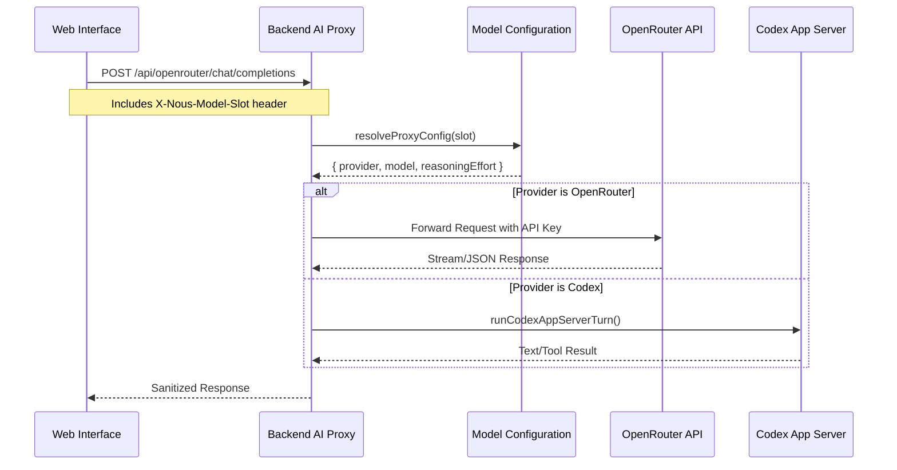
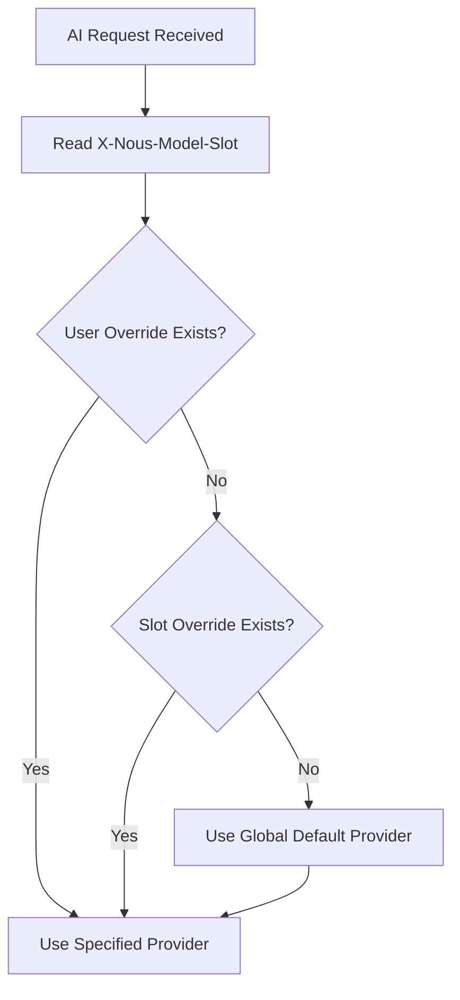
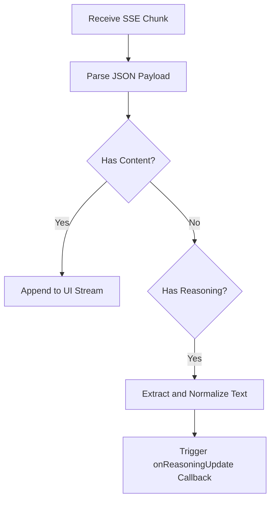

<details>
<summary>Relevant source files</summary>

The following files were used as context for generating this wiki page:

- [apps/backend/src/routes/openRouterProxy.ts](https://github.com/immagiov4/Nous/blob/21ec8b9ef2e9c48eae54d59ba738a6dc8f10dee6/apps/backend/src/routes/openRouterProxy.ts)
- [apps/backend/src/services/aiSdkTextModel.ts](https://github.com/immagiov4/Nous/blob/21ec8b9ef2e9c48eae54d59ba738a6dc8f10dee6/apps/backend/src/services/aiSdkTextModel.ts)
- [apps/web/services/openrouter/client.ts](https://github.com/immagiov4/Nous/blob/21ec8b9ef2e9c48eae54d59ba738a6dc8f10dee6/apps/web/services/openrouter/client.ts)
- [scripts/real-workflow-provider-config.ts](https://github.com/immagiov4/Nous/blob/21ec8b9ef2e9c48eae54d59ba738a6dc8f10dee6/scripts/real-workflow-provider-config.ts)
- [apps/backend/src/routes/chatPrompts.ts](https://github.com/immagiov4/Nous/blob/21ec8b9ef2e9c48eae54d59ba738a6dc8f10dee6/apps/backend/src/routes/chatPrompts.ts)
- [apps/backend/tests/routes/openRouterProxy.test.ts](https://github.com/immagiov4/Nous/blob/21ec8b9ef2e9c48eae54d59ba738a6dc8f10dee6/apps/backend/tests/routes/openRouterProxy.test.ts)
- [apps/web/tests/components/admin/AdminPanel.test.tsx](https://github.com/immagiov4/Nous/blob/21ec8b9ef2e9c48eae54d59ba738a6dc8f10dee6/apps/web/tests/components/admin/AdminPanel.test.tsx)
</details>

# OpenRouter & AI Provider Configuration

The OpenRouter and AI Provider Configuration system manages the routing, authentication, and execution of Large Language Model (LLM) requests across the Nous platform. It supports a dual-provider architecture: **OpenRouter**, which serves as an aggregator for various third-party models (OpenAI, Google, Anthropic, etc.), and **Codex**, an internal application server for specialized tasks.

The system uses a "slot-based" configuration, where specific pedagogical functions—such as lesson generation, artifact creation, or research—are mapped to specific models, providers, and reasoning efforts. This ensures that the most appropriate model is used for each task while maintaining centralized control over API keys and costs.

Sources: [apps/backend/src/routes/openRouterProxy.ts](https://github.com/immagiov4/Nous/blob/21ec8b9ef2e9c48eae54d59ba738a6dc8f10dee6/apps/backend/src/routes/openRouterProxy.ts), [apps/backend/src/services/aiSdkTextModel.ts](https://github.com/immagiov4/Nous/blob/21ec8b9ef2e9c48eae54d59ba738a6dc8f10dee6/apps/backend/src/services/aiSdkTextModel.ts)

## Architecture Overview

The backend acts as a secure proxy between the client and the AI providers. When the web interface requests a completion, the backend intercepts the request, identifies the functional slot, resolves the configured model and provider, and injects the necessary authentication headers.

### AI Request Flow
The following sequence diagram illustrates the flow of an AI request from the User Interface through the Backend Proxy to the final Provider.


Sources: [apps/backend/src/routes/openRouterProxy.ts](https://github.com/immagiov4/Nous/blob/21ec8b9ef2e9c48eae54d59ba738a6dc8f10dee6/apps/backend/src/routes/openRouterProxy.ts), [apps/web/services/openrouter/client.ts](https://github.com/immagiov4/Nous/blob/21ec8b9ef2e9c48eae54d59ba738a6dc8f10dee6/apps/web/services/openrouter/client.ts)

## Functional Model Slots

Nous categorizes AI tasks into specific "slots." Each slot has its own configuration for the model name and the level of reasoning effort required.

| Slot | Description | Key Config Elements |
| :--- | :--- | :--- |
| `lesson` | Generates core pedagogical content and prose. | `lessonModel`, `lessonReasoningEffort` |
| `artifact` | Creates visual and static diagrams (SVG, Mermaid). | `artifactModel`, `artifactReasoningEffort` |
| `artifactInteractive` | Generates interactive HTML/JS labs and simulations. | `artifactInteractiveModel`, `artifactInteractiveReasoningEffort` |
| `research` | Performs web searches and supplementary research. | `researchModel`, `researchReasoningEffort` |
| `course` | Handles high-level course planning and syllabus creation. | `courseModel`, `courseReasoningEffort` |
| `assessment` | Conducts student interviews and knowledge checks. | `assessmentModel`, `assessmentReasoningEffort` |
| `progress` | Summarizes learning advancement and history. | `progressModel`, `progressReasoningEffort` |
| `playbackPreparation` | Prepares content for audio playback. | `playbackPreparationModel`, `playbackPreparationReasoningEffort` |

Sources: [apps/backend/src/routes/openRouterProxy.ts](https://github.com/immagiov4/Nous/blob/21ec8b9ef2e9c48eae54d59ba738a6dc8f10dee6/apps/backend/src/routes/openRouterProxy.ts), [apps/web/tests/components/admin/AdminPanel.test.tsx](https://github.com/immagiov4/Nous/blob/21ec8b9ef2e9c48eae54d59ba738a6dc8f10dee6/apps/web/tests/components/admin/AdminPanel.test.tsx)

## Provider Resolution Logic

The system determines the AI provider based on a hierarchy of settings. It first checks for specific user-level overrides, then falls back to global slot-based overrides, and finally uses the default global provider.



### Configuration Enforcement
The proxy enforces several rules during resolution:
1.  **Header Injection**: The proxy adds `X-Title: Nous Reader` and `HTTP-Referer` to OpenRouter requests for identification.
2.  **Service Tiers**: For OpenAI models routed through OpenRouter, the proxy automatically requests the `flex` economy service tier.
3.  **Image Fallback**: If a request contains images but the resolved model is text-only, the proxy strips the image inputs to prevent upstream errors, provided the `X-Nous-Allow-Text-Only-Image-Fallback` header is set to `true`.

Sources: [apps/backend/src/routes/openRouterProxy.ts](https://github.com/immagiov4/Nous/blob/21ec8b9ef2e9c48eae54d59ba738a6dc8f10dee6/apps/backend/src/routes/openRouterProxy.ts), [apps/backend/tests/routes/openRouterProxy.test.ts](https://github.com/immagiov4/Nous/blob/21ec8b9ef2e9c48eae54d59ba738a6dc8f10dee6/apps/backend/tests/routes/openRouterProxy.test.ts)

## Reasoning and Effort Mapping

Reasoning effort is a specific configuration that controls how much processing time a model dedicates to "thinking" before generating a response. This is primarily used for models that support explicit reasoning phases (e.g., OpenAI o1-style models).

### Configuration Options
The `ReasoningEffort` type supports the following levels:
*   `none`: Reasoning is disabled or not requested.
*   `minimal`: Lowest priority/cost reasoning.
*   `low`: Basic reasoning for simple logic tasks.
*   `medium`: Default for most interactive tasks.
*   `high`: Maximum effort for complex planning or coding.

When configuring OpenRouter through the AI SDK, the provider options are mapped as follows:
```typescript
export const resolveOpenRouterProviderOptions = (
  reasoningEffort: ResolvedTextModelRequest['reasoningEffort']
): Record<string, Record<string, JSONValue>> =>
  reasoningEffort === 'none'
    ? {}
    : {
        openrouter: { reasoning: { enabled: true, effort: reasoningEffort } },
      };
```
Sources: [apps/backend/src/services/aiSdkTextModel.ts](https://github.com/immagiov4/Nous/blob/21ec8b9ef2e9c48eae54d59ba738a6dc8f10dee6/apps/backend/src/services/aiSdkTextModel.ts), [apps/backend/src/routes/openRouterProxy.ts](https://github.com/immagiov4/Nous/blob/21ec8b9ef2e9c48eae54d59ba738a6dc8f10dee6/apps/backend/src/routes/openRouterProxy.ts)

## Client-Side Implementation

The web interface interacts with the proxy using the `callOpenRouter` service. This client handles streaming responses, reasoning updates, and tool calls.

### Streaming and Reasoning Extraction
The client decodes Server-Sent Events (SSE) from the proxy. It distinguishes between standard content deltas and reasoning deltas. Reasoning chunks are accumulated and preserved, maintaining paragraph breaks between distinct reasoning sections.



### Web Search Integration
For the `research` slot, the system integrates OpenRouter's web search tool. The client collects `url_citation` annotations from the model response and appends a "FONTI WEB RESTITUITE DAL PROVIDER" (Web Sources Returned by Provider) appendix to the generated text.

Sources: [apps/web/services/openrouter/client.ts](https://github.com/immagiov4/Nous/blob/21ec8b9ef2e9c48eae54d59ba738a6dc8f10dee6/apps/web/services/openrouter/client.ts), [apps/backend/src/routes/chatPrompts.ts](https://github.com/immagiov4/Nous/blob/21ec8b9ef2e9c48eae54d59ba738a6dc8f10dee6/apps/backend/src/routes/chatPrompts.ts)

## Tool Calling and Context Limits

The system supports multi-round tool calling. The client can execute tools requested by the model and feed the results back for a final answer. To prevent excessive cost and context window exhaustion, the system enforces a strict byte limit on cumulative tool results.

*   **Max Tool Rounds**: 6 steps.
*   **Context Limit**: Defined by `SOURCE_ARCHIVE_TOOL_CONTEXT_MAX_BYTES`. If the cumulative results of tool calls exceed this limit, the request is aborted with an error: "Il modello ha superato il limite cumulativo di consultazione della sorgente."

Sources: [apps/web/services/openrouter/client.ts](https://github.com/immagiov4/Nous/blob/21ec8b9ef2e9c48eae54d59ba738a6dc8f10dee6/apps/web/services/openrouter/client.ts)
