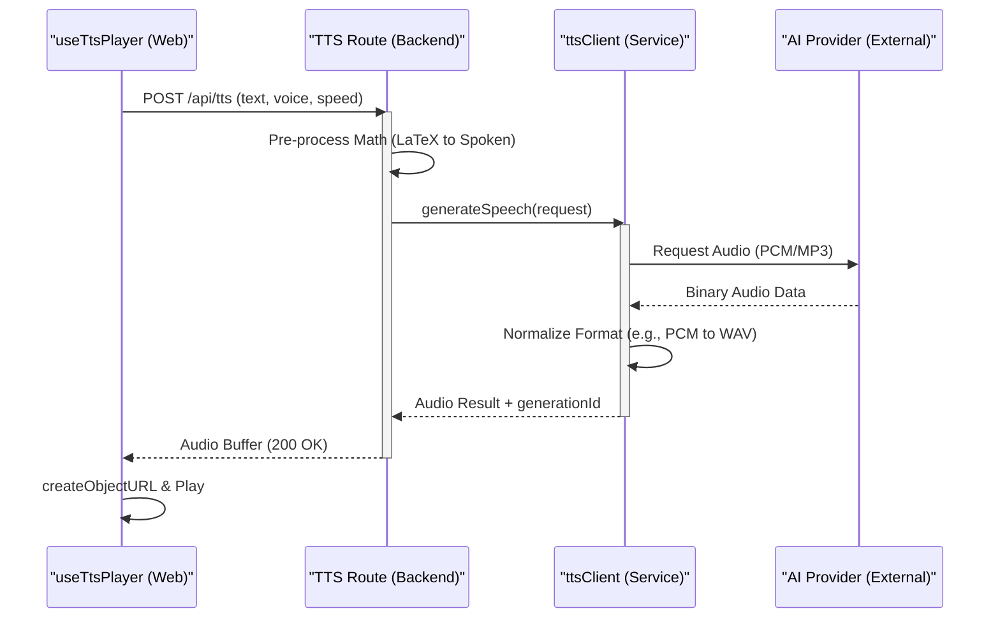
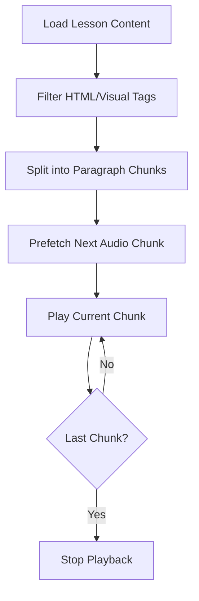

Relevant source files

The following files were used as context for generating this wiki page:

- [apps/backend/tests/routes/tts.test.ts](https://github.com/immagiov4/Nous/blob/21ec8b9ef2e9c48eae54d59ba738a6dc8f10dee6/apps/backend/tests/routes/tts.test.ts)
- [apps/backend/tests/services/ttsClient.test.ts](https://github.com/immagiov4/Nous/blob/21ec8b9ef2e9c48eae54d59ba738a6dc8f10dee6/apps/backend/tests/services/ttsClient.test.ts)
- [apps/web/tests/hooks/reader/useTtsPlayer.test.tsx](https://github.com/immagiov4/Nous/blob/21ec8b9ef2e9c48eae54d59ba738a6dc8f10dee6/apps/web/tests/hooks/reader/useTtsPlayer.test.tsx)
- [e2e/nous/tests/playbackAtlas.test.ts](https://github.com/immagiov4/Nous/blob/21ec8b9ef2e9c48eae54d59ba738a6dc8f10dee6/e2e/nous/tests/playbackAtlas.test.ts)
- [apps/backend/src/routes/chatPrompts.ts](https://github.com/immagiov4/Nous/blob/21ec8b9ef2e9c48eae54d59ba738a6dc8f10dee6/apps/backend/src/routes/chatPrompts.ts)
- [packages/shared-types/lessonWritingContract.ts](https://github.com/immagiov4/Nous/blob/21ec8b9ef2e9c48eae54d59ba738a6dc8f10dee6/packages/shared-types/lessonWritingContract.ts)

# TTS & STT Integrations

The TTS (Text-to-Speech) and STT (Speech-to-Text) systems provide the multimodal backbone for the Nous Reader, enabling narrated lessons and interactive voice support. The system integrates multiple AI providers through a unified backend client that handles voice normalization, audio format conversion, and specialized pre-processing for educational content such as mathematical notation.

## System Architecture

The integration follows a request-response cycle where the frontend `useTtsPlayer` hook manages state and audio buffering, while the backend `ttsClient` orchestrates communication with external providers like OpenAI and Google (via OpenRouter).

### Audio Generation Flow

This diagram illustrates the sequence from a user initiating playback to the delivery of processed audio.

Sources: [apps/backend/tests/routes/tts.test.ts](https://github.com/immagiov4/Nous/blob/21ec8b9ef2e9c48eae54d59ba738a6dc8f10dee6/apps/backend/tests/routes/tts.test.ts), [apps/backend/tests/services/ttsClient.test.ts](https://github.com/immagiov4/Nous/blob/21ec8b9ef2e9c48eae54d59ba738a6dc8f10dee6/apps/backend/tests/services/ttsClient.test.ts), [apps/web/tests/hooks/reader/useTtsPlayer.test.tsx](https://github.com/immagiov4/Nous/blob/21ec8b9ef2e9c48eae54d59ba738a6dc8f10dee6/apps/web/tests/hooks/reader/useTtsPlayer.test.tsx)

## Backend Implementation

The backend serves as a proxy that validates requests and transforms data to meet provider-specific requirements.

### TTS Endpoint and Validation
The primary endpoint `POST /api/tts` enforces strict validation rules:
*   **Text Presence**: The request must contain a non-empty string.
*   **Length Limits**: Standard requests are capped (e.g., `MAX_TTS_TEXT_CHARS = 10000`).
*   **Rate Limiting**: The system respects `Retry-After` headers from upstream providers, passing the retry delay back to the client in milliseconds.

Sources: [apps/backend/tests/routes/tts.test.ts:75-90](https://github.com/immagiov4/Nous/blob/21ec8b9ef2e9c48eae54d59ba738a6dc8f10dee6/apps/backend/tests/routes/tts.test.ts#L75-L90), [apps/backend/tests/services/ttsClient.test.ts:205-220](https://github.com/immagiov4/Nous/blob/21ec8b9ef2e9c48eae54d59ba738a6dc8f10dee6/apps/backend/tests/services/ttsClient.test.ts#L205-L220)

### Mathematical Pre-processing
Before sending text to the TTS engine, the system identifies and transforms LaTeX formulas into spoken language to ensure pedagogical clarity.

| Original Notation | Spoken Transformation Example |
| :--- | :--- |
| `$\mathcal{P}(A)$` | "pi di a" |
| `$\sum_{i=1}^{n} i$` | "somma degli i" |
| `$f: A\to B$` | "effe da a in bi" |

Sources: [apps/backend/tests/routes/tts.test.ts:127-147](https://github.com/immagiov4/Nous/blob/21ec8b9ef2e9c48eae54d59ba738a6dc8f10dee6/apps/backend/tests/routes/tts.test.ts#L127-L147), [e2e/nous/tests/playbackAtlas.test.ts:140-160](https://github.com/immagiov4/Nous/blob/21ec8b9ef2e9c48eae54d59ba738a6dc8f10dee6/e2e/nous/tests/playbackAtlas.test.ts#L140-L160)

### Client and Voice Normalization
The `ttsClient` normalizes requests across different models to provide a consistent interface for the frontend.

1.  **Model Selection**: Uses a global default (e.g., `google/gemini-3.8-flash-lite-tts`) unless overridden.
2.  **Voice Rollout**: Automatically maps requested voices to supported provider voices (e.g., mapping `Zephyr` or `Puck` to `Ara` for specific models).
3.  **Format Handling**: 
    *   **OpenAI**: Returns standard `audio/mpeg`.
    *   **Gemini**: Returns `audio/pcm` which the client wraps in a playable `audio/wav` container by generating a valid RIFF header.

Sources: [apps/backend/tests/services/ttsClient.test.ts:40-108](https://github.com/immagiov4/Nous/blob/21ec8b9ef2e9c48eae54d59ba738a6dc8f10dee6/apps/backend/tests/services/ttsClient.test.ts#L40-L108), [apps/backend/tests/services/ttsClient.test.ts:126-150](https://github.com/immagiov4/Nous/blob/21ec8b9ef2e9c48eae54d59ba738a6dc8f10dee6/apps/backend/tests/services/ttsClient.test.ts#L126-L150)

## Frontend Integration

The `useTtsPlayer` hook handles the lifecycle of audio playback in the browser, including prefetching and synchronization with the lesson text.

### Content Chunking and Logic
To optimize performance and responsiveness, the player splits lesson content into manageable segments.
*   **Paragraph Preservation**: Authored paragraph boundaries are respected during chunking.
*   **Visual Filtering**: Non-speech elements like `{{PDF_IMAGE}}` or `<figure>` tags are excluded from the speech queue.
*   **Math Alignment**: The player maintains a dual representation—it renders prose for visual selection while sending original LaTeX for speech generation.

Sources: [apps/web/tests/hooks/reader/useTtsPlayer.test.tsx:85-103](https://github.com/immagiov4/Nous/blob/21ec8b9ef2e9c48eae54d59ba738a6dc8f10dee6/apps/web/tests/hooks/reader/useTtsPlayer.test.tsx#L85-L103), [apps/web/tests/hooks/reader/useTtsPlayer.test.tsx:256-270](https://github.com/immagiov4/Nous/blob/21ec8b9ef2e9c48eae54d59ba738a6dc8f10dee6/apps/web/tests/hooks/reader/useTtsPlayer.test.tsx#L256-L270)

### Error Recovery and Retries
The player implements a resilient retry strategy:
1.  If a request fails, it attempts a single retry.
2.  If the provider specifies a `Retry-After` duration, the player schedules the retry accordingly.
3.  The player cancels pending retries if the user pauses, seeks, or unmounts the component to prevent redundant network traffic.

Sources: [apps/web/tests/hooks/reader/useTtsPlayer.test.tsx:325-350](https://github.com/immagiov4/Nous/blob/21ec8b9ef2e9c48eae54d59ba738a6dc8f10dee6/apps/web/tests/hooks/reader/useTtsPlayer.test.tsx#L325-L350), [apps/web/tests/hooks/reader/useTtsPlayer.test.tsx:430-460](https://github.com/immagiov4/Nous/blob/21ec8b9ef2e9c48eae54d59ba738a6dc8f10dee6/apps/web/tests/hooks/reader/useTtsPlayer.test.tsx#L430-L460)

## Configuration Summary

The following table summarizes the key configuration constants and defaults used across the TTS/STT services.

| Parameter | Default Value / Constraint | Description |
| :--- | :--- | :--- |
| `DEFAULT_TTS_MODEL` | `openai/gpt-4o-mini-tts-...` | Primary model for speech synthesis. |
| `MAX_TTS_TEXT_CHARS` | `10,000` | Maximum characters per single TTS request. |
| `Audio Format` | `audio/wav` or `audio/mpeg` | Supported formats for browser playback. |
| `Math Delimiters` | `\(...\)` or `\[...\]` | Standard notation for formula recognition. |

Sources: [apps/backend/tests/routes/tts.test.ts:25-30](https://github.com/immagiov4/Nous/blob/21ec8b9ef2e9c48eae54d59ba738a6dc8f10dee6/apps/backend/tests/routes/tts.test.ts#L25-L30), [packages/shared-types/lessonWritingContract.ts:4-8](https://github.com/immagiov4/Nous/blob/21ec8b9ef2e9c48eae54d59ba738a6dc8f10dee6/packages/shared-types/lessonWritingContract.ts#L4-L8)

The TTS and STT integrations ensure that educational content is accessible and engaging. By handling complex transformations like LaTeX-to-speech and format normalization, the system provides a seamless experience across various AI models and device viewports.
