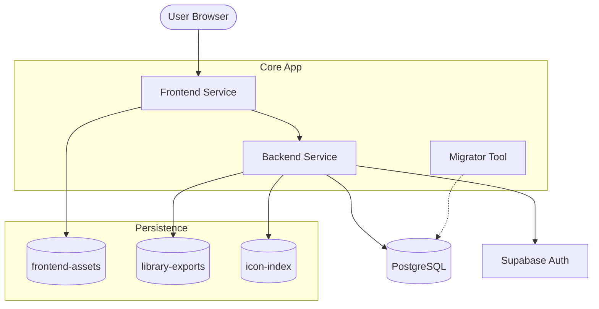
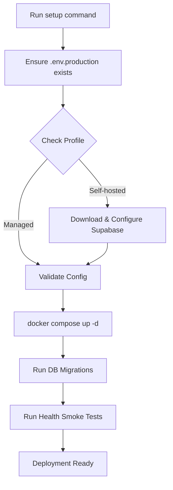

<details>
<summary>Relevant source files</summary>

The following files were used as context for generating this wiki page:

- [deploy/compose.codex.yml](https://github.com/immagiov4/Nous/blob/21ec8b9ef2e9c48eae54d59ba738a6dc8f10dee6/deploy/compose.codex.yml)
- [deploy/compose.self-hosted.yml](https://github.com/immagiov4/Nous/blob/21ec8b9ef2e9c48eae54d59ba738a6dc8f10dee6/deploy/compose.self-hosted.yml)
- [deploy/nous.sh](https://github.com/immagiov4/Nous/blob/21ec8b9ef2e9c48eae54d59ba738a6dc8f10dee6/deploy/nous.sh)
- [deploy/supabase.override.yml](https://github.com/immagiov4/Nous/blob/21ec8b9ef2e9c48eae54d59ba738a6dc8f10dee6/deploy/supabase.override.yml)
- [compose.yml](https://github.com/immagiov4/Nous/blob/21ec8b9ef2e9c48eae54d59ba738a6dc8f10dee6/compose.yml)
- [deploy/nous.ps1](https://github.com/immagiov4/Nous/blob/21ec8b9ef2e9c48eae54d59ba738a6dc8f10dee6/deploy/nous.ps1)
- [apps/web/tests/scripts/productionDeployment.test.ts](https://github.com/immagiov4/Nous/blob/21ec8b9ef2e9c48eae54d59ba738a6dc8f10dee6/apps/web/tests/scripts/productionDeployment.test.ts)
</details>

# Deployment Guide

Nous uses Docker Compose to orchestrate the frontend, backend, and supporting services. The deployment system supports two primary profiles: **Managed**, which relies on external Supabase services, and **Self-hosted**, which runs a local Supabase stack. You manage the deployment lifecycle using the `deploy/nous.sh` (Shell) or `deploy/nous.ps1` (PowerShell) scripts.

These scripts automate configuration validation, environment setup, database migrations, and health monitoring. The architecture ensures that the backend and frontend remain isolated via read-only filesystems and specific volume mounts for persistent data like library exports and icon indices.

## Deployment Architecture

The deployment consists of a core application stack and optional service layers. The `compose.yml` file defines the primary `backend`, `frontend`, and `migrate` services.


*The diagram shows the relationship between core services and persistent volumes within the Docker network.*

### Service Definitions
*   **Frontend**: Serves the React application. It depends on the backend's health and uses a read-only filesystem with a `tmpfs` for temporary files.
*   **Backend**: Handles AI processing and business logic. It manages volumes for `icon-index`, `library-exports`, and `source-staging`.
*   **Migrate**: A one-shot service that pushes database schema changes to the Supabase database before the backend starts.
*   **Supabase (Self-hosted only)**: Provides Auth, PostgreSQL, and Storage services when local deployment is selected.

Sources: [compose.yml](https://github.com/immagiov4/Nous/blob/21ec8b9ef2e9c48eae54d59ba738a6dc8f10dee6/compose.yml), [deploy/compose.self-hosted.yml](https://github.com/immagiov4/Nous/blob/21ec8b9ef2e9c48eae54d59ba738a6dc8f10dee6/deploy/compose.self-hosted.yml)

## Deployment Profiles

You select the deployment type by setting the `SUPABASE_DEPLOYMENT` variable in your environment file.

| Profile | Description | Configuration Requirements |
| :--- | :--- | :--- |
| **Managed** | Connects to the official Supabase cloud or a pre-existing external instance. | Requires external `SUPABASE_URL` and `SUPABASE_SERVICE_ROLE_KEY`. |
| **Self-hosted** | Downloads and runs a pinned version of the Supabase Docker stack locally. | Generates local secrets; requires port overrides for local accessibility. |

Sources: [deploy/nous.sh](https://github.com/immagiov4/Nous/blob/21ec8b9ef2e9c48eae54d59ba738a6dc8f10dee6/deploy/nous.sh), [apps/web/tests/scripts/productionDeployment.test.ts](https://github.com/immagiov4/Nous/blob/21ec8b9ef2e9c48eae54d59ba738a6dc8f10dee6/apps/web/tests/scripts/productionDeployment.test.ts)

### Self-Hosted Specifics
When you run a self-hosted deployment, the system:
1.  Downloads the specific Supabase version defined in `deploy/SUPABASE_VERSION`.
2.  Generates cryptographic keys and JWT secrets if they are missing.
3.  Applies Nous-branded email templates (confirmation, invite, magic link, recovery) to the Supabase Auth service.
4.  Configures an internal `email-templates` Nginx server to serve these assets to the Auth container.

Sources: [deploy/nous.sh](https://github.com/immagiov4/Nous/blob/21ec8b9ef2e9c48eae54d59ba738a6dc8f10dee6/deploy/nous.sh), [deploy/supabase.override.yml](https://github.com/immagiov4/Nous/blob/21ec8b9ef2e9c48eae54d59ba738a6dc8f10dee6/deploy/supabase.override.yml)

## Deployment Procedure

### 1. Preflight and Requirements
Before starting, ensure your host meets the following criteria:
*   **Operating System**: Linux (x86_64/aarch64), Darwin (x86_64/arm64), or Windows (AMD64/ARM64).
*   **Docker**: Docker Engine/Desktop installed and running.
*   **Docker Compose**: Version 2.24 or newer is mandatory for safe port overrides.
*   **Permissions**: Writable access to the `deploy/` directory.

### 2. Setup Lifecycle
The `setup` command performs the initial configuration and service launch.


*The flowchart illustrates the sequential steps taken by the deployment script during the setup phase.*

Sources: [deploy/nous.sh](https://github.com/immagiov4/Nous/blob/21ec8b9ef2e9c48eae54d59ba738a6dc8f10dee6/deploy/nous.sh), [deploy/nous.ps1](https://github.com/immagiov4/Nous/blob/21ec8b9ef2e9c48eae54d59ba738a6dc8f10dee6/deploy/nous.ps1)

## Command Reference

Use the deployment script with the following commands:

| Command | Action |
| :--- | :--- |
| `config` | Validates environment variables and generates the final Docker Compose configuration. |
| `setup` | Initialized the environment, downloads Supabase (if needed), builds images, and starts services. |
| `up` | Starts existing containers without rebuilding or running migrations. |
| `redeploy` | Rebuilds images, runs database migrations, and restarts services. |
| `status` | Displays the running status of application and Supabase containers. |
| `smoke` | Performs an automated health check against frontend, backend, and auth endpoints. |
| `backup` | Creates a timestamped `.dump` of the database and a `.tar` of project sources. |
| `restore` | Restores the database and project sources from provided backup files. |
| `codex-login` | Triggers device authentication for the Codex app server if enabled. |

Sources: [deploy/nous.sh](https://github.com/immagiov4/Nous/blob/21ec8b9ef2e9c48eae54d59ba738a6dc8f10dee6/deploy/nous.sh), [deploy/nous.ps1](https://github.com/immagiov4/Nous/blob/21ec8b9ef2e9c48eae54d59ba738a6dc8f10dee6/deploy/nous.ps1)

## Configuration and Validation

The deployment script enforces strict validation rules to prevent misconfiguration:
*   **Project Origin**: In managed deployments, `SUPABASE_URL` and `NOUS_SUPABASE_PUBLIC_URL` must share the same origin.
*   **JWT Issuer**: `SUPABASE_JWT_ISSUER` must be a valid absolute URL.
*   **CORS**: `CORS_ALLOWED_ORIGINS` must be set and correctly formatted.
*   **Placeholders**: The script rejects configuration files containing default placeholder values (e.g., `replace_with_...`).
*   **Secrets**: `SUPABASE_JWT_SECRET` is required for contract testing and secure communication.

Sources: [apps/web/tests/scripts/productionDeployment.test.ts](https://github.com/immagiov4/Nous/blob/21ec8b9ef2e9c48eae54d59ba738a6dc8f10dee6/apps/web/tests/scripts/productionDeployment.test.ts), [deploy/nous.sh](https://github.com/immagiov4/Nous/blob/21ec8b9ef2e9c48eae54d59ba738a6dc8f10dee6/deploy/nous.sh)

### Environment Snippet Example
```yaml
# deploy/supabase.override.yml
services:
  auth:
    environment:
      GOTRUE_MAILER_TEMPLATES_CONFIRMATION: http://email-templates/confirmation.html
      GOTRUE_MAILER_SUBJECTS_CONFIRMATION: "Conferma il tuo account Nous"
```
Sources: [deploy/supabase.override.yml](https://github.com/immagiov4/Nous/blob/21ec8b9ef2e9c48eae54d59ba738a6dc8f10dee6/deploy/supabase.override.yml)

## Data Management

### Backup and Restore
The `backup` command utilizes `pg_dump` to export the database (excluding the `storage` schema) and uses a dedicated internal tool to archive project sources. 
*   **Integrity**: The system generates a SHA256 hash of the database dump to verify project source artifacts during both backup and restoration.
*   **Storage**: Backups are stored in `deploy/backups/`.
*   **Verification**: The `restore` command requires the `CONFIRM_RESTORE=nous-reader` environment variable to prevent accidental data loss.

Sources: [deploy/nous.sh](https://github.com/immagiov4/Nous/blob/21ec8b9ef2e9c48eae54d59ba738a6dc8f10dee6/deploy/nous.sh), [deploy/nous.ps1](https://github.com/immagiov4/Nous/blob/21ec8b9ef2e9c48eae54d59ba738a6dc8f10dee6/deploy/nous.ps1)

### Persistent Volumes
The application uses several volumes to maintain state across restarts:
*   `library-exports`: Located at `/var/lib/nous/library-exports` in the backend; stores generated course exports.
*   `frontend-assets`: Retains hashed assets between deployments to support cached frontend clients.
*   `source-staging`: Temporary directory for project imports.

Sources: [compose.yml](https://github.com/immagiov4/Nous/blob/21ec8b9ef2e9c48eae54d59ba738a6dc8f10dee6/compose.yml), [apps/web/tests/scripts/productionDeployment.test.ts](https://github.com/immagiov4/Nous/blob/21ec8b9ef2e9c48eae54d59ba738a6dc8f10dee6/apps/web/tests/scripts/productionDeployment.test.ts)
