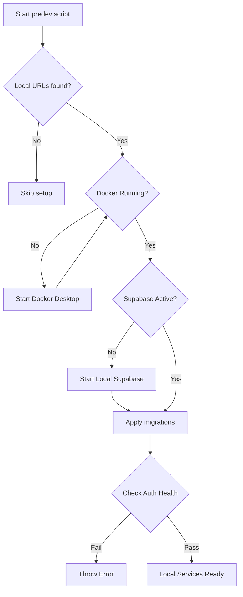
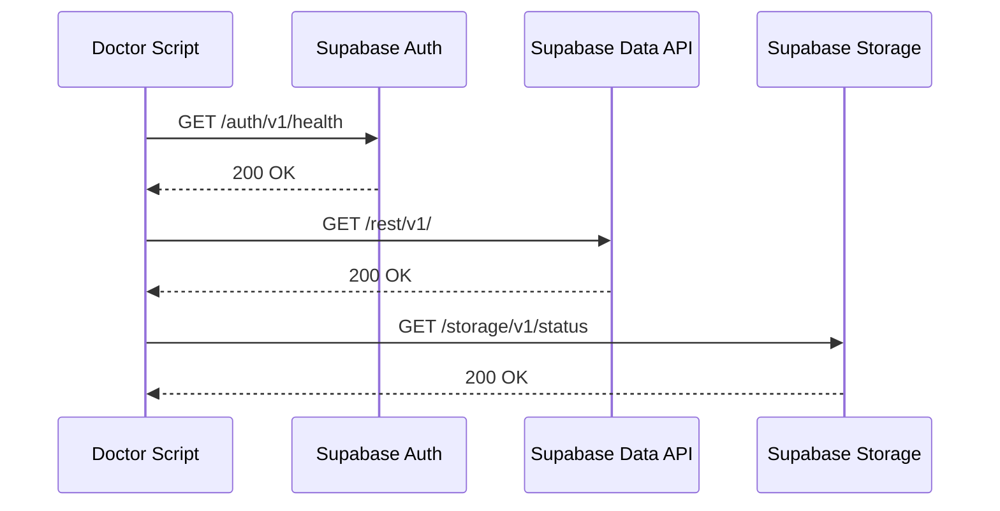

Relevant source files

The following files were used as context for generating this wiki page:

- [scripts/ensure-local-dev-services.ts](https://github.com/immagiov4/Nous/blob/21ec8b9ef2e9c48eae54d59ba738a6dc8f10dee6/scripts/ensure-local-dev-services.ts)
- [package.json](https://github.com/immagiov4/Nous/blob/21ec8b9ef2e9c48eae54d59ba738a6dc8f10dee6/package.json)
- [scripts/doctor.ts](https://github.com/immagiov4/Nous/blob/21ec8b9ef2e9c48eae54d59ba738a6dc8f10dee6/scripts/doctor.ts)
- [PROJECT_RULES.md](https://github.com/immagiov4/Nous/blob/21ec8b9ef2e9c48eae54d59ba738a6dc8f10dee6/PROJECT_RULES.md)
- [scripts/setup-codex-cloud.test.ts](https://github.com/immagiov4/Nous/blob/21ec8b9ef2e9c48eae54d59ba738a6dc8f10dee6/scripts/setup-codex-cloud.test.ts)

# Local Development Setup

The Local Development Setup provides a containerized and automated environment for developing the Nous Reader application. It orchestrates the frontend, backend, and persistent storage layers to ensure developers can run the full learning platform locally with minimal manual configuration.

The environment relies on [Docker](https://www.docker.com/) for infrastructure and [Bun](https://bun.sh/) for task execution and dependency management. The setup process automates the availability of local Supabase services, applies database migrations, and verifies the health of required API endpoints before starting the development servers.

Sources: [scripts/ensure-local-dev-services.ts](https://github.com/immagiov4/Nous/blob/21ec8b9ef2e9c48eae54d59ba738a6dc8f10dee6/scripts/ensure-local-dev-services.ts), [package.json](https://github.com/immagiov4/Nous/blob/21ec8b9ef2e9c48eae54d59ba738a6dc8f10dee6/package.json), [PROJECT_RULES.md](https://github.com/immagiov4/Nous/blob/21ec8b9ef2e9c48eae54d59ba738a6dc8f10dee6/PROJECT_RULES.md)

## Core Service Initialization

The project uses a dedicated initialization script to prepare the local infrastructure. When you execute the development command, the system identifies local loopback URLs in your environment variables to determine if a local stack is required.

### Service Orchestration Flow

The following diagram illustrates the automated sequence performed by `ensure-local-dev-services.ts` to prepare the development environment.

The orchestration script ensures that Docker is active and the Supabase container stack is healthy before allowing application code to run.

Sources: [scripts/ensure-local-dev-services.ts:107-133](https://github.com/immagiov4/Nous/blob/21ec8b9ef2e9c48eae54d59ba738a6dc8f10dee6/scripts/ensure-local-dev-services.ts#L107-L133)

### Infrastructure Requirements
The setup script specifically monitors the following environment variables to trigger local service initialization:

| Variable | Usage | Expected Host |
| :--- | :--- | :--- |
| `SUPABASE_URL` | Backend Supabase API connection | `localhost` or `127.0.0.1` |
| `VITE_SUPABASE_URL` | Frontend Supabase API connection | `localhost` or `127.0.0.1` |
| `DATABASE_URL` | Direct PostgreSQL connection string | `localhost` or `127.0.0.1` |

Sources: [scripts/ensure-local-dev-services.ts:7-9](https://github.com/immagiov4/Nous/blob/21ec8b9ef2e9c48eae54d59ba738a6dc8f10dee6/scripts/ensure-local-dev-services.ts#L7-L9)

## Environment Diagnostics

The `doctor.ts` utility provides a comprehensive diagnostic suite to verify that your local machine meets the project's technical requirements. It checks for runtime versions, workspace binaries, and service connectivity.

### Diagnostic Profiles
You can run the doctor script with specific profiles using `bun run doctor -- --profile <name>`.

| Profile | Scope of Verification |
| :--- | :--- |
| `checks` | Verifies Bun version, workspace binaries, and Fallow dead-code baselines. |
| `gate` | Probes the local SonarQube service and its permission provisioner. |
| `local` | Probes local Supabase services (Auth, Rest, Storage, Realtime) and migration parity. |
| `all` | Runs all environment and service probes sequentially. |

Sources: [scripts/doctor.ts:60-78](https://github.com/immagiov4/Nous/blob/21ec8b9ef2e9c48eae54d59ba738a6dc8f10dee6/scripts/doctor.ts#L60-L78)

### Supabase Health Endpoints
When using the `local` profile, the system probes specific paths on the local Supabase origin to ensure the stack is operational.

Sources: [scripts/doctor.ts:25-33](https://github.com/immagiov4/Nous/blob/21ec8b9ef2e9c48eae54d59ba738a6dc8f10dee6/scripts/doctor.ts#L25-L33), [scripts/doctor.ts:279-299](https://github.com/immagiov4/Nous/blob/21ec8b9ef2e9c48eae54d59ba738a6dc8f10dee6/scripts/doctor.ts#L279-L299)

## Development Workflow Commands

Common development tasks are managed through `package.json` scripts. The primary entry point for daily work is `bun run dev`, which triggers the service check before launching the application components.

### Primary Commands

*   **`bun run dev`**: Starts the local development environment. It runs `predev` to ensure services are ready, then starts the backend and frontend.
*   **`bun run doctor`**: Runs environment diagnostics to identify missing dependencies or runtime mismatches.
*   **`bun run deps:install`**: Installs workspace dependencies using Bun with a frozen lockfile and hardlink backend.
*   **`bun run quality`**: Executes a full suite of checks including TypeScript compilation, Biome linting, and Sonar-style rules.
*   **`bun run fix`**: Automatically applies Biome lint and format fixes across the repository.

Sources: [package.json:10-38](https://github.com/immagiov4/Nous/blob/21ec8b9ef2e9c48eae54d59ba738a6dc8f10dee6/package.json#L10-L38), [PROJECT_RULES.md:156-180](https://github.com/immagiov4/Nous/blob/21ec8b9ef2e9c48eae54d59ba738a6dc8f10dee6/PROJECT_RULES.md#L156-L180)

### Runtime Version Enforcement
The project strictly pins the Bun version. The `doctor` script validates that the locally installed Bun runtime matches the version specified in the `packageManager` field of `package.json`.

Sources: [scripts/doctor.ts:98-115](https://github.com/immagiov4/Nous/blob/21ec8b9ef2e9c48eae54d59ba738a6dc8f10dee6/scripts/doctor.ts#L98-L115), [package.json:5](https://github.com/immagiov4/Nous/blob/21ec8b9ef2e9c48eae54d59ba738a6dc8f10dee6/package.json#L5)

## AI and Codex Configuration

For features involving AI-driven learning and playback, the repository integrates with [Codex](https://github.com/immagiov4/Geppetto). 

### Codex Cloud Setup
The `setup:codex` command (`scripts/setup-codex-cloud.mjs`) prepares the environment for agentic work. It performs the following actions:
1.  Installs required Geppetto plugins and skill packs.
2.  Configures memory buckets for the project (e.g., the `nous` bucket).
3.  Approves necessary plugin hooks for automated workflows.

Sources: [scripts/setup-codex-cloud.test.ts:34-80](https://github.com/immagiov4/Nous/blob/21ec8b9ef2e9c48eae54d59ba738a6dc8f10dee6/scripts/setup-codex-cloud.test.ts#L34-L80), [package.json:96](https://github.com/immagiov4/Nous/blob/21ec8b9ef2e9c48eae54d59ba738a6dc8f10dee6/package.json#L96)

## Summary

Setting up the local environment requires Docker for service containerization and Bun for script execution. By running `bun run dev`, you trigger an automated lifecycle that starts Supabase, applies database migrations, and launches the application services. Diagnostics via `bun run doctor` ensure the environment remains consistent with the project's strictly pinned runtime and quality standards.
