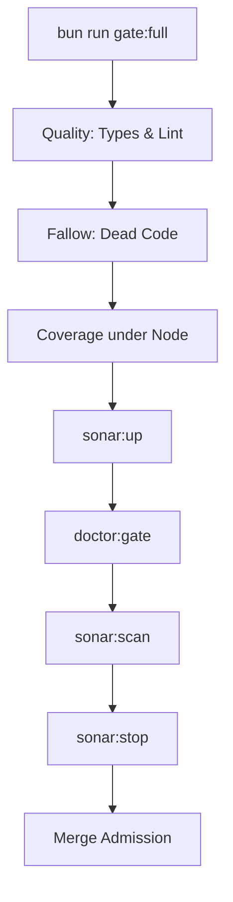
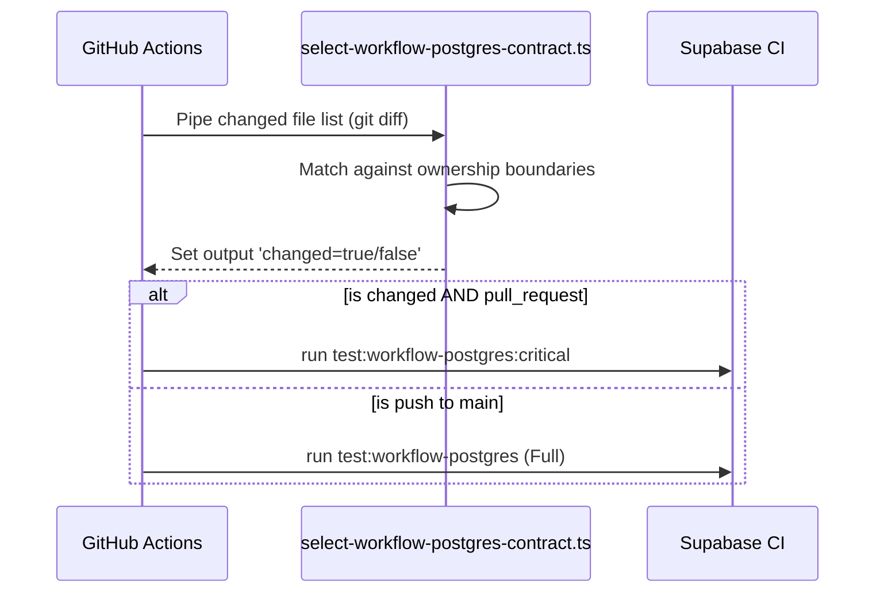

<details>
<summary>Relevant source files</summary>

The following files were used as context for generating this wiki page:

- [scripts/run-full-quality-gate.ts](../../../scripts/run-full-quality-gate.ts)
- [scripts/run-full-quality-gate.test.ts](../../../scripts/run-full-quality-gate.test.ts)
- [scripts/doctor.ts](../../../scripts/doctor.ts)
- [scripts/doctor.test.ts](../../../scripts/doctor.test.ts)
- [scripts/select-workflow-postgres-contract.ts](../../../scripts/select-workflow-postgres-contract.ts)
- [apps/web/tests/scripts/workflowPostgresCi.test.ts](../../../apps/web/tests/scripts/workflowPostgresCi.test.ts)
- [AGENTS.md](../../../AGENTS.md)
</details>

# Testing & Quality Gates

Nous Reader uses focused local checks during development, GitHub Actions on pull-request updates and pushes to `main`, and one local SonarQube scan on the final merge candidate. Fallow blocks new dead-code findings against a committed baseline.

Sources: [AGENTS.md:143-162](../../../AGENTS.md#L143-L162), [scripts/run-full-quality-gate.ts:1-20](../../../scripts/run-full-quality-gate.ts#L1-L20)

## Validation Hierarchy

The quality process is organized into discrete profiles and stages, allowing developers to run the narrowest meaningful validation first before proceeding to the full merge gate.

### Local Health Diagnostics (Doctor)
The `doctor` utility is a read-only diagnostic tool that reports on environment health without modifying state. It supports four distinct profiles to probe different layers of the application.

| Profile | Description |
| :--- | :--- |
| `checks` | Default profile. Inspects Bun, project executables, and the Fallow baseline without running quality or tests. |
| `gate` | Probes the loopback-only local SonarQube service. |
| `local` | Probes local Supabase services and checks for migration parity/drift. |
| `all` | Combines environment checks with both Sonar and Supabase service probes. |

Sources: [scripts/doctor.ts:98-124](../../../scripts/doctor.ts#L98-L124), [AGENTS.md:144-150](../../../AGENTS.md#L144-L150)

### The Full Quality Gate

The `gate:full` command runs one heavy process at a time after GitHub CI passes on the same commit. CI owns the complete Bun suite and dependency graph check. The local gate runs quality, Fallow, and Node coverage before it starts SonarQube. After startup, `doctor:gate` verifies the pinned Bun runtime and Sonar readiness before analysis. The gate stops SonarQube after the scan, including when startup, preflight, or analysis throws.



An earlier stage failure does not skip later stages. The command reports every failed stage after Sonar stops.
Sources: [scripts/run-full-quality-gate.ts:22-60](../../../scripts/run-full-quality-gate.ts#L22-L60), [scripts/run-full-quality-gate.test.ts:39-57](../../../scripts/run-full-quality-gate.test.ts#L39-L57)

## Static Analysis & Regressions

### Fallow: Dead Code Detection
The project uses "Fallow" to detect unused files, exports, and dependencies. It maintains a baseline to prevent regressions in debt.
- **Baseline Path:** `.fallow-baselines/regression.json`
- **Metric Categories:** Unused files, unused dependencies, and unused exports.
- **Enforcement:** The doctor tool warns if the total issues in the baseline are greater than zero.

Sources: [scripts/doctor.ts:6-7](../../../scripts/doctor.ts#L6-L7), [scripts/doctor.ts:162-184](../../../scripts/doctor.ts#L162-L184)

### Quality checks

The local `quality` script runs TypeScript checks, Biome, and the React Hooks lint report. CI runs `quality:ci`, which adds dependency-cruiser once per commit. Fallow separately blocks new dead-code and dependency findings against `.fallow-baselines/regression.json`.

React Hooks linting keeps ESLint's persistent cache under the ignored `.temp/eslint/` directory. The cache filename includes the `bun.lock` hash so dependency upgrades force fresh linting; ESLint invalidates changed files and configuration. Every run writes the complete Sonar report and retains the zero-warning check.

Lesson review tests isolate the Mermaid process with explicit classification fixtures. A real-parser integration test validates the entire shared fixture set in one batch, keeping parser checks while avoiding a new DOM process for each review case.
Sources: [package.json](../../../package.json), [scripts/check-fallow-regression.ts](../../../scripts/check-fallow-regression.ts), [scripts/run-eslint-react-hooks.ts](../../../scripts/run-eslint-react-hooks.ts), [apps/backend/tests/services/mermaidValidation.test.ts](../../../apps/backend/tests/services/mermaidValidation.test.ts)

## Agentic playtests

`bun run playtest -- --id library-open-course --provider openrouter --model openai/gpt-6-luna` runs the Nous learner stories with a hidden Chromium browser. Set `NOUS_E2E_DATA` to an external local data directory and supply `OPENROUTER_API_KEY` in the environment. Provide `$NOUS_E2E_DATA/complaint-mining/TAXONOMY.md` with the heading `## Family matrix for the checker prompt`; if that section is unavailable, the report records an inspection error and retains only probe-based inspection. Story filters include `--id`, `--tag`, and `--kind`; `--headed` is an explicit opt-in. The bundled checks cover opening a course on desktop and mobile, reading and selecting on mobile, and asking a study question on desktop. The Giulia mission uses `synthetic-law-short`, an introductory lesson on contract validity, nullity and voidability; the checks retain the synthetic water-cycle course.

The adapter creates or reuses the `nous-playtest` Supabase project under `$NOUS_E2E_DATA/stack/`, using the hands spike's ports 55321–55324, backend port 3301, and frontend port 5173. It copies repository migrations and auth templates, passes isolated database and Storage addresses explicitly, and refuses occupied app ports rather than taking over another server. Startup reports Supabase, backend, frontend, and HTTP readiness stages to stderr. Each Supabase, backend, and frontend stage has one 180,000 ms readiness deadline (`STACK_STAGE_READINESS_LIMIT_MS`); readiness also races child exit. Expiry and early exit include the stage and redacted recent process output, and expiry terminates owned process trees on Windows and sends SIGTERM to detached app process groups or the Supabase CLI process on POSIX. Preparation creates a fresh confirmed synthetic account for each story and viewport. `course: synthetic-short` and `course: synthetic-law-short` use `PostgresProjectStore.saveProject`; `course: fixture:<name>` reads a file within `$NOUS_E2E_DATA/fixtures/` and uses the product's JSON or ZIP import method. Supply only synthetic fixtures and model inputs for these runs. Unsupported or missing preconditions yield `blocked-precondition` while the other stories continue. The optional cleanup callback returned by `prepare` runs after the story’s browser context closes, including failure paths. The Nous adapter deletes the account’s projects through the product store, which queues asset cleanup, then removes the synthetic auth account; a preparation failure also triggers cleanup. Cleanup errors are recorded in the story report.

The learner receives its goal, optional persona, app description, and visible viewport evidence; credentials stay with the operator. Learner text uses per-character keyboard events. Credential filling requires a matching native input type or email/username autocomplete field. Screenshot masks cover credential controls and reflected secrets, leaving ordinary message and note fields visible. Both learner and judge require image-capable models; catalogue models with unsupported pricing overrides are rejected. A failed model decision retains the accumulated actions, observations, diary and friction for reporting and inspection. An `observe` action refreshes the viewport without changing the page, and unsupported keyboard keys return `not-actionable` for the learner to reconsider. A failed or navigation-invalidated viewport capture is retried once (`SCREENSHOT_CAPTURE_RETRIES`), including document-handle acquisition; a second failure retains the operator-failure outcome. A persona's optional `affects` list is sampled once per story and viewport, and the selected state is stored in the story report. The adapter stops a story on backend HTTP 5xx, including API responses proxied through Vite, retaining `x-request-id`. Probe thresholds remain `{}`: raw signals are recorded without numerical defect findings. The inspector reads only the local taxonomy's family matrix, keeping complaint examples outside its prompt; reference screens remain empty until supplied by the maintainer. Its instructions identify credential masks as privacy redactions. Each screenshot is paired with a compact list of visible node names from the same observation so the judge can check wording as well as the image; the judge also receives the recorded learner trace, raw probe signals, elapsed time, stop event and browser trace path to assess defects across actions. Raw signals remain measurements rather than automatic defect verdicts.

Reports, screenshots, diaries, and browser traces are written under `$NOUS_E2E_DATA/runs/<timestamp>/`. Generic adapters can use an explicit `--run-dir` without `NOUS_E2E_DATA`; empty story selections fail before stack startup. Dynamic Markdown report text is escaped so model output cannot introduce active images or links. Read `summary.html` or `summary.json` for outcomes and each story's `story.json` or `story.md` for evidence, friction, and findings. Each story and summary record includes `elapsedMs` from preparation through inspection, excluding shared stack startup and report writing. `modelUsage` retains Pi-reported token counts and USD costs for learner, judge, and total, with response counts; these costs use provider usage and Pi model pricing, rather than a billing reconciliation. Concurrent stories have separate usage scopes, including usage from unsuccessful responses. Stop the isolated stack after use with `bun run e2e/nous/stack.ts --stop`; this verifies the saved isolated project configuration and each recorded app process’s birth time and command before signaling it, then stops the named playtest Supabase project while retaining its data volumes. Shutdown uses the saved configuration, so a later repository configuration edit does not prevent it. On POSIX, shutdown sends SIGTERM to the app process groups and proceeds to stop Supabase without waiting for their exit; the graceful-exit wait and expiry policy remain pending maintainer approval.

Sources: [Nous adapter](../../../e2e/nous/adapter.ts), [Stack lifecycle](../../../e2e/nous/stack.ts), [Preparation](../../../e2e/nous/prepare.ts), [Runner](../../../packages/playtest/src/runner.ts).

## Continuous Integration (CI) Contracts

The CI pipeline mirrors local gates but adds specialized logic for PostgreSQL and Supabase contract testing. The test job installs Chromium and its Linux dependencies with `bunx playwright install --with-deps chromium` before the Vitest suite, following the [Playwright CI setup](https://playwright.dev/docs/ci). Playtest process fixtures use Node APIs so the same tests can run under Bun and Node coverage.

Pull requests run the Auth/RLS contract against the disposable local Supabase stack. The managed staging contract receives staging credentials only on trusted pushes to `main`; its checkout does not persist the GitHub token.

`test:supabase-contract` and its `test:supabase-local` alias run files sequentially because they share a database. Project asset cleanup claims the global pending queue, so one file can otherwise claim another file's fixture before teardown. Concurrency assertions within each file remain enabled. The main test suite keeps its existing parallel execution.

Both commands include the account-store persistence, ownership, RLS and recorded-usage integration tests. Those tests use the Supabase command's enable flag and database address; their setup and teardown affect only the generated account and project IDs.

### Workflow Selection Logic
To optimize CI runs, the project uses a selection script that detects if changes affect the "PostgreSQL Contract." This is triggered by modifications to specific paths like backend source code, migrations, or database configurations.



Sources: [apps/web/tests/scripts/workflowPostgresCi.test.ts:30-66](../../../apps/web/tests/scripts/workflowPostgresCi.test.ts#L30-L66), [scripts/select-workflow-postgres-contract.ts](../../../scripts/select-workflow-postgres-contract.ts)

### Migration Integrity
The doctor tool verifies that the local migration history matches the state of the database to prevent drift.
- **Drift Detection:** Compares the list of local migration files against the `remote` (database) records.
- **Reporting:** Reports specific drifted migrations in the format `local=TIMESTAMP, database=-`.

Sources: [scripts/doctor.ts:285-321](../../../scripts/doctor.ts#L285-L321), [scripts/doctor.test.ts:62-81](../../../scripts/doctor.test.ts#L62-L81)

## Implementation Details

### Gate Execution Logic
The gate runner uses `Bun.spawn` to execute scripts and captures output to provide formatted summaries of each stage's duration and exit code.

```typescript
// scripts/run-full-quality-gate.ts:39-53
const processHandle = Bun.spawn([process.execPath, 'run', stage.script], {
  cwd: process.cwd(),
  env: environment,
  stdin: 'inherit',
  stdout: 'pipe',
  stderr: 'pipe',
});
const [exitCode, stdout, stderr] = await Promise.all([
  processHandle.exited,
  new Response(processHandle.stdout).text(),
  new Response(processHandle.stderr).text(),
]);
```

Sources: [scripts/run-full-quality-gate.ts:39-53](../../../scripts/run-full-quality-gate.ts#L39-L53)

### SonarQube Integration
SonarQube acts as a local-only merge gate and is intentionally excluded from GitHub Actions.
- **Lifecycle:** `gate:full` starts the local service immediately before analysis and stops it after the scan.
- **Configuration:** Docker binds the local service to `127.0.0.1:9000`. Its Docker-internal one-shot provisioner grants `Anyone` the global `Create Projects` and `Execute Analysis` permissions on a fresh volume, enabling anonymous analysis without scanner credentials. The `gate` Doctor profile requires that provisioner to complete successfully before it reports anonymous analysis ready.
- **Merge Block:** A skipped, failed, or unreachable Sonar scan explicitly blocks the merge process.

Sources: [AGENTS.md:156-162](../../../AGENTS.md#L156-L162), [scripts/doctor.ts:233-275](../../../scripts/doctor.ts#L233-L275)

Use focused checks while editing. Use GitHub CI for the full suite after pull-request updates and pushes to `main`. After CI passes, run `gate:full` once on the same commit after implementation and review feedback are complete. Coverage uses any Node 26.x release; `.node-version` pins only the major. The coverage preflight deletes the previous LCOV report before it checks that pin, so Sonar cannot consume stale coverage after a runtime mismatch. Coverage uses four workers and writes only the LCOV report consumed by Sonar.

Sources: [AGENTS.md:155-162](../../../AGENTS.md#L155-L162)
