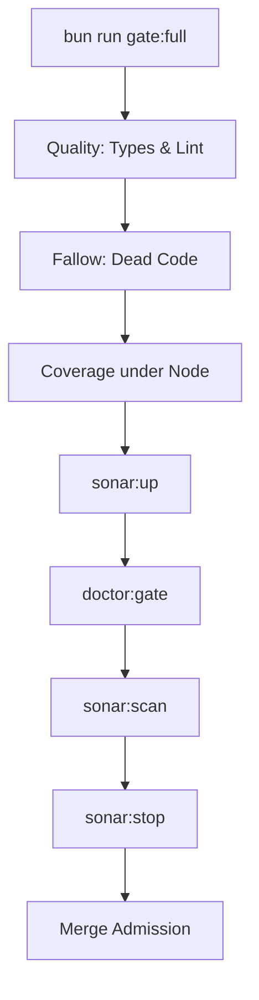
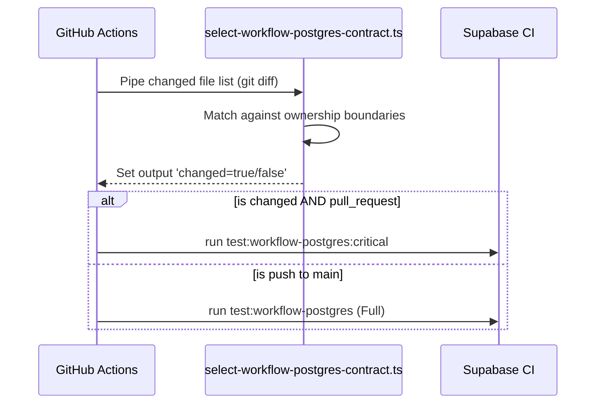

<details>
<summary>Relevant source files</summary>

The following files were used as context for generating this wiki page:

- [scripts/run-full-quality-gate.ts](../../../scripts/run-full-quality-gate.ts)
- [scripts/run-full-quality-gate.test.ts](../../../scripts/run-full-quality-gate.test.ts)
- [scripts/doctor.ts](../../../scripts/doctor.ts)
- [scripts/doctor.test.ts](../../../scripts/doctor.test.ts)
- [scripts/select-workflow-postgres-contract.ts](../../../scripts/select-workflow-postgres-contract.ts)
- [apps/web/tests/scripts/workflowPostgresCi.test.ts](../../../apps/web/tests/scripts/workflowPostgresCi.test.ts)
- [AGENTS.md](../../../AGENTS.md)
</details>

# Testing & Quality Gates

Nous Reader uses focused local checks during development, GitHub Actions on pull-request updates and pushes to `main`, and one local SonarQube scan on the final merge candidate. Fallow blocks new dead-code findings against a committed baseline.

Sources: [AGENTS.md:143-162](../../../AGENTS.md#L143-L162), [scripts/run-full-quality-gate.ts:1-20](../../../scripts/run-full-quality-gate.ts#L1-L20)

## Validation Hierarchy

The quality process is organized into discrete profiles and stages, allowing developers to run the narrowest meaningful validation first before proceeding to the full merge gate.

### Implementation quality workflow

Every implementation task follows `.agents/skills/quality-workflow/SKILL.md`, which AGENTS.md references. The agent states a level at the start: a local fix needs behaviour tests and `bun run quality`; a medium feature adds real-flow provider integration, a step-by-step review of the recorded run trace and an agentic playtest; a large or visual feature also starts from a functioning mockup on a temporary app page that the maintainer approves before production code. The ordered test ladder is behaviour tests that are shown to fail when the code is broken, performance measurements recorded per run (thresholds come from the maintainer), integration on each provider the changed flow supports, trace review, playtest, and maintainer visual QA with the playtest evidence. The skill also routes bugs found outside the work, requires a zoom-out check before fixes, and keeps Sonar to one run on the final candidate. Vendored third-party skills follow the precedence rules in `.agents/skills/THIRD_PARTY_SKILLS.md`.

### Real-provider model exchanges

The workflow-provider, lesson-review and lesson-evidence harnesses opt into `captureModelExchanges` on `withRunEvidence`. Each run writes `$NOUS_E2E_DATA/runs/<scenario>/<run-id>/model-exchanges.jsonl` beside its manifest. Each line represents one provider call, ordered by start time (start order breaks ties). Course-object requests forward their model slot and schema name as the exchange role on both providers; Codex also retains the schema name in the captured request. Caption, chat, web-search and image-generation adapters retain their operation identity and available slot. Resolved structured-model requests retain the output name as their role even when their target has no slot. Full synthetic prompts and responses are retained without truncation or redaction. Keep these local files with the other real-run evidence.

Entries contain `provider` (`codex` or `openrouter`), `model`, available `slot` and `role`, `reasoningEffort`, `serviceTier`, ISO `startedAt` and `endedAt`, monotonic `latencyMs`, `request`, `response`, `toolCalls`, provider-reported `usage`, and `status`. `request` retains instruction layers, input messages, tool definitions and the output schema and its name when supplied. Structured answers remain their original JSON text. SDK `responseContent` retains generated content parts and non-text stream parts, including sources and provider tool results, with provider metadata excluded. Codex `response` retains every exposed agent message in order, including commentary. A role derived from the structured output schema identifies calls whose model was resolved before invocation. `workflow`, when available, contains `runId`, `nodeInstanceId` and `attemptNumber`; direct harness calls use the identity assigned by `measure`. `reasoningSummary` and Codex `reasoningText` contain only text exposed by the provider. Absent usage or reasoning is unavailable in the captured exchange; it establishes neither zero usage nor absence of reasoning. SDK status uses the provider finish reason when available, or `cancelled`, `incomplete` or `error` when consumption ends without a provider finish event. Codex status uses its terminal turn status, or `error` when the call fails before receiving one. Transport failures retain an error type, never the raw exception message, request headers, authentication responses or API keys.

Capture uses `AsyncLocalStorage` and has no production environment switch. The harness starts and stops its in-process durable runtime inside the capture scope. Timer descendants inherit that scope; the worker explicitly binds its notification callback because a PostgreSQL wake can originate outside it. The existing attempt-metering context supplies the durable identity. Capture waits for already-started calls to settle before writing, including Codex terminal notifications after caller interruption. This does not change durable usage persistence for interrupted attempts (follow-up #288). An external worker process would require its own explicit harness scope.

The AI SDK middleware captures generation and consumed streams; the Codex adapter captures matching-thread text, exposed reasoning, dynamic tool calls, completed built-in tool items and terminal usage. With capture disabled, descriptions are not evaluated and unmetered SDK models retain their identity. Behaviour tests cover these boundaries, exclusion of transport credentials, notification context propagation and JSONL persistence. The real-run trace is the input to quality-workflow stage d: review every recorded request and response, and distinguish provider-exposed reasoning from any interpretation of it.

### Local Health Diagnostics (Doctor)
The `doctor` utility is a read-only diagnostic tool that reports on environment health without modifying state. It supports four distinct profiles to probe different layers of the application.

| Profile | Description |
| :--- | :--- |
| `checks` | Default profile. Inspects Bun, project executables, and the Fallow baseline without running quality or tests. |
| `gate` | Probes the loopback-only local SonarQube service. |
| `local` | Probes local Supabase services and checks for migration parity/drift. |
| `all` | Combines environment checks with both Sonar and Supabase service probes. |

Sources: [scripts/doctor.ts:98-124](../../../scripts/doctor.ts#L98-L124), [AGENTS.md:144-150](../../../AGENTS.md#L144-L150)

### The Full Quality Gate

The `gate:full` command runs one heavy process at a time after GitHub CI passes on the same commit. CI owns the complete Bun suite and dependency graph check. The local gate runs quality, Fallow, and Node coverage before it starts SonarQube. After startup, `doctor:gate` verifies the pinned Bun runtime and Sonar readiness before analysis. The gate stops SonarQube after the scan, including when startup, preflight, or analysis throws.



An earlier stage failure does not skip later stages. The command reports every failed stage after Sonar stops.
Sources: [scripts/run-full-quality-gate.ts:22-60](../../../scripts/run-full-quality-gate.ts#L22-L60), [scripts/run-full-quality-gate.test.ts:39-57](../../../scripts/run-full-quality-gate.test.ts#L39-L57)

## Static Analysis & Regressions

### Fallow: Dead Code Detection
The project uses "Fallow" to detect unused files, exports, and dependencies. It maintains a baseline to prevent regressions in debt.
- **Baseline Path:** `.fallow-baselines/regression.json`
- **Metric Categories:** Unused files, unused dependencies, and unused exports.
- **Enforcement:** The doctor tool warns if the total issues in the baseline are greater than zero.

Sources: [scripts/doctor.ts:6-7](../../../scripts/doctor.ts#L6-L7), [scripts/doctor.ts:162-184](../../../scripts/doctor.ts#L162-L184)

### Quality checks

The local `quality` script runs TypeScript checks, Biome, the React Hooks lint report, and `check:eslint-sonar`. CI runs `quality:ci`, which adds dependency-cruiser once per commit. Fallow separately blocks new dead-code and dependency findings against `.fallow-baselines/regression.json`.

React Hooks linting keeps ESLint's persistent cache under the ignored `.temp/eslint/` directory. The cache filename includes the `bun.lock` hash so dependency upgrades force fresh linting; ESLint invalidates changed files and configuration. Every run writes the complete Sonar report and retains the zero-warning check.

`bun run check:eslint-sonar` runs ESLint 10 with exact-pinned SonarJS and the TypeScript ESLint and Unicorn rules that Sonar delegates to those plugins. Its separate configuration covers TS/TSX in `apps/web`, `apps/backend/src`, `packages`, `scripts`, and `e2e`, excluding declaration files, generated code, vendor code, dependencies, build output, coverage, and fixtures. `tsconfig.eslint.json` supplies type information for deprecation, sorting, optional properties, string conversion, optional chaining, and awaited values. The selected set covers the requested SonarWay findings; the broader recommended preset also introduces unrelated policies and thresholds.

| Sonar TypeScript key | ESLint rule | Configuration |
| --- | --- | --- |
| S3776 | `sonarjs/cognitive-complexity` | Error above 15 |
| S2004 | `sonarjs/no-nested-functions` | Error above 4 levels |
| S3358 | `sonarjs/no-nested-conditional` | Error |
| S4624 | `sonarjs/no-nested-template-literals` | Error |
| S1874 | `sonarjs/deprecation` | Error |
| S4043 | `sonarjs/no-misleading-array-reverse` | Error |
| S2871 | `sonarjs/no-alphabetical-sort` | Error |
| S4782 | `sonarjs/no-redundant-optional` | Error |
| S6551 | `@typescript-eslint/no-base-to-string` | Error |
| S6582 | `@typescript-eslint/prefer-optional-chain` | Error |
| S4123 | `@typescript-eslint/await-thenable` | Error |
| S7781 | `unicorn/prefer-string-replace-all` | Error |
| S7780 | `unicorn/prefer-string-raw` | Error |
| S7721 | `unicorn/consistent-function-scoping` | Error |
| S7785 | `unicorn/prefer-top-level-await` | Error |

ESLint's [bulk suppressions](https://eslint.org/docs/latest/use/suppressions) store existing error counts per file and rule in the tracked `eslint-suppressions.json`. A new file or a count above its baseline fails the check. Replacing an old violation with another violation of the same rule in the same file can stay within that count, so this check complements the final Sonar scan. Unused suppressions fail too: after fixing existing violations, run `bun run check:eslint-sonar --prune-suppressions` and include the reduced baseline with the fix. The initial baseline was generated once with `bun run check:eslint-sonar --suppress-all`; repeating that command accepts all current errors and requires explicit maintainer approval.

After regenerating or pruning, run `bunx biome format --write eslint-suppressions.json`: ESLint writes the baseline without the trailing newline required by Biome.

The Sonar-style runner shares the lockfile-keyed, content-based persistent cache implementation with React Hooks, using a separate `sonar-*.cache` file under `.temp/eslint/`. Bulk suppressions are applied after cached diagnostics are loaded, so baseline changes take effect on warm runs. An unchanged consumer can retain cached type diagnostics when only an imported declaration changes; choose an unused path with `--cache-location` for a complete reevaluation. The React Hooks JSON report and `SONAR_ESLINT_REPORT_PATH` override continue to serve Sonar's report import independently.

Sources: [Sonar's rule catalogue and external-plugin mappings](https://github.com/SonarSource/SonarJS/blob/master/packages/analysis/src/jsts/rules/README.md), [Sonar ESLint configuration](../../../eslint.sonar.config.mjs), [Sonar runner](../../../scripts/run-eslint-sonar.ts), [shared cache](../../../scripts/eslint-cache.ts), [lint type configuration](../../../tsconfig.eslint.json), [suppressions](../../../eslint-suppressions.json).

Lesson review tests isolate the Mermaid process with explicit classification fixtures. A real-parser integration test validates the entire shared fixture set in one batch, keeping parser checks while avoiding a new DOM process for each review case.
Sources: [package.json](../../../package.json), [scripts/check-fallow-regression.ts](../../../scripts/check-fallow-regression.ts), [scripts/run-eslint-react-hooks.ts](../../../scripts/run-eslint-react-hooks.ts), [apps/backend/tests/services/mermaidValidation.test.ts](../../../apps/backend/tests/services/mermaidValidation.test.ts)

## Real-provider run evidence

`bun run test:workflow-providers -- --provider codex --case simple --run`, `bun run test:lesson-quality`, and `bun run test:lesson-evidence-quality` require `NOUS_E2E_DATA` to point outside the repository before provider work starts. The recorder resolves the scenario directory canonically, including junctions, and rejects it when it lies inside the repository; links planted by hand inside that external directory are outside this check. The shared [run recorder](../../../scripts/run-evidence.ts) writes named evidence and `manifest.json` under `$NOUS_E2E_DATA/runs/<scenario>/<UTC-timestamp-and-UUID>/` and appends the finalized manifest once to the scenario's `history.jsonl`, including failed runs. The manifest retains provider and optional case, effective model settings by slot or role (generation, review, factual verification and evaluator), including provider-normalized reasoning effort and service tier, Git revision and dirty state, timestamps, total duration, workflow or case/call durations and attempt numbers, token usage (including cache and reasoning), reported provider cost when available, outcome and a stable error identifier (the error's string `code`, otherwise its class name), excluding error messages. These are measurements, without duration or cost pass/fail rules. If final persistence fails after the operation failed, an `AggregateError` retains the operation error as its cause and both errors in order; a persistence failure after success is reported on its own.

Durable workflow runs retain their state and usage from `public.workflow_ai_usage` before database cleanup. The scenario asserts stored AI usage on its success path. After the runtime drains, cleanup rereads each final workflow state through an independent PostgreSQL store, replaces the earlier trace and manifest node snapshot, and collects usage for partial runs before database cleanup. Cleanup failures preserve the primary error. Node evidence includes the available creation, availability, update and completion timestamps and creation-to-completion lifetime; the public DTO does not expose node execution start times. The workflow scenario includes research, scene, scene-icon, artifact, interactive-artifact and image settings as well as course and lesson roles. Lesson scripts retain their existing JSON outputs in the run directory and meter their direct calls. A case outcome that differs from its expectation is recorded as failed; the factual-evidence scenario still executes the remaining cases. Capture-enabled harnesses wait for direct interrupted Codex turns to settle before finalizing exchanges and manifest usage. Durable interrupted-attempt usage persistence remains a separate limitation (follow-up #288). `bun run test:workflow-providers -- --provider codex --case simple --dry-run` resolves configuration locally. The OpenRouter dry run additionally reads the free model catalogue and rejects missing mapped text and speech IDs before paid requests.

### Real-provider workflow matrix

Run the `simple` cell first, then `realistic`, for each provider. Select `--provider codex|openrouter`, `--case simple|realistic`, and exactly one of `--dry-run` or `--run`. The simple cell preserves the learn-mode distributed-systems course, one generated lesson and its visual artifact. The realistic cell stores the synthetic two-page [PDF fixture](../../../apps/backend/tests/fixtures/distributed-systems.pdf), requests a two-lesson source-based course, and generates both lessons and their visual artifacts through the application routes. OpenRouter cells also call `POST /api/tts` and retain the returned audio bytes, media type, generation ID and duration. That route exposes no token usage or provider cost, so those measurements remain unavailable for speech.

```bash
bun run test:workflow-providers -- --provider codex --case simple --dry-run
bun run test:workflow-providers -- --provider codex --case simple --run
bun run test:workflow-providers -- --provider codex --case realistic --run
bun run test:workflow-providers -- --provider openrouter --case simple --dry-run
bun run test:workflow-providers -- --provider openrouter --case realistic --dry-run
```

Real runs require `RUN_REAL_WORKFLOW_PROVIDER_TESTS=I_ACCEPT_REAL_PROVIDER_COSTS`, external `NOUS_E2E_DATA`, and `REAL_WORKFLOW_PROVIDER_DATABASE_URL` pointing to a disposable, migrated loopback PostgreSQL database with empty project, workflow-run and asset-deletion tables. Create a fresh disposable database for each cell and drop it after evidence collection; never select a database containing user data. Source and generated-asset objects are held in memory for the run. Codex cells use an authenticated local ChatGPT account and enable `CODEX_APP_SERVER_ENABLED=true` before runtime startup. OpenRouter real cells require `OPENROUTER_API_KEY` and maintainer approval for the paid calls.

The shared selection module loads `getResolvedGlobalModelConfig()`, including persisted settings when enabled, and preserves every slot's reasoning effort and Codex service tier. Codex cells select the Codex provider with its resolved application models, including artifact and interactive-artifact models; the harness does not substitute smaller Codex models. OpenRouter cells replace every text slot with a small model: `openai/gpt-5.6-luna`, or `openai/gpt-6-luna` for scene, scene-icon and playback preparation. Provider overrides are cleared so each cell exercises its selected provider. Codex applies its normal transport normalization of `none` and `minimal` to `low`; OpenRouter retains the original effort. Lesson review and factual verification retain their production `medium` overrides. The lesson-review and lesson-evidence harnesses also load resolved global settings before replacing their lesson model. The lesson-quality evaluator uses the resolved lesson service tier for both its request and recorded evidence. The free catalogue check requests all output modalities and validates all selected OpenRouter text and speech IDs before any real flow starts, including auxiliary roles. Image and speech settings retain their production configuration and are recorded separately; the retained artifact request uses `svg`, which the current application fulfills as a native lesson scene. The runner validates `render.kind: scene` and the production `LessonSceneSchema`.

Evidence is stored under `$NOUS_E2E_DATA/runs/workflow-providers/`, with provider and case in the manifest, input project and selection snapshots, uniquely named workflow results and final traces, AI usage and model exchanges. Durations and usage are observations. Performance thresholds, budgets and cost caps require a maintainer decision rather than values chosen by the harness.

`bun run test:lesson-quality` and `bun run test:lesson-evidence-quality` both enable `CODEX_APP_SERVER_ENABLED=true` after checking `REAL_LESSON_QUALITY_TESTS=I_ACCEPT_REAL_PROVIDER_COSTS` and before model execution. They require the same authenticated local ChatGPT account and external evidence directory.

Sources: [workflow runner](../../../scripts/run-real-workflow-provider-tests.ts), [provider defaults and small-model selection](../../../scripts/real-workflow-provider-config.ts), [behaviour tests](../../../scripts/real-workflow-provider-config.test.ts), [lesson review runner](../../../scripts/run-lesson-review-quality.ts), [lesson evidence runner](../../../scripts/run-lesson-evidence-quality.ts).

## Agentic playtests

`bun run playtest -- --id library-open-course --provider openrouter --model openai/gpt-6-luna` runs the Nous learner stories with a hidden Chromium browser. Set `NOUS_E2E_DATA` to an external local data directory and supply `OPENROUTER_API_KEY` in the environment. Provide `$NOUS_E2E_DATA/complaint-mining/TAXONOMY.md` with the heading `## Family matrix for the checker prompt`; if that section is unavailable, the report records an inspection error and retains only probe-based inspection. Story filters include `--id`, `--tag`, and `--kind`; `--headed` is an explicit opt-in. The bundled checks cover opening a course on desktop and mobile, reading and selecting on desktop (the operator cannot perform mobile text-selection gestures), and asking a study question on desktop. The Giulia mission uses `synthetic-law-short`, an introductory lesson on contract validity, nullity and voidability; the checks retain the synthetic water-cycle course.

The adapter creates or reuses the `nous-playtest` Supabase project under `$NOUS_E2E_DATA/stack/`, using the hands spike's ports 55321–55324, backend port 3301, and frontend port 5173. Each run stops the recorded, identity-verified app servers before initializing the isolated Supabase project, then starts fresh backend and frontend processes. Before replacing a saved generated configuration, it validates the fixed project ID, isolated ports and disabled SMTP; changes from the current repository then replace the saved configuration. Shutdown validates the saved isolated identity without comparing it to the current repository configuration. A PID record owned by another worktree blocks startup and shutdown before process inspection or signaling; the error names the owner and instructs running `bun run e2e/nous/stack.ts --stop` there with the same `NOUS_E2E_DATA` before retrying. It mirrors repository migrations exactly, removing stale copied files, and copies auth templates. A SHA-256 fingerprint covers sorted migration file names and contents; a changed or missing stored fingerprint triggers `supabase db reset --local` against the isolated workdir after its status is identity-checked. The fingerprint is saved only after reset and migration application succeed. It passes isolated database and Storage addresses explicitly, replaces inherited JWT issuer and JWKS endpoints with the isolated auth endpoints, and refuses occupied app ports rather than taking over another server. Startup reports Supabase, backend, frontend, and HTTP readiness stages to stderr. Each Supabase, backend, and frontend stage has one 180,000 ms readiness deadline (`STACK_STAGE_READINESS_LIMIT_MS`); failed HTTP checks wait 500 ms (`STACK_READINESS_POLL_INTERVAL_MS`) before retrying, and readiness still races child exit and the stage deadline. Each owned child writes its complete stdout and stderr to a log under `$NOUS_E2E_DATA/stack/`; expiry and early exit identify the stage and log path, and expiry terminates owned process trees on Windows and sends SIGTERM to detached app process groups or the Supabase CLI process on POSIX. Preparation creates a fresh confirmed synthetic account for each story and viewport. It calls the product account store’s `finishSetup` with `status: skipped` before opening the browser, so ordinary stories enter the application directly after authentication. `requires.onboarding: first-run` preserves the account’s initial setup enrollment. `course: synthetic-short` and `course: synthetic-law-short` use `PostgresProjectStore.saveProject`; `course: fixture:<name>` reads a file within `$NOUS_E2E_DATA/fixtures/` and uses the product's JSON or ZIP import method. Supply only synthetic fixtures and model inputs for these runs. Unsupported or missing preconditions yield `blocked-precondition` while the other stories continue. The optional cleanup callback returned by `prepare` runs after the story’s browser context closes, including failure paths. The Nous adapter deletes the account’s projects through the product store, which queues asset cleanup, then removes the synthetic auth account; a preparation failure also triggers cleanup. Cleanup errors are recorded in the story report.

The learner receives its goal, optional persona, app description, and visible viewport evidence; credentials stay with the operator. Page URLs are excluded from both current learner observations and historical action results, while operator traces, reports and inspector evidence retain them. Every browser context uses the adapter’s `locale()` for browser locale and `Accept-Language`; Nous supplies `it-IT`. Mobile contexts enable `isMobile` and `hasTouch` with a Playwright mobile device user agent, and learner clicks execute as taps. Controls receive references when their visible viewport intersection contains an uncovered hit-test point; rectangle edges partition covered intersections into candidate cells. Pointer actions hit-test before dispatch and use that recorded point from the latest observation: a hit-test failure returns `target-moved` with the observed and current boxes, which are retained for the learner and inspector. Mobile dragging, including text-selection drag and selection handles, is unsupported and returns `not-actionable`; scrolling uses wheel input and typing uses keyboard events, so these actions do not establish native touch scrolling or virtual-keyboard behavior. Learner text uses per-character keyboard events. Credential filling requires a matching native input type or email/username autocomplete field. Screenshot masks cover only controls that hold a generated credential and reflected secrets; empty login fields and ordinary message and note fields stay visible, so the learner sees the form a person sees. Both learner and judge require image-capable models; OpenRouter catalogue models retain their conditional pricing overrides for per-request cost accounting. Learner and judge model requests retry transient provider failures twice with Pi's default backoff (`MODEL_REQUEST_RETRIES`, maintainer-approved). A single lazy model metadata resolver is shared by every learner source and judge in the run; agent sessions and usage scopes remain isolated. A failed model decision retains the accumulated actions, observations, diary and friction for reporting and inspection. An `observe` action refreshes the viewport without changing the page, and unsupported keyboard keys return `not-actionable` for the learner to reconsider. After every action, the operator waits for the page load state before observing; post-input paint synchronization and capture run inside the capture retry boundary, so navigation does not turn a dispatched click or tap into a stale target. A MutationObserver counter brackets node, screenshot and probe capture. Capture preserves the caret and excludes only Playwright’s own glass-pane mask mutations, so screenshot instrumentation does not mark a static page unstable. Same-document mutations and failed or navigation-invalidated captures share the single retry (`SCREENSHOT_CAPTURE_RETRIES`), including document-handle acquisition. A capture that remains unstable retains its latest image, nodes and probes and records `diagnostics.capture.unstable: true` on the observation; a second capture failure retains the operator-failure outcome. Retried captures discard superseded geometry while preserving event facts. A persona’s optional `affects` list is sampled uniformly once per story and viewport with keyed SHA-256 rejection sampling, independent of worker order. `--seed` supplies the reproducible seed; by default it is the run-directory ID, and `summary.json` records it. `requires.affect` can pin an affect listed by the story’s persona; invalid pins block preparation. The selected state is stored in the story report. The generic runner appends the sampled affect alone unless the adapter supplies `describeAffect`; the Nous adapter uses that hook for its Italian description. The adapter stops a story on backend HTTP 5xx, including API responses proxied through Vite, retaining `x-request-id`. Probe thresholds remain `{}`: raw signals are recorded without numerical defect findings. When thresholds are supplied, the adapter owns signal-to-class mapping through `probeClass(kind)`; mappings absent from `taxonomyClasses()` produce no probe finding. Nous retains its current D-class mapping in its adapter. The inspector reads only the local taxonomy's family matrix, keeping complaint examples outside its prompt; reference screens remain empty until supplied by the maintainer. Its instructions and structured `privacyRedactions` metadata identify the opaque magenta (`#FF00FF`) bounding-box rectangles over credential controls and reflected secrets as harness privacy redactions; their colour, size, overlap and hidden content are excluded from app defect findings. Each screenshot is paired with a compact list of visible node names from the same observation so the judge can check wording as well as the image; the judge also receives the recorded learner trace, raw probe signals, stop event and browser trace path to assess defects across actions. Slowness is judged only from probe timing signals: total elapsed time, which includes preparation and model latency, stays in the reports and is not sent to the judge. Probe signal text is redacted of the generated credentials before it leaves the operator. Event Timing retains latency entries when the target becomes hidden or disconnected, using the entry’s `targetSelector` or the selector recorded at pointerdown. The adapter supplies `taxonomyClasses()`; judge findings outside this allowlist are dropped and counted with other invalid findings. Raw signals remain measurements rather than automatic defect verdicts.

Video recording is opt-in through `--video` for maintainer-requested review or co-review of new UI work; trace and screenshots remain the default evidence. Recording preserves headless execution by default and uses the story's viewport dimensions. After the browser context closes, the main story page's finalized recording is saved as `video.webm` beside `trace.zip` in `$NOUS_E2E_DATA/runs/playtest/<run-id>/story-<index>-<encoded-id>/<viewport>/`. Trace or video closure failures are retained in `evidenceError` in the story and summary JSON and shown beside `Cleanup:` in the story Markdown. Trace export and video finalization are independent: each saved artifact and its report link are retained even when the other fails, and simultaneous failures name both artifacts in the stable evidence-save reason. A recording-context closure failure is classified as a video failure; closure without recording retains trace-failure classification. An application stop keeps its primary `app-error` outcome and reason; an event-classification failure keeps its classification reason. Without a stop, an evidence-save failure sets `operator-failure` and the stable trace- or video-save reason; a subsequent account-cleanup failure can replace that reason while both dedicated fields remain. Account cleanup failures are independently retained in `cleanupError`. The story Markdown links the video, and `videoPath` is included in the story JSON and the summary's story record. Without `--video`, recording is disabled and these fields and links are omitted. Recordings capture the rendered page continuously, including synthetic credentials visible during interaction; screenshot privacy masks do not apply to video. Keep these local recordings with the synthetic playtest evidence. Human visual approval remains pending until the maintainer reviews the evidence (issue #194).

The Nous command `bun run playtest` enters through `e2e/nous/run.ts`, which wraps the generic CLI in `withRunEvidence`. After argument parsing and evidence-directory validation, the recorder creates `manifest.json` under `$NOUS_E2E_DATA/runs/playtest/<run-id>/`. The generic CLI writes its summary and available story artifacts there, and finalization appends the manifest to `$NOUS_E2E_DATA/runs/playtest/history.jsonl`. The manifest records Git identity, provider, learner and judge models, execution duration, a measured playtest case and relative links to every retained artifact, including partial evidence on failure. The recorder preserves its existing failure finalization and `runErrorCode` semantics. Nous owns this output directory and rejects `--run-dir`; the generic CLI still accepts it and returns its summary without importing Nous or backend code.

The command and manifest outcome describe execution only. Stack startup, story loading, preparation or import, learner/operator, classification, inspection, cleanup and evidence-writing errors fail execution after available reports are preserved. An abandoned learner, an inconclusive `harness-limit` story, application errors and inspector findings remain story results and do not fail execution by themselves. Explicit operational diagnostic flags keep this distinction even when an application error remains the primary story outcome. Story elapsed times and model usage remain in the reports.

Reports, screenshots, diaries, and browser traces are written under `$NOUS_E2E_DATA/runs/playtest/<run-id>/`. Generic adapters can use an explicit `--run-dir` without `NOUS_E2E_DATA`; empty story selections fail before stack startup. Dynamic Markdown report text is escaped so model output cannot introduce active images or links. A shared diagnostic helper logs internal causes to stderr and records `diagnostics.<stage>` while preserving stable outcome messages. Story scopes cover preparation, learner decisions, observation and action failures, capture retries, classification, inspection, browser traces, account cleanup and story-report writing; run scopes cover stack stages, workers, browser shutdown, CLI loading and summary writing. Concurrent stories have isolated diagnostic scopes. If a companion story report cannot be written, the story JSON retains its evidence and report diagnostics; an unwritable story JSON retains its diagnostic record in the run summary. If summary rendering fails, the summary JSON is updated with the cause and the CLI reports a stable failure. Persistence failures are logged; an unwritable output location cannot retain a diagnostic artifact. Read `summary.html` or `summary.json` for outcomes and each story's `story.json` or `story.md` for evidence, friction, and findings. Each story and summary record includes `elapsedMs` from preparation through inspection, excluding shared stack startup and report writing. `modelUsage` records token counts reported by Pi, USD costs for learner, judge, and total, response counts, and a `requests` ledger. OpenRouter costs use each request’s input, cache-read and cache-write token counts to select matching `min_prompt_tokens` tiers; applicable overrides are applied in catalogue order, with later rates winning per key. The supported token rates are prompt, completion, cache read and default-TTL cache write. If any override condition or rate cannot be interpreted, that request uses base rates and carries `costEstimated: true`; the flag also appears in `modelUsage`, the story record and the summary whenever any request was estimated. Markdown and HTML cost labels identify these estimates. Other models retain Pi’s reported costs; the figures are not a billing reconciliation. Concurrent stories have separate usage scopes, including usage from unsuccessful responses. Stop the isolated stack after use with `bun run e2e/nous/stack.ts --stop`; this verifies the saved isolated project configuration and each recorded app process’s birth time and command before signaling it, then stops the named playtest Supabase project while retaining its data volumes. Stack configuration parsing uses the exact-pinned `smol-toml` dependency, and process creation uses Node APIs; the test-reachable stack lifecycle runs under Bun and Node 26 coverage. Shutdown uses the saved configuration, so a later repository configuration edit does not prevent it. On POSIX, shutdown sends SIGTERM to each identity-verified app process group and waits up to 10,000 ms (`STACK_SHUTDOWN_GRACE_MS`) for the whole group to exit, sending SIGKILL to the group if the grace period expires. Its PID record is removed after the group exits or SIGKILL is sent; Supabase is stopped after the backend group has completed this sequence.

Sources: [Nous entrypoint](../../../e2e/nous/run.ts), [Run recorder](../../../scripts/run-evidence.ts), [Nous adapter](../../../e2e/nous/adapter.ts), [Stack lifecycle](../../../e2e/nous/stack.ts), [Preparation](../../../e2e/nous/prepare.ts), [Runner](../../../packages/playtest/src/runner.ts).

## Continuous Integration (CI) Contracts

The CI pipeline mirrors local gates but adds specialized logic for PostgreSQL and Supabase contract testing. The test job installs Chromium and its Linux dependencies with `bunx playwright install --with-deps chromium` before the Vitest suite, following the [Playwright CI setup](https://playwright.dev/docs/ci). Playtest process fixtures use Node APIs so the same tests can run under Bun and Node coverage.

Pull requests run the Auth/RLS contract against the disposable local Supabase stack. The managed staging contract receives staging credentials only on trusted pushes to `main`; its checkout does not persist the GitHub token.

`test:supabase-contract` and its `test:supabase-local` alias run files sequentially because they share a database. Project asset cleanup claims the global pending queue, so one file can otherwise claim another file's fixture before teardown. Concurrency assertions within each file remain enabled. The main test suite keeps its existing parallel execution.

Both commands include the account-store persistence, ownership, RLS and recorded-usage integration tests. Those tests use the Supabase command's enable flag and database address; their setup and teardown affect only the generated account and project IDs.

### Workflow Selection Logic
To optimize CI runs, the project uses a selection script that detects if changes affect the "PostgreSQL Contract." This is triggered by modifications to specific paths like backend source code, migrations, or database configurations.



Sources: [apps/web/tests/scripts/workflowPostgresCi.test.ts:30-66](../../../apps/web/tests/scripts/workflowPostgresCi.test.ts#L30-L66), [scripts/select-workflow-postgres-contract.ts](../../../scripts/select-workflow-postgres-contract.ts)

### Migration Integrity
The doctor tool verifies that the local migration history matches the state of the database to prevent drift.
- **Drift Detection:** Compares the list of local migration files against the `remote` (database) records.
- **Reporting:** Reports specific drifted migrations in the format `local=TIMESTAMP, database=-`.

Sources: [scripts/doctor.ts:285-321](../../../scripts/doctor.ts#L285-L321), [scripts/doctor.test.ts:62-81](../../../scripts/doctor.test.ts#L62-L81)

## Implementation Details

### Gate Execution Logic
The gate runner uses `Bun.spawn` to execute scripts and captures output to provide formatted summaries of each stage's duration and exit code.

```typescript
// scripts/run-full-quality-gate.ts:39-53
const processHandle = Bun.spawn([process.execPath, 'run', stage.script], {
  cwd: process.cwd(),
  env: environment,
  stdin: 'inherit',
  stdout: 'pipe',
  stderr: 'pipe',
});
const [exitCode, stdout, stderr] = await Promise.all([
  processHandle.exited,
  new Response(processHandle.stdout).text(),
  new Response(processHandle.stderr).text(),
]);
```

Sources: [scripts/run-full-quality-gate.ts:39-53](../../../scripts/run-full-quality-gate.ts#L39-L53)

### SonarQube Integration
SonarQube acts as a local-only merge gate and is intentionally excluded from GitHub Actions.
- **Lifecycle:** `gate:full` starts the local service immediately before analysis and stops it after the scan.
- **Configuration:** Docker binds the local service to `127.0.0.1:9000`. Its Docker-internal one-shot provisioner grants `Anyone` the global `Create Projects` and `Execute Analysis` permissions on a fresh volume, enabling anonymous analysis without scanner credentials. The `gate` Doctor profile requires that provisioner to complete successfully before it reports anonymous analysis ready.
- **Merge Block:** A required Sonar scan that is skipped, failed, or unreachable blocks the merge.

Sources: [AGENTS.md:156-162](../../../AGENTS.md#L156-L162), [scripts/doctor.ts:233-275](../../../scripts/doctor.ts#L233-L275)

Use focused checks while editing. Use GitHub CI for the full suite after pull-request updates and pushes to `main`. After CI passes, run `gate:full` once on the same commit after implementation and review feedback are complete. Coverage uses any Node 26.x release; `.node-version` pins only the major. The coverage preflight deletes the previous LCOV report before it checks that pin, so Sonar cannot consume stale coverage after a runtime mismatch. Coverage uses four workers and writes only the LCOV report consumed by Sonar.

Sources: [AGENTS.md:155-162](../../../AGENTS.md#L155-L162)

## X-ray review of recorded real runs

Set `CODEX_APP_SERVER_ENABLED=true` and run `bun run xray -- <run-directory>` after a capture-enabled real-provider harness completes. The command loads `manifest.json` and every `model-exchanges.jsonl` entry, preserves original zero-based indexes and reviews exchanges in chronological start order, retaining capture order for equal timestamps. It uses the Codex ChatGPT subscription and the configured Codex lesson model and effort, loading persisted settings when enabled before selecting the Codex provider for the review. Trace contents are untrusted data; the reviewer must distinguish exposed reasoning from unrecorded reasoning and quote evidence from the referenced exchange for every finding.

The command sends one reviewer turn per recorded `(runId, nodeInstanceId, attemptNumber)` group, ordered by its first exchange. Exchanges without workflow identity share their own chronological group. Each turn receives the complete manifest and its group's complete exchanges, with no size-based splitting or truncation. Findings are validated against that group's exchange references and merged into one report. A rejected or invalid group records an evidence limit with its identity, exchange indexes, measured input bytes and characters; review continues for the other groups, retaining their findings while the overall status remains `needs-maintainer`.

The strict review contains `findings` (exchange index, category `ambiguity`, `inefficiency`, `error` or `unexpected-reasoning`, severity `low`, `medium` or `high`, quoted evidence, explanation and suggested correction) and `evidenceLimits`. Runtime validation rejects unsupported references and quotations: evidence must be a contiguous substring of one recorded string value, including nested values; JSON field names, escaping and cross-field excerpts do not qualify unless present in a recorded string. `xray.json` and escaped, readable `xray.md` retain findings, evidence limits, reviewer settings, measured source and input bytes, exchange count and review duration. `xray.json` preserves each original reviewer response, including invalid responses, and the identity, references, measured input size and status of each group in `nodeReviews`. Total input bytes include the repeated manifest context across turns. Exclusive file creation refuses an existing review before making a provider call. Preserve both files with the source trace and apply receiving-pr-reviews before changing product behaviour.

Every group is submitted in full without a size threshold or truncation. Provider rejection, including context exhaustion, or an invalid review produces `needs-maintainer` and measured sizes for that group, while preserving supported findings from reviewed groups; the command exits unsuccessfully and logs the diagnostic. A maintainer must decide how to review a single group that exceeds the provider context. The trace establishes only recorded requests, responses, exposed reasoning, tool calls and run measurements; it does not establish complete private reasoning or unrecorded runtime and UI behaviour.
