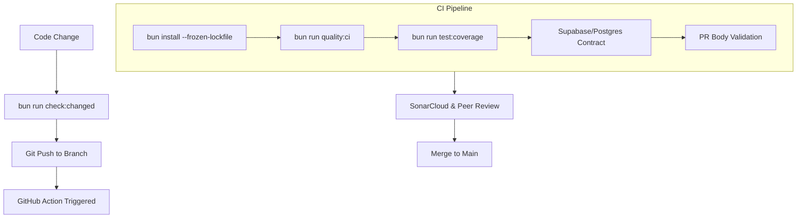
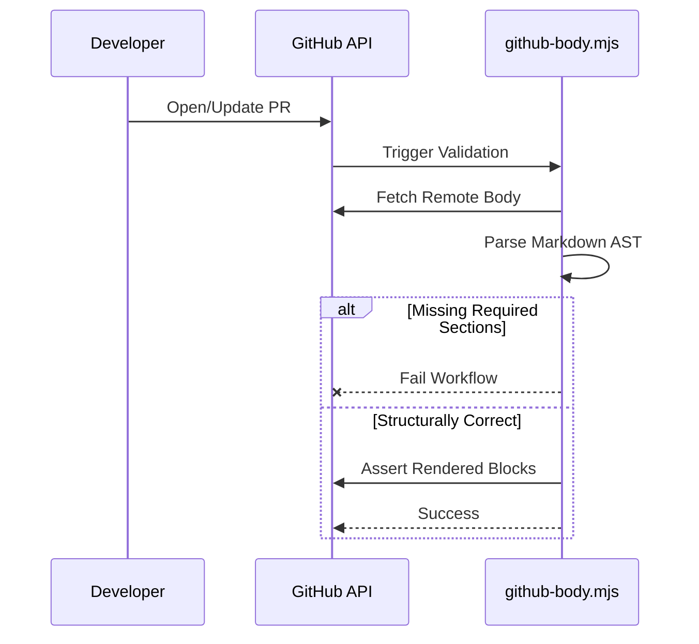

Relevant source files

The following files were used as context for generating this wiki page:

- [scripts/run-full-quality-gate.ts](https://github.com/immagiov4/Nous/blob/21ec8b9ef2e9c48eae54d59ba738a6dc8f10dee6/scripts/run-full-quality-gate.ts)
- [scripts/run-sonar-scan.ts](https://github.com/immagiov4/Nous/blob/21ec8b9ef2e9c48eae54d59ba738a6dc8f10dee6/scripts/run-sonar-scan.ts)
- [.agents/skills/quality-workflow/SKILL.md](https://github.com/immagiov4/Nous/blob/21ec8b9ef2e9c48eae54d59ba738a6dc8f10dee6/.agents/skills/quality-workflow/SKILL.md)
- [config/docker-compose.sonarqube.yml](https://github.com/immagiov4/Nous/blob/21ec8b9ef2e9c48eae54d59ba738a6dc8f10dee6/config/docker-compose.sonarqube.yml)
- [PROJECT_RULES.md](https://github.com/immagiov4/Nous/blob/21ec8b9ef2e9c48eae54d59ba738a6dc8f10dee6/PROJECT_RULES.md)
- [package.json](https://github.com/immagiov4/Nous/blob/21ec8b9ef2e9c48eae54d59ba738a6dc8f10dee6/package.json)
- [apps/web/tests/scripts/workflowPostgresCi.test.ts](https://github.com/immagiov4/Nous/blob/21ec8b9ef2e9c48eae54d59ba738a6dc8f10dee6/apps/web/tests/scripts/workflowPostgresCi.test.ts)
- [scripts/github-body-workflow.test.ts](https://github.com/immagiov4/Nous/blob/21ec8b9ef2e9c48eae54d59ba738a6dc8f10dee6/scripts/github-body-workflow.test.ts)
- [scripts/github-body.test.ts](https://github.com/immagiov4/Nous/blob/21ec8b9ef2e9c48eae54d59ba738a6dc8f10dee6/scripts/github-body.test.ts)

# Quality & CI/CD Workflow

The Quality and CI/CD workflow in Nous Reader ensures the stability, security, and maintainability of the codebase through a multi-layered verification system. This system integrates static analysis, automated testing, and strict Pull Request (PR) validation into a continuous pipeline that spans from local development to GitHub Actions.

The workflow prioritizes "Context Before Code," requiring developers to understand surrounding architectures and helpers before implementation to prevent logic duplication. Every change must be proven through observable evidence, such as behavior tests or traces, before merging into the main branch.
Sources: [PROJECT_RULES.md](https://github.com/immagiov4/Nous/blob/21ec8b9ef2e9c48eae54d59ba738a6dc8f10dee6/PROJECT_RULES.md), [AGENTS.md](https://github.com/immagiov4/Nous/blob/21ec8b9ef2e9c48eae54d59ba738a6dc8f10dee6/AGENTS.md)

## Core Validation Layers

The project organizes verification into a hierarchy of commands that increase in depth and resource usage. Developers use fast, local checks during development and heavy gate commands before pushing changes.

### Local Development Commands
Developers run focused checks to catch early regressions:
*   `bun run check:changed`: Performs Biome linting and ESLint checks only on files modified relative to `origin/main`.
*   `bun run quality`: Executes complete TypeScript type checks, Biome linting, React Hooks rules, and Sonar-style checks across the entire project.
*   `bun run fix`: Automatically applies Biome linting and formatting fixes.
Sources: [PROJECT_RULES.md](https://github.com/immagiov4/Nous/blob/21ec8b9ef2e9c48eae54d59ba738a6dc8f10dee6/PROJECT_RULES.md), [package.json](https://github.com/immagiov4/Nous/blob/21ec8b9ef2e9c48eae54d59ba738a6dc8f10dee6/package.json)

### Gate Commands
Gates provide a unified entry point for comprehensive verification:
*   `gate:ci`: The standard CI gate running quality checks, Fallow regression analysis, and Node.js tests with LCOV coverage.
*   `gate:full`: A sequential gate designed to diagnose environment-specific failures. It runs quality checks, followed by Node.js coverage and a local Sonar scan.
Sources: [scripts/run-full-quality-gate.ts](https://github.com/immagiov4/Nous/blob/21ec8b9ef2e9c48eae54d59ba738a6dc8f10dee6/scripts/run-full-quality-gate.ts), [package.json](https://github.com/immagiov4/Nous/blob/21ec8b9ef2e9c48eae54d59ba738a6dc8f10dee6/package.json)

| Command | Purpose | Tools Included |
| :--- | :--- | :--- |
| `check:changed` | Fast iteration | Biome, ESLint |
| `quality` | Full local audit | TS, Biome, React Hooks, Sonar Rules |
| `gate:ci` | Merge readiness | Quality, Fallow, Vitest, Coverage |
| `gate:full` | Deep diagnosis | Quality, Coverage, Local SonarQube |

## CI/CD Pipeline Architecture

The Continuous Integration (CI) pipeline runs on GitHub Actions, triggered by pushes to `main` and pull request updates. It enforces deterministic contracts for database migrations and cross-module dependencies.

### Workflow Process Flow
The following diagram illustrates the path from a local code change to a successful merge.

The diagram shows the sequence of automated checks required for code to transition from a local environment to the production branch.
Sources: [apps/web/tests/scripts/workflowPostgresCi.test.ts](https://github.com/immagiov4/Nous/blob/21ec8b9ef2e9c48eae54d59ba738a6dc8f10dee6/apps/web/tests/scripts/workflowPostgresCi.test.ts), [PROJECT_RULES.md](https://github.com/immagiov4/Nous/blob/21ec8b9ef2e9c48eae54d59ba738a6dc8f10dee6/PROJECT_RULES.md)

### PostgreSQL and Supabase Contracts
The CI pipeline executes specific jobs to verify database integrity:
*   **Supabase Contract:** Runs `bun run test:supabase-contract` to verify Authentication and Row Level Security (RLS) rules.
*   **Workflow PostgreSQL Contract:** Detects if changes affect the workflow runtime or migrations. If changed, it runs `bun run test:workflow-postgres:critical` (for PRs) or the full suite (for main branch).
Sources: [apps/web/tests/scripts/workflowPostgresCi.test.ts](https://github.com/immagiov4/Nous/blob/21ec8b9ef2e9c48eae54d59ba738a6dc8f10dee6/apps/web/tests/scripts/workflowPostgresCi.test.ts), [scripts/select-workflow-postgres-contract.test.ts](https://github.com/immagiov4/Nous/blob/21ec8b9ef2e9c48eae54d59ba738a6dc8f10dee6/scripts/select-workflow-postgres-contract.test.ts)

## Static Analysis and Sonar Integration

Nous Reader leverages SonarQube (local) and SonarCloud (CI) for deep static analysis, focusing on cognitive complexity and security vulnerabilities.

### Local Sonar Infrastructure
For local deep analysis, the project provides a Docker-based SonarQube environment.
*   **Configuration:** Defined in `config/docker-compose.sonarqube.yml`, using a PostgreSQL 15 backend.
*   **Execution:** `bun run sonar:up` starts the service, and `scripts/run-sonar-scan.ts` handles the analysis, excluding directories like `node_modules`, `dist`, and `e2e` to ensure performance.
Sources: [config/docker-compose.sonarqube.yml](https://github.com/immagiov4/Nous/blob/21ec8b9ef2e9c48eae54d59ba738a6dc8f10dee6/config/docker-compose.sonarqube.yml), [scripts/run-sonar-scan.ts](https://github.com/immagiov4/Nous/blob/21ec8b9ef2e9c48eae54d59ba738a6dc8f10dee6/scripts/run-sonar-scan.ts)

### Rules and Complexity
*   **Cognitive Complexity:** The project targets a maximum cognitive complexity of 15 per function.
*   **Check ESLint Sonar:** A cached rule set (`config/eslint.sonar.config.mjs`) checks TS/TSX files against a baseline of suppressions tracked in `config/eslint-suppressions.json`.
Sources: [PROJECT_RULES.md](https://github.com/immagiov4/Nous/blob/21ec8b9ef2e9c48eae54d59ba738a6dc8f10dee6/PROJECT_RULES.md)

## Pull Request Governance

Every Pull Request must follow a strict structural contract to maintain a clear project history.

### Body Validation
The `scripts/github-body.mjs` utility validates that PR descriptions include specific sections: **Problem**, **Approach**, and **Result**. 
*   **Testing Section:** A mandatory `## Testing` section must summarize CI and SonarCloud status.
*   **Format Rules:** The script rejects single-line bodies, empty bodies, and improper spacing around headings or lists.
Sources: [scripts/github-body.test.ts](https://github.com/immagiov4/Nous/blob/21ec8b9ef2e9c48eae54d59ba738a6dc8f10dee6/scripts/github-body.test.ts), [scripts/github-body-workflow.test.ts](https://github.com/immagiov4/Nous/blob/21ec8b9ef2e9c48eae54d59ba738a6dc8f10dee6/scripts/github-body-workflow.test.ts)

The sequence diagram details the interaction between the GitHub environment and the validation script to ensure PR documentation standards.
Sources: [scripts/github-body.test.ts](https://github.com/immagiov4/Nous/blob/21ec8b9ef2e9c48eae54d59ba738a6dc8f10dee6/scripts/github-body.test.ts), [scripts/github-body-workflow.test.ts](https://github.com/immagiov4/Nous/blob/21ec8b9ef2e9c48eae54d59ba738a6dc8f10dee6/scripts/github-body-workflow.test.ts)

## Testing Standards

The testing suite uses Vitest for unit and integration tests and Playwright for browser-based end-to-end (E2E) testing.

*   **Behavior Tests:** Product work starts with a failing behavior test.
*   **Audio Production:** Specific browser tests verify production audio in Chromium and Firefox.
*   **Heavy Command Leases:** Heavy analysis processes (like Sonar or full gates) acquire shared FIFO leases to manage system load.
*   **Coverage:** CI requires Node.js coverage with LCOV output, prepared via `bun run prepare:coverage`.
Sources: [PROJECT_RULES.md](https://github.com/immagiov4/Nous/blob/21ec8b9ef2e9c48eae54d59ba738a6dc8f10dee6/PROJECT_RULES.md), [package.json](https://github.com/immagiov4/Nous/blob/21ec8b9ef2e9c48eae54d59ba738a6dc8f10dee6/package.json), [apps/web/tests/scripts/workflowPostgresCi.test.ts](https://github.com/immagiov4/Nous/blob/21ec8b9ef2e9c48eae54d59ba738a6dc8f10dee6/apps/web/tests/scripts/workflowPostgresCi.test.ts)

## Summary

The Quality & CI/CD workflow establishes a high-trust environment by combining rapid local feedback with rigorous cloud-based verification. By enforcing architectural principles via static analysis and validating documentation structure alongside code, the system ensures that every merge contributes to a stable and well-documented ADHD-friendly learning platform.
Sources: [PROJECT_RULES.md](https://github.com/immagiov4/Nous/blob/21ec8b9ef2e9c48eae54d59ba738a6dc8f10dee6/PROJECT_RULES.md), [AGENTS.md](https://github.com/immagiov4/Nous/blob/21ec8b9ef2e9c48eae54d59ba738a6dc8f10dee6/AGENTS.md)
