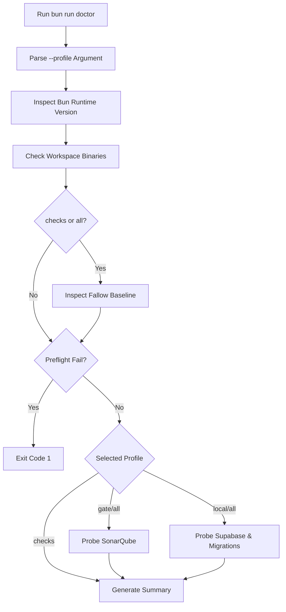
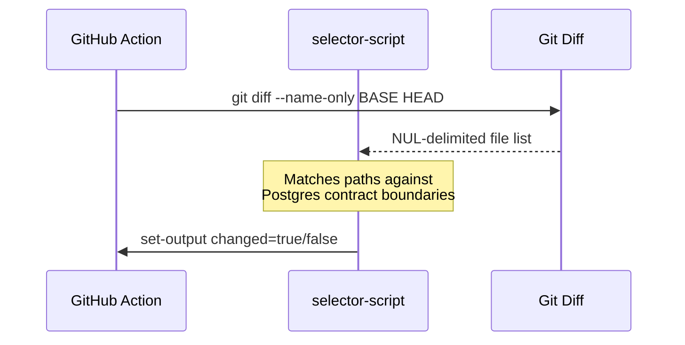

<details>
<summary>Relevant source files</summary>

The following files were used as context for generating this wiki page:

- [scripts/doctor.ts](../../../scripts/doctor.ts)
- [scripts/doctor.test.ts](../../../scripts/doctor.test.ts)
- [scripts/select-workflow-postgres-contract.ts](../../../scripts/select-workflow-postgres-contract.ts)
- [apps/web/tests/scripts/workflowPostgresCi.test.ts](../../../apps/web/tests/scripts/workflowPostgresCi.test.ts)
- [README.md](../../../README.md)
- [AGENTS.md](../../../AGENTS.md)
- [biome.json](../../../biome.json)

</details>

# CLI Tools & Diagnostics

Nous provides a robust suite of Command Line Interface (CLI) tools and diagnostic scripts designed to maintain system health, ensure code quality, and validate environmental configurations. These tools serve as the first line of defense for developers, offering automated checks for dependencies, service availability, and CI/CD workflow integrity.

The primary entry point for health monitoring is the `doctor` script, which performs observational diagnostics across multiple profiles, ranging from local dependency checks to full service probes. These tools are integrated into the project's [Testing and quality gates](02-p-testing-quality.md) to ensure that every change adheres to the project's technical standards before merging.
Sources: [AGENTS.md:124-142](../../../AGENTS.md#L124-L142)

## The Doctor Diagnostic Tool

The `doctor` script (`scripts/doctor.ts`) is a comprehensive diagnostic utility that validates the development environment and infrastructure services. It is strictly observational, meaning it reports statuses (`PASS`, `FAIL`, `WARN`, `SKIP`) without modifying configurations or starting services.

### Diagnostic Profiles
The tool supports four execution profiles to target specific layers of the application stack:

| Profile | Description |
| :--- | :--- |
| `checks` | Default profile. Runs service-free checks like Bun runtime, dependencies, and Fallow debt. |
| `gate` | Probes the loopback-only local SonarQube service. |
| `local` | Probes Supabase services (Auth, Data API, Storage, Realtime) and migration parity. |
| `all` | Executes every available check and service probe. |

Sources: [scripts/doctor.ts:46-52](../../../scripts/doctor.ts#L46-L52), [scripts/doctor.ts:79-100](../../../scripts/doctor.ts#L79-L100)

### Environmental Logic Flow
The diagnostic process begins by verifying the core runtime environment before proceeding to higher-level service checks.



The tool treats `package.json#packageManager` as the Bun version source. It verifies that the local runtime and `@types/bun` match the pin, and that GitHub Actions lets `oven-sh/setup-bun` read the same field instead of declaring another version.
Sources: [scripts/doctor.ts:106-137](../../../scripts/doctor.ts#L106-L137), [scripts/doctor.ts:268-293](../../../scripts/doctor.ts#L268-L293)

## Workflow & CI Selectors

To optimize Continuous Integration, Nous utilizes specialized scripts to determine which tests are relevant based on changed files. The `select-workflow-postgres-contract.ts` script is used in GitHub Actions to detect changes affecting the PostgreSQL persistence layer.

### Contract Selection Logic
The selector identifies changes within specific ownership boundaries:
*  **Infrastructure**: `supabase/migrations/`, `supabase/config.toml`.
*  **Backend Logic**: `apps/backend/src/projects/postgresProjectStore.ts`, `apps/backend/src/workflows/persistence/postgresWorkflowStore.ts`.
*  **Shared Types**: `packages/shared-types/projectContract.ts`.
*  **CI Configuration**: `.github/workflows/ci.yml`.

Sources: [scripts/select-workflow-postgres-contract.test.ts:11-30](../../../scripts/select-workflow-postgres-contract.test.ts#L11-L30), [apps/web/tests/scripts/workflowPostgresCi.test.ts:38-55](../../../apps/web/tests/scripts/workflowPostgresCi.test.ts#L38-L55)



Sources: [apps/web/tests/scripts/workflowPostgresCi.test.ts:38-55](../../../apps/web/tests/scripts/workflowPostgresCi.test.ts#L38-L55)

## Service Health Probes

### Supabase Integration
The diagnostic tool verifies the availability of the local Supabase stack by probing specific health endpoints using loopback hostnames (`127.0.0.1`, `localhost`).

| Service | Health Endpoint |
| :--- | :--- |
| Supabase Auth | `/auth/v1/health` |
| Supabase Data API | `/rest/v1/` |
| Supabase Storage | `/storage/v1/status` |
| Supabase Realtime | `/realtime/v1/api/tenants/realtime-dev/health` |

Sources: [scripts/doctor.ts:31-40](../../../scripts/doctor.ts#L31-L40), [scripts/doctor.ts:303-333](../../../scripts/doctor.ts#L303-L333)

### Migration Drift Analysis
The CLI tools include logic to detect "drift" between local migration files and the state of the database. This is achieved by executing `supabase migration list --local --output-format json` and comparing the status of local vs. remote migrations.
Sources: [scripts/doctor.ts:139-156](../../../scripts/doctor.ts#L139-L156), [scripts/doctor.ts:358-386](../../../scripts/doctor.ts#L358-L386)

## Code Quality & Linting
Nous uses **Biome** for formatting and linting, governed by `biome.json`. The CLI tools integrate these checks via the `bun run quality` command.

### Biome Configuration Summary
*  **Formatter**: Uses spaces (width 2), line length 100, and single quotes for JavaScript.
*  **Linter**: Enables recommended rules with specific overrides for `noUnusedImports`, `noExplicitAny`, and `useConst` set to `warn`.
*  **VCS Integration**: Enabled with Git support to respect ignore files.

Sources: [biome.json:10-85](../../../biome.json#L10-L85)

## Validation Commands Reference
Developers use the following commands to interact with the diagnostic and quality systems:

| Command | Purpose |
| :--- | :--- |
| `bun run doctor` | Run observational health checks (default: `checks` profile). |
| `bun run quality` | Run TypeScript type checks and Biome linting. |
| `bun run quality:ci` | Add dependency boundary validation to the common quality checks for CI and the local full gate. |
| `bun run gate:full` | After green CI, run shared `gate:ci` checks, Node coverage, and Sonar on the same final commit. |
| `bun run sonar:up` | Start and provision the loopback-only Sonar service for diagnosis. |
| `bun run sonar:stop` | Stop the Sonar containers without deleting their volumes. |
| `bun run fix` | Automatically fix Biome linting, formatting, and import ordering. |
| `bun run test` | Execute the Vitest suite under the Bun runtime. |

Sources: [AGENTS.md:124-142](../../../AGENTS.md#L124-L142)

The diagnostic ecosystem ensures that the development environment is stable, services are reachable, and the codebase remains compliant with established architectural and quality standards.

## Playback visual atlas

`bun run atlas:playback` creates a local atlas from normalized lessons and renders the production playback components in headless Chromium. It uses the application's deterministic segmentation and estimated playback timeline, samples each block at its start, middle and end, and writes separately labelled sheets for isolated visuals that those block positions might miss. Ordinary library exports omit prepared playback scenes and audio; the atlas exercises the authored visuals available in the export.

```bash
bun run atlas:playback -- --synthetic synthetic-short
bun run atlas:playback -- --library "$NOUS_E2E_LIBRARY"
bun run atlas:playback -- --fixture path/to/synthetic-project.json
bun run atlas:playback -- --scenario path/to/playback-scenario.json
```

The default fixture is a deterministic pairwise generator over playback content kinds, supported visual kinds, the current scene catalog and Markdown syntax. It reuses the existing valid scene examples and checks generated scenes against the shared contract. The existing `synthetic-short` and `synthetic-law-short` courses remain available for a short run.

A scenario declares its identity, tags, fixture, viewports or named Playwright devices, and enabled structural checks. The built-in scenario covers desktop, mobile and tablet. JSON definitions use the following shape; fixture paths are resolved from the command's working directory.

```json
{
  "id": "playback-example",
  "surface": "playback",
  "tags": ["playback", "synthetic"],
  "fixture": { "kind": "synthetic", "generator": "pairwise" },
  "viewports": [
    { "id": "desktop", "device": "Desktop Chrome" },
    { "id": "mobile", "device": "Pixel 7" }
  ],
  "checks": [
    "visual-empty",
    "visual-symbol-only",
    "caption-word-mismatch",
    "speech-inline-math-omitted",
    "visual-clipped",
    "console-error",
    "render-error",
    "scene-invalid"
  ]
}
```

`--course` and `--lesson` select exact IDs. `--source-root` loads segmentation, components and styles from another source checkout with its dependencies installed, allowing one version of the atlas to compare application commits. The renderer builds immutable assets with the selected checkout's Vite, PostCSS and Tailwind configuration before starting a local preview. Capture remains sequential. The output records the resolved scenario, source and tool revisions, dirty-state flags, per-tile geometry and rendering duration.

Each run creates a fresh directory under `~/nous-atlas/`, or under an explicit `--output-root`. Output paths must resolve outside every Git repository. `index.html` links to contact sheets and original PNGs; `report.json` gives every finding an exact HTML fragment, image, sheet and sheet rectangle. These artifacts include lesson content and stay private. Library inputs are refused in CI; CI can use the synthetic generator or repository-owned project fixtures. The renderer uses local assets and system font fallbacks, with outbound requests blocked.

Checks identify rendered empty content, symbolic content without prose, captions crossing canonical spoken-word boundaries, exact clipping, scene contract failures and rendering or console errors. A formula can satisfy the symbolic-content check while remaining valid teaching content: structural findings still require interpretation against the lesson. Sparse nonempty content, fitted font size, canvas occupancy and rendering duration retain raw measurements and maintainer decisions instead of numerical quality cutoffs. The command exits unsuccessfully when findings or operational errors are present. Lessons without spoken playback blocks are explicitly recorded as incomplete coverage rather than silently counted as captured.

Contact sheets include a transcript of the actual caption DOM beneath every image, including on mobile where the production stage hides that caption region. Each tile records its canonical `speech` text in JSON, including failed captures; its HTML sheet also exposes that text under Speech. `speech-inline-math-omitted` compares parsed inline mathematical ranges with the production source-to-speech mapping and flags ranges with no mapped spoken text. It analyzes the original source blocks, including lines with no spoken span. A gap between spoken blocks is recorded on both adjacent blocks with their IDs and the original source-block index. It excludes display math and math inside code, image sources, link destinations and HTML syntax. Standalone punctuation or symbol tokens are retained with their speech offsets in `speechPunctuationTokens`; these raw tokens require interpretation and do not fail a run. This records the spoken-form regression tracked separately in #350 without changing the product projection.

The report initially marks agent visual review as pending; the reviewing agent records inspected tile paths and observations separately from automatic findings.

Run `bun run test -- e2e/nous/tests/playbackAtlas.test.ts` for the deterministic contracts. Run `bun run test:atlas:browser` for the sequential Chromium contract: it compares repeated PNGs byte for byte and checks animated content clipped inside an iframe and an iframe clipped by its outer stage. An optional positional source checkout path exercises that version of the application. The contract uses only generated synthetic inputs and runs with `CI=1`. Fallow registers the Vite-only browser entry as test code and recognizes the build-resolved KaTeX CSS alias; the standalone contract has its own package script entry.

Sources: [command](../../../e2e/nous/playbackAtlas.ts), [scenario contract](../../../e2e/nous/atlas/scenario.ts), [synthetic generator](../../../e2e/nous/atlas/synthetic.ts), [behavior tests](../../../e2e/nous/tests/playbackAtlas.test.ts).


Private atlas runs use owner-only POSIX directories (`0700`) and evidence files (`0600`), including when the parent directory already exists. On Windows, output must resolve under the current user's profile, including after resolving junctions; the atlas relies on that profile's inherited ACLs. Custom Windows output roots outside the profile are rejected. Run evidence and the renderer bundle remain outside Git repositories.

The selected `--source-root` supplies KaTeX CSS through its own `rehype-katex` dependency. Direct project ZIP and JSON fixtures use the application's import readers before normalization; ZIP decoding also retains archived asset bytes. Capture waits for PDF image figures to mount an image or report a resolution failure, then waits for image decoding. Failed PDF resolution is a render finding.

Before application code loads, Playwright installs and pauses its clock at a fixed fixture instant; each sample resets wall time and the main document's seeded random sequence. Every new iframe receives the same random seed before its scripts execute. The controlled clock advances through the sampled playback time and the existing two layout frames, covering timers, animation frames and performance time. Web Animations are settled in every frame. These controls do not impose an execution deadline: a non-terminating visual script still requires a separately approved external deadline or a restricted rendering policy.
