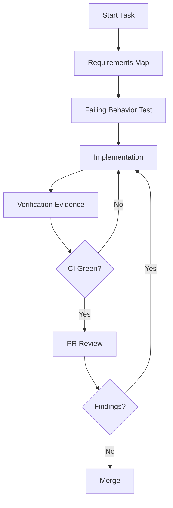
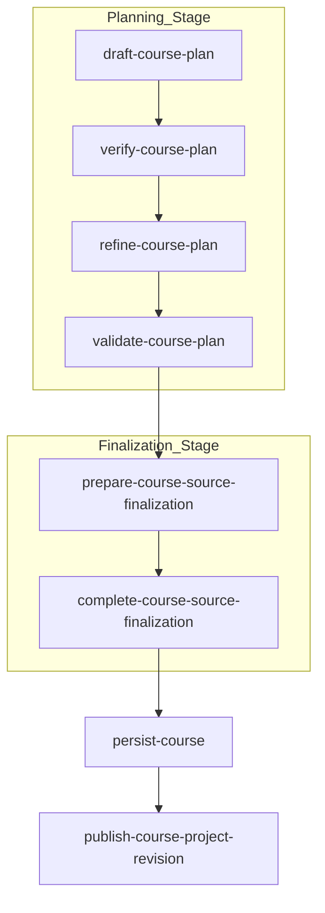

Relevant source files

The following files were used as context for generating this wiki page:

- [PROJECT\_RULES.md](https://github.com/immagiov4/Nous/blob/21ec8b9ef2e9c48eae54d59ba738a6dc8f10dee6/PROJECT_RULES.md)
- [AGENTS.md](https://github.com/immagiov4/Nous/blob/21ec8b9ef2e9c48eae54d59ba738a6dc8f10dee6/AGENTS.md)
- [apps/backend/src/workflows/validation.ts](https://github.com/immagiov4/Nous/blob/21ec8b9ef2e9c48eae54d59ba738a6dc8f10dee6/apps/backend/src/workflows/validation.ts)
- [apps/backend/src/routes/chatPrompts.ts](https://github.com/immagiov4/Nous/blob/21ec8b9ef2e9c48eae54d59ba738a6dc8f10dee6/apps/backend/src/routes/chatPrompts.ts)
- [apps/backend/tests/workflows/courseGenerationWorkflow.test.ts](https://github.com/immagiov4/Nous/blob/21ec8b9ef2e9c48eae54d59ba738a6dc8f10dee6/apps/backend/tests/workflows/courseGenerationWorkflow.test.ts)
- [apps/backend/src/services/lessonScenes/lessonSceneGeneration.ts](https://github.com/immagiov4/Nous/blob/21ec8b9ef2e9c48eae54d59ba738a6dc8f10dee6/apps/backend/src/services/lessonScenes/lessonSceneGeneration.ts)

# Developer Workflows & Agent Skills

Developer workflows and agent skills define the operational framework for building and maintaining the Nous Reader codebase. This system coordinates human developers, automated CI/CD processes, and AI-driven agents (Codex/Geppetto) to ensure code quality, architectural consistency, and verified functionality.

The workflow prioritizes "Context Before Code," requiring agents and developers to understand existing helpers, constants, and module boundaries before implementing changes. Verification is central to the process; every PR must contain observable evidence of work, such as behavior tests or render atlases, to prove the effectiveness of a change.

## Agent System Architecture

The agent system operates through a set of specialized "skills" and automated hooks that integrate into the developer's environment. Agents use the Geppetto plugin and Codex tasks to execute implementation, review, and documentation work.

### Core Intentions
The system operates based on five main intents:
1.  **Improve it**: Agents watch for recurring friction and proactively suggest or implement fixes.
2.  **See inside**: Features must be built with observability, preserving error causes and trace durations.
3.  **Prove it**: Claims must be backed by measurements, behavior tests, or traces.
4.  **Keep it small**: Units of work must be small enough to verify together.
5.  **Reuse before inventing**: Existing skills, scripts, and hooks take precedence over new parallel paths.

Sources: [AGENTS.md](https://github.com/immagiov4/Nous/blob/21ec8b9ef2e9c48eae54d59ba738a6dc8f10dee6/AGENTS.md), [PROJECT\_RULES.md](https://github.com/immagiov4/Nous/blob/21ec8b9ef2e9c48eae54d59ba738a6dc8f10dee6/PROJECT%5C_RULES.md)

### Skill Discovery and Application
Skills are modular units of capability categorized by their role in the development lifecycle.

| When | Skill Category | Description |
| :--- | :--- | :--- |
| Planning | `$geppetto-spec` | Maps requirements and defines behavior changes. |
| Implementing | `$geppetto-build` | Executes the specified unit of work. |
| Verification | `$geppetto-verify` | Checks completion and addresses review findings. |
| Learning | `$geppetto-learn` | Records recurring friction and curates skills. |
| Engineering | `$engineering-workflow` | General execution of engineering tasks. |

Sources: [AGENTS.md](https://github.com/immagiov4/Nous/blob/21ec8b9ef2e9c48eae54d59ba738a6dc8f10dee6/AGENTS.md)

## Development Lifecycle & PR Requirements

The development process follows a strict sequence of requirement mapping, implementation, and rigorous verification before a pull request (PR) can be merged.

### PR Selection and Body Contract
PR bodies must follow a specific structure to ensure clarity and provide a durable record of the change. This is enforced by `scripts/github-body.mjs`.

- **Problem**: Defines the issue or requirement.
- **Approach**: Explains the technical solution and architectural choices.
- **Result**: Provides a Before/After comparison or a "Not measured" statement.
- **Observability**: Describes how the change is monitored or traced.
- **Testing**: Summarizes CI status and SonarCloud results.

Sources: [PROJECT\_RULES.md](https://github.com/immagiov4/Nous/blob/21ec8b9ef2e9c48eae54d59ba738a6dc8f10dee6/PROJECT%5C_RULES.md), [AGENTS.md](https://github.com/immagiov4/Nous/blob/21ec8b9ef2e9c48eae54d59ba738a6dc8f10dee6/AGENTS.md), [scripts/github-body.test.ts](https://github.com/immagiov4/Nous/blob/21ec8b9ef2e9c48eae54d59ba738a6dc8f10dee6/scripts/github-body.test.ts)

### Verification and Evidence
Developers and agents must provide observable evidence for every change.
- **UI Changes**: Require screenshots, videos, or render atlases.
- **Backend Changes**: Require behavior tests and integration evidence.
- **End-to-End**: High-level flows must be proven with Playwright actions.

The diagram shows the standard flow from task initiation to merge, emphasizing the requirement for failing tests before implementation.
Sources: [PROJECT\_RULES.md](https://github.com/immagiov4/Nous/blob/21ec8b9ef2e9c48eae54d59ba738a6dc8f10dee6/PROJECT%5C_RULES.md), [AGENTS.md](https://github.com/immagiov4/Nous/blob/21ec8b9ef2e9c48eae54d59ba738a6dc8f10dee6/AGENTS.md)

## Durable Workflow Engine

The backend utilizes a durable workflow engine to manage long-running or complex processes, such as course generation. These workflows are composed of nodes and steps with strictly validated schemas.

### Workflow Validation
Workflows are validated against a manifest to ensure compatibility and durability. The system uses SHA-256 hashing of canonical JSON manifests to detect changes that might break resumed executions.

- **Step**: An atomic unit of work with `run`, `commit`, and `undo` callbacks.
- **Sequence**: A series of nodes where the output of one must match the input of the next.
- **FanOut**: Parallel execution across multiple items with a `worker` node.
- **Repeat**: Iterative execution until a condition is met or `maxIterations` is reached.

Sources: [apps/backend/src/workflows/validation.ts:167-330](https://github.com/immagiov4/Nous/blob/21ec8b9ef2e9c48eae54d59ba738a6dc8f10dee6/apps/backend/src/workflows/validation.ts#L167-L330)

### Course Generation Workflow
The course generation process is a prime example of a durable workflow, routing through stages of research, planning, and source finalization.

This diagram illustrates the planning and finalization phases of the course generation workflow.
Sources: [apps/backend/tests/workflows/courseGenerationWorkflow.test.ts:315-345](https://github.com/immagiov4/Nous/blob/21ec8b9ef2e9c48eae54d59ba738a6dc8f10dee6/apps/backend/tests/workflows/courseGenerationWorkflow.test.ts#L315-L345)

## Agent Chat & Tooling

Agents interact with the library and lessons through a specialized chat interface that utilizes tools for search, annotation, and artifact generation.

### Tool Selection Logic
Agent behavior is governed by active user preferences and explicit instructions.
- **SearchWeb**: Used when external facts or verification improve the answer. Explicit user search requests take priority over preferences.
- **RequestAddToNotes**: Proposes saving clarifications or rephrasings when they add value to the lesson.
- **GenerateCurrentLessonArtifact**: Creates visual aids like charts or diagrams proactively if the preference is active.

Sources: [apps/backend/src/routes/chatPrompts.ts:400-550](https://github.com/immagiov4/Nous/blob/21ec8b9ef2e9c48eae54d59ba738a6dc8f10dee6/apps/backend/src/routes/chatPrompts.ts#L400-L550)

### Context Awareness
Agents are provided with truncated context blocks to stay within token budgets while maintaining accuracy.

| Context Type | Field | Description |
| :--- | :--- | :--- |
| Lesson | `lessonContent` | The full text of the current lesson. |
| Selection | `selectedText` | The specific passage the user is highlighting. |
| Source | `sourceMaterial` | Aggregate text from original source documents. |
| Metadata | `sourceReferences` | Untrusted JSON data describing source provenance. |

Sources: [apps/backend/src/routes/chatPrompts.ts:440-490](https://github.com/immagiov4/Nous/blob/21ec8b9ef2e9c48eae54d59ba738a6dc8f10dee6/apps/backend/src/routes/chatPrompts.ts#L440-L490)

## Code Quality Standards

Workflows must adhere to the project's core philosophy: "Write code that is easy to understand, easy to change, and difficult to misuse."

### Implementation Rules
- **Guard Clauses**: Use instead of nested conditionals to reduce cognitive complexity.
- **Naming**: Variables and functions must be semantically decodable at a glance.
- **Single Source of Truth**: Constants and logic must be centralized to avoid hidden coupling.
- **Magic Numbers**: All literals (colors, timeouts, thresholds) must be replaced with named constants.

Sources: [PROJECT\_RULES.md](https://github.com/immagiov4/Nous/blob/21ec8b9ef2e9c48eae54d59ba738a6dc8f10dee6/PROJECT%5C_RULES.md)

### Error Handling Methodology
1.  **Identify root cause**: Determine the underlying pattern causing the bug.
2.  **Broad Search**: Look for similar patterns in the same file and related modules.
3.  **Systemic Fix**: Fix all occurrences consistently rather than applying a local patch.
4.  **Verification**: Add regression coverage to protect the contract.

Sources: [PROJECT\_RULES.md](https://github.com/immagiov4/Nous/blob/21ec8b9ef2e9c48eae54d59ba738a6dc8f10dee6/PROJECT%5C_RULES.md)
