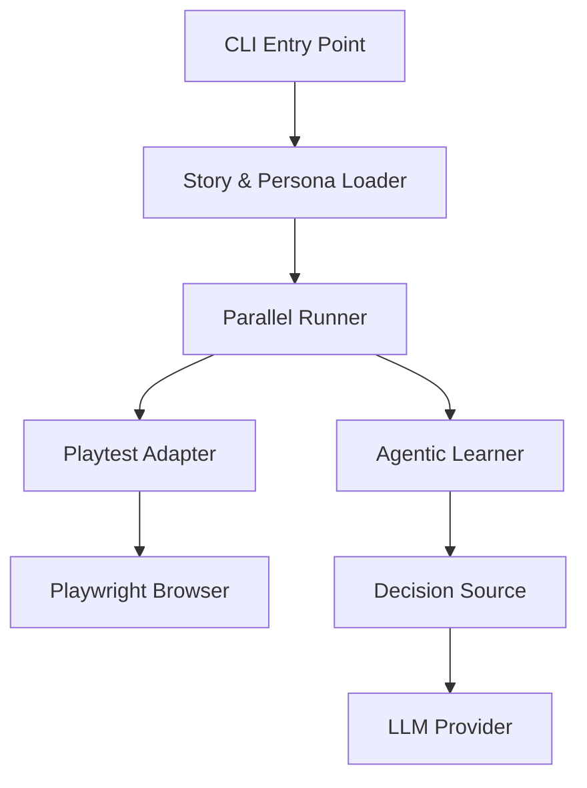
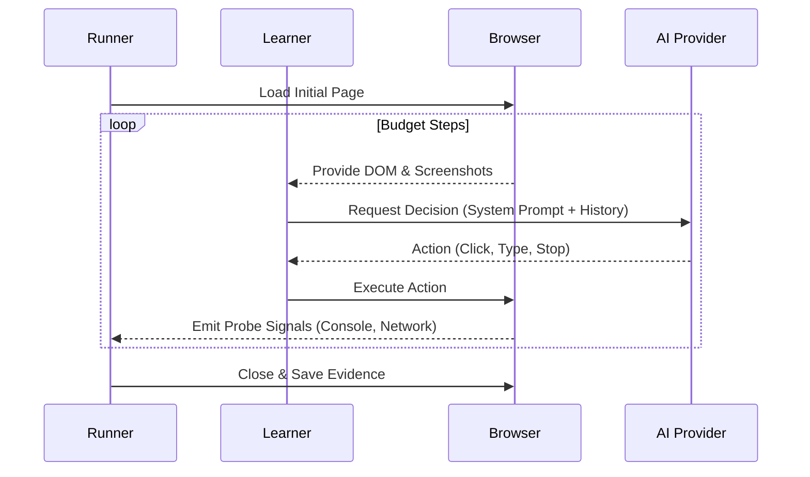

Relevant source files

The following files were used as context for generating this wiki page:

- [packages/playtest/src/cli.ts](https://github.com/immagiov4/Nous/blob/21ec8b9ef2e9c48eae54d59ba738a6dc8f10dee6/packages/playtest/src/cli.ts)
- [packages/playtest/src/runner.ts](https://github.com/immagiov4/Nous/blob/21ec8b9ef2e9c48eae54d59ba738a6dc8f10dee6/packages/playtest/src/runner.ts)
- [packages/playtest/tests/runner.test.ts](https://github.com/immagiov4/Nous/blob/21ec8b9ef2e9c48eae54d59ba738a6dc8f10dee6/packages/playtest/tests/runner.test.ts)
- [e2e/nous/tests/playbackAtlas.browser.ts](https://github.com/immagiov4/Nous/blob/21ec8b9ef2e9c48eae54d59ba738a6dc8f10dee6/e2e/nous/tests/playbackAtlas.browser.ts)
- [PROJECT_RULES.md](https://github.com/immagiov4/Nous/blob/21ec8b9ef2e9c48eae54d59ba738a6dc8f10dee6/PROJECT_RULES.md)

# Playtest Framework

The Playtest Framework executes headless agentic stories to verify application behavior, pedagogical flow, and visual integrity. It simulates diverse learner interactions using personas with specific emotional or cognitive affects to detect regressions in complex user journeys.

## Core Architecture

The system operates through a layered architecture that separates story definition, execution orchestration, and application-specific adaptation.

The diagram shows the data flow from command-line input to the AI-driven agent interacting with the browser.
Sources: [packages/playtest/src/cli.ts](https://github.com/immagiov4/Nous/blob/21ec8b9ef2e9c48eae54d59ba738a6dc8f10dee6/packages/playtest/src/cli.ts), [packages/playtest/src/runner.ts](https://github.com/immagiov4/Nous/blob/21ec8b9ef2e9c48eae54d59ba738a6dc8f10dee6/packages/playtest/src/runner.ts)

### Command Line Interface (CLI)
The CLI processes user arguments to configure the testing environment. It parses options for model selection, provider endpoints, and concurrency limits. You run the framework using the `bun run playtest` command, which requires environment variables like `NOUS_E2E_DATA`.

Key functionalities of the CLI include:
*   **Argument Parsing:** `parsePlaytestArgs` extracts filters such as `--id`, `--tag`, and `--kind` to narrow the test suite.
*   **Validation:** It ensures that both `--model` and `--provider` are specified before execution begins.
*   **Story Filtering:** `filterStories` matches loaded stories against the provided CLI criteria.
Sources: [packages/playtest/src/cli.ts](https://github.com/immagiov4/Nous/blob/21ec8b9ef2e9c48eae54d59ba738a6dc8f10dee6/packages/playtest/src/cli.ts), [PROJECT_RULES.md](https://github.com/immagiov4/Nous/blob/21ec8b9ef2e9c48eae54d59ba738a6dc8f10dee6/PROJECT_RULES.md)

### Parallel Runner
The `runPlaytest` function orchestrates parallel job execution. It manages a pool of browser contexts and coordinates between the Agentic Learner and the Playtest Adapter.

| Component | Responsibility |
| :--- | :--- |
| **Concurrency Manager** | Limits active stories to the specified `concurrency` count (default: 4). |
| **Affect Selector** | `selectAffect` assigns a reproducible persona state (e.g., curious, tired) based on a seed. |
| **Evidence Collector** | Captures browser traces, WebM videos, and JSON reports for every story. |
| **Diagnostic Engine** | Records operational failures, preparation errors, and cleanup issues. |
Sources: [packages/playtest/src/runner.ts](https://github.com/immagiov4/Nous/blob/21ec8b9ef2e9c48eae54d59ba738a6dc8f10dee6/packages/playtest/src/runner.ts), [packages/playtest/tests/runner.test.ts](https://github.com/immagiov4/Nous/blob/21ec8b9ef2e9c48eae54d59ba738a6dc8f10dee6/packages/playtest/tests/runner.test.ts)

## Agentic Learner Logic

The framework uses an LLM-driven "Learner" to navigate the application. Unlike static scripts, the Learner makes dynamic decisions based on the current DOM state and pedagogical goals.

The sequence shows the iterative decision loop where the agent observes the browser and acts until the story budget is exhausted.
Sources: [packages/playtest/src/runner.ts](https://github.com/immagiov4/Nous/blob/21ec8b9ef2e9c48eae54d59ba738a6dc8f10dee6/packages/playtest/src/runner.ts), [packages/playtest/tests/runner.test.ts](https://github.com/immagiov4/Nous/blob/21ec8b9ef2e9c48eae54d59ba738a6dc8f10dee6/packages/playtest/tests/runner.test.ts)

## Visual Inspection and Atlas

The framework integrates a specialized system called the **Playback Atlas** for deep visual verification. It focuses on rendering accuracy and layout constraints that traditional functional tests miss.

### Snapshot Verification
The Atlas performs pixel-perfect comparisons between settled states. It verifies:
*   **Typography:** Ensures mathematical notation (LaTeX/KaTeX) renders correctly without omission.
*   **Clipping:** Detects if text overflows its container using `visual-clipped` findings.
*   **Determinism:** Validates that scripted animations and random elements settle into a predictable state before capture.
Sources: [e2e/nous/tests/playbackAtlas.browser.ts](https://github.com/immagiov4/Nous/blob/21ec8b9ef2e9c48eae54d59ba738a6dc8f10dee6/e2e/nous/tests/playbackAtlas.browser.ts)

### Visual Findings
The `inspectAtlasDom` function probes the DOM for specific visual anomalies.

| Finding Kind | Description |
| :--- | :--- |
| `visual-clipped` | Reported when an element's bounding box exceeds its parent's visible boundary. |
| `visual-empty` | Triggered when a required visual element (SVG or Canvas) contains no drawn content. |
| `speech-inline-math-omitted` | Occurs when LaTeX delimiters are found in text but ignored by the rendering engine. |
| `render-error` | Captured when a scripted visual (HTML/JS) fails or terminates unexpectedly. |
Sources: [e2e/nous/tests/playbackAtlas.browser.ts](https://github.com/immagiov4/Nous/blob/21ec8b9ef2e9c48eae54d59ba738a6dc8f10dee6/e2e/nous/tests/playbackAtlas.browser.ts)

## Evidence and Reporting

Every playtest run generates a structured output directory containing detailed verification data.

1.  **Summary Report:** A `summary.json` and `summary.html` file provide an overview of all executed stories, outcome counts, and total model usage costs.
2.  **Story Artifacts:**
    *   **JSON Report:** Contains the full learner diary, turn history, and probe signals.
    *   **Markdown Report:** A human-readable version of the results, including embedded links to traces.
    *   **Browser Trace:** A Playwright `trace.zip` for post-mortem debugging.
    *   **Video:** A WebM recording of the interaction (optional).
Sources: [packages/playtest/src/cli.ts](https://github.com/immagiov4/Nous/blob/21ec8b9ef2e9c48eae54d59ba738a6dc8f10dee6/packages/playtest/src/cli.ts), [packages/playtest/tests/runner.test.ts](https://github.com/immagiov4/Nous/blob/21ec8b9ef2e9c48eae54d59ba738a6dc8f10dee6/packages/playtest/tests/runner.test.ts)

The framework implements a strict cleanup phase. Even if a story fails or the application throws a 500 error, the `cleanup` hook in the adapter ensures that synthetic accounts and temporary data are removed from the system.
Sources: [packages/playtest/tests/runner.test.ts](https://github.com/immagiov4/Nous/blob/21ec8b9ef2e9c48eae54d59ba738a6dc8f10dee6/packages/playtest/tests/runner.test.ts)
