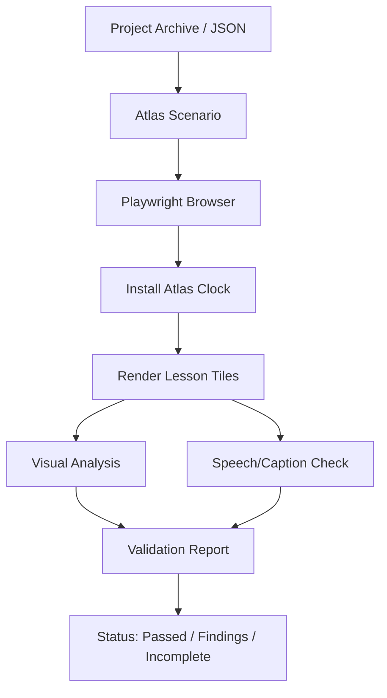
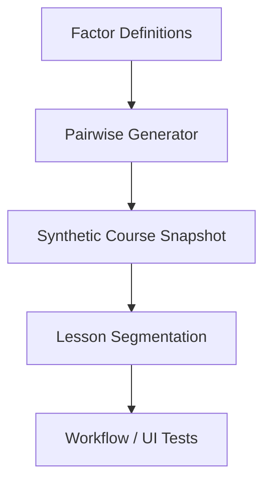

Relevant source files

The following files were used as context for generating this wiki page:

- [PROJECT_RULES.md](https://github.com/immagiov4/Nous/blob/21ec8b9ef2e9c48eae54d59ba738a6dc8f10dee6/PROJECT_RULES.md)
- [e2e/nous/tests/playbackAtlas.browser.ts](https://github.com/immagiov4/Nous/blob/21ec8b9ef2e9c48eae54d59ba738a6dc8f10dee6/e2e/nous/tests/playbackAtlas.browser.ts)
- [e2e/nous/tests/playbackAtlas.test.ts](https://github.com/immagiov4/Nous/blob/21ec8b9ef2e9c48eae54d59ba738a6dc8f10dee6/e2e/nous/tests/playbackAtlas.test.ts)
- [packages/playtest/tests/coverage.test.ts](https://github.com/immagiov4/Nous/blob/21ec8b9ef2e9c48eae54d59ba738a6dc8f10dee6/packages/playtest/tests/coverage.test.ts)
- [e2e/syntheticCourse.ts](https://github.com/immagiov4/Nous/blob/21ec8b9ef2e9c48eae54d59ba738a6dc8f10dee6/e2e/syntheticCourse.ts)
- [apps/backend/tests/workflows/courseGenerationPlanning.test.ts](https://github.com/immagiov4/Nous/blob/21ec8b9ef2e9c48eae54d59ba738a6dc8f10dee6/apps/backend/tests/workflows/courseGenerationPlanning.test.ts)

# E2E & Synthetic Testing

E2E (End-to-End) and Synthetic Testing ensure the reliability of the learning environment by simulating human-like interactions and generating deterministic test data. The system uses Playwright for browser-based verification and a synthetic course generator to exercise edge cases without relying on non-deterministic AI outputs.

Testing is governed by a strict "Prove it" philosophy, where every change must be validated with observable evidence such as screenshots, render atlases, and integration traces.

Sources: [PROJECT_RULES.md](https://github.com/immagiov4/Nous/blob/21ec8b9ef2e9c48eae54d59ba738a6dc8f10dee6/PROJECT_RULES.md), [AGENTS.md](https://github.com/immagiov4/Nous/blob/21ec8b9ef2e9c48eae54d59ba738a6dc8f10dee6/AGENTS.md)

## Playback Atlas Architecture

The Playback Atlas is a centralized verification system that captures visual and auditory snapshots of the lesson experience across different devices. It utilizes Playwright to automate Chromium browsers and verify that lessons render correctly and speech matches the visual output.

### Components and Flow

The following diagram illustrates how the Atlas processes a course through the browser to produce a validation report.

The Atlas executes within a controlled environment, installing a specific clock to ensure deterministic rendering for scripts and animations.

Sources: [e2e/nous/tests/playbackAtlas.browser.ts](https://github.com/immagiov4/Nous/blob/21ec8b9ef2e9c48eae54d59ba738a6dc8f10dee6/e2e/nous/tests/playbackAtlas.browser.ts), [e2e/nous/tests/playbackAtlas.test.ts](https://github.com/immagiov4/Nous/blob/21ec8b9ef2e9c48eae54d59ba738a6dc8f10dee6/e2e/nous/tests/playbackAtlas.test.ts)

### Visual and Caption Findings

The system identifies regressions through specific "findings" categories:

| Finding Kind | Description |
| :--- | :--- |
| `visual-empty` | The renderer produced no visible text, math, or media during active speech. |
| `visual-symbol-only` | Only symbols (e.g., arrows) were rendered without semantic content. |
| `visual-clipped` | Content extends beyond the viewport boundaries (e.g., iframe overflow). |
| `caption-word-mismatch` | The generated captions do not match the spoken audio fragments. |
| `speech-inline-math-omitted` | Inline LaTeX math (e.g., $x$) present in the source is missing from the speech. |

Sources: [e2e/nous/tests/playbackAtlas.browser.ts](https://github.com/immagiov4/Nous/blob/21ec8b9ef2e9c48eae54d59ba738a6dc8f10dee6/e2e/nous/tests/playbackAtlas.browser.ts), [e2e/nous/tests/playbackAtlas.test.ts](https://github.com/immagiov4/Nous/blob/21ec8b9ef2e9c48eae54d59ba738a6dc8f10dee6/e2e/nous/tests/playbackAtlas.test.ts)

## Synthetic Testing Framework

Synthetic testing replaces non-deterministic AI generation with stable, hardcoded, or pairwise-generated fixtures. This allows the test suite to cover complex pedagogical scenarios, such as mathematical formulas and interactive scenes, with guaranteed repeatability.

### Deterministic Pairwise Generation

The system uses `pairwiseRows` to cover factor combinations (e.g., content types vs. visual types) efficiently. This ensures that every pair of factors is tested at least once without requiring a full Cartesian product of all permutations.

Sources: [e2e/nous/tests/playbackAtlas.test.ts](https://github.com/immagiov4/Nous/blob/21ec8b9ef2e9c48eae54d59ba738a6dc8f10dee6/e2e/nous/tests/playbackAtlas.test.ts), [e2e/syntheticCourse.ts](https://github.com/immagiov4/Nous/blob/21ec8b9ef2e9c48eae54d59ba738a6dc8f10dee6/e2e/syntheticCourse.ts)

### Synthetic Scenes

Synthetic scenes exercise the `LessonScene` registry. Each scene type (e.g., `formula-spotlight`, `flowchart`, `timeline`) is validated against its structural schema and rendering rules to prevent regressions in how information is displayed to the learner.

Sources: [e2e/nous/tests/playbackAtlas.test.ts](https://github.com/immagiov4/Nous/blob/21ec8b9ef2e9c48eae54d59ba738a6dc8f10dee6/e2e/nous/tests/playbackAtlas.test.ts), [apps/backend/src/services/lessonScenes/lessonSceneGeneration.ts](https://github.com/immagiov4/Nous/blob/21ec8b9ef2e9c48eae54d59ba738a6dc8f10dee6/apps/backend/src/services/lessonScenes/lessonSceneGeneration.ts)

## Execution and Performance

Testing is divided into fast local checks and heavy integration runs.

*   **Fast Checks:** Use `bun run check:changed` to run Biome and ESLint on modified files.
*   **Heavy Runs:** Commanded via `bun scripts/heavy-run.mjs`, these include Playwright browser suites and agentic stories. These runs acquire a shared FIFO lease to manage machine capacity.
*   **Coverage Map:** The system tracks "Surface Coverage" (e.g., `lesson-reader`, `library`, `home-chat`) across test stories to identify uncovered product areas.

Sources: [PROJECT_RULES.md](https://github.com/immagiov4/Nous/blob/21ec8b9ef2e9c48eae54d59ba738a6dc8f10dee6/PROJECT_RULES.md), [package.json](https://github.com/immagiov4/Nous/blob/21ec8b9ef2e9c48eae54d59ba738a6dc8f10dee6/package.json), [packages/playtest/tests/coverage.test.ts](https://github.com/immagiov4/Nous/blob/21ec8b9ef2e9c48eae54d59ba738a6dc8f10dee6/packages/playtest/tests/coverage.test.ts)

### Validation Commands

| Command | Purpose |
| :--- | :--- |
| `bun run test` | Executes the Vitest suite for unit and logic tests. |
| `bun run playtest` | Runs headless agentic stories requiring `NOUS_E2E_DATA`. |
| `bun run test:atlas:browser` | Executes the explicit browser contract for the Playback Atlas. |
| `bun run gate:ci` | Standard CI gate combining quality checks and coverage. |

Sources: [PROJECT_RULES.md](https://github.com/immagiov4/Nous/blob/21ec8b9ef2e9c48eae54d59ba738a6dc8f10dee6/PROJECT_RULES.md), [package.json](https://github.com/immagiov4/Nous/blob/21ec8b9ef2e9c48eae54d59ba738a6dc8f10dee6/package.json)

## Conclusion

E2E and Synthetic Testing provide a deterministic foundation for a non-deterministic application. By anchoring AI-generated content in synthetic fixtures and capturing visual evidence via the Playback Atlas, the project ensures that pedagogical standards are maintained across every commit.
