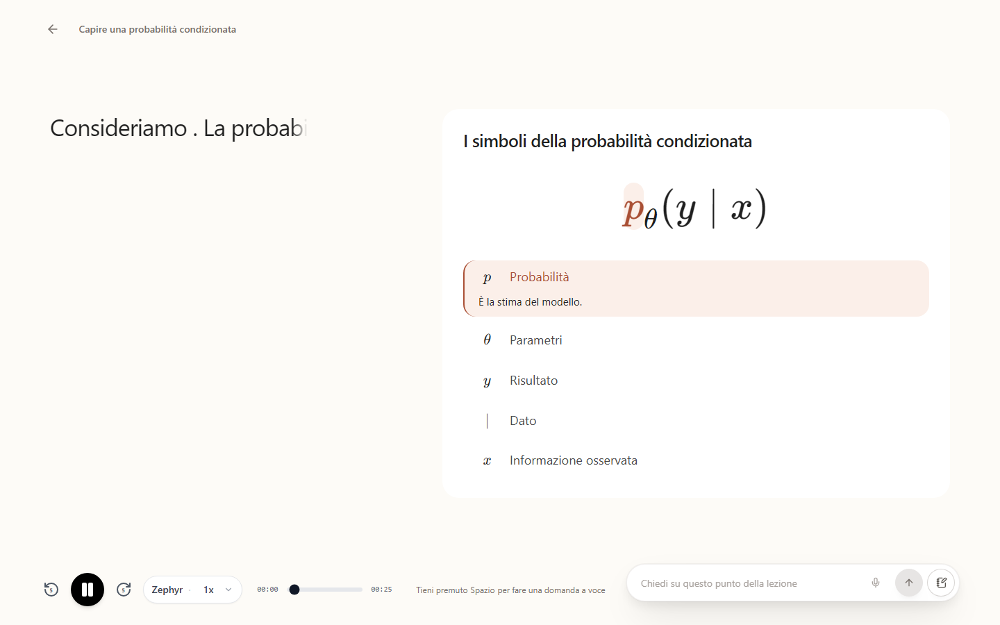

# Nous Reader

Nous Reader turns documents and researched topics into courses with connected explanations, exercises and narrated lessons. It keeps the source material, explanation and visual reasoning together so a subject can be studied as a coherent sequence.

The real lesson player follows the narration and highlights the symbol being explained. This example uses a synthetic lesson in Italian.

## Explore the system

Start with the [developer manual](.cubic/wiki/index.md) for the reading order, or follow the [source-to-playback flow](.cubic/wiki/01-section-overview/01-p-overview.md) to see how the parts connect. The [architecture](.cubic/wiki/02-section-architecture/01-p-architecture.md) locates the browser, backend, shared contracts and storage boundaries.

## Run and contribute

Follow [local development setup](.cubic/wiki/09-section-tools/01-p-local-setup.md) to install dependencies, configure the data services and start the app.

Use [testing and quality](.cubic/wiki/09-section-tools/02-p-testing-quality.md) to verify a change and the [deployment guide](docs/DEPLOYMENT.md) to run an installation. Merge readiness requires green CI on the exact PR head, including SonarCloud and applicable contract checks. Repository automation follows [AGENTS.md](AGENTS.md).
